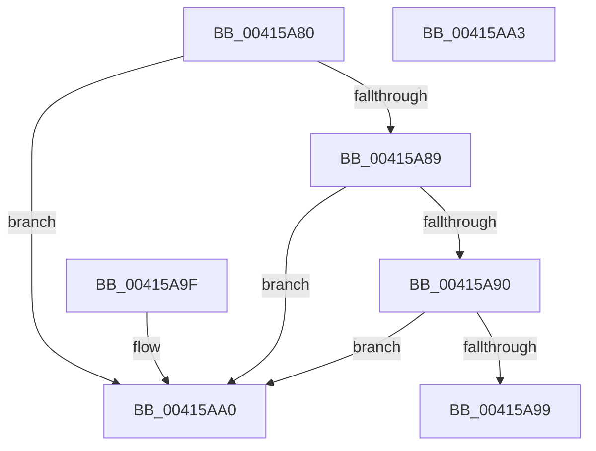

# KiIsKernelStackSwappable

- RVA: `0x00415A80`–`0x00415AA4` (길이 `36` bytes)
- VA: `0x0000000140415A80`
- 실행 섹션: `.text`
- PDB 이름 있음: `예`; PDB Function 태그: `아니요`
- unwind 정보 RVA: `0x000DB714`
- 디코드: `13`개 명령, `36/36` bytes 표시
- 미해석 바이트: `0` (있으면 어셈블리에 `.byte`로 보존)

> 이 문서는 커널 이미지의 기계어와 PDB 기호를 분석해 생성했습니다. 4번과 5번은 함수 원형과 자료형을 바이너리 사용 방식에서 추정한 C 해석이며 원본 소스 복구 결과는 아닙니다.

## 1. Dependencies

- 직접 호출 지점: **0**; 고유 호출 대상: **0**
- 직접 호출자로 확인된 함수: **2**
- RIP 상대 이미지 참조: **0**

### Outgoing calls
- 직접 디코드된 call 명령이 없습니다.

### Direct callers
- [KiCommitThreadWait](../20/KiCommitThreadWait_function_0020DFE0.md) at `0x0020E042`
- [KeTryToFreezeThreadStack](../4B/KeTryToFreezeThreadStack_function_004B5038.md) at `0x004B5307`

### Static image references
- 디코드된 RIP-relative 메모리 참조가 없습니다.

## 2. Other-region calls and transfers

- 다른 실행 섹션으로 향하는 call: **0**
- 별도 외부 분기/꼬리 이동을 확인하지 못했습니다.

## 3. Assembly (complete function range)

```asm
00415A80  80 B9 87 01 00 00 00            cmp byte ptr [rcx + 0x187], 0
00415A87  74 17                           je 0x140415aa0
00415A89  8B 41 78                        mov eax, dword ptr [rcx + 0x78]
00415A8C  A8 40                           test al, 0x40
00415A8E  74 10                           je 0x140415aa0
00415A90  80 B9 C3 00 00 00 19            cmp byte ptr [rcx + 0xc3], 0x19
00415A97  7D 07                           jge 0x140415aa0
00415A99  B8 01 00 00 00                  mov eax, 1
00415A9E  C3                              ret
00415A9F  CC                              int3
00415AA0  33 C0                           xor eax, eax
00415AA2  C3                              ret
00415AA3  CC                              int3
```

## 4. C-style interpretation (structured pseudocode)

```c
__int64 __fastcall KiIsKernelStackSwappable(__int64 a1)
{
    __int64 result;

    if ((*(unsigned __int8 *)(a1 + 391)) == 0) goto loc_00415AA0;
    if ((((unsigned __int8)((unsigned int)(*(unsigned int *)(a1 + 120)))) & (64)) == 0) goto loc_00415AA0;
    if ((*(unsigned __int8 *)(a1 + 195)) >= 25) goto loc_00415AA0;
    return 1;
loc_00415AA0:
    result = 0;
    return result;
}
```

## 5. (Beta) C Style

```c
int64_t KiIsKernelStackSwappable(void *Arg1)
{
    uint8_t *arg1 = (uint8_t *)Arg1;

    int64_t result;

    if ((*(uint8_t *)(arg1 + 0x187)) == 0) goto loc_00415AA0;
    if ((((uint8_t)((uint32_t)(*(uint32_t *)(arg1 + 0x78)))) & (64)) == 0) goto loc_00415AA0;
    if ((*(uint8_t *)(arg1 + 0xC3)) >= 25) goto loc_00415AA0;
    return 1;
loc_00415AA0:
    result = 0;
    return result;
}
```

### 관측된 메모리 오프셋

구조체 형식이 확인되지 않은 접근은 인자 기준의 오프셋으로만 기록했습니다.

| 기준 인자 | 오프셋 표현 | 폭 (bit) | 접근 |
|---|---:|---:|---|
| `Arg1` | `+ 0x78` | `32` | `R` |
| `Arg1` | `+ 0xC3` | `8` | `R` |
| `Arg1` | `+ 0x187` | `8` | `R` |

## 6. Execution-region graph

[열기: 2D/3D 그래프와 함수 탐색 컨트롤 패널](../../../control-panel.html?section=text&rva=0x00415A80&view=graph)

- 2D 그래프는 위에서 아래로 흐르고, 3D 그래프는 빈 공간을 드래그해 회전합니다. Shift+드래그는 이동, 휠은 확대·축소, 함수 노드 선택은 대상 보고서 이동입니다.

### Static fallback


