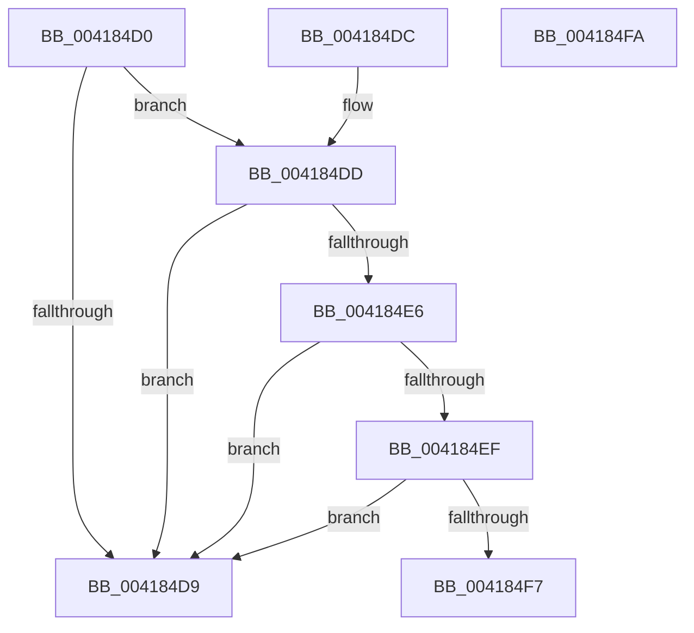

# KiIsTraceMemoryAccess

- RVA: `0x004184D0`–`0x004184FB` (길이 `43` bytes)
- VA: `0x00000001404184D0`
- 실행 섹션: `.text`
- PDB 이름 있음: `예`; PDB Function 태그: `아니요`
- unwind 정보 RVA: `0x000DB714`
- 디코드: `15`개 명령, `43/43` bytes 표시
- 미해석 바이트: `0` (있으면 어셈블리에 `.byte`로 보존)

> 이 문서는 커널 이미지의 기계어와 PDB 기호를 분석해 생성했습니다. 4번과 5번은 함수 원형과 자료형을 바이너리 사용 방식에서 추정한 C 해석이며 원본 소스 복구 결과는 아닙니다.

## 1. Dependencies

- 직접 호출 지점: **0**; 고유 호출 대상: **0**
- 직접 호출자로 확인된 함수: **2**
- RIP 상대 이미지 참조: **3**

### Outgoing calls
- 직접 디코드된 call 명령이 없습니다.

### Direct callers
- [sub_00320866](../32/Unknown_function_00320866.md) at `0x00320CC9`
- [MiComputeMaximumFaultCluster](MiComputeMaximumFaultCluster_function_00418210.md) at `0x00418309`

### Static image references
- `0x004184D0` → RVA `0x00FC7450` (`ALMOSTRO`; read)
- `0x004184DD` → RVA `0x00FC7448` (`ALMOSTRO`; read)
- `0x004184E6` → RVA `0x00FC6C10` (`ALMOSTRO`; read)

## 2. Other-region calls and transfers

- 다른 실행 섹션으로 향하는 call: **0**
- 별도 외부 분기/꼬리 이동을 확인하지 못했습니다.

## 3. Assembly (complete function range)

```asm
004184D0  48 3B 0D 79 EF BA 00            cmp rcx, qword ptr [rip + 0xbaef79]
004184D7  72 04                           jb 0x1404184dd
004184D9  32 C0                           xor al, al
004184DB  C3                              ret
004184DC  CC                              int3
004184DD  48 3B 0D 64 EF BA 00            cmp rcx, qword ptr [rip + 0xbaef64]
004184E4  72 F3                           jb 0x1404184d9
004184E6  83 3D 23 E7 BA 00 00            cmp dword ptr [rip + 0xbae723], 0
004184ED  74 EA                           je 0x1404184d9
004184EF  44 0F 20 C0                     mov rax, cr8
004184F3  3C 0F                           cmp al, 0xf
004184F5  75 E2                           jne 0x1404184d9
004184F7  B0 01                           mov al, 1
004184F9  C3                              ret
004184FA  CC                              int3
```

## 4. C-style interpretation (structured pseudocode)

```c
__int64 __fastcall KiIsTraceMemoryAccess(__int64 a1)
{
    __int64 result;

    if (a1 < (*(unsigned __int64 *)(v_rip + 12251001))) goto loc_004184DD;
loc_004184D9:
    result = 0;
    return result;
loc_004184DD:
    if (a1 < (*(unsigned __int64 *)(v_rip + 12250980))) goto loc_004184D9;
    if ((*(unsigned int *)(v_rip + 12248867)) == 0) goto loc_004184D9;
    if (((unsigned __int8)(v_cr8)) != 15) goto loc_004184D9;
    return 1;
}
```

## 5. (Beta) C Style

```c
int64_t KiIsTraceMemoryAccess(int64_t Arg1)
{
    int64_t result;

    if (Arg1 < (*(uint64_t *)(v_rip + 0xBAEF79))) goto loc_004184DD;
loc_004184D9:
    result = 0;
    return result;
loc_004184DD:
    if (Arg1 < (*(uint64_t *)(v_rip + 0xBAEF64))) goto loc_004184D9;
    if ((*(uint32_t *)(v_rip + 0xBAE723)) == 0) goto loc_004184D9;
    if (((uint8_t)(v_cr8)) != 15) goto loc_004184D9;
    return 1;
}
```

## 6. Execution-region graph

[열기: 2D/3D 그래프와 함수 탐색 컨트롤 패널](../../../control-panel.html?section=text&rva=0x004184D0&view=graph)

- 2D 그래프는 위에서 아래로 흐르고, 3D 그래프는 빈 공간을 드래그해 회전합니다. Shift+드래그는 이동, 휠은 확대·축소, 함수 노드 선택은 대상 보고서 이동입니다.

### Static fallback


