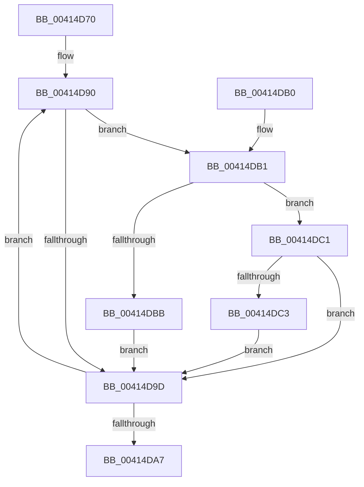

# KiReduceAffinityToRankListMaximums

- RVA: `0x00414D70`–`0x00414DCC` (길이 `92` bytes)
- VA: `0x0000000140414D70`
- 실행 섹션: `.text`
- PDB 이름 있음: `예`; PDB Function 태그: `아니요`
- unwind 정보 RVA: `0x00081C50`
- 디코드: `29`개 명령, `92/92` bytes 표시
- 미해석 바이트: `0` (있으면 어셈블리에 `.byte`로 보존)

> 이 문서는 커널 이미지의 기계어와 PDB 기호를 분석해 생성했습니다. 4번과 5번은 함수 원형과 자료형을 바이너리 사용 방식에서 추정한 C 해석이며 원본 소스 복구 결과는 아닙니다.

## 1. Dependencies

- 직접 호출 지점: **0**; 고유 호출 대상: **0**
- 직접 호출자로 확인된 함수: **3**
- RIP 상대 이미지 참조: **0**

### Outgoing calls
- 직접 디코드된 call 명령이 없습니다.

### Direct callers
- [KiTallyHeteroSoftParkElectionVotes](../39/KiTallyHeteroSoftParkElectionVotes_function_0039E5B8.md) at `0x0039E785`
- [KiHeteroReduceToMaximallyPreferredByClass](KiHeteroReduceToMaximallyPreferredByClass_function_00414A48.md) at `0x00414A6A`
- [KiHeteroIdleSetReduction](KiHeteroIdleSetReduction_function_00414A90.md) at `0x00414C5A`

### Static image references
- 디코드된 RIP-relative 메모리 참조가 없습니다.

## 2. Other-region calls and transfers

- 다른 실행 섹션으로 향하는 call: **0**
- 별도 외부 분기/꼬리 이동을 확인하지 못했습니다.

## 3. Assembly (complete function range)

```asm
00414D70  48 89 5C 24 08                  mov qword ptr [rsp + 8], rbx
00414D75  45 33 D2                        xor r10d, r10d
00414D78  45 32 DB                        xor r11b, r11b
00414D7B  4C 8B C9                        mov r9, rcx
00414D7E  45 8B C2                        mov r8d, r10d
00414D81  32 C9                           xor cl, cl
00414D83  48 8B DA                        mov rbx, rdx
00414D86  66 66 0F 1F 84 00 00 00 00 00   nop word ptr [rax + rax]
00414D90  B8 01 00 00 00                  mov eax, 1
00414D95  48 D3 E0                        shl rax, cl
00414D98  49 85 C1                        test r9, rax
00414D9B  75 14                           jne 0x140414db1
00414D9D  FE C1                           inc cl
00414D9F  49 FF C0                        inc r8
00414DA2  80 F9 40                        cmp cl, 0x40
00414DA5  72 E9                           jb 0x140414d90
00414DA7  48 8B 5C 24 08                  mov rbx, qword ptr [rsp + 8]
00414DAC  49 8B C2                        mov rax, r10
00414DAF  C3                              ret
00414DB0  CC                              int3
00414DB1  41 0F B6 14 18                  movzx edx, byte ptr [r8 + rbx]
00414DB6  41 3A D3                        cmp dl, r11b
00414DB9  75 06                           jne 0x140414dc1
00414DBB  4D 0F AB C2                     bts r10, r8
00414DBF  EB DC                           jmp 0x140414d9d
00414DC1  76 DA                           jbe 0x140414d9d
00414DC3  44 0F B6 DA                     movzx r11d, dl
00414DC7  4C 8B D0                        mov r10, rax
00414DCA  EB D1                           jmp 0x140414d9d
```

## 4. C-style interpretation (structured pseudocode)

```c
__int64 __fastcall KiReduceAffinityToRankListMaximums(__int64 a1, __int64 a2)
{
    __int64 result;
    __int64 v_r10;
    __int64 v_r11;
    unsigned __int64 v_stack_p8;

    v_stack_p8 = v_rbx;
    v_r10 = 0;
    v_r11 = 0;
    a1 = 0;
loc_00414D90:
    result = (1) << (0);
    if (((0) & (result)) != 0) goto loc_00414DB1;
loc_00414D9D:
    a1 = (unsigned __int8)((a1) + 1);
    a3 = (0) + 1;
    if (((unsigned __int8)(a1)) < 64) goto loc_00414D90;
    return 0;
loc_00414DB1:
    if (((unsigned __int8)(*(unsigned __int8 *)(a3 + v_stack_p8 * 1))) != 0) goto loc_00414DC1;
    goto loc_00414D9D;
loc_00414DC1:
    if (((unsigned __int8)(*(unsigned __int8 *)(a3 + v_stack_p8 * 1))) <= 0) goto loc_00414D9D;
    goto loc_00414D9D;
}
```

## 5. (Beta) C Style

```c
int64_t KiReduceAffinityToRankListMaximums(int64_t Arg1, int64_t Arg2)
{
    int64_t result;
    int64_t local_r10;
    int64_t local_r11;
    uint64_t v_stack_p8;

    v_stack_p8 = local_rbx;
    local_r10 = 0;
    local_r11 = 0;
    Arg1 = 0;
loc_00414D90:
    result = (1) << (0);
    if (((0) & (result)) != 0) goto loc_00414DB1;
loc_00414D9D:
    Arg1 = (uint8_t)((Arg1) + 1);
    a3 = (0) + 1;
    if (((uint8_t)(Arg1)) < 64) goto loc_00414D90;
    return 0;
loc_00414DB1:
    if (((uint8_t)(*(uint8_t *)(a3 + v_stack_p8 * 1))) != 0) goto loc_00414DC1;
    goto loc_00414D9D;
loc_00414DC1:
    if (((uint8_t)(*(uint8_t *)(a3 + v_stack_p8 * 1))) <= 0) goto loc_00414D9D;
    goto loc_00414D9D;
}
```

## 6. Execution-region graph

[열기: 2D/3D 그래프와 함수 탐색 컨트롤 패널](../../../control-panel.html?section=text&rva=0x00414D70&view=graph)

- 2D 그래프는 위에서 아래로 흐르고, 3D 그래프는 빈 공간을 드래그해 회전합니다. Shift+드래그는 이동, 휠은 확대·축소, 함수 노드 선택은 대상 보고서 이동입니다.

### Static fallback


