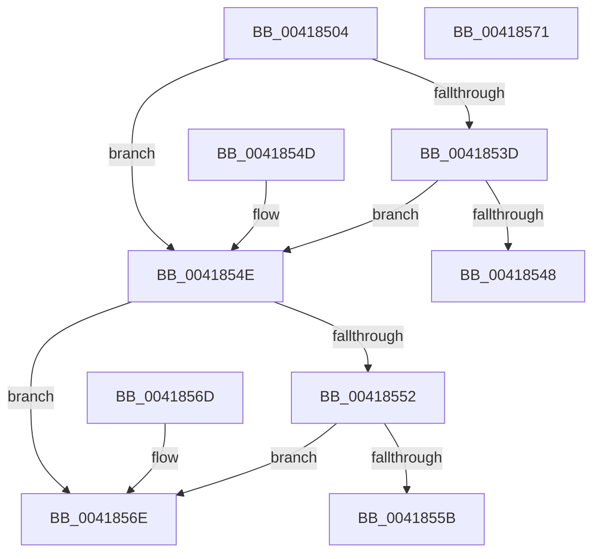

# KiRspInIstStack

- RVA: `0x00418504`–`0x00418572` (길이 `110` bytes)
- VA: `0x0000000140418504`
- 실행 섹션: `.text`
- PDB 이름 있음: `예`; PDB Function 태그: `아니요`
- unwind 정보 RVA: `0x000DB714`
- 디코드: `36`개 명령, `110/110` bytes 표시
- 미해석 바이트: `0` (있으면 어셈블리에 `.byte`로 보존)

> 이 문서는 커널 이미지의 기계어와 PDB 기호를 분석해 생성했습니다. 4번과 5번은 함수 원형과 자료형을 바이너리 사용 방식에서 추정한 C 해석이며 원본 소스 복구 결과는 아닙니다.

## 1. Dependencies

- 직접 호출 지점: **0**; 고유 호출 대상: **0**
- 직접 호출자로 확인된 함수: **5**
- RIP 상대 이미지 참조: **2**

### Outgoing calls
- 직접 디코드된 call 명령이 없습니다.

### Direct callers
- [sub_002F7FCA](../2F/Unknown_function_002F7FCA.md) at `0x002F7FF7`
- [sub_00320866](../32/Unknown_function_00320866.md) at `0x00320D93`
- [sub_00320866](../32/Unknown_function_00320866.md) at `0x00320DAA`
- [KeInvalidAccessAllowed](../34/KeInvalidAccessAllowed_function_0034B3F0.md) at `0x0034B4FA`
- [MiComputeMaximumFaultCluster](MiComputeMaximumFaultCluster_function_00418210.md) at `0x004182CB`
- [MiComputeMaximumFaultCluster](MiComputeMaximumFaultCluster_function_00418210.md) at `0x00418410`
- [KiMcheckFastForward](../5C/KiMcheckFastForward_function_005CB550.md) at `0x005CB593`
- [KiMcheckFastForward](../5C/KiMcheckFastForward_function_005CB550.md) at `0x005CB5AF`

### Static image references
- `0x00418510` → RVA `0x01201840` (`CFGRO`; read)
- `0x00418519` → RVA `0x00FC5060` (`ALMOSTRO`; read)

## 2. Other-region calls and transfers

- 다른 실행 섹션으로 향하는 call: **0**
- 별도 외부 분기/꼬리 이동을 확인하지 못했습니다.

## 3. Assembly (complete function range)

```asm
00418504  65 48 8B 04 25 18 00 00 00      mov rax, qword ptr gs:[0x18]
0041850D  4C 8B CA                        mov r9, rdx
00418510  8A 15 2A 93 DE 00               mov dl, byte ptr [rip + 0xde932a]
00418516  45 33 D2                        xor r10d, r10d
00418519  44 8B 1D 40 CB BA 00            mov r11d, dword ptr [rip + 0xbacb40]
00418520  84 D2                           test dl, dl
00418522  8B C9                           mov ecx, ecx
00418524  48 8B 40 08                     mov rax, qword ptr [rax + 8]
00418528  4C 8B 44 C8 1C                  mov r8, qword ptr [rax + rcx*8 + 0x1c]
0041852D  41 8B C3                        mov eax, r11d
00418530  B9 D0 01 00 00                  mov ecx, 0x1d0
00418535  0F 45 C1                        cmovne eax, ecx
00418538  4D 3B C8                        cmp r9, r8
0041853B  77 11                           ja 0x14041854e
0041853D  49 8B C8                        mov rcx, r8
00418540  48 2B C8                        sub rcx, rax
00418543  4C 3B C9                        cmp r9, rcx
00418546  72 06                           jb 0x14041854e
00418548  41 8D 42 01                     lea eax, [r10 + 1]
0041854C  C3                              ret
0041854D  CC                              int3
0041854E  84 D2                           test dl, dl
00418550  74 1C                           je 0x14041856e
00418552  4D 8B 40 08                     mov r8, qword ptr [r8 + 8]
00418556  4D 3B C8                        cmp r9, r8
00418559  77 13                           ja 0x14041856e
0041855B  41 8D 53 E0                     lea edx, [r11 - 0x20]
0041855F  4C 2B C2                        sub r8, rdx
00418562  4D 3B C8                        cmp r9, r8
00418565  41 0F 93 C2                     setae r10b
00418569  41 8B C2                        mov eax, r10d
0041856C  C3                              ret
0041856D  CC                              int3
0041856E  33 C0                           xor eax, eax
00418570  C3                              ret
00418571  CC                              int3
```

## 4. C-style interpretation (structured pseudocode)

```c
__int64 __fastcall KiRspInIstStack(int a1, __int64 a2)
{
    __int64 result;
    __int64 v_r10;

    v_r10 = 0;
    result = (unsigned int)((unsigned int)((unsigned int)(*(unsigned int *)(v_rip + 12241728))));
    if ((unsigned __int8)(*(unsigned __int8 *)(v_rip + 14586666)) != 0) { result = 464; }
    if (a2 > (*(unsigned __int64 *)(*(unsigned __int64 *)(*(unsigned __int64 *)(gs_base + (0 + 24)) + 8) + (unsigned int)(a1) * 8 + 28))) goto loc_0041854E;
    a1 = (*(unsigned __int64 *)(*(unsigned __int64 *)(*(unsigned __int64 *)(gs_base + (0 + 24)) + 8) + (unsigned int)(a1) * 8 + 28)) - (result);
    if (a2 < a1) goto loc_0041854E;
    return v_r10 + 1;
loc_0041854E:
    if ((unsigned __int8)(*(unsigned __int8 *)(v_rip + 14586666)) == 0) goto loc_0041856E;
    if (a2 > (*(unsigned __int64 *)(*(unsigned __int64 *)(*(unsigned __int64 *)(*(unsigned __int64 *)(gs_base + (0 + 24)) + 8) + (unsigned int)(a1) * 8 + 28) + 8))) goto loc_0041856E;
    a3 = (*(unsigned __int64 *)(*(unsigned __int64 *)(*(unsigned __int64 *)(*(unsigned __int64 *)(gs_base + (0 + 24)) + 8) + (unsigned int)(a1) * 8 + 28) + 8)) - ((unsigned int)(*(unsigned int *)(v_rip + 12241728)) - 32);
    v_r10 = (a2 >= a3) ? 1 : 0;
    return (unsigned int)((unsigned int)(v_r10));
loc_0041856E:
    result = 0;
    return result;
}
```

## 5. (Beta) C Style

```c
int64_t KiRspInIstStack(int32_t Arg1, int64_t Arg2)
{
    int64_t result;
    int64_t local_r10;

    local_r10 = 0;
    result = (uint32_t)((uint32_t)((uint32_t)(*(uint32_t *)(v_rip + 0xBACB40))));
    if ((uint8_t)(*(uint8_t *)(v_rip + 0xDE932A)) != 0) { result = 464; }
    if (Arg2 > (*(uint64_t *)(*(uint64_t *)(*(uint64_t *)(gs_base + (0 + 0x18)) + 0x8) + (uint32_t)(Arg1) * 8 + 0x1C))) goto loc_0041854E;
    Arg1 = (*(uint64_t *)(*(uint64_t *)(*(uint64_t *)(gs_base + (0 + 0x18)) + 0x8) + (uint32_t)(Arg1) * 8 + 0x1C)) - (result);
    if (Arg2 < Arg1) goto loc_0041854E;
    return local_r10 + 1;
loc_0041854E:
    if ((uint8_t)(*(uint8_t *)(v_rip + 0xDE932A)) == 0) goto loc_0041856E;
    if (Arg2 > (*(uint64_t *)(*(uint64_t *)(*(uint64_t *)(*(uint64_t *)(gs_base + (0 + 0x18)) + 0x8) + (uint32_t)(Arg1) * 8 + 0x1C) + 0x8))) goto loc_0041856E;
    a3 = (*(uint64_t *)(*(uint64_t *)(*(uint64_t *)(*(uint64_t *)(gs_base + (0 + 0x18)) + 0x8) + (uint32_t)(Arg1) * 8 + 0x1C) + 0x8)) - ((uint32_t)(*(uint32_t *)(v_rip + 0xBACB40)) - 32);
    local_r10 = (Arg2 >= a3) ? 1 : 0;
    return (uint32_t)((uint32_t)(local_r10));
loc_0041856E:
    result = 0;
    return result;
}
```

## 6. Execution-region graph

[열기: 2D/3D 그래프와 함수 탐색 컨트롤 패널](../../../control-panel.html?section=text&rva=0x00418504&view=graph)

- 2D 그래프는 위에서 아래로 흐르고, 3D 그래프는 빈 공간을 드래그해 회전합니다. Shift+드래그는 이동, 휠은 확대·축소, 함수 노드 선택은 대상 보고서 이동입니다.

### Static fallback


