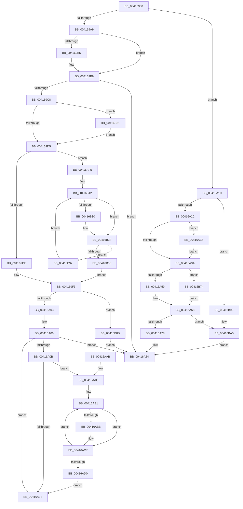

# KiSetProcessorIdle

- RVA: `0x00416950`–`0x00416BB2` (길이 `610` bytes)
- VA: `0x0000000140416950`
- 실행 섹션: `.text`
- PDB 이름 있음: `예`; PDB Function 태그: `아니요`
- unwind 정보 RVA: `0x0009CBF8`
- 디코드: `149`개 명령, `610/610` bytes 표시
- 미해석 바이트: `0` (있으면 어셈블리에 `.byte`로 보존)

> 이 문서는 커널 이미지의 기계어와 PDB 기호를 분석해 생성했습니다. 4번과 5번은 함수 원형과 자료형을 바이너리 사용 방식에서 추정한 C 해석이며 원본 소스 복구 결과는 아닙니다.

## 1. Dependencies

- 직접 호출 지점: **4**; 고유 호출 대상: **3**
- 직접 호출자로 확인된 함수: **2**
- RIP 상대 이미지 참조: **1**

### Outgoing calls
- `0x00416A63` → [KiInterlockedIncrementRankListMembersNoFence](KiInterlockedIncrementRankListMembersNoFence_function_00416BC0.md) (function, `0x00416BC0`)
- `0x00416A7F` → [KiInterlockedIncrementRankListMembersNoFence](KiInterlockedIncrementRankListMembersNoFence_function_00416BC0.md) (function, `0x00416BC0`)
- `0x00416A8C` → [_security_check_cookie](../6A/_security_check_cookie_function_006AC640.md) (function, `0x006AC640`)
- `0x00416B66` → [KiInterlockedDecrementRankListMembersNoFence](KiInterlockedDecrementRankListMembersNoFence_function_00416C30.md) (function, `0x00416C30`)

### Direct callers
- [KiCommitRescheduleContextEntry](../30/KiCommitRescheduleContextEntry_function_0030CFD0.md) at `0x0030D17B`
- [KiCommitRescheduleContextEntry](../30/KiCommitRescheduleContextEntry_function_0030CFD0.md) at `0x0030D2A4`
- [KiCommitRescheduleContextEntry](../30/KiCommitRescheduleContextEntry_function_0030CFD0.md) at `0x0030D316`
- [KiCommitRescheduleContextEntry](../30/KiCommitRescheduleContextEntry_function_0030CFD0.md) at `0x0030D47D`
- [KiCompleteKernelInit](../../pagelk/B6/KiCompleteKernelInit_function_00B66090.md) at `0x00B66380`

### Static image references
- `0x00416968` → RVA `0x00E0A740` (`.data`; read)

## 2. Other-region calls and transfers

- 다른 실행 섹션으로 향하는 call: **0**
- 별도 외부 분기/꼬리 이동을 확인하지 못했습니다.

## 3. Assembly (complete function range)

```asm
00416950  48 89 5C 24 10                  mov qword ptr [rsp + 0x10], rbx
00416955  48 89 6C 24 18                  mov qword ptr [rsp + 0x18], rbp
0041695A  48 89 74 24 20                  mov qword ptr [rsp + 0x20], rsi
0041695F  57                              push rdi
00416960  41 54                           push r12
00416962  41 56                           push r14
00416964  48 83 EC 50                     sub rsp, 0x50
00416968  48 8B 05 D1 3D 9F 00            mov rax, qword ptr [rip + 0x9f3dd1]
0041696F  48 33 C4                        xor rax, rsp
00416972  48 89 44 24 40                  mov qword ptr [rsp + 0x40], rax
00416977  44 0F B6 B1 D1 00 00 00         movzx r14d, byte ptr [rcx + 0xd1]
0041697F  48 8B E9                        mov rbp, rcx
00416982  48 8B B9 C0 00 00 00            mov rdi, qword ptr [rcx + 0xc0]
00416989  41 BC 01 00 00 00               mov r12d, 1
0041698F  8A 41 23                        mov al, byte ptr [rcx + 0x23]
00416992  41 8B F4                        mov esi, r12d
00416995  41 8A CE                        mov cl, r14b
00416998  41 8B D8                        mov ebx, r8d
0041699B  4C 8B 85 60 8E 00 00            mov r8, qword ptr [rbp + 0x8e60]
004169A2  48 D3 E6                        shl rsi, cl
004169A5  85 D2                           test edx, edx
004169A7  74 73                           je 0x140416a1c
004169A9  48 8B 8D B8 8E 00 00            mov rcx, qword ptr [rbp + 0x8eb8]
004169B0  48 85 C9                        test rcx, rcx
004169B3  74 04                           je 0x1404169b9
004169B5  44 88 61 10                     mov byte ptr [rcx + 0x10], r12b
004169B9  88 9D BB 38 00 00               mov byte ptr [rbp + 0x38bb], bl
004169BF  41 84 C4                        test r12b, al
004169C2  0F 84 BC 00 00 00               je 0x140416a84
004169C8  24 FE                           and al, 0xfe
004169CA  88 45 23                        mov byte ptr [rbp + 0x23], al
004169CD  A8 10                           test al, 0x10
004169CF  0F 84 AC 01 00 00               je 0x140416b81
004169D5  4C 3B C6                        cmp r8, rsi
004169D8  0F 85 17 01 00 00               jne 0x140416af5
004169DE  F0 48 09 77 10                  lock or qword ptr [rdi + 0x10], rsi
004169E3  F0 48 09 77 18                  lock or qword ptr [rdi + 0x18], rsi
004169E8  4A 8D 0C 37                     lea rcx, [rdi + r14]
004169EC  C6 81 00 02 00 00 00            mov byte ptr [rcx + 0x200], 0
004169F3  48 8B 95 78 8E 00 00            mov rdx, qword ptr [rbp + 0x8e78]
004169FA  48 3B D6                        cmp rdx, rsi
004169FD  0F 84 88 01 00 00               je 0x140416b8b
00416A03  45 32 C9                        xor r9b, r9b
00416A06  48 85 D2                        test rdx, rdx
00416A09  74 79                           je 0x140416a84
00416A0B  84 D2                           test dl, dl
00416A0D  0F 85 99 00 00 00               jne 0x140416aac
00416A13  45 02 CC                        add r9b, r12b
00416A16  48 C1 EA 08                     shr rdx, 8
00416A1A  EB EA                           jmp 0x140416a06
00416A1C  C6 85 BB 38 00 00 00            mov byte ptr [rbp + 0x38bb], 0
00416A23  41 84 C4                        test r12b, al
00416A26  0F 85 72 01 00 00               jne 0x140416b9e
00416A2C  41 0A C4                        or al, r12b
00416A2F  88 45 23                        mov byte ptr [rbp + 0x23], al
00416A32  A8 10                           test al, 0x10
00416A34  0F 84 AB 00 00 00               je 0x140416ae5
00416A3A  48 8B C6                        mov rax, rsi
00416A3D  48 F7 D0                        not rax
00416A40  F0 48 21 47 10                  lock and qword ptr [rdi + 0x10], rax
00416A45  49 8B C0                        mov rax, r8
00416A48  48 F7 D0                        not rax
00416A4B  F0 48 21 47 18                  lock and qword ptr [rdi + 0x18], rax
00416A50  49 3B F0                        cmp rsi, r8
00416A53  0F 84 1B 01 00 00               je 0x140416b74
00416A59  48 8D 8F 00 02 00 00            lea rcx, [rdi + 0x200]
00416A60  49 8B D0                        mov rdx, r8
00416A63  E8 58 01 00 00                  call 0x140416bc0
00416A68  48 8B 95 78 8E 00 00            mov rdx, qword ptr [rbp + 0x8e78]
00416A6F  48 3B F2                        cmp rsi, rdx
00416A72  0F 84 2D 01 00 00               je 0x140416ba5
00416A78  48 8D 8F 40 02 00 00            lea rcx, [rdi + 0x240]
00416A7F  E8 3C 01 00 00                  call 0x140416bc0
00416A84  48 8B 4C 24 40                  mov rcx, qword ptr [rsp + 0x40]
00416A89  48 33 CC                        xor rcx, rsp
00416A8C  E8 AF 5B 29 00                  call 0x1406ac640
00416A91  4C 8D 5C 24 50                  lea r11, [rsp + 0x50]
00416A96  49 8B 5B 28                     mov rbx, qword ptr [r11 + 0x28]
00416A9A  49 8B 6B 30                     mov rbp, qword ptr [r11 + 0x30]
00416A9E  49 8B 73 38                     mov rsi, qword ptr [r11 + 0x38]
00416AA2  49 8B E3                        mov rsp, r11
00416AA5  41 5E                           pop r14
00416AA7  41 5C                           pop r12
00416AA9  5F                              pop rdi
00416AAA  C3                              ret
00416AAB  CC                              int3
00416AAC  33 DB                           xor ebx, ebx
00416AAE  45 32 C0                        xor r8b, r8b
00416AB1  41 0F B6 C8                     movzx ecx, r8b
00416AB5  48 0F A3 CA                     bt rdx, rcx
00416AB9  73 0C                           jae 0x140416ac7
00416ABB  C1 E1 03                        shl ecx, 3
00416ABE  49 8B C4                        mov rax, r12
00416AC1  48 D3 E0                        shl rax, cl
00416AC4  48 03 D8                        add rbx, rax
00416AC7  45 02 C4                        add r8b, r12b
00416ACA  41 80 F8 08                     cmp r8b, 8
00416ACE  72 E1                           jb 0x140416ab1
00416AD0  48 F7 DB                        neg rbx
00416AD3  41 0F B6 C1                     movzx eax, r9b
00416AD7  F0 48 01 9C C7 40 02 00 00      lock add qword ptr [rdi + rax*8 + 0x240], rbx
00416AE0  E9 2E FF FF FF                  jmp 0x140416a13
00416AE5  48 8B C6                        mov rax, rsi
00416AE8  48 F7 D0                        not rax
00416AEB  F0 48 21 47 08                  lock and qword ptr [rdi + 8], rax
00416AF0  E9 45 FF FF FF                  jmp 0x140416a3a
00416AF5  48 8B 47 10                     mov rax, qword ptr [rdi + 0x10]
00416AF9  48 8B 57 18                     mov rdx, qword ptr [rdi + 0x18]
00416AFD  48 83 64 24 28 00               and qword ptr [rsp + 0x28], 0
00416B03  48 89 44 24 30                  mov qword ptr [rsp + 0x30], rax
00416B08  4C 8B 54 24 30                  mov r10, qword ptr [rsp + 0x30]
00416B0D  48 89 54 24 38                  mov qword ptr [rsp + 0x38], rdx
00416B12  49 8B DA                        mov rbx, r10
00416B15  48 89 54 24 28                  mov qword ptr [rsp + 0x28], rdx
00416B1A  48 0B DE                        or rbx, rsi
00416B1D  4C 8B CA                        mov r9, rdx
00416B20  48 8B CB                        mov rcx, rbx
00416B23  48 89 5C 24 20                  mov qword ptr [rsp + 0x20], rbx
00416B28  49 23 C8                        and rcx, r8
00416B2B  49 3B C8                        cmp rcx, r8
00416B2E  75 08                           jne 0x140416b38
00416B30  4D 0B C8                        or r9, r8
00416B33  4C 89 4C 24 28                  mov qword ptr [rsp + 0x28], r9
00416B38  49 8B C9                        mov rcx, r9
00416B3B  49 8B C2                        mov rax, r10
00416B3E  F0 48 0F C7 4F 10               lock cmpxchg16b xmmword ptr [rdi + 0x10]
00416B44  4C 8B D0                        mov r10, rax
00416B47  48 89 44 24 30                  mov qword ptr [rsp + 0x30], rax
00416B4C  0F 94 C0                        sete al
00416B4F  48 89 54 24 38                  mov qword ptr [rsp + 0x38], rdx
00416B54  84 C0                           test al, al
00416B56  74 3F                           je 0x140416b97
00416B58  48 8B 95 60 8E 00 00            mov rdx, qword ptr [rbp + 0x8e60]
00416B5F  48 8D 8F 00 02 00 00            lea rcx, [rdi + 0x200]
00416B66  E8 C5 00 00 00                  call 0x140416c30
00416B6B  4A 8D 0C 37                     lea rcx, [rdi + r14]
00416B6F  E9 7F FE FF FF                  jmp 0x1404169f3
00416B74  45 88 A4 3E 00 02 00 00         mov byte ptr [r14 + rdi + 0x200], r12b
00416B7C  E9 E7 FE FF FF                  jmp 0x140416a68
00416B81  F0 48 09 77 08                  lock or qword ptr [rdi + 8], rsi
00416B86  E9 4A FE FF FF                  jmp 0x1404169d5
00416B8B  C6 81 40 02 00 00 00            mov byte ptr [rcx + 0x240], 0
00416B92  E9 ED FE FF FF                  jmp 0x140416a84
00416B97  F3 90                           pause
00416B99  E9 74 FF FF FF                  jmp 0x140416b12
00416B9E  B9 21 00 00 00                  mov ecx, 0x21
00416BA3  CD 29                           int 0x29
00416BA5  45 88 A4 3E 40 02 00 00         mov byte ptr [r14 + rdi + 0x240], r12b
00416BAD  E9 D2 FE FF FF                  jmp 0x140416a84
```

## 4. C-style interpretation (structured pseudocode)

```c
__int64 __fastcall KiSetProcessorIdle(__int64 a1, int a2, int a3, unsigned __int8 a4)
{
    __int64 result;
    __int64 v_rbx;
    __int64 v_rsi;
    __int64 v_rsp;
    unsigned __int64 v_stack_m18;
    unsigned __int64 v_stack_m20;
    unsigned __int64 v_stack_m28;
    unsigned __int64 v_stack_m30;
    unsigned __int64 v_stack_p10;
    unsigned __int64 v_stack_p18;
    unsigned __int64 v_stack_p20;

    v_stack_p10 = v_rbx;
    v_stack_p18 = v_rbp;
    v_stack_p20 = v_rsi;
    v_rsp = (v_rsp) - (80);
    result = (*(unsigned __int64 *)(v_rip + 10436049)) ^ (v_rsp);
    v_stack_m28 = result;
    v_rsi = (1) << ((unsigned __int8)((unsigned __int8)(*(unsigned __int8 *)(a1 + 209))));
    if (a2 == 0) goto loc_00416A1C;
    if (*(unsigned __int64 *)(a1 + 36536) != 0) {
        *(unsigned __int8 *)(*(unsigned __int64 *)(a1 + 36536) + 16) = 1;
    }
    *(unsigned __int8 *)(a1 + 14523) = (unsigned __int8)((unsigned int)(a3));
    if (((1) & ((unsigned __int8)(*(unsigned __int8 *)(a1 + 35)))) == 0) goto loc_00416A84;
    result = (unsigned __int8)((*(unsigned __int8 *)(a1 + 35)) & (254));
    *(unsigned __int8 *)(a1 + 35) = (unsigned __int8)(result);
    if ((((unsigned __int8)(result)) & (16)) == 0) goto loc_00416B81;
loc_004169D5:
    if ((*(unsigned __int64 *)(a1 + 36448)) != v_rsi) goto loc_00416AF5;
    *(unsigned __int8 *)(*(unsigned __int64 *)(a1 + 192) + *(unsigned __int8 *)(a1 + 209) * 1 + 512) = 0;
loc_004169F3:
    if ((*(unsigned __int64 *)(a1 + 36472)) == v_rsi) goto loc_00416B8B;
    a4 = 0;
loc_00416A06:
    if (*(unsigned __int64 *)(a1 + 36472) == 0) goto loc_00416A84;
    if ((unsigned __int8)(*(unsigned __int64 *)(a1 + 36472)) != 0) goto loc_00416AAC;
loc_00416A13:
    a4 = (unsigned __int8)((a4) + (1));
    a2 = (*(unsigned __int64 *)(a1 + 36472)) >> (8);
    goto loc_00416A06;
loc_00416A1C:
    *(unsigned __int8 *)(a1 + 14523) = 0;
    if (((1) & ((unsigned __int8)(result))) != 0) goto loc_00416B9E;
    result = (unsigned __int8)((result) | (1));
    *(unsigned __int8 *)(a1 + 35) = (unsigned __int8)(result);
    if ((((unsigned __int8)(result)) & (16)) == 0) goto loc_00416AE5;
loc_00416A3A:
    result = ~(v_rsi);
    result = ~(*(unsigned __int64 *)(a1 + 36448));
    if (v_rsi == (*(unsigned __int64 *)(a1 + 36448))) goto loc_00416B74;
    result = KiInterlockedIncrementRankListMembersNoFence(*(unsigned __int64 *)(a1 + 192) + 512, *(unsigned __int64 *)(a1 + 36448), *(unsigned __int64 *)(a1 + 36448), a4);
loc_00416A68:
    if (v_rsi == (*(unsigned __int64 *)(a1 + 36472))) goto loc_00416BA5;
    result = KiInterlockedIncrementRankListMembersNoFence(*(unsigned __int64 *)(a1 + 192) + 576, *(unsigned __int64 *)(a1 + 36472), *(unsigned __int64 *)(a1 + 36448), a4);
loc_00416A84:
    a1 = (v_stack_m28) ^ (v_rsp);
    result = _security_check_cookie(a1, *(unsigned __int64 *)(a1 + 36472), *(unsigned __int64 *)(a1 + 36448), a4);
    return result;
loc_00416AAC:
    v_rbx = 0;
    a3 = 0;
loc_00416AB1:
    if (!(condition_is_above_or_equal)) {
        a1 = (unsigned int)((0) << (3));
        result = 1;
        result = (result) << ((unsigned __int8)(a1));
        v_rbx = (v_rbx) + (result);
    }
    a3 = (unsigned __int8)((a3) + (1));
    if (((unsigned __int8)(a3)) < 8) goto loc_00416AB1;
    v_rbx = -(v_rbx);
    goto loc_00416A13;
loc_00416AE5:
    result = ~(*(unsigned __int64 *)(v_stack_m18 + 56));
    goto loc_00416A3A;
loc_00416AF5:
    v_stack_m20 = *(unsigned __int64 *)(*(unsigned __int64 *)(a1 + 192) + 16);
    v_stack_m18 = *(unsigned __int64 *)(*(unsigned __int64 *)(a1 + 192) + 24);
loc_00416B12:
    v_stack_m28 = *(unsigned __int64 *)(*(unsigned __int64 *)(a1 + 192) + 24);
    v_rbx = (v_stack_m20) | (*(unsigned __int64 *)(v_stack_m18 + 56));
    v_stack_m30 = v_rbx;
    a1 = (v_rbx) & (a3);
    if (a1 == a3) {
        a4 = (*(unsigned __int64 *)(*(unsigned __int64 *)(a1 + 192) + 24)) | (a3);
        v_stack_m28 = a4;
    }
    v_stack_m20 = v_stack_m20;
    result = (condition_is_equal) ? 1 : 0;
    v_stack_m18 = *(unsigned __int64 *)(*(unsigned __int64 *)(a1 + 192) + 24);
    if ((unsigned __int8)(result) == 0) goto loc_00416B97;
    result = KiInterlockedDecrementRankListMembersNoFence(*(unsigned __int64 *)(a1 + 192) + 512, *(unsigned __int64 *)(*(unsigned __int64 *)(v_stack_m18 + 48) + 36448), a3, a4);
    goto loc_004169F3;
loc_00416B74:
    *(unsigned __int8 *)(*(unsigned __int8 *)(a1 + 209) + *(unsigned __int64 *)(a1 + 192) * 1 + 512) = 1;
    goto loc_00416A68;
loc_00416B81:
    goto loc_004169D5;
loc_00416B8B:
    *(unsigned __int8 *)(*(unsigned __int64 *)(a1 + 192) + *(unsigned __int8 *)(a1 + 209) * 1 + 576) = 0;
    goto loc_00416A84;
loc_00416B97:
    goto loc_00416B12;
loc_00416B9E:
loc_00416BA5:
    *(unsigned __int8 *)(*(unsigned __int8 *)(a1 + 209) + *(unsigned __int64 *)(a1 + 192) * 1 + 576) = 1;
    goto loc_00416A84;
}
```

## 5. (Beta) C Style

```c
int64_t KiSetProcessorIdle(void *Arg1, int32_t Arg2, int32_t Arg3, uint8_t Arg4)
{
    uint8_t *arg1 = (uint8_t *)Arg1;

    int64_t result;
    int64_t local_rbx;
    int64_t local_rsi;
    int64_t local_rsp;
    uint64_t v_stack_m18;
    uint64_t v_stack_m20;
    uint64_t v_stack_m28;
    uint64_t v_stack_m30;
    uint64_t v_stack_p10;
    uint64_t v_stack_p18;
    uint64_t v_stack_p20;

    v_stack_p10 = local_rbx;
    v_stack_p18 = local_rbp;
    v_stack_p20 = local_rsi;
    local_rsp = (local_rsp) - (80);
    result = (*(uint64_t *)(v_rip + 0x9F3DD1)) ^ (local_rsp);
    v_stack_m28 = result;
    local_rsi = (1) << ((uint8_t)((uint8_t)(*(uint8_t *)(arg1 + 0xD1))));
    if (Arg2 == 0) goto loc_00416A1C;
    if (*(uint64_t *)(arg1 + 0x8EB8) != 0) {
        *(uint8_t *)(*(uint64_t *)(arg1 + 0x8EB8) + 0x10) = 1;
    }
    *(uint8_t *)(arg1 + 0x38BB) = (uint8_t)((uint32_t)(Arg3));
    if (((1) & ((uint8_t)(*(uint8_t *)(arg1 + 0x23)))) == 0) goto loc_00416A84;
    result = (uint8_t)((*(uint8_t *)(arg1 + 0x23)) & (254));
    *(uint8_t *)(arg1 + 0x23) = (uint8_t)(result);
    if ((((uint8_t)(result)) & (16)) == 0) goto loc_00416B81;
loc_004169D5:
    if ((*(uint64_t *)(arg1 + 0x8E60)) != local_rsi) goto loc_00416AF5;
    *(uint8_t *)(*(uint64_t *)(arg1 + 0xC0) + *(uint8_t *)(arg1 + 0xD1) * 1 + 0x200) = 0;
loc_004169F3:
    if ((*(uint64_t *)(arg1 + 0x8E78)) == local_rsi) goto loc_00416B8B;
    Arg4 = 0;
loc_00416A06:
    if (*(uint64_t *)(arg1 + 0x8E78) == 0) goto loc_00416A84;
    if ((uint8_t)(*(uint64_t *)(arg1 + 0x8E78)) != 0) goto loc_00416AAC;
loc_00416A13:
    Arg4 = (uint8_t)((Arg4) + (1));
    Arg2 = (*(uint64_t *)(arg1 + 0x8E78)) >> (8);
    goto loc_00416A06;
loc_00416A1C:
    *(uint8_t *)(arg1 + 0x38BB) = 0;
    if (((1) & ((uint8_t)(result))) != 0) goto loc_00416B9E;
    result = (uint8_t)((result) | (1));
    *(uint8_t *)(arg1 + 0x23) = (uint8_t)(result);
    if ((((uint8_t)(result)) & (16)) == 0) goto loc_00416AE5;
loc_00416A3A:
    result = ~(local_rsi);
    result = ~(*(uint64_t *)(arg1 + 0x8E60));
    if (local_rsi == (*(uint64_t *)(arg1 + 0x8E60))) goto loc_00416B74;
    result = KiInterlockedIncrementRankListMembersNoFence(*(uint64_t *)(arg1 + 0xC0) + 512, *(uint64_t *)(arg1 + 0x8E60), *(uint64_t *)(arg1 + 0x8E60), Arg4);
loc_00416A68:
    if (local_rsi == (*(uint64_t *)(arg1 + 0x8E78))) goto loc_00416BA5;
    result = KiInterlockedIncrementRankListMembersNoFence(*(uint64_t *)(arg1 + 0xC0) + 576, *(uint64_t *)(arg1 + 0x8E78), *(uint64_t *)(arg1 + 0x8E60), Arg4);
loc_00416A84:
    Arg1 = (v_stack_m28) ^ (local_rsp);
    result = _security_check_cookie(Arg1, *(uint64_t *)(arg1 + 0x8E78), *(uint64_t *)(arg1 + 0x8E60), Arg4);
    return result;
loc_00416AAC:
    local_rbx = 0;
    Arg3 = 0;
loc_00416AB1:
    if (!(condition_is_above_or_equal)) {
        Arg1 = (uint32_t)((0) << (3));
        result = 1;
        result = (result) << ((uint8_t)(Arg1));
        local_rbx = (local_rbx) + (result);
    }
    Arg3 = (uint8_t)((Arg3) + (1));
    if (((uint8_t)(Arg3)) < 8) goto loc_00416AB1;
    local_rbx = -(local_rbx);
    goto loc_00416A13;
loc_00416AE5:
    result = ~(*(uint64_t *)(v_stack_m18 + 0x38));
    goto loc_00416A3A;
loc_00416AF5:
    v_stack_m20 = *(uint64_t *)(*(uint64_t *)(arg1 + 0xC0) + 0x10);
    v_stack_m18 = *(uint64_t *)(*(uint64_t *)(arg1 + 0xC0) + 0x18);
loc_00416B12:
    v_stack_m28 = *(uint64_t *)(*(uint64_t *)(arg1 + 0xC0) + 0x18);
    local_rbx = (v_stack_m20) | (*(uint64_t *)(v_stack_m18 + 0x38));
    v_stack_m30 = local_rbx;
    Arg1 = (local_rbx) & (Arg3);
    if (Arg1 == Arg3) {
        Arg4 = (*(uint64_t *)(*(uint64_t *)(arg1 + 0xC0) + 0x18)) | (Arg3);
        v_stack_m28 = Arg4;
    }
    v_stack_m20 = v_stack_m20;
    result = (condition_is_equal) ? 1 : 0;
    v_stack_m18 = *(uint64_t *)(*(uint64_t *)(arg1 + 0xC0) + 0x18);
    if ((uint8_t)(result) == 0) goto loc_00416B97;
    result = KiInterlockedDecrementRankListMembersNoFence(*(uint64_t *)(arg1 + 0xC0) + 512, *(uint64_t *)(*(uint64_t *)(v_stack_m18 + 0x30) + 0x8E60), Arg3, Arg4);
    goto loc_004169F3;
loc_00416B74:
    *(uint8_t *)(*(uint8_t *)(arg1 + 0xD1) + *(uint64_t *)(arg1 + 0xC0) * 1 + 0x200) = 1;
    goto loc_00416A68;
loc_00416B81:
    goto loc_004169D5;
loc_00416B8B:
    *(uint8_t *)(*(uint64_t *)(arg1 + 0xC0) + *(uint8_t *)(arg1 + 0xD1) * 1 + 0x240) = 0;
    goto loc_00416A84;
loc_00416B97:
    goto loc_00416B12;
loc_00416B9E:
loc_00416BA5:
    *(uint8_t *)(*(uint8_t *)(arg1 + 0xD1) + *(uint64_t *)(arg1 + 0xC0) * 1 + 0x240) = 1;
    goto loc_00416A84;
}
```

### 관측된 메모리 오프셋

구조체 형식이 확인되지 않은 접근은 인자 기준의 오프셋으로만 기록했습니다.

| 기준 인자 | 오프셋 표현 | 폭 (bit) | 접근 |
|---|---:|---:|---|
| `Arg1` | `+ 0x23` | `8` | `R` |
| `Arg1` | `+ 0x23` | `8` | `W` |
| `Arg1` | `+ 0xC0` | `64` | `R` |
| `Arg1` | `+ 0xD1` | `8` | `R` |
| `Arg1` | `+ 0x38BB` | `8` | `W` |
| `Arg1` | `+ 0x8E60` | `64` | `R` |
| `Arg1` | `+ 0x8E78` | `64` | `R` |
| `Arg1` | `+ 0x8EB8` | `64` | `R` |

## 6. Execution-region graph

[열기: 2D/3D 그래프와 함수 탐색 컨트롤 패널](../../../control-panel.html?section=text&rva=0x00416950&view=graph)

- 2D 그래프는 위에서 아래로 흐르고, 3D 그래프는 빈 공간을 드래그해 회전합니다. Shift+드래그는 이동, 휠은 확대·축소, 함수 노드 선택은 대상 보고서 이동입니다.

### Static fallback


