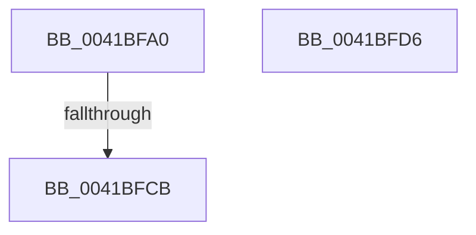

# KiSynchronizeUserIsolationDomainExit

- RVA: `0x0041BFA0`–`0x0041BFD7` (길이 `55` bytes)
- VA: `0x000000014041BFA0`
- 실행 섹션: `.text`
- PDB 이름 있음: `예`; PDB Function 태그: `예`
- unwind 정보 RVA: `0x0009D684`
- 디코드: `14`개 명령, `55/55` bytes 표시
- 미해석 바이트: `0` (있으면 어셈블리에 `.byte`로 보존)

> 이 문서는 커널 이미지의 기계어와 PDB 기호를 분석해 생성했습니다. 4번과 5번은 함수 원형과 자료형을 바이너리 사용 방식에서 추정한 C 해석이며 원본 소스 복구 결과는 아닙니다.

## 1. Dependencies

- 직접 호출 지점: **0**; 고유 호출 대상: **0**
- 직접 호출자로 확인된 함수: **37**
- RIP 상대 이미지 참조: **0**

### Outgoing calls
- 직접 디코드된 call 명령이 없습니다.

### Direct callers
- [KyStartUserThread](../6B/KyStartUserThread_function_006B2AF0.md) at `0x006B2E05`
- [KxIsrLinkage](../6B/KxIsrLinkage_function_006B5680.md) at `0x006B5992`
- [KiApcInterrupt](../6B/KiApcInterrupt_function_006B5E20.md) at `0x006B6136`
- [KiHvInterrupt](../6B/KiHvInterrupt_function_006B6620.md) at `0x006B6934`
- [KiVmbusInterrupt0](../6B/KiVmbusInterrupt0_function_006B6990.md) at `0x006B6CA4`
- [KiVmbusInterrupt1](../6B/KiVmbusInterrupt1_function_006B6D00.md) at `0x006B7014`
- [KiVmbusInterrupt2](../6B/KiVmbusInterrupt2_function_006B7070.md) at `0x006B7384`
- [KiVmbusInterrupt3](../6B/KiVmbusInterrupt3_function_006B73E0.md) at `0x006B76F4`
- [KiSwInterrupt](../6B/KiSwInterrupt_function_006B8070.md) at `0x006B8386`
- [KiDpcInterrupt](../6B/KiDpcInterrupt_function_006B87C0.md) at `0x006B8AD6`
- [KiIpiInterrupt](../6B/KiIpiInterrupt_function_006B8F20.md) at `0x006B9236`
- [KiDivideErrorFault](../6B/KiDivideErrorFault_function_006BCA00.md) at `0x006BCD15`
- [KxDebugTrapOrFault](../6B/KxDebugTrapOrFault_function_006BCF40.md) at `0x006BD255`
- [KiBreakpointTrap](../6B/KiBreakpointTrap_function_006BD940.md) at `0x006BDC55`
- [KiOverflowTrap](../6B/KiOverflowTrap_function_006BDCC0.md) at `0x006BDFD5`
- [KiBoundFault](../6B/KiBoundFault_function_006BE040.md) at `0x006BE355`
- [KiInvalidOpcodeFault](../6B/KiInvalidOpcodeFault_function_006BE740.md) at `0x006BEA55`
- [KiNpxNotAvailableFault](../6B/KiNpxNotAvailableFault_function_006BEE00.md) at `0x006BF115`
- [KiDoubleFaultAbort](../6B/KiDoubleFaultAbort_function_006BF1C0.md) at `0x006BF4D1`
- [KiNpxSegmentOverrunAbort](../6B/KiNpxSegmentOverrunAbort_function_006BF540.md) at `0x006BF855`
- [KiInvalidTssFault](../6B/KiInvalidTssFault_function_006BF8C0.md) at `0x006BFBD1`
- [KiSegmentNotPresentFault](../6B/KiSegmentNotPresentFault_function_006BFC40.md) at `0x006BFF51`
- [KiStackFault](../6C/KiStackFault_function_006C0040.md) at `0x006C0351`
- [KiGeneralProtectionFault](../6C/KiGeneralProtectionFault_function_006C03C0.md) at `0x006C06D1`
- [KiPageFault](../6C/KiPageFault_function_006C0740.md) at `0x006C0A68`
- [KiFloatingErrorFault](../6C/KiFloatingErrorFault_function_006C0F40.md) at `0x006C1255`
- [KiAlignmentFault](../6C/KiAlignmentFault_function_006C1340.md) at `0x006C1651`
- [KxMcheckAlternateReturn](../6C/KxMcheckAlternateReturn_function_006C1E00.md) at `0x006C212E`
- [KiXmmException](../6C/KiXmmException_function_006C2500.md) at `0x006C2815`
- [KiVirtualizationException](../6C/KiVirtualizationException_function_006C2900.md) at `0x006C2C15`
- [KiControlProtectionFault](../6C/KiControlProtectionFault_function_006C3040.md) at `0x006C3351`
- [KiRaiseSecurityCheckFailure](../6C/KiRaiseSecurityCheckFailure_function_006C37C0.md) at `0x006C3AE7`
- [KiRaiseAssertion](../6C/KiRaiseAssertion_function_006C3B40.md) at `0x006C3E67`
- [KiDebugServiceTrap](../6C/KiDebugServiceTrap_function_006C3EC0.md) at `0x006C41E6`
- [KiSystemCall32](../6C/KiSystemCall32_function_006C4500.md) at `0x006C484F`
- [KiSystemCall64](../6C/KiSystemCall64_function_006C4A40.md) at `0x006C4D36`
- [KiSystemCall32Shadow](../../kvascode/BC/KiSystemCall32Shadow_function_00BCCE40.md) at `0x00BCD185`

### Static image references
- 디코드된 RIP-relative 메모리 참조가 없습니다.

## 2. Other-region calls and transfers

- 다른 실행 섹션으로 향하는 call: **0**
- call이 아닌 외부 분기/꼬리 이동: **1**
  - `0x0041BFC9` → [sub_0041BFD7](Unknown_function_0041BFD7.md) (`tail-transfer`)

## 3. Assembly (complete function range)

```asm
0041BFA0  48 89 5C 24 18                  mov qword ptr [rsp + 0x18], rbx
0041BFA5  57                              push rdi
0041BFA6  48 83 EC 20                     sub rsp, 0x20
0041BFAA  65 48 8B 04 25 20 00 00 00      mov rax, qword ptr gs:[0x20]
0041BFB3  48 8B 98 58 8E 00 00            mov rbx, qword ptr [rax + 0x8e58]
0041BFBA  8B B8 B4 AE 00 00               mov edi, dword ptr [rax + 0xaeb4]
0041BFC0  48 8B 5B 28                     mov rbx, qword ptr [rbx + 0x28]
0041BFC4  48 83 7B 08 00                  cmp qword ptr [rbx + 8], 0
0041BFC9  75 0C                           jne 0x14041bfd7
0041BFCB  48 8B 5C 24 40                  mov rbx, qword ptr [rsp + 0x40]
0041BFD0  48 83 C4 20                     add rsp, 0x20
0041BFD4  5F                              pop rdi
0041BFD5  C3                              ret
0041BFD6  CC                              int3
```

## 4. C-style interpretation (structured pseudocode)

```c
__int64 __fastcall KiSynchronizeUserIsolationDomainExit(void)
{
    __int64 v_rsp;
    unsigned __int64 v_stack_p18;

    v_stack_p18 = v_rbx;
    v_rsp = (v_rsp) - (32);
    v_rsp = (v_rsp) + (32);
    return *(unsigned __int64 *)(gs_base + (0 + 32));
}
```

## 5. (Beta) C Style

```c
void KiSynchronizeUserIsolationDomainExit(void)
{
    int64_t local_rsp;
    uint64_t v_stack_p18;

    v_stack_p18 = local_rbx;
    local_rsp = (local_rsp) - (32);
    local_rsp = (local_rsp) + (32);
    return *(uint64_t *)(gs_base + (0 + 0x20));
}
```

## 6. Execution-region graph

[열기: 2D/3D 그래프와 함수 탐색 컨트롤 패널](../../../control-panel.html?section=text&rva=0x0041BFA0&view=graph)

- 2D 그래프는 위에서 아래로 흐르고, 3D 그래프는 빈 공간을 드래그해 회전합니다. Shift+드래그는 이동, 휠은 확대·축소, 함수 노드 선택은 대상 보고서 이동입니다.

### Static fallback


