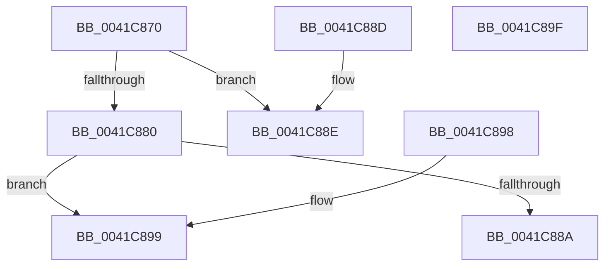

# KiWaitSatisfyOther

- RVA: `0x0041C870`–`0x0041C8A0` (길이 `48` bytes)
- VA: `0x000000014041C870`
- 실행 섹션: `.text`
- PDB 이름 있음: `예`; PDB Function 태그: `아니요`
- unwind 정보 RVA: `0x000DB714`
- 디코드: `19`개 명령, `48/48` bytes 표시
- 미해석 바이트: `0` (있으면 어셈블리에 `.byte`로 보존)

> 이 문서는 커널 이미지의 기계어와 PDB 기호를 분석해 생성했습니다. 4번과 5번은 함수 원형과 자료형을 바이너리 사용 방식에서 추정한 C 해석이며 원본 소스 복구 결과는 아닙니다.

## 1. Dependencies

- 직접 호출 지점: **0**; 고유 호출 대상: **0**
- 직접 호출자로 확인된 함수: **3**
- RIP 상대 이미지 참조: **0**

### Outgoing calls
- 직접 디코드된 call 명령이 없습니다.

### Direct callers
- [sub_0020D8DF](../20/Unknown_function_0020D8DF.md) at `0x0020D960`
- [KeRegisterObjectNotification](../39/KeRegisterObjectNotification_function_00393454.md) at `0x003934C5`
- [KeRegisterObjectDpc](../5B/KeRegisterObjectDpc_function_005B2544.md) at `0x005B25A9`

### Static image references
- 디코드된 RIP-relative 메모리 참조가 없습니다.

## 2. Other-region calls and transfers

- 다른 실행 섹션으로 향하는 call: **0**
- 별도 외부 분기/꼬리 이동을 확인하지 못했습니다.

## 3. Assembly (complete function range)

```asm
0041C870  44 0F B6 01                     movzx r8d, byte ptr [rcx]
0041C874  41 0F B6 D0                     movzx edx, r8b
0041C878  80 E2 07                        and dl, 7
0041C87B  80 FA 01                        cmp dl, 1
0041C87E  74 0E                           je 0x14041c88e
0041C880  41 80 E0 7F                     and r8b, 0x7f
0041C884  41 80 F8 05                     cmp r8b, 5
0041C888  74 0F                           je 0x14041c899
0041C88A  32 C0                           xor al, al
0041C88C  C3                              ret
0041C88D  CC                              int3
0041C88E  C7 41 04 00 00 00 00            mov dword ptr [rcx + 4], 0
0041C895  B0 01                           mov al, 1
0041C897  C3                              ret
0041C898  CC                              int3
0041C899  FF 49 04                        dec dword ptr [rcx + 4]
0041C89C  B0 01                           mov al, 1
0041C89E  C3                              ret
0041C89F  CC                              int3
```

## 4. C-style interpretation (structured pseudocode)

```c
__int64 __fastcall KiWaitSatisfyOther(__int64 a1)
{
    __int64 result;

    a2 = (unsigned __int8)(((unsigned __int8)(*(unsigned __int8 *)(a1))) & (7));
    if (((unsigned __int8)(a2)) == 1) goto loc_0041C88E;
    a3 = (unsigned __int8)((*(unsigned __int8 *)(a1)) & (127));
    if (((unsigned __int8)(a3)) == 5) goto loc_0041C899;
    result = 0;
    return result;
loc_0041C88E:
    *(unsigned int *)(a1 + 4) = 0;
    return 1;
loc_0041C899:
    return 1;
}
```

## 5. (Beta) C Style

```c
int64_t KiWaitSatisfyOther(void *Arg1)
{
    uint8_t *arg1 = (uint8_t *)Arg1;

    int64_t result;

    a2 = (uint8_t)(((uint8_t)(*(uint8_t *)(arg1))) & (7));
    if (((uint8_t)(a2)) == 1) goto loc_0041C88E;
    a3 = (uint8_t)((*(uint8_t *)(arg1)) & (127));
    if (((uint8_t)(a3)) == 5) goto loc_0041C899;
    result = 0;
    return result;
loc_0041C88E:
    *(uint32_t *)(arg1 + 0x4) = 0;
    return 1;
loc_0041C899:
    return 1;
}
```

### 관측된 메모리 오프셋

구조체 형식이 확인되지 않은 접근은 인자 기준의 오프셋으로만 기록했습니다.

| 기준 인자 | 오프셋 표현 | 폭 (bit) | 접근 |
|---|---:|---:|---|
| `Arg1` | `+ 0x0` | `8` | `R` |
| `Arg1` | `+ 0x4` | `32` | `R/W` |
| `Arg1` | `+ 0x4` | `32` | `W` |

## 6. Execution-region graph

[열기: 2D/3D 그래프와 함수 탐색 컨트롤 패널](../../../control-panel.html?section=text&rva=0x0041C870&view=graph)

- 2D 그래프는 위에서 아래로 흐르고, 3D 그래프는 빈 공간을 드래그해 회전합니다. Shift+드래그는 이동, 휠은 확대·축소, 함수 노드 선택은 대상 보고서 이동입니다.

### Static fallback


