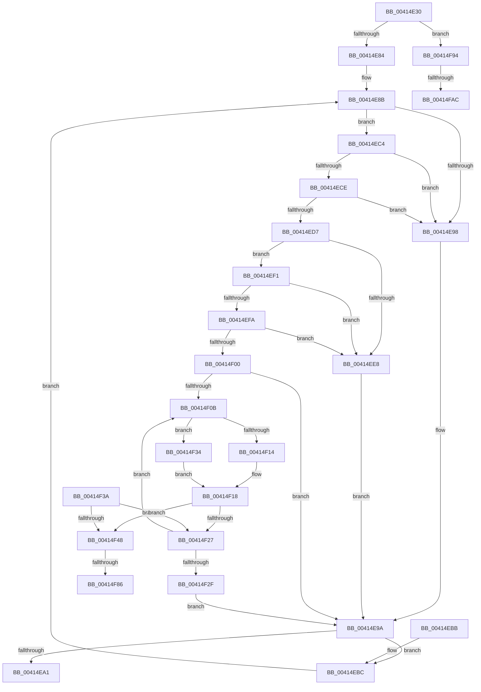

# KxWaitForLockOwnerShipWithIrql

- RVA: `0x00414E30`–`0x00414FBB` (길이 `395` bytes)
- VA: `0x0000000140414E30`
- 실행 섹션: `.text`
- PDB 이름 있음: `예`; PDB Function 태그: `예`
- unwind 정보 RVA: `0x0009C190`
- 디코드: `112`개 명령, `395/395` bytes 표시
- 미해석 바이트: `0` (있으면 어셈블리에 `.byte`로 보존)

> 이 문서는 커널 이미지의 기계어와 PDB 기호를 분석해 생성했습니다. 4번과 5번은 함수 원형과 자료형을 바이너리 사용 방식에서 추정한 C 해석이며 원본 소스 복구 결과는 아닙니다.

## 1. Dependencies

- 직접 호출 지점: **6**; 고유 호출 대상: **6**
- 직접 호출자로 확인된 함수: **1**
- RIP 상대 이미지 참조: **5**

### Outgoing calls
- `0x00414ECE` → [KiCheckVpBackingLongSpinWaitHypercall](../30/KiCheckVpBackingLongSpinWaitHypercall_function_0030F490.md) (function, `0x0030F490`)
- `0x00414EEA` → [HvlNotifyLongSpinWait](../30/HvlNotifyLongSpinWait_function_0030F460.md) (function, `0x0030F460`)
- `0x00414EF1` → [KeCanUseHaltOnAddress](../4F/KeCanUseHaltOnAddress_function_004FC22C.md) (function, `0x004FC22C`)
- `0x00414F74` → [KiAddHaltBlockToWaitList](../5B/KiAddHaltBlockToWaitList_function_005BB948.md) (function, `0x005BB948`)
- `0x00414F89` → [KiWakeAddressAll](../45/KiWakeAddressAll_function_0045B334.md) (function, `0x0045B334`)
- `0x00414FB0` → [KiRaiseIrqlProcessIrqlFlags](../4F/KiRaiseIrqlProcessIrqlFlags_function_004F56FC.md) (function, `0x004F56FC`)

### Direct callers
- [KiAcquireQueuedSpinLockInstrumented](../27/KiAcquireQueuedSpinLockInstrumented_function_00275850.md) at `0x002758BE`

### Static image references
- `0x00414E8D` → RVA `0x00FC52AC` (`ALMOSTRO`; reference)
- `0x00414EC4` → RVA `0x00FC6AB8` (`ALMOSTRO`; read)
- `0x00414ED9` → RVA `0x00FC6B38` (`ALMOSTRO`; read)
- `0x00414F58` → RVA `0x00F21B20` (`.data`; read)
- `0x00414F9F` → RVA `0x00FC6D20` (`ALMOSTRO`; read)

## 2. Other-region calls and transfers

- 다른 실행 섹션으로 향하는 call: **0**
- call이 아닌 외부 분기/꼬리 이동: **4**
  - `0x00414F80` → [sub_006ED39E + 0x9](../6E/Unknown_function_006ED39E.md) (`tail-transfer`)
  - `0x00414F8F` → [sub_006ED39E + 0x9](../6E/Unknown_function_006ED39E.md) (`tail-transfer`)
  - `0x00414FA6` → [sub_006ED39E](../6E/Unknown_function_006ED39E.md) (`tail-transfer`)
  - `0x00414FB6` → [sub_006ED39E](../6E/Unknown_function_006ED39E.md) (`tail-transfer`)

## 3. Assembly (complete function range)

```asm
00414E30  48 89 5C 24 08                  mov qword ptr [rsp + 8], rbx
00414E35  48 89 74 24 10                  mov qword ptr [rsp + 0x10], rsi
00414E3A  48 89 7C 24 18                  mov qword ptr [rsp + 0x18], rdi
00414E3F  55                              push rbp
00414E40  48 8B EC                        mov rbp, rsp
00414E43  48 83 EC 70                     sub rsp, 0x70
00414E47  33 C0                           xor eax, eax
00414E49  48 8D 59 08                     lea rbx, [rcx + 8]
00414E4D  48 89 45 F0                     mov qword ptr [rbp - 0x10], rax
00414E51  49 8B F8                        mov rdi, r8
00414E54  48 8B 03                        mov rax, qword ptr [rbx]
00414E57  41 B8 01 00 00 00               mov r8d, 1
00414E5D  A8 04                           test al, 4
00414E5F  0F 57 C0                        xorps xmm0, xmm0
00414E62  0F B6 45 F1                     movzx eax, byte ptr [rbp - 0xf]
00414E66  41 0F 45 C0                     cmovne eax, r8d
00414E6A  4C 09 03                        or qword ptr [rbx], r8
00414E6D  88 45 F1                        mov byte ptr [rbp - 0xf], al
00414E70  0F 11 45 D0                     movups xmmword ptr [rbp - 0x30], xmm0
00414E74  0F 11 45 E0                     movups xmmword ptr [rbp - 0x20], xmm0
00414E78  48 89 0A                        mov qword ptr [rdx], rcx
00414E7B  48 85 FF                        test rdi, rdi
00414E7E  0F 85 10 01 00 00               jne 0x140414f94
00414E84  33 FF                           xor edi, edi
00414E86  33 F6                           xor esi, esi
00414E88  89 75 D4                        mov dword ptr [rbp - 0x2c], esi
00414E8B  FF C7                           inc edi
00414E8D  85 3D 19 04 BB 00               test dword ptr [rip + 0xbb0419], edi
00414E93  89 7D D0                        mov dword ptr [rbp - 0x30], edi
00414E96  74 2C                           je 0x140414ec4
00414E98  F3 90                           pause
00414E9A  48 8B 03                        mov rax, qword ptr [rbx]
00414E9D  A8 01                           test al, 1
00414E9F  75 1B                           jne 0x140414ebc
00414EA1  8B 45 D0                        mov eax, dword ptr [rbp - 0x30]
00414EA4  4C 8D 5C 24 70                  lea r11, [rsp + 0x70]
00414EA9  49 8B 5B 10                     mov rbx, qword ptr [r11 + 0x10]
00414EAD  90                              nop
00414EAE  49 8B 73 18                     mov rsi, qword ptr [r11 + 0x18]
00414EB2  49 8B 7B 20                     mov rdi, qword ptr [r11 + 0x20]
00414EB6  49 8B E3                        mov rsp, r11
00414EB9  5D                              pop rbp
00414EBA  C3                              ret
00414EBB  CC                              int3
00414EBC  8B 75 D4                        mov esi, dword ptr [rbp - 0x2c]
00414EBF  8B 7D D0                        mov edi, dword ptr [rbp - 0x30]
00414EC2  EB C7                           jmp 0x140414e8b
00414EC4  8B 05 EE 1B BB 00               mov eax, dword ptr [rip + 0xbb1bee]
00414ECA  A8 40                           test al, 0x40
00414ECC  74 CA                           je 0x140414e98
00414ECE  E8 BD A5 EF FF                  call 0x14030f490
00414ED3  84 C0                           test al, al
00414ED5  74 C1                           je 0x140414e98
00414ED7  FF C6                           inc esi
00414ED9  F7 05 55 1C BB 00 00 00 01 00   test dword ptr [rip + 0xbb1c55], 0x10000
00414EE3  89 75 D4                        mov dword ptr [rbp - 0x2c], esi
00414EE6  75 09                           jne 0x140414ef1
00414EE8  8B CF                           mov ecx, edi
00414EEA  E8 71 A5 EF FF                  call 0x14030f460
00414EEF  EB A9                           jmp 0x140414e9a
00414EF1  E8 36 73 0E 00                  call 0x1404fc22c
00414EF6  84 C0                           test al, al
00414EF8  74 EE                           je 0x140414ee8
00414EFA  40 F6 C6 07                     test sil, 7
00414EFE  75 E8                           jne 0x140414ee8
00414F00  48 8B 03                        mov rax, qword ptr [rbx]
00414F03  48 89 45 E8                     mov qword ptr [rbp - 0x18], rax
00414F07  A8 01                           test al, 1
00414F09  74 8F                           je 0x140414e9a
00414F0B  80 7D F1 00                     cmp byte ptr [rbp - 0xf], 0
00414F0F  48 8B C8                        mov rcx, rax
00414F12  74 20                           je 0x140414f34
00414F14  48 83 E1 FB                     and rcx, 0xfffffffffffffffb
00414F18  48 89 4D D8                     mov qword ptr [rbp - 0x28], rcx
00414F1C  F0 48 0F B1 0B                  lock cmpxchg qword ptr [rbx], rcx
00414F21  48 89 45 E0                     mov qword ptr [rbp - 0x20], rax
00414F25  74 21                           je 0x140414f48
00414F27  48 89 45 E8                     mov qword ptr [rbp - 0x18], rax
00414F2B  A8 01                           test al, 1
00414F2D  75 DC                           jne 0x140414f0b
00414F2F  E9 66 FF FF FF                  jmp 0x140414e9a
00414F34  48 83 C9 04                     or rcx, 4
00414F38  EB DE                           jmp 0x140414f18
00414F3A  FB                              sti
00414F3B  48 8B 03                        mov rax, qword ptr [rbx]
00414F3E  48 89 45 E0                     mov qword ptr [rbp - 0x20], rax
00414F42  48 3B 45 D8                     cmp rax, qword ptr [rbp - 0x28]
00414F46  75 DF                           jne 0x140414f27
00414F48  48 C7 45 C8 00 00 00 00         mov qword ptr [rbp - 0x38], 0
00414F50  48 8D 55 B0                     lea rdx, [rbp - 0x50]
00414F54  48 89 5D B0                     mov qword ptr [rbp - 0x50], rbx
00414F58  48 8D 0D C1 CB B0 00            lea rcx, [rip + 0xb0cbc1]
00414F5F  48 C7 45 C0 00 00 00 00         mov qword ptr [rbp - 0x40], 0
00414F67  65 48 8B 04 25 20 00 00 00      mov rax, qword ptr gs:[0x20]
00414F70  48 89 45 B8                     mov qword ptr [rbp - 0x48], rax
00414F74  E8 CF 69 1A 00                  call 0x1405bb948
00414F79  48 8B 03                        mov rax, qword ptr [rbx]
00414F7C  48 3B 45 D8                     cmp rax, qword ptr [rbp - 0x28]
00414F80  0F 84 21 84 2D 00               je 0x1406ed3a7
00414F86  48 8B CB                        mov rcx, rbx
00414F89  E8 A6 63 04 00                  call 0x14045b334
00414F8E  90                              nop
00414F8F  E9 13 84 2D 00                  jmp 0x1406ed3a7
00414F94  0F B6 17                        movzx edx, byte ptr [rdi]
00414F97  44 0F 20 C6                     mov rsi, cr8
00414F9B  44 0F 22 C2                     mov cr8, rdx
00414F9F  83 3D 7A 1D BB 00 00            cmp dword ptr [rip + 0xbb1d7a], 0
00414FA6  0F 84 F2 83 2D 00               je 0x1406ed39e
00414FAC  40 0F B6 CE                     movzx ecx, sil
00414FB0  E8 47 07 0E 00                  call 0x1404f56fc
00414FB5  90                              nop
00414FB6  E9 E3 83 2D 00                  jmp 0x1406ed39e
```

## 4. C-style interpretation (structured pseudocode)

```c
__int64 __fastcall KxWaitForLockOwnerShipWithIrql(__int64 a1, __int64 a2, __int64 a3)
{
    __int64 result;
    __int64 v_rdi;
    __int64 v_rsi;
    __int64 v_rsp;
    unsigned __int8 v_stack_m17;
    unsigned __int64 v_stack_m18;
    unsigned __int64 v_stack_m20;
    unsigned __int64 v_stack_m28;
    unsigned __int64 v_stack_m30;
    unsigned int v_stack_m34;
    unsigned __int64 v_stack_m38;
    unsigned __int64 v_stack_m40;
    unsigned __int64 v_stack_m48;
    unsigned __int64 v_stack_m50;
    unsigned __int64 v_stack_m58;
    unsigned __int64 v_stack_m8;
    unsigned __int64 v_stack_p10;
    unsigned __int64 v_stack_p18;
    unsigned __int64 v_stack_p8;

    v_stack_p8 = v_rbx;
    v_stack_p10 = v_rsi;
    v_stack_p18 = v_rdi;
    v_rsp = (v_rsp) - (112);
    result = 0;
    v_stack_m18 = 0;
    result = v_stack_m17;
    if ((((unsigned __int8)(*(unsigned __int64 *)(a1 + 8))) & (4)) != 0) { result = 1; }
    v_stack_m17 = (unsigned __int8)(result);
    v_stack_m38 = v_xmm0;
    v_stack_m28 = v_xmm0;
    *(unsigned __int64 *)(a2) = a1;
    if (a3 != 0) goto loc_00414F94;
    v_rdi = 0;
    v_rsi = 0;
    v_stack_m34 = 0;
loc_00414E8B:
    v_rdi = (unsigned int)((v_rdi) + 1);
    v_stack_m38 = (unsigned int)(v_rdi);
    if (((*(unsigned int *)(v_rip + 12256281)) & ((unsigned int)(v_rdi))) == 0) goto loc_00414EC4;
loc_00414E98:
loc_00414E9A:
    if ((((unsigned __int8)(*(unsigned __int64 *)(a1 + 8))) & (1)) != 0) goto loc_00414EBC;
    return (unsigned int)(v_stack_m38);
loc_00414EBC:
    goto loc_00414E8B;
loc_00414EC4:
    if ((((unsigned __int8)((unsigned int)(*(unsigned int *)(v_rip + 12262382)))) & (64)) == 0) goto loc_00414E98;
    result = KiCheckVpBackingLongSpinWaitHypercall(a1, a2, 1, a4);
    if ((unsigned __int8)(result) == 0) goto loc_00414E98;
    v_rsi = (unsigned int)(((unsigned int)(v_stack_m34)) + 1);
    v_stack_m34 = (unsigned int)(v_rsi);
    if (((*(unsigned int *)(v_rip + 12262485)) & (0x10000ULL)) != 0) goto loc_00414EF1;
loc_00414EE8:
    result = HvlNotifyLongSpinWait((unsigned int)((unsigned int)((unsigned int)(v_stack_m38))), a2, 1, a4);
    goto loc_00414E9A;
loc_00414EF1:
    result = KeCanUseHaltOnAddress((unsigned int)((unsigned int)((unsigned int)(v_stack_m38))), a2, 1, a4);
    if ((unsigned __int8)(result) == 0) goto loc_00414EE8;
    if ((((unsigned __int8)(v_rsi)) & (7)) != 0) goto loc_00414EE8;
    v_stack_m20 = *(unsigned __int64 *)(*(unsigned __int64 *)(v_stack_m8 + 16));
    if ((((unsigned __int8)(*(unsigned __int64 *)(*(unsigned __int64 *)(v_stack_m8 + 16)))) & (1)) == 0) goto loc_00414E9A;
loc_00414F0B:
    if (v_stack_m17 == 0) goto loc_00414F34;
    a1 = (*(unsigned __int64 *)(*(unsigned __int64 *)(v_stack_m8 + 16))) & (-5);
loc_00414F18:
    v_stack_m30 = a1;
    v_stack_m28 = *(unsigned __int64 *)(*(unsigned __int64 *)(v_stack_m8 + 16));
    if (condition_is_equal) goto loc_00414F48;
loc_00414F27:
    v_stack_m20 = *(unsigned __int64 *)(*(unsigned __int64 *)(v_stack_m8 + 16));
    if ((((unsigned __int8)(*(unsigned __int64 *)(*(unsigned __int64 *)(v_stack_m8 + 16)))) & (1)) != 0) goto loc_00414F0B;
    goto loc_00414E9A;
loc_00414F34:
    a1 = (a1) | (4);
    goto loc_00414F18;
loc_00414F48:
    v_stack_m40 = 0;
    v_stack_m58 = *(unsigned __int64 *)(v_stack_m8 + 16);
    v_stack_m48 = 0;
    v_stack_m50 = *(unsigned __int64 *)(gs_base + (0 + 32));
    result = KiAddHaltBlockToWaitList(v_rip + 11586497, v_stack_m58, 1, a4);
    result = KiWakeAddressAll(*(unsigned __int64 *)(v_stack_m8 + 16), v_stack_m58, 1, a4);
loc_00414F94:
    result = KiRaiseIrqlProcessIrqlFlags((unsigned __int8)(v_cr8), *(unsigned __int8 *)((unsigned int)(v_stack_m38)), 1, a4);
}
```

## 5. (Beta) C Style

```c
int64_t KxWaitForLockOwnerShipWithIrql(void *Arg1, void *Arg2, int64_t Arg3)
{
    uint8_t *arg1 = (uint8_t *)Arg1;
    uint8_t *arg2 = (uint8_t *)Arg2;

    int64_t result;
    int64_t local_rdi;
    int64_t local_rsi;
    int64_t local_rsp;
    uint8_t v_stack_m17;
    uint64_t v_stack_m18;
    uint64_t v_stack_m20;
    uint64_t v_stack_m28;
    uint64_t v_stack_m30;
    uint32_t v_stack_m34;
    uint64_t v_stack_m38;
    uint64_t v_stack_m40;
    uint64_t v_stack_m48;
    uint64_t v_stack_m50;
    uint64_t v_stack_m58;
    uint64_t v_stack_m8;
    uint64_t v_stack_p10;
    uint64_t v_stack_p18;
    uint64_t v_stack_p8;

    v_stack_p8 = local_rbx;
    v_stack_p10 = local_rsi;
    v_stack_p18 = local_rdi;
    local_rsp = (local_rsp) - (112);
    result = 0;
    v_stack_m18 = 0;
    result = v_stack_m17;
    if ((((uint8_t)(*(uint64_t *)(arg1 + 0x8))) & (4)) != 0) { result = 1; }
    v_stack_m17 = (uint8_t)(result);
    v_stack_m38 = v_xmm0;
    v_stack_m28 = v_xmm0;
    *(void **)(arg2) = Arg1;
    if (Arg3 != 0) goto loc_00414F94;
    local_rdi = 0;
    local_rsi = 0;
    v_stack_m34 = 0;
loc_00414E8B:
    local_rdi = (uint32_t)((local_rdi) + 1);
    v_stack_m38 = (uint32_t)(local_rdi);
    if (((*(uint32_t *)(v_rip + 0xBB0419)) & ((uint32_t)(local_rdi))) == 0) goto loc_00414EC4;
loc_00414E98:
loc_00414E9A:
    if ((((uint8_t)(*(uint64_t *)(arg1 + 0x8))) & (1)) != 0) goto loc_00414EBC;
    return (uint32_t)(v_stack_m38);
loc_00414EBC:
    goto loc_00414E8B;
loc_00414EC4:
    if ((((uint8_t)((uint32_t)(*(uint32_t *)(v_rip + 0xBB1BEE)))) & (64)) == 0) goto loc_00414E98;
    result = KiCheckVpBackingLongSpinWaitHypercall(Arg1, Arg2, 1, a4);
    if ((uint8_t)(result) == 0) goto loc_00414E98;
    local_rsi = (uint32_t)(((uint32_t)(v_stack_m34)) + 1);
    v_stack_m34 = (uint32_t)(local_rsi);
    if (((*(uint32_t *)(v_rip + 0xBB1C55)) & (0x10000ULL)) != 0) goto loc_00414EF1;
loc_00414EE8:
    result = HvlNotifyLongSpinWait((uint32_t)((uint32_t)((uint32_t)(v_stack_m38))), Arg2, 1, a4);
    goto loc_00414E9A;
loc_00414EF1:
    result = KeCanUseHaltOnAddress((uint32_t)((uint32_t)((uint32_t)(v_stack_m38))), Arg2, 1, a4);
    if ((uint8_t)(result) == 0) goto loc_00414EE8;
    if ((((uint8_t)(local_rsi)) & (7)) != 0) goto loc_00414EE8;
    v_stack_m20 = *(uint64_t *)(*(uint64_t *)(v_stack_m8 + 0x10));
    if ((((uint8_t)(*(uint64_t *)(*(uint64_t *)(v_stack_m8 + 0x10)))) & (1)) == 0) goto loc_00414E9A;
loc_00414F0B:
    if (v_stack_m17 == 0) goto loc_00414F34;
    Arg1 = (*(uint64_t *)(*(uint64_t *)(v_stack_m8 + 0x10))) & (-5);
loc_00414F18:
    v_stack_m30 = Arg1;
    v_stack_m28 = *(uint64_t *)(*(uint64_t *)(v_stack_m8 + 0x10));
    if (condition_is_equal) goto loc_00414F48;
loc_00414F27:
    v_stack_m20 = *(uint64_t *)(*(uint64_t *)(v_stack_m8 + 0x10));
    if ((((uint8_t)(*(uint64_t *)(*(uint64_t *)(v_stack_m8 + 0x10)))) & (1)) != 0) goto loc_00414F0B;
    goto loc_00414E9A;
loc_00414F34:
    Arg1 = (Arg1) | (4);
    goto loc_00414F18;
loc_00414F48:
    v_stack_m40 = 0;
    v_stack_m58 = *(uint64_t *)(v_stack_m8 + 0x10);
    v_stack_m48 = 0;
    v_stack_m50 = *(uint64_t *)(gs_base + (0 + 0x20));
    result = KiAddHaltBlockToWaitList(v_rip + 11586497, v_stack_m58, 1, a4);
    result = KiWakeAddressAll(*(uint64_t *)(v_stack_m8 + 0x10), v_stack_m58, 1, a4);
loc_00414F94:
    result = KiRaiseIrqlProcessIrqlFlags((uint8_t)(v_cr8), *(uint8_t *)((uint32_t)(v_stack_m38)), 1, a4);
}
```

### 관측된 메모리 오프셋

구조체 형식이 확인되지 않은 접근은 인자 기준의 오프셋으로만 기록했습니다.

| 기준 인자 | 오프셋 표현 | 폭 (bit) | 접근 |
|---|---:|---:|---|
| `Arg1` | `+ 0x0` | `64` | `R` |
| `Arg1` | `+ 0x0` | `64` | `R/W` |
| `Arg1` | `+ 0x8` | `64` | `R` |
| `Arg2` | `+ 0x0` | `64` | `W` |

## 6. Execution-region graph

[열기: 2D/3D 그래프와 함수 탐색 컨트롤 패널](../../../control-panel.html?section=text&rva=0x00414E30&view=graph)

- 2D 그래프는 위에서 아래로 흐르고, 3D 그래프는 빈 공간을 드래그해 회전합니다. Shift+드래그는 이동, 휠은 확대·축소, 함수 노드 선택은 대상 보고서 이동입니다.

### Static fallback


