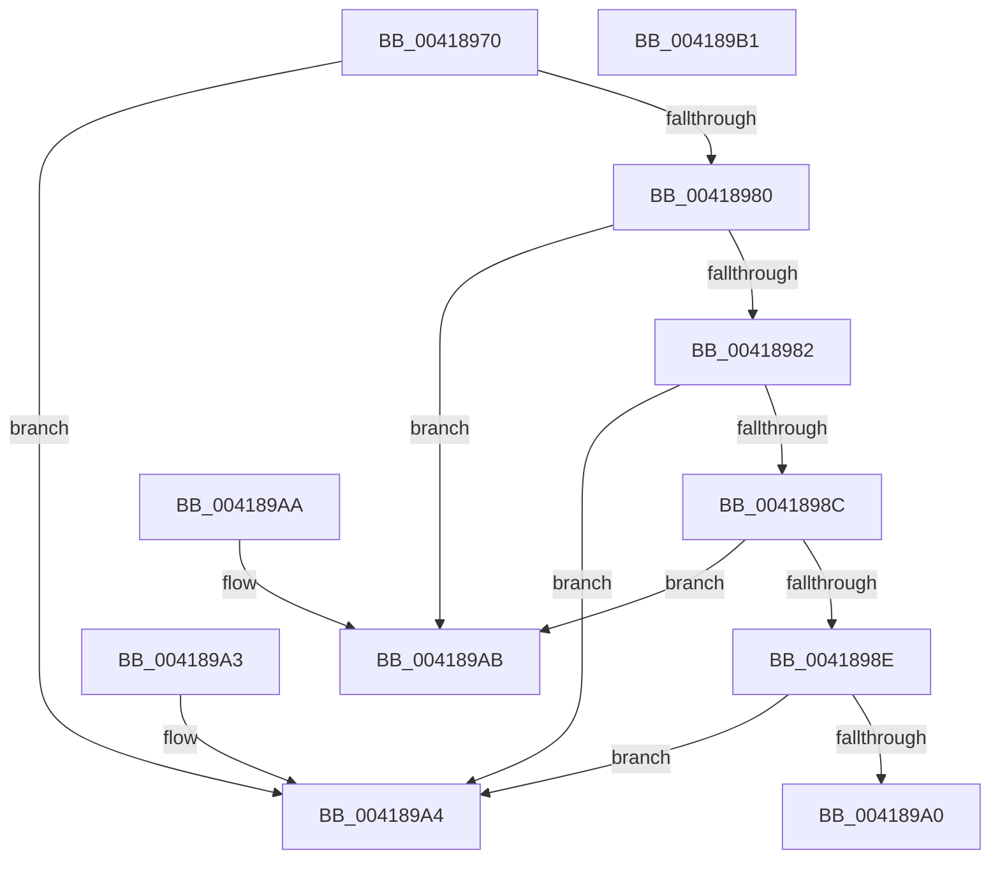

# MiCombineActiveCrcSortByHash

- RVA: `0x00418970`–`0x004189B2` (길이 `66` bytes)
- VA: `0x0000000140418970`
- 실행 섹션: `.text`
- PDB 이름 있음: `예`; PDB Function 태그: `아니요`
- unwind 정보 RVA: `0x000DB714`
- 디코드: `25`개 명령, `66/66` bytes 표시
- 미해석 바이트: `0` (있으면 어셈블리에 `.byte`로 보존)

> 이 문서는 커널 이미지의 기계어와 PDB 기호를 분석해 생성했습니다. 4번과 5번은 함수 원형과 자료형을 바이너리 사용 방식에서 추정한 C 해석이며 원본 소스 복구 결과는 아닙니다.

## 1. Dependencies

- 직접 호출 지점: **0**; 고유 호출 대상: **0**
- 직접 호출자로 확인된 함수: **0**
- RIP 상대 이미지 참조: **0**

### Outgoing calls
- 직접 디코드된 call 명령이 없습니다.

### Direct callers
- 이 함수 시작 RVA로 연결되는 직접 call은 확인되지 않았습니다. 간접 호출은 완전히 역산할 수 없습니다.

### Static image references
- 디코드된 RIP-relative 메모리 참조가 없습니다.

## 2. Other-region calls and transfers

- 다른 실행 섹션으로 향하는 call: **0**
- 별도 외부 분기/꼬리 이동을 확인하지 못했습니다.

## 3. Assembly (complete function range)

```asm
00418970  4C 8B 01                        mov r8, qword ptr [rcx]
00418973  4C 8B 0A                        mov r9, qword ptr [rdx]
00418976  49 8B 40 08                     mov rax, qword ptr [r8 + 8]
0041897A  49 3B 41 08                     cmp rax, qword ptr [r9 + 8]
0041897E  77 24                           ja 0x1404189a4
00418980  72 29                           jb 0x1404189ab
00418982  49 8B 40 18                     mov rax, qword ptr [r8 + 0x18]
00418986  49 3B 41 18                     cmp rax, qword ptr [r9 + 0x18]
0041898A  77 18                           ja 0x1404189a4
0041898C  72 1D                           jb 0x1404189ab
0041898E  41 8B 48 20                     mov ecx, dword ptr [r8 + 0x20]
00418992  41 8B 41 20                     mov eax, dword ptr [r9 + 0x20]
00418996  83 E1 1F                        and ecx, 0x1f
00418999  83 E0 1F                        and eax, 0x1f
0041899C  3B C8                           cmp ecx, eax
0041899E  77 04                           ja 0x1404189a4
004189A0  1B C0                           sbb eax, eax
004189A2  C3                              ret
004189A3  CC                              int3
004189A4  B8 01 00 00 00                  mov eax, 1
004189A9  C3                              ret
004189AA  CC                              int3
004189AB  B8 FF FF FF FF                  mov eax, 0xffffffff
004189B0  C3                              ret
004189B1  CC                              int3
```

## 4. C-style interpretation (structured pseudocode)

```c
__int64 __fastcall MiCombineActiveCrcSortByHash(__int64 a1, __int64 a2)
{
    __int64 result;

    if ((*(unsigned __int64 *)(*(unsigned __int64 *)(a1) + 8)) > (*(unsigned __int64 *)(*(unsigned __int64 *)(a2) + 8))) goto loc_004189A4;
    if ((*(unsigned __int64 *)(*(unsigned __int64 *)(a1) + 8)) < (*(unsigned __int64 *)(*(unsigned __int64 *)(a2) + 8))) goto loc_004189AB;
    if ((*(unsigned __int64 *)(*(unsigned __int64 *)(a1) + 24)) > (*(unsigned __int64 *)(*(unsigned __int64 *)(a2) + 24))) goto loc_004189A4;
    if ((*(unsigned __int64 *)(*(unsigned __int64 *)(a1) + 24)) < (*(unsigned __int64 *)(*(unsigned __int64 *)(a2) + 24))) goto loc_004189AB;
    a1 = (unsigned int)(((unsigned int)(*(unsigned int *)(*(unsigned __int64 *)(a1) + 32))) & (31));
    result = (unsigned int)(((unsigned int)(*(unsigned int *)(*(unsigned __int64 *)(a2) + 32))) & (31));
    if (((unsigned int)(a1)) > ((unsigned int)(result))) goto loc_004189A4;
    return result;
loc_004189A4:
    return 1;
loc_004189AB:
    return (unsigned int)(0xFFFFFFFFULL);
}
```

## 5. (Beta) C Style

```c
int64_t MiCombineActiveCrcSortByHash(void *Arg1, void *Arg2)
{
    uint8_t *arg1 = (uint8_t *)Arg1;
    uint8_t *arg2 = (uint8_t *)Arg2;

    int64_t result;

    if ((*(uint64_t *)(*(uint64_t *)(arg1) + 0x8)) > (*(uint64_t *)(*(uint64_t *)(arg2) + 0x8))) goto loc_004189A4;
    if ((*(uint64_t *)(*(uint64_t *)(arg1) + 0x8)) < (*(uint64_t *)(*(uint64_t *)(arg2) + 0x8))) goto loc_004189AB;
    if ((*(uint64_t *)(*(uint64_t *)(arg1) + 0x18)) > (*(uint64_t *)(*(uint64_t *)(arg2) + 0x18))) goto loc_004189A4;
    if ((*(uint64_t *)(*(uint64_t *)(arg1) + 0x18)) < (*(uint64_t *)(*(uint64_t *)(arg2) + 0x18))) goto loc_004189AB;
    Arg1 = (uint32_t)(((uint32_t)(*(uint32_t *)(*(uint64_t *)(arg1) + 0x20))) & (31));
    result = (uint32_t)(((uint32_t)(*(uint32_t *)(*(uint64_t *)(arg2) + 0x20))) & (31));
    if (((uint32_t)(Arg1)) > ((uint32_t)(result))) goto loc_004189A4;
    return result;
loc_004189A4:
    return 1;
loc_004189AB:
    return (uint32_t)(0xFFFFFFFFULL);
}
```

### 관측된 메모리 오프셋

구조체 형식이 확인되지 않은 접근은 인자 기준의 오프셋으로만 기록했습니다.

| 기준 인자 | 오프셋 표현 | 폭 (bit) | 접근 |
|---|---:|---:|---|
| `Arg1` | `+ 0x0` | `64` | `R` |
| `Arg2` | `+ 0x0` | `64` | `R` |

## 6. Execution-region graph

[열기: 2D/3D 그래프와 함수 탐색 컨트롤 패널](../../../control-panel.html?section=text&rva=0x00418970&view=graph)

- 2D 그래프는 위에서 아래로 흐르고, 3D 그래프는 빈 공간을 드래그해 회전합니다. Shift+드래그는 이동, 휠은 확대·축소, 함수 노드 선택은 대상 보고서 이동입니다.

### Static fallback


