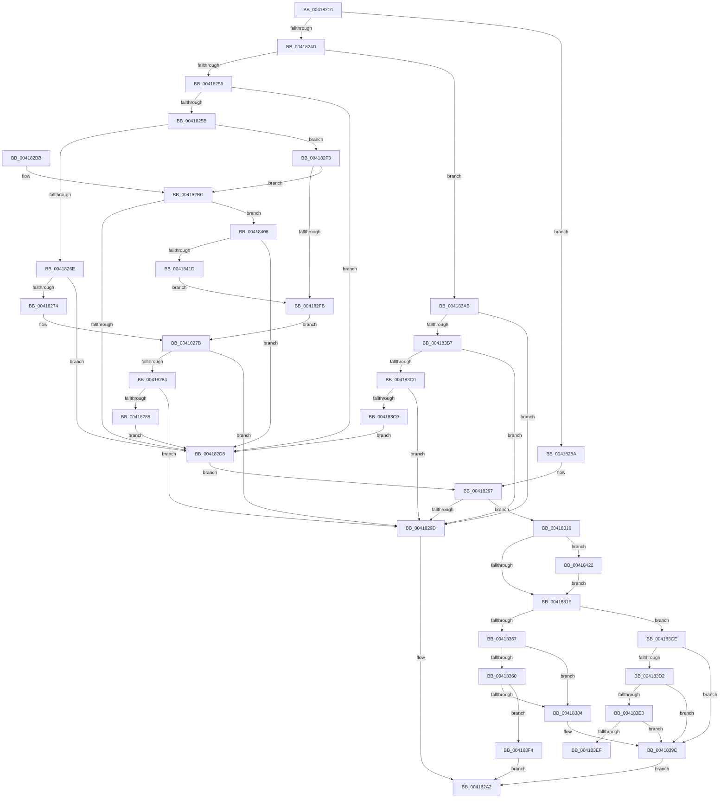

# MiComputeMaximumFaultCluster

- RVA: `0x00418210`–`0x00418431` (길이 `545` bytes)
- VA: `0x0000000140418210`
- 실행 섹션: `.text`
- PDB 이름 있음: `예`; PDB Function 태그: `예`
- unwind 정보 RVA: `0x0009CEC0`
- 디코드: `142`개 명령, `545/545` bytes 표시
- 미해석 바이트: `0` (있으면 어셈블리에 `.byte`로 보존)

> 이 문서는 커널 이미지의 기계어와 PDB 기호를 분석해 생성했습니다. 4번과 5번은 함수 원형과 자료형을 바이너리 사용 방식에서 추정한 C 해석이며 원본 소스 복구 결과는 아닙니다.

## 1. Dependencies

- 직접 호출 지점: **8**; 고유 호출 대상: **7**
- 직접 호출자로 확인된 함수: **2**
- RIP 상대 이미지 참조: **3**

### Outgoing calls
- `0x0041828A` → [MiFaultListPagesRemaining](MiFaultListPagesRemaining_function_00418440.md) (function, `0x00418440`)
- `0x004182CB` → [KiRspInIstStack](KiRspInIstStack_function_00418504.md) (function, `0x00418504`)
- `0x00418309` → [KiIsTraceMemoryAccess](KiIsTraceMemoryAccess_function_004184D0.md) (function, `0x004184D0`)
- `0x00418363` → [MiLockVadTree](../27/MiLockVadTree_function_0027C0F0.md) (function, `0x0027C0F0`)
- `0x0041836B` → [MiLocateAddress](../31/MiLocateAddress_function_003168D0.md) (function, `0x003168D0`)
- `0x0041837A` → [MiUnlockVadTree](../29/MiUnlockVadTree_function_00297020.md) (function, `0x00297020`)
- `0x004183D8` → [MiGetAnyMultiplexedVm](../44/MiGetAnyMultiplexedVm_function_00448BD0.md) (function, `0x00448BD0`)
- `0x00418410` → [KiRspInIstStack](KiRspInIstStack_function_00418504.md) (function, `0x00418504`)

### Direct callers
- [sub_00320540](../32/Unknown_function_00320540.md) at `0x00320636`
- [sub_00320866](../32/Unknown_function_00320866.md) at `0x00320D50`

### Static image references
- `0x00418274` → RVA `0x00FC74C0` (`ALMOSTRO`; read)
- `0x00418302` → RVA `0x006BA587` (`ExpInterlockedPopEntrySListFault`; read)
- `0x004183E3` → RVA `0x00E36048` (`.data`; read)

## 2. Other-region calls and transfers

- 다른 실행 섹션으로 향하는 call: **0**
- call이 아닌 외부 분기/꼬리 이동: **1**
  - `0x004183EF` → [sub_006ED400](../6E/Unknown_function_006ED400.md) (`tail-transfer`)

## 3. Assembly (complete function range)

```asm
00418210  48 89 5C 24 08                  mov qword ptr [rsp + 8], rbx
00418215  48 89 6C 24 10                  mov qword ptr [rsp + 0x10], rbp
0041821A  48 89 74 24 18                  mov qword ptr [rsp + 0x18], rsi
0041821F  57                              push rdi
00418220  41 56                           push r14
00418222  41 57                           push r15
00418224  48 83 EC 20                     sub rsp, 0x20
00418228  48 8B 59 10                     mov rbx, qword ptr [rcx + 0x10]
0041822C  4C 8B F2                        mov r14, rdx
0041822F  48 8B 31                        mov rsi, qword ptr [rcx]
00418232  48 8B C3                        mov rax, rbx
00418235  48 83 E0 FE                     and rax, 0xfffffffffffffffe
00418239  48 81 E6 00 F0 FF FF            and rsi, 0xfffffffffffff000
00418240  48 8B F9                        mov rdi, rcx
00418243  BD 00 02 00 00                  mov ebp, 0x200
00418248  48 3B D8                        cmp rbx, rax
0041824B  75 3D                           jne 0x14041828a
0041824D  F6 C3 01                        test bl, 1
00418250  0F 85 55 01 00 00               jne 0x1404183ab
00418256  48 85 DB                        test rbx, rbx
00418259  74 7D                           je 0x1404182d8
0041825B  0F B7 83 70 01 00 00            movzx eax, word ptr [rbx + 0x170]
00418262  32 C9                           xor cl, cl
00418264  66 83 F8 10                     cmp ax, 0x10
00418268  0F 84 85 00 00 00               je 0x1404182f3
0041826E  66 83 F8 33                     cmp ax, 0x33
00418272  75 64                           jne 0x1404182d8
00418274  4C 8B 3D 45 F2 BA 00            mov r15, qword ptr [rip + 0xbaf245]
0041827B  4C 39 BB 68 01 00 00            cmp qword ptr [rbx + 0x168], r15
00418282  74 19                           je 0x14041829d
00418284  84 C9                           test cl, cl
00418286  75 15                           jne 0x14041829d
00418288  EB 4E                           jmp 0x1404182d8
0041828A  E8 B1 01 00 00                  call 0x140418440
0041828F  4C 8B D8                        mov r11, rax
00418292  B9 01 00 00 00                  mov ecx, 1
00418297  49 83 FB 01                     cmp r11, 1
0041829B  75 79                           jne 0x140418316
0041829D  B8 01 00 00 00                  mov eax, 1
004182A2  48 8B 5C 24 40                  mov rbx, qword ptr [rsp + 0x40]
004182A7  48 8B 6C 24 48                  mov rbp, qword ptr [rsp + 0x48]
004182AC  48 8B 74 24 50                  mov rsi, qword ptr [rsp + 0x50]
004182B1  48 83 C4 20                     add rsp, 0x20
004182B5  41 5F                           pop r15
004182B7  41 5E                           pop r14
004182B9  5F                              pop rdi
004182BA  C3                              ret
004182BB  CC                              int3
004182BC  4C 8B BB 80 01 00 00            mov r15, qword ptr [rbx + 0x180]
004182C3  B9 03 00 00 00                  mov ecx, 3
004182C8  49 8B D7                        mov rdx, r15
004182CB  E8 34 02 00 00                  call 0x140418504
004182D0  85 C0                           test eax, eax
004182D2  0F 84 30 01 00 00               je 0x140418408
004182D8  8B 4F 50                        mov ecx, dword ptr [rdi + 0x50]
004182DB  41 BB 01 00 00 00               mov r11d, 1
004182E1  48 C1 E9 09                     shr rcx, 9
004182E5  0F B6 D1                        movzx edx, cl
004182E8  49 3B D3                        cmp rdx, r11
004182EB  44 0F 47 DA                     cmova r11d, edx
004182EF  33 C9                           xor ecx, ecx
004182F1  EB A4                           jmp 0x140418297
004182F3  85 AB 78 01 00 00               test dword ptr [rbx + 0x178], ebp
004182F9  74 C1                           je 0x1404182bc
004182FB  48 8B 8B 68 01 00 00            mov rcx, qword ptr [rbx + 0x168]
00418302  4C 8D 3D 7E 22 2A 00            lea r15, [rip + 0x2a227e]
00418309  E8 C2 01 00 00                  call 0x1404184d0
0041830E  0F B6 C8                        movzx ecx, al
00418311  E9 65 FF FF FF                  jmp 0x14041827b
00418316  4D 85 F6                        test r14, r14
00418319  0F 85 03 01 00 00               jne 0x140418422
0041831F  48 8B C6                        mov rax, rsi
00418322  48 C1 E8 09                     shr rax, 9
00418326  48 BA 00 00 00 00 80 F6 FF FF   movabs rdx, 0xfffff68000000000
00418330  03 C2                           add eax, edx
00418332  48 C1 E8 03                     shr rax, 3
00418336  25 FF 01 00 00                  and eax, 0x1ff
0041833B  48 2B E8                        sub rbp, rax
0041833E  48 B8 00 00 00 00 00 80 FF FF   movabs rax, 0xffff800000000000
00418348  4C 3B DD                        cmp r11, rbp
0041834B  4C 8B F5                        mov r14, rbp
0041834E  4D 0F 46 F3                     cmovbe r14, r11
00418352  48 3B F0                        cmp rsi, rax
00418355  73 77                           jae 0x1404183ce
00418357  48 8B 5F 58                     mov rbx, qword ptr [rdi + 0x58]
0041835B  48 85 DB                        test rbx, rbx
0041835E  75 24                           jne 0x140418384
00418360  8D 4B 01                        lea ecx, [rbx + 1]
00418363  E8 88 3D E6 FF                  call 0x14027c0f0
00418368  48 8B CE                        mov rcx, rsi
0041836B  E8 60 E5 EF FF                  call 0x1403168d0
00418370  B2 11                           mov dl, 0x11
00418372  B9 01 00 00 00                  mov ecx, 1
00418377  48 8B D8                        mov rbx, rax
0041837A  E8 A1 EC E7 FF                  call 0x140297020
0041837F  48 85 DB                        test rbx, rbx
00418382  74 70                           je 0x1404183f4
00418384  0F B6 6B 21                     movzx ebp, byte ptr [rbx + 0x21]
00418388  8B 43 1C                        mov eax, dword ptr [rbx + 0x1c]
0041838B  48 C1 E5 20                     shl rbp, 0x20
0041838F  48 0B E8                        or rbp, rax
00418392  48 C1 EE 0C                     shr rsi, 0xc
00418396  48 2B EE                        sub rbp, rsi
00418399  48 FF C5                        inc rbp
0041839C  4C 3B F5                        cmp r14, rbp
0041839F  4C 0F 47 F5                     cmova r14, rbp
004183A3  49 8B C6                        mov rax, r14
004183A6  E9 F7 FE FF FF                  jmp 0x1404182a2
004183AB  0F B6 08                        movzx ecx, byte ptr [rax]
004183AE  80 F9 01                        cmp cl, 1
004183B1  0F 84 E6 FE FF FF               je 0x14041829d
004183B7  80 F9 03                        cmp cl, 3
004183BA  0F 84 DD FE FF FF               je 0x14041829d
004183C0  80 F9 06                        cmp cl, 6
004183C3  0F 84 D4 FE FF FF               je 0x14041829d
004183C9  E9 0A FF FF FF                  jmp 0x1404182d8
004183CE  85 C9                           test ecx, ecx
004183D0  75 CA                           jne 0x14041839c
004183D2  8D 69 01                        lea ebp, [rcx + 1]
004183D5  8D 4D 01                        lea ecx, [rbp + 1]
004183D8  E8 F3 07 03 00                  call 0x140448bd0
004183DD  48 39 47 38                     cmp qword ptr [rdi + 0x38], rax
004183E1  75 B9                           jne 0x14041839c
004183E3  48 8B 15 5E DC A1 00            mov rdx, qword ptr [rip + 0xa1dc5e]
004183EA  48 85 D2                        test rdx, rdx
004183ED  74 AD                           je 0x14041839c
004183EF  E9 0C 50 2D 00                  jmp 0x1406ed400
004183F4  BD 01 00 00 00                  mov ebp, 1
004183F9  4C 3B F5                        cmp r14, rbp
004183FC  4C 0F 47 F5                     cmova r14, rbp
00418400  49 8B C6                        mov rax, r14
00418403  E9 9A FE FF FF                  jmp 0x1404182a2
00418408  49 8B D7                        mov rdx, r15
0041840B  B9 02 00 00 00                  mov ecx, 2
00418410  E8 EF 00 00 00                  call 0x140418504
00418415  85 C0                           test eax, eax
00418417  0F 85 BB FE FF FF               jne 0x1404182d8
0041841D  E9 D9 FE FF FF                  jmp 0x1404182fb
00418422  4D 3B F3                        cmp r14, r11
00418425  4D 0F 47 F3                     cmova r14, r11
00418429  4D 8B DE                        mov r11, r14
0041842C  E9 EE FE FF FF                  jmp 0x14041831f
```

## 4. C-style interpretation (structured pseudocode)

```c
__int64 __fastcall MiComputeMaximumFaultCluster(__int64 a1, __int64 a2)
{
    __int64 result;
    __int64 v_r11;
    __int64 v_r14;
    __int64 v_rbp;
    __int64 v_rsi;
    __int64 v_rsp;
    unsigned __int64 v_stack_p10;
    unsigned __int64 v_stack_p18;
    unsigned __int64 v_stack_p8;

    v_stack_p8 = v_rbx;
    v_stack_p10 = v_rbp;
    v_stack_p18 = v_rsi;
    v_rsp = (v_rsp) - (32);
    result = (*(unsigned __int64 *)(a1 + 16)) & (-2);
    v_rsi = (*(unsigned __int64 *)(a1)) & (0xFFFFFFFFFFFFF000ULL);
    if ((*(unsigned __int64 *)(a1 + 16)) != result) goto loc_0041828A;
    if ((((unsigned __int8)(*(unsigned __int64 *)(a1 + 16))) & (1)) != 0) goto loc_004183AB;
    if (*(unsigned __int64 *)(a1 + 16) == 0) goto loc_004182D8;
    a1 = 0;
    if (((unsigned __int16)(*(unsigned __int16 *)(*(unsigned __int64 *)(a1 + 16) + 368))) == 16) goto loc_004182F3;
    if (((unsigned __int16)(*(unsigned __int16 *)(*(unsigned __int64 *)(a1 + 16) + 368))) != 51) goto loc_004182D8;
loc_0041827B:
    if ((*(unsigned __int64 *)(*(unsigned __int64 *)(a1 + 16) + 360)) == (*(unsigned __int64 *)(v_rip + 12251717))) goto loc_0041829D;
    if (0 != 0) goto loc_0041829D;
    goto loc_004182D8;
loc_0041828A:
    result = MiFaultListPagesRemaining(a1, a2, a3, a4);
loc_00418297:
    if (result != 1) goto loc_00418316;
loc_0041829D:
loc_004182A2:
    v_rsp = (v_rsp) + (32);
    return 1;
loc_004182BC:
    result = KiRspInIstStack(3, *(unsigned __int64 *)(v_stack_p8 + 384), a3, a4);
    if ((unsigned int)(result) == 0) goto loc_00418408;
loc_004182D8:
    a1 = ((unsigned int)(*(unsigned int *)(a1 + 80))) >> (9);
    v_r11 = 1;
    if (((unsigned __int8)(a1)) > 1) { v_r11 = (unsigned int)((unsigned __int8)(a1)); }
    a1 = 0;
    goto loc_00418297;
loc_004182F3:
    if (((*(unsigned int *)(v_stack_p8 + 376)) & ((unsigned int)(v_stack_p10))) == 0) goto loc_004182BC;
loc_004182FB:
    result = KiIsTraceMemoryAccess(*(unsigned __int64 *)(v_stack_p8 + 360), (unsigned __int8)(a1), a3, a4);
    goto loc_0041827B;
loc_00418316:
    if (a2 != 0) goto loc_00418422;
loc_0041831F:
    result = (v_stack_p18) >> (9);
    result = (unsigned int)((result) + ((unsigned int)((unsigned __int8)(a1))));
    result = (result) >> (3);
    result = (unsigned int)((result) & (511));
    v_rbp = (v_stack_p10) - (result);
    v_r14 = v_rbp;
    if (v_r11 <= v_rbp) { v_r14 = v_r11; }
    if (v_stack_p18 >= result) goto loc_004183CE;
    if (*(unsigned __int64 *)(a1 + 88) != 0) goto loc_00418384;
    result = MiLockVadTree(*(unsigned __int64 *)(a1 + 88) + 1, (unsigned __int8)(a1), a3, a4);
    result = MiLocateAddress(v_stack_p18, (unsigned __int8)(a1), a3, a4);
    result = MiUnlockVadTree(1, 17, a3, a4);
    if (result == 0) goto loc_004183F4;
loc_00418384:
    v_rbp = (*(unsigned __int8 *)(result + 33)) << (32);
    v_rbp = (v_rbp) | ((unsigned int)(*(unsigned int *)(result + 28)));
    v_rsi = (v_stack_p18) >> (12);
    v_rbp = (v_rbp) - (v_rsi);
    v_rbp = (v_rbp) + 1;
loc_0041839C:
    if (v_r14 > v_rbp) { v_r14 = v_rbp; }
    goto loc_004182A2;
loc_004183AB:
    if (((unsigned __int8)(*(unsigned __int8 *)(v_r14))) == 1) goto loc_0041829D;
    if (((unsigned __int8)(*(unsigned __int8 *)(v_r14))) == 3) goto loc_0041829D;
    if (((unsigned __int8)(*(unsigned __int8 *)(v_r14))) == 6) goto loc_0041829D;
    goto loc_004182D8;
loc_004183CE:
    if ((unsigned int)(*(unsigned __int8 *)(v_r14)) != 0) goto loc_0041839C;
    result = MiGetAnyMultiplexedVm(*(unsigned __int8 *)(v_r14) + 1 + 1, 17, a3, a4);
    if ((*(unsigned __int64 *)(a1 + 56)) != result) goto loc_0041839C;
    if (*(unsigned __int64 *)(v_rip + 10607710) == 0) goto loc_0041839C;
loc_004183F4:
    if (v_r14 > 1) { v_r14 = 1; }
    goto loc_004182A2;
loc_00418408:
    result = KiRspInIstStack(2, v_rip + 2761342, a3, a4);
    if ((unsigned int)(result) != 0) goto loc_004182D8;
    goto loc_004182FB;
loc_00418422:
    if (v_r14 > v_r11) { v_r14 = v_r11; }
    goto loc_0041831F;
}
```

## 5. (Beta) C Style

```c
int64_t MiComputeMaximumFaultCluster(void *Arg1, int64_t Arg2)
{
    uint8_t *arg1 = (uint8_t *)Arg1;

    int64_t result;
    int64_t local_r11;
    int64_t local_r14;
    int64_t local_rbp;
    int64_t local_rsi;
    int64_t local_rsp;
    uint64_t v_stack_p10;
    uint64_t v_stack_p18;
    uint64_t v_stack_p8;

    v_stack_p8 = local_rbx;
    v_stack_p10 = local_rbp;
    v_stack_p18 = local_rsi;
    local_rsp = (local_rsp) - (32);
    result = (*(uint64_t *)(arg1 + 0x10)) & (-2);
    local_rsi = (*(uint64_t *)(arg1)) & (0xFFFFFFFFFFFFF000ULL);
    if ((*(uint64_t *)(arg1 + 0x10)) != result) goto loc_0041828A;
    if ((((uint8_t)(*(uint64_t *)(arg1 + 0x10))) & (1)) != 0) goto loc_004183AB;
    if (*(uint64_t *)(arg1 + 0x10) == 0) goto loc_004182D8;
    Arg1 = 0;
    if (((uint16_t)(*(uint16_t *)(*(uint64_t *)(arg1 + 0x10) + 0x170))) == 16) goto loc_004182F3;
    if (((uint16_t)(*(uint16_t *)(*(uint64_t *)(arg1 + 0x10) + 0x170))) != 51) goto loc_004182D8;
loc_0041827B:
    if ((*(uint64_t *)(*(uint64_t *)(arg1 + 0x10) + 0x168)) == (*(uint64_t *)(v_rip + 0xBAF245))) goto loc_0041829D;
    if (0 != 0) goto loc_0041829D;
    goto loc_004182D8;
loc_0041828A:
    result = MiFaultListPagesRemaining(Arg1, Arg2, a3, a4);
loc_00418297:
    if (result != 1) goto loc_00418316;
loc_0041829D:
loc_004182A2:
    local_rsp = (local_rsp) + (32);
    return 1;
loc_004182BC:
    result = KiRspInIstStack(3, *(uint64_t *)(v_stack_p8 + 0x180), a3, a4);
    if ((uint32_t)(result) == 0) goto loc_00418408;
loc_004182D8:
    Arg1 = ((uint32_t)(*(uint32_t *)(arg1 + 0x50))) >> (9);
    local_r11 = 1;
    if (((uint8_t)(Arg1)) > 1) { local_r11 = (uint32_t)((uint8_t)(Arg1)); }
    Arg1 = 0;
    goto loc_00418297;
loc_004182F3:
    if (((*(uint32_t *)(v_stack_p8 + 0x178)) & ((uint32_t)(v_stack_p10))) == 0) goto loc_004182BC;
loc_004182FB:
    result = KiIsTraceMemoryAccess(*(uint64_t *)(v_stack_p8 + 0x168), (uint8_t)(Arg1), a3, a4);
    goto loc_0041827B;
loc_00418316:
    if (Arg2 != 0) goto loc_00418422;
loc_0041831F:
    result = (v_stack_p18) >> (9);
    result = (uint32_t)((result) + ((uint32_t)((uint8_t)(Arg1))));
    result = (result) >> (3);
    result = (uint32_t)((result) & (511));
    local_rbp = (v_stack_p10) - (result);
    local_r14 = local_rbp;
    if (local_r11 <= local_rbp) { local_r14 = local_r11; }
    if (v_stack_p18 >= result) goto loc_004183CE;
    if (*(uint64_t *)(arg1 + 0x58) != 0) goto loc_00418384;
    result = MiLockVadTree(*(uint64_t *)(arg1 + 0x58) + 1, (uint8_t)(Arg1), a3, a4);
    result = MiLocateAddress(v_stack_p18, (uint8_t)(Arg1), a3, a4);
    result = MiUnlockVadTree(1, 17, a3, a4);
    if (result == 0) goto loc_004183F4;
loc_00418384:
    local_rbp = (*(uint8_t *)(result + 0x21)) << (32);
    local_rbp = (local_rbp) | ((uint32_t)(*(uint32_t *)(result + 0x1C)));
    local_rsi = (v_stack_p18) >> (12);
    local_rbp = (local_rbp) - (local_rsi);
    local_rbp = (local_rbp) + 1;
loc_0041839C:
    if (local_r14 > local_rbp) { local_r14 = local_rbp; }
    goto loc_004182A2;
loc_004183AB:
    if (((uint8_t)(*(uint8_t *)(local_r14))) == 1) goto loc_0041829D;
    if (((uint8_t)(*(uint8_t *)(local_r14))) == 3) goto loc_0041829D;
    if (((uint8_t)(*(uint8_t *)(local_r14))) == 6) goto loc_0041829D;
    goto loc_004182D8;
loc_004183CE:
    if ((uint32_t)(*(uint8_t *)(local_r14)) != 0) goto loc_0041839C;
    result = MiGetAnyMultiplexedVm(*(uint8_t *)(local_r14) + 1 + 1, 17, a3, a4);
    if ((*(uint64_t *)(arg1 + 0x38)) != result) goto loc_0041839C;
    if (*(uint64_t *)(v_rip + 0xA1DC5E) == 0) goto loc_0041839C;
loc_004183F4:
    if (local_r14 > 1) { local_r14 = 1; }
    goto loc_004182A2;
loc_00418408:
    result = KiRspInIstStack(2, v_rip + 2761342, a3, a4);
    if ((uint32_t)(result) != 0) goto loc_004182D8;
    goto loc_004182FB;
loc_00418422:
    if (local_r14 > local_r11) { local_r14 = local_r11; }
    goto loc_0041831F;
}
```

### 관측된 메모리 오프셋

구조체 형식이 확인되지 않은 접근은 인자 기준의 오프셋으로만 기록했습니다.

| 기준 인자 | 오프셋 표현 | 폭 (bit) | 접근 |
|---|---:|---:|---|
| `Arg1` | `+ 0x0` | `64` | `R` |
| `Arg1` | `+ 0x10` | `64` | `R` |
| `Arg1` | `+ 0x38` | `64` | `R` |
| `Arg1` | `+ 0x50` | `32` | `R` |
| `Arg1` | `+ 0x58` | `64` | `R` |

## 6. Execution-region graph

[열기: 2D/3D 그래프와 함수 탐색 컨트롤 패널](../../../control-panel.html?section=text&rva=0x00418210&view=graph)

- 2D 그래프는 위에서 아래로 흐르고, 3D 그래프는 빈 공간을 드래그해 회전합니다. Shift+드래그는 이동, 휠은 확대·축소, 함수 노드 선택은 대상 보고서 이동입니다.

### Static fallback


