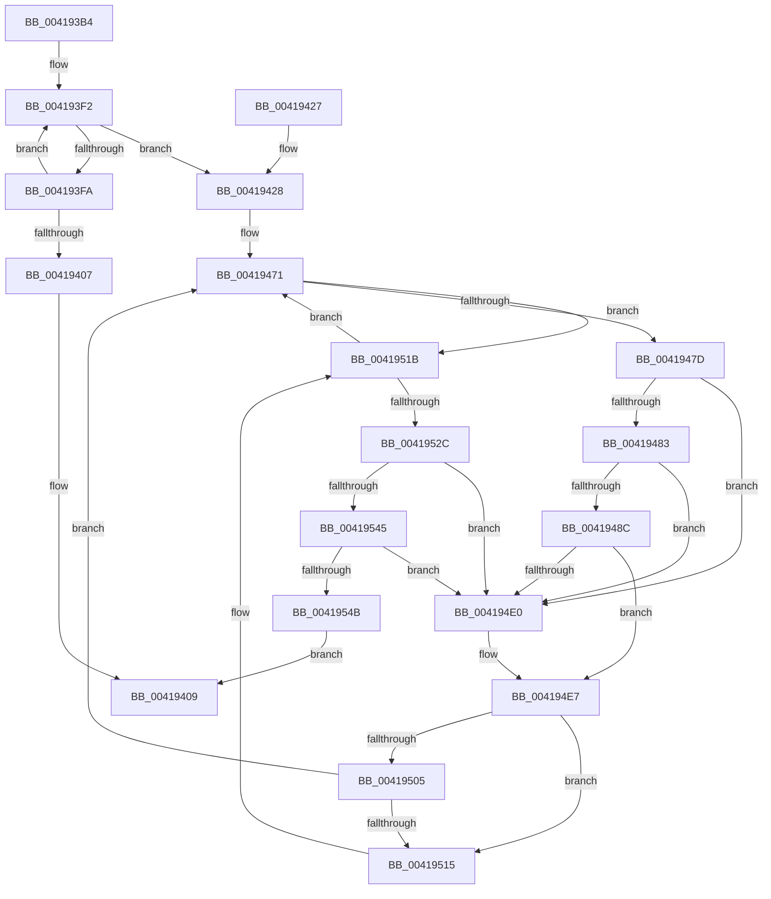

# MiConsumeSystemCacheTbFlushNeededView

- RVA: `0x004193B4`–`0x0041958A` (길이 `470` bytes)
- VA: `0x00000001404193B4`
- 실행 섹션: `.text`
- PDB 이름 있음: `예`; PDB Function 태그: `아니요`
- unwind 정보 RVA: `0x0009D10C`
- 디코드: `124`개 명령, `470/470` bytes 표시
- 미해석 바이트: `0` (있으면 어셈블리에 `.byte`로 보존)

> 이 문서는 커널 이미지의 기계어와 PDB 기호를 분석해 생성했습니다. 4번과 5번은 함수 원형과 자료형을 바이너리 사용 방식에서 추정한 C 해석이며 원본 소스 복구 결과는 아닙니다.

## 1. Dependencies

- 직접 호출 지점: **8**; 고유 호출 대상: **8**
- 직접 호출자로 확인된 함수: **1**
- RIP 상대 이미지 참조: **1**

### Outgoing calls
- `0x0041943D` → [MiGetProcessorFlushList](../24/MiGetProcessorFlushList_function_00242C90.md) (function, `0x00242C90`)
- `0x00419461` → [MiInitializeTbFlushList](../29/MiInitializeTbFlushList_function_00294F00.md) (function, `0x00294F00`)
- `0x00419466` → [MiTbFlushListPromoteThreshold](MiTbFlushListPromoteThreshold_function_004195D0.md) (function, `0x004195D0`)
- `0x004194CE` → [MiInsertTbFlushEntry](../29/MiInsertTbFlushEntry_function_00293670.md) (function, `0x00293670`)
- `0x0041952F` → [MiFlushTbList](../31/MiFlushTbList_function_00311FC0.md) (function, `0x00311FC0`)
- `0x00419562` → [MiInsertReadiedSystemCacheViews](MiInsertReadiedSystemCacheViews_function_00419734.md) (function, `0x00419734`)
- `0x00419567` → [MiReleaseProcessorFlushList](../31/MiReleaseProcessorFlushList_function_00313C70.md) (function, `0x00313C70`)
- `0x0041957D` → [MiRebalanceSystemCacheFreedViews](MiRebalanceSystemCacheFreedViews_function_00419620.md) (function, `0x00419620`)

### Direct callers
- [sub_00238CD1](../23/Unknown_function_00238CD1.md) at `0x00238CED`
- [sub_00238CD1](../23/Unknown_function_00238CD1.md) at `0x00238D3A`

### Static image references
- `0x00419571` → RVA `0x00FCF080` (`CACHEALI`; read)

## 2. Other-region calls and transfers

- 다른 실행 섹션으로 향하는 call: **0**
- 별도 외부 분기/꼬리 이동을 확인하지 못했습니다.

## 3. Assembly (complete function range)

```asm
004193B4  48 8B C4                        mov rax, rsp
004193B7  48 89 58 08                     mov qword ptr [rax + 8], rbx
004193BB  48 89 70 10                     mov qword ptr [rax + 0x10], rsi
004193BF  48 89 78 18                     mov qword ptr [rax + 0x18], rdi
004193C3  4C 89 60 20                     mov qword ptr [rax + 0x20], r12
004193C7  55                              push rbp
004193C8  41 56                           push r14
004193CA  41 57                           push r15
004193CC  48 8B EC                        mov rbp, rsp
004193CF  48 83 EC 50                     sub rsp, 0x50
004193D3  0F 57 C0                        xorps xmm0, xmm0
004193D6  48 8D B9 80 08 00 00            lea rdi, [rcx + 0x880]
004193DD  45 33 C0                        xor r8d, r8d
004193E0  48 8D 47 10                     lea rax, [rdi + 0x10]
004193E4  0F 11 45 E0                     movups xmmword ptr [rbp - 0x20], xmm0
004193E8  45 33 C9                        xor r9d, r9d
004193EB  4C 8B F9                        mov r15, rcx
004193EE  0F 11 45 F0                     movups xmmword ptr [rbp - 0x10], xmm0
004193F2  4C 03 00                        add r8, qword ptr [rax]
004193F5  4C 3B C2                        cmp r8, rdx
004193F8  73 2E                           jae 0x140419428
004193FA  41 FF C1                        inc r9d
004193FD  48 83 C0 20                     add rax, 0x20
00419401  41 83 F9 04                     cmp r9d, 4
00419405  72 EB                           jb 0x1404193f2
00419407  33 C0                           xor eax, eax
00419409  4C 8D 5C 24 50                  lea r11, [rsp + 0x50]
0041940E  49 8B 5B 20                     mov rbx, qword ptr [r11 + 0x20]
00419412  49 8B 73 28                     mov rsi, qword ptr [r11 + 0x28]
00419416  49 8B 7B 30                     mov rdi, qword ptr [r11 + 0x30]
0041941A  4D 8B 63 38                     mov r12, qword ptr [r11 + 0x38]
0041941E  49 8B E3                        mov rsp, r11
00419421  41 5F                           pop r15
00419423  41 5E                           pop r14
00419425  5D                              pop rbp
00419426  C3                              ret
00419427  CC                              int3
00419428  48 83 65 F0 00                  and qword ptr [rbp - 0x10], 0
0041942D  48 8D 45 E0                     lea rax, [rbp - 0x20]
00419431  48 89 45 E8                     mov qword ptr [rbp - 0x18], rax
00419435  48 8D 45 E0                     lea rax, [rbp - 0x20]
00419439  48 89 45 E0                     mov qword ptr [rbp - 0x20], rax
0041943D  E8 4E 98 E2 FF                  call 0x140242c90
00419442  49 8D 97 80 49 00 00            lea rdx, [r15 + 0x4980]
00419449  C7 44 24 20 01 00 00 00         mov dword ptr [rsp + 0x20], 1
00419451  41 B9 08 00 00 00               mov r9d, 8
00419457  48 8B C8                        mov rcx, rax
0041945A  48 8B F0                        mov rsi, rax
0041945D  44 8B 40 0C                     mov r8d, dword ptr [rax + 0xc]
00419461  E8 9A BA E7 FF                  call 0x140294f00
00419466  E8 65 01 00 00                  call 0x1404195d0
0041946B  4C 8B E0                        mov r12, rax
0041946E  45 33 F6                        xor r14d, r14d
00419471  48 8B 1F                        mov rbx, qword ptr [rdi]
00419474  48 3B DF                        cmp rbx, rdi
00419477  0F 84 9E 00 00 00               je 0x14041951b
0041947D  48 39 7B 08                     cmp qword ptr [rbx + 8], rdi
00419481  75 5D                           jne 0x1404194e0
00419483  48 8B 03                        mov rax, qword ptr [rbx]
00419486  48 39 58 08                     cmp qword ptr [rax + 8], rbx
0041948A  75 54                           jne 0x1404194e0
0041948C  48 89 07                        mov qword ptr [rdi], rax
0041948F  48 B9 FF FF FF FF FF FF FF 3F   movabs rcx, 0x3fffffffffffffff
00419499  48 89 78 08                     mov qword ptr [rax + 8], rdi
0041949D  45 33 C9                        xor r9d, r9d
004194A0  48 FF 4F 10                     dec qword ptr [rdi + 0x10]
004194A4  48 8B 43 20                     mov rax, qword ptr [rbx + 0x20]
004194A8  48 23 C1                        and rax, rcx
004194AB  48 B9 00 00 00 00 00 00 00 80   movabs rcx, 0x8000000000000000
004194B5  48 0B C1                        or rax, rcx
004194B8  45 8D 41 40                     lea r8d, [r9 + 0x40]
004194BC  48 89 43 20                     mov qword ptr [rbx + 0x20], rax
004194C0  48 8B CE                        mov rcx, rsi
004194C3  48 8B 53 10                     mov rdx, qword ptr [rbx + 0x10]
004194C7  48 81 E2 00 F0 FF FF            and rdx, 0xfffffffffffff000
004194CE  E8 9D A1 E7 FF                  call 0x140293670
004194D3  48 8B 45 E8                     mov rax, qword ptr [rbp - 0x18]
004194D7  48 8D 4D E0                     lea rcx, [rbp - 0x20]
004194DB  48 39 08                        cmp qword ptr [rax], rcx
004194DE  74 07                           je 0x1404194e7
004194E0  B9 03 00 00 00                  mov ecx, 3
004194E5  CD 29                           int 0x29
004194E7  48 89 43 08                     mov qword ptr [rbx + 8], rax
004194EB  48 8D 4D E0                     lea rcx, [rbp - 0x20]
004194EF  48 89 0B                        mov qword ptr [rbx], rcx
004194F2  48 89 18                        mov qword ptr [rax], rbx
004194F5  48 FF 45 F0                     inc qword ptr [rbp - 0x10]
004194F9  48 89 5D E8                     mov qword ptr [rbp - 0x18], rbx
004194FD  8B 46 0C                        mov eax, dword ptr [rsi + 0xc]
00419500  39 46 1C                        cmp dword ptr [rsi + 0x1c], eax
00419503  74 10                           je 0x140419515
00419505  48 8B 46 20                     mov rax, qword ptr [rsi + 0x20]
00419509  48 FF C0                        inc rax
0041950C  49 3B C4                        cmp rax, r12
0041950F  0F 82 5C FF FF FF               jb 0x140419471
00419515  41 BE 03 00 00 00               mov r14d, 3
0041951B  41 FF C6                        inc r14d
0041951E  48 83 C7 20                     add rdi, 0x20
00419522  41 83 FE 04                     cmp r14d, 4
00419526  0F 82 45 FF FF FF               jb 0x140419471
0041952C  48 8B CE                        mov rcx, rsi
0041952F  E8 8C 8A EF FF                  call 0x140311fc0
00419534  48 8B 5D E0                     mov rbx, qword ptr [rbp - 0x20]
00419538  48 8D 4D E0                     lea rcx, [rbp - 0x20]
0041953C  48 8B 03                        mov rax, qword ptr [rbx]
0041953F  48 39 4B 08                     cmp qword ptr [rbx + 8], rcx
00419543  75 9B                           jne 0x1404194e0
00419545  48 39 58 08                     cmp qword ptr [rax + 8], rbx
00419549  75 95                           jne 0x1404194e0
0041954B  48 8D 4D E0                     lea rcx, [rbp - 0x20]
0041954F  48 89 45 E0                     mov qword ptr [rbp - 0x20], rax
00419553  48 89 48 08                     mov qword ptr [rax + 8], rcx
00419557  48 8D 55 E0                     lea rdx, [rbp - 0x20]
0041955B  48 FF 4D F0                     dec qword ptr [rbp - 0x10]
0041955F  49 8B CF                        mov rcx, r15
00419562  E8 CD 01 00 00                  call 0x140419734
00419567  E8 04 A7 EF FF                  call 0x140313c70
0041956C  F0 83 0C 24 00                  lock or dword ptr [rsp], 0
00419571  8B 15 09 5B BB 00               mov edx, dword ptr [rip + 0xbb5b09]
00419577  45 33 C0                        xor r8d, r8d
0041957A  49 8B CF                        mov rcx, r15
0041957D  E8 9E 00 00 00                  call 0x140419620
00419582  48 8B C3                        mov rax, rbx
00419585  E9 7F FE FF FF                  jmp 0x140419409
```

## 4. C-style interpretation (structured pseudocode)

```c
__int64 __fastcall MiConsumeSystemCacheTbFlushNeededView(__int64 a1, __int64 a2, int a3, int a4)
{
    __int64 result;
    __int64 v_r14;
    __int64 v_rdi;
    __int64 v_rsp;
    unsigned __int64 v_stack_m18;
    unsigned __int64 v_stack_m28;
    unsigned __int64 v_stack_m30;
    unsigned __int64 v_stack_m38;
    unsigned int v_stack_m50;

    *(unsigned __int64 *)(v_rsp + 8) = v_rbx;
    *(unsigned __int64 *)(v_rsp + 16) = v_rsi;
    *(unsigned __int64 *)(v_rsp + 24) = v_rdi;
    *(unsigned __int64 *)(v_rsp + 32) = v_r12;
    v_rsp = (v_rsp) - (80);
    a3 = 0;
    v_stack_m38 = v_xmm0;
    a4 = 0;
    v_stack_m28 = v_xmm0;
loc_004193F2:
    a3 = (a3) + (*(unsigned __int64 *)(a1 + 2176 + 16));
    if (a3 >= a2) goto loc_00419428;
    a4 = (unsigned int)((a4) + 1);
    result = (a1 + 2176 + 16) + (32);
    if (a4 < 4) goto loc_004193F2;
    result = 0;
loc_00419409:
    return result;
loc_00419428:
    v_stack_m30 = v_stack_m38;
    v_stack_m38 = v_stack_m38;
    result = MiGetProcessorFlushList(a1, a2, a3, a4);
    v_stack_m30 = 1;
    result = MiInitializeTbFlushList(result, a1 + 18816, (unsigned int)(*(unsigned int *)(result + 12)), 8);
    result = MiTbFlushListPromoteThreshold(result, a1 + 18816, (unsigned int)(*(unsigned int *)(result + 12)), 8);
    v_r14 = 0;
loc_00419471:
    if ((*(unsigned __int64 *)(*(unsigned __int64 *)(v_stack_m18 + 48))) == (*(unsigned __int64 *)(v_stack_m18 + 48))) goto loc_0041951B;
    if ((*(unsigned __int64 *)(*(unsigned __int64 *)(*(unsigned __int64 *)(v_stack_m18 + 48)) + 8)) != (*(unsigned __int64 *)(v_stack_m18 + 48))) goto loc_004194E0;
    if ((*(unsigned __int64 *)(*(unsigned __int64 *)(*(unsigned __int64 *)(*(unsigned __int64 *)(v_stack_m18 + 48))) + 8)) != (*(unsigned __int64 *)(*(unsigned __int64 *)(v_stack_m18 + 48)))) goto loc_004194E0;
    *(unsigned __int64 *)(*(unsigned __int64 *)(v_stack_m18 + 48)) = *(unsigned __int64 *)(*(unsigned __int64 *)(*(unsigned __int64 *)(v_stack_m18 + 48)));
    *(unsigned __int64 *)(*(unsigned __int64 *)(*(unsigned __int64 *)(*(unsigned __int64 *)(v_stack_m18 + 48))) + 8) = *(unsigned __int64 *)(v_stack_m18 + 48);
    a4 = 0;
    result = (*(unsigned __int64 *)(*(unsigned __int64 *)(*(unsigned __int64 *)(v_stack_m18 + 48)) + 32)) & (result);
    result = (result) | (result);
    *(unsigned __int64 *)(*(unsigned __int64 *)(*(unsigned __int64 *)(v_stack_m18 + 48)) + 32) = result;
    a2 = (*(unsigned __int64 *)(*(unsigned __int64 *)(*(unsigned __int64 *)(v_stack_m18 + 48)) + 16)) & (0xFFFFFFFFFFFFF000ULL);
    result = MiInsertTbFlushEntry(result, a2, a4 + 64, a4);
    if ((*(unsigned __int64 *)(v_stack_m30)) != v_stack_m38) {
        a1 = 3;
    }
    *(unsigned __int64 *)(*(unsigned __int64 *)(*(unsigned __int64 *)(v_stack_m18 + 48)) + 8) = v_stack_m30;
    *(unsigned __int64 *)(*(unsigned __int64 *)(*(unsigned __int64 *)(v_stack_m18 + 48))) = v_stack_m38;
    *(unsigned __int64 *)(v_stack_m30) = *(unsigned __int64 *)(*(unsigned __int64 *)(v_stack_m18 + 48));
    v_stack_m30 = *(unsigned __int64 *)(*(unsigned __int64 *)(v_stack_m18 + 48));
    if ((*(unsigned int *)(result + 28)) == ((unsigned int)((unsigned int)(*(unsigned int *)(result + 12))))) goto loc_00419515;
    result = (*(unsigned __int64 *)(result + 32)) + 1;
    if (result < result) goto loc_00419471;
loc_00419515:
loc_0041951B:
    v_r14 = (unsigned int)((3) + 1);
    v_rdi = (*(unsigned __int64 *)(v_stack_m18 + 48)) + (32);
    if (((unsigned int)(v_r14)) < 4) goto loc_00419471;
    result = MiFlushTbList(result, a2, a4 + 64, a4);
    if ((*(unsigned __int64 *)(v_stack_m38 + 8)) != v_stack_m38) goto loc_004194E0;
    if ((*(unsigned __int64 *)(*(unsigned __int64 *)(v_stack_m38) + 8)) != v_stack_m38) goto loc_004194E0;
    v_stack_m38 = *(unsigned __int64 *)(v_stack_m38);
    *(unsigned __int64 *)(*(unsigned __int64 *)(v_stack_m38) + 8) = v_stack_m38;
    result = MiInsertReadiedSystemCacheViews(a1, v_stack_m38, a4 + 64, a4);
    result = MiReleaseProcessorFlushList(a1, v_stack_m38, a4 + 64, a4);
    a3 = 0;
    result = MiRebalanceSystemCacheFreedViews(a1, (unsigned int)(*(unsigned int *)(v_rip + 12278537)), a3, a4);
    goto loc_00419409;
}
```

## 5. (Beta) C Style

```c
int64_t MiConsumeSystemCacheTbFlushNeededView(void *Arg1, int64_t Arg2, int32_t Arg3, int32_t Arg4)
{
    uint8_t *arg1 = (uint8_t *)Arg1;

    int64_t result;
    int64_t local_r14;
    int64_t local_rdi;
    int64_t local_rsp;
    uint64_t v_stack_m18;
    uint64_t v_stack_m28;
    uint64_t v_stack_m30;
    uint64_t v_stack_m38;
    uint32_t v_stack_m50;

    *(uint64_t *)(local_rsp + 0x8) = local_rbx;
    *(uint64_t *)(local_rsp + 0x10) = local_rsi;
    *(uint64_t *)(local_rsp + 0x18) = local_rdi;
    *(uint64_t *)(local_rsp + 0x20) = local_r12;
    local_rsp = (local_rsp) - (80);
    Arg3 = 0;
    v_stack_m38 = v_xmm0;
    Arg4 = 0;
    v_stack_m28 = v_xmm0;
loc_004193F2:
    Arg3 = (Arg3) + (*(uint64_t *)(arg1 + 0x880 + 0x10));
    if (Arg3 >= Arg2) goto loc_00419428;
    Arg4 = (uint32_t)((Arg4) + 1);
    result = (Arg1 + 2176 + 16) + (32);
    if (Arg4 < 4) goto loc_004193F2;
    result = 0;
loc_00419409:
    return result;
loc_00419428:
    v_stack_m30 = v_stack_m38;
    v_stack_m38 = v_stack_m38;
    result = MiGetProcessorFlushList(Arg1, Arg2, Arg3, Arg4);
    v_stack_m30 = 1;
    result = MiInitializeTbFlushList(result, Arg1 + 18816, (uint32_t)(*(uint32_t *)(result + 0xC)), 8);
    result = MiTbFlushListPromoteThreshold(result, Arg1 + 18816, (uint32_t)(*(uint32_t *)(result + 0xC)), 8);
    local_r14 = 0;
loc_00419471:
    if ((*(uint64_t *)(*(uint64_t *)(v_stack_m18 + 0x30))) == (*(uint64_t *)(v_stack_m18 + 0x30))) goto loc_0041951B;
    if ((*(uint64_t *)(*(uint64_t *)(*(uint64_t *)(v_stack_m18 + 0x30)) + 0x8)) != (*(uint64_t *)(v_stack_m18 + 0x30))) goto loc_004194E0;
    if ((*(uint64_t *)(*(uint64_t *)(*(uint64_t *)(*(uint64_t *)(v_stack_m18 + 0x30))) + 0x8)) != (*(uint64_t *)(*(uint64_t *)(v_stack_m18 + 0x30)))) goto loc_004194E0;
    *(uint64_t *)(*(uint64_t *)(v_stack_m18 + 0x30)) = *(uint64_t *)(*(uint64_t *)(*(uint64_t *)(v_stack_m18 + 0x30)));
    *(uint64_t *)(*(uint64_t *)(*(uint64_t *)(*(uint64_t *)(v_stack_m18 + 0x30))) + 0x8) = *(uint64_t *)(v_stack_m18 + 0x30);
    Arg4 = 0;
    result = (*(uint64_t *)(*(uint64_t *)(*(uint64_t *)(v_stack_m18 + 0x30)) + 0x20)) & (result);
    result = (result) | (result);
    *(uint64_t *)(*(uint64_t *)(*(uint64_t *)(v_stack_m18 + 0x30)) + 0x20) = result;
    Arg2 = (*(uint64_t *)(*(uint64_t *)(*(uint64_t *)(v_stack_m18 + 0x30)) + 0x10)) & (0xFFFFFFFFFFFFF000ULL);
    result = MiInsertTbFlushEntry(result, Arg2, Arg4 + 64, Arg4);
    if ((*(uint64_t *)(v_stack_m30)) != v_stack_m38) {
        Arg1 = 3;
    }
    *(uint64_t *)(*(uint64_t *)(*(uint64_t *)(v_stack_m18 + 0x30)) + 0x8) = v_stack_m30;
    *(uint64_t *)(*(uint64_t *)(*(uint64_t *)(v_stack_m18 + 0x30))) = v_stack_m38;
    *(uint64_t *)(v_stack_m30) = *(uint64_t *)(*(uint64_t *)(v_stack_m18 + 0x30));
    v_stack_m30 = *(uint64_t *)(*(uint64_t *)(v_stack_m18 + 0x30));
    if ((*(uint32_t *)(result + 0x1C)) == ((uint32_t)((uint32_t)(*(uint32_t *)(result + 0xC))))) goto loc_00419515;
    result = (*(uint64_t *)(result + 0x20)) + 1;
    if (result < result) goto loc_00419471;
loc_00419515:
loc_0041951B:
    local_r14 = (uint32_t)((3) + 1);
    local_rdi = (*(uint64_t *)(v_stack_m18 + 0x30)) + (32);
    if (((uint32_t)(local_r14)) < 4) goto loc_00419471;
    result = MiFlushTbList(result, Arg2, Arg4 + 64, Arg4);
    if ((*(uint64_t *)(v_stack_m38 + 0x8)) != v_stack_m38) goto loc_004194E0;
    if ((*(uint64_t *)(*(uint64_t *)(v_stack_m38) + 0x8)) != v_stack_m38) goto loc_004194E0;
    v_stack_m38 = *(uint64_t *)(v_stack_m38);
    *(uint64_t *)(*(uint64_t *)(v_stack_m38) + 0x8) = v_stack_m38;
    result = MiInsertReadiedSystemCacheViews(Arg1, v_stack_m38, Arg4 + 64, Arg4);
    result = MiReleaseProcessorFlushList(Arg1, v_stack_m38, Arg4 + 64, Arg4);
    Arg3 = 0;
    result = MiRebalanceSystemCacheFreedViews(Arg1, (uint32_t)(*(uint32_t *)(v_rip + 0xBB5B09)), Arg3, Arg4);
    goto loc_00419409;
}
```

### 관측된 메모리 오프셋

구조체 형식이 확인되지 않은 접근은 인자 기준의 오프셋으로만 기록했습니다.

| 기준 인자 | 오프셋 표현 | 폭 (bit) | 접근 |
|---|---:|---:|---|
| `Arg1` | `+ 0x0` | `64` | `R` |
| `Arg1` | `+ 0x0` | `64` | `W` |
| `Arg1` | `+ 0x10` | `64` | `R` |
| `Arg1` | `+ 0x10` | `64` | `R/W` |
| `Arg1` | `+ 0x880` | `64` | `R` |
| `Arg1` | `+ 0x4980` | `64` | `R` |

## 6. Execution-region graph

[열기: 2D/3D 그래프와 함수 탐색 컨트롤 패널](../../../control-panel.html?section=text&rva=0x004193B4&view=graph)

- 2D 그래프는 위에서 아래로 흐르고, 3D 그래프는 빈 공간을 드래그해 회전합니다. Shift+드래그는 이동, 휠은 확대·축소, 함수 노드 선택은 대상 보고서 이동입니다.

### Static fallback


