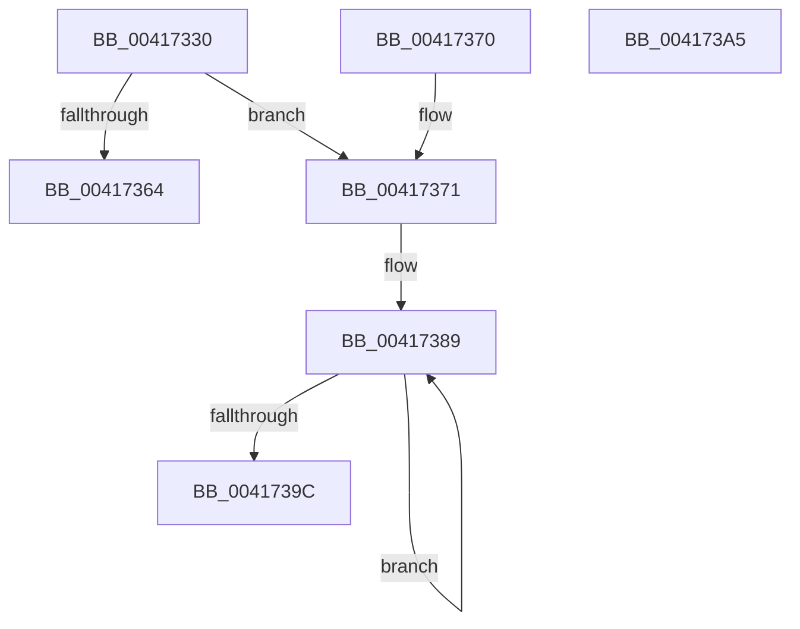

# MiDecommitComputeCheckPte

- RVA: `0x00417330`–`0x004173A6` (길이 `118` bytes)
- VA: `0x0000000140417330`
- 실행 섹션: `.text`
- PDB 이름 있음: `예`; PDB Function 태그: `아니요`
- unwind 정보 RVA: `0x000DB714`
- 디코드: `31`개 명령, `118/118` bytes 표시
- 미해석 바이트: `0` (있으면 어셈블리에 `.byte`로 보존)

> 이 문서는 커널 이미지의 기계어와 PDB 기호를 분석해 생성했습니다. 4번과 5번은 함수 원형과 자료형을 바이너리 사용 방식에서 추정한 C 해석이며 원본 소스 복구 결과는 아닙니다.

## 1. Dependencies

- 직접 호출 지점: **0**; 고유 호출 대상: **0**
- 직접 호출자로 확인된 함수: **2**
- RIP 상대 이미지 참조: **0**

### Outgoing calls
- 직접 디코드된 call 명령이 없습니다.

### Direct callers
- [MiDecommitInitializePacket](../24/MiDecommitInitializePacket_function_00242F30.md) at `0x002430DF`
- [sub_0024359E](../24/Unknown_function_0024359E.md) at `0x002435C3`

### Static image references
- 디코드된 RIP-relative 메모리 참조가 없습니다.

## 2. Other-region calls and transfers

- 다른 실행 섹션으로 향하는 call: **0**
- 별도 외부 분기/꼬리 이동을 확인하지 못했습니다.

## 3. Assembly (complete function range)

```asm
00417330  4C 8B C2                        mov r8, rdx
00417333  48 89 51 48                     mov qword ptr [rcx + 0x48], rdx
00417337  49 C1 E0 19                     shl r8, 0x19
0041733B  49 BA 00 00 00 00 80 F6 FF FF   movabs r10, 0xfffff68000000000
00417345  49 8B C2                        mov rax, r10
00417348  48 C1 E0 19                     shl rax, 0x19
0041734C  4C 2B C0                        sub r8, rax
0041734F  49 C1 F8 10                     sar r8, 0x10
00417353  4C 89 41 38                     mov qword ptr [rcx + 0x38], r8
00417357  44 8B 81 CC 00 00 00            mov r8d, dword ptr [rcx + 0xcc]
0041735E  41 83 F8 01                     cmp r8d, 1
00417362  76 0D                           jbe 0x140417371
00417364  C7 41 60 00 00 00 00            mov dword ptr [rcx + 0x60], 0
0041736B  48 89 51 58                     mov qword ptr [rcx + 0x58], rdx
0041736F  C3                              ret
00417370  CC                              int3
00417371  B8 02 00 00 00                  mov eax, 2
00417376  49 BB F8 FF FF FF 7F 00 00 00   movabs r11, 0x7ffffffff8
00417380  41 2B C0                        sub eax, r8d
00417383  44 8B C0                        mov r8d, eax
00417386  44 8B C8                        mov r9d, eax
00417389  48 C1 EA 09                     shr rdx, 9
0041738D  49 23 D3                        and rdx, r11
00417390  49 8B C2                        mov rax, r10
00417393  48 03 D0                        add rdx, rax
00417396  49 83 E8 01                     sub r8, 1
0041739A  75 ED                           jne 0x140417389
0041739C  44 89 49 60                     mov dword ptr [rcx + 0x60], r9d
004173A0  48 89 51 58                     mov qword ptr [rcx + 0x58], rdx
004173A4  C3                              ret
004173A5  CC                              int3
```

## 4. C-style interpretation (structured pseudocode)

```c
__int64 __fastcall MiDecommitComputeCheckPte(__int64 a1, __int64 a2)
{
    __int64 result;

    *(unsigned __int64 *)(a1 + 72) = a2;
    a3 = (a2) << (25);
    result = (v_r10) << (25);
    a3 = (a3) - (result);
    a3 = (a3) >> (16);
    *(unsigned __int64 *)(a1 + 56) = a3;
    if (((unsigned int)((unsigned int)(*(unsigned int *)(a1 + 204)))) <= 1) goto loc_00417371;
    *(unsigned int *)(a1 + 96) = 0;
    *(unsigned __int64 *)(a1 + 88) = a2;
    return result;
loc_00417371:
    result = (unsigned int)((2) - ((unsigned int)((unsigned int)(*(unsigned int *)(a1 + 204)))));
loc_00417389:
    a2 = (a2) >> (9);
    a2 = (a2) & (v_r11);
    a2 = (a2) + (v_r10);
    a3 = ((unsigned int)((unsigned int)(result))) - (1);
    if (condition_is_not_equal) goto loc_00417389;
    *(unsigned int *)(a1 + 96) = (unsigned int)((unsigned int)((unsigned int)(result)));
    *(unsigned __int64 *)(a1 + 88) = a2;
    return v_r10;
}
```

## 5. (Beta) C Style

```c
int64_t MiDecommitComputeCheckPte(void *Arg1, int64_t Arg2)
{
    uint8_t *arg1 = (uint8_t *)Arg1;

    int64_t result;

    *(uint64_t *)(arg1 + 0x48) = Arg2;
    a3 = (Arg2) << (25);
    result = (local_r10) << (25);
    a3 = (a3) - (result);
    a3 = (a3) >> (16);
    *(uint64_t *)(arg1 + 0x38) = a3;
    if (((uint32_t)((uint32_t)(*(uint32_t *)(arg1 + 0xCC)))) <= 1) goto loc_00417371;
    *(uint32_t *)(arg1 + 0x60) = 0;
    *(uint64_t *)(arg1 + 0x58) = Arg2;
    return result;
loc_00417371:
    result = (uint32_t)((2) - ((uint32_t)((uint32_t)(*(uint32_t *)(arg1 + 0xCC)))));
loc_00417389:
    Arg2 = (Arg2) >> (9);
    Arg2 = (Arg2) & (local_r11);
    Arg2 = (Arg2) + (local_r10);
    a3 = ((uint32_t)((uint32_t)(result))) - (1);
    if (condition_is_not_equal) goto loc_00417389;
    *(uint32_t *)(arg1 + 0x60) = (uint32_t)((uint32_t)((uint32_t)(result)));
    *(uint64_t *)(arg1 + 0x58) = Arg2;
    return local_r10;
}
```

### 관측된 메모리 오프셋

구조체 형식이 확인되지 않은 접근은 인자 기준의 오프셋으로만 기록했습니다.

| 기준 인자 | 오프셋 표현 | 폭 (bit) | 접근 |
|---|---:|---:|---|
| `Arg1` | `+ 0x38` | `64` | `W` |
| `Arg1` | `+ 0x48` | `64` | `W` |
| `Arg1` | `+ 0x58` | `64` | `W` |
| `Arg1` | `+ 0x60` | `32` | `W` |
| `Arg1` | `+ 0xCC` | `32` | `R` |

## 6. Execution-region graph

[열기: 2D/3D 그래프와 함수 탐색 컨트롤 패널](../../../control-panel.html?section=text&rva=0x00417330&view=graph)

- 2D 그래프는 위에서 아래로 흐르고, 3D 그래프는 빈 공간을 드래그해 회전합니다. Shift+드래그는 이동, 휠은 확대·축소, 함수 노드 선택은 대상 보고서 이동입니다.

### Static fallback


