# MiDecommitFreePagesTail

- RVA: `0x0041ECE0`–`0x0041F0E4` (길이 `1,028` bytes)
- VA: `0x000000014041ECE0`
- 실행 섹션: `.text`
- PDB 이름 있음: `예`; PDB Function 태그: `예`
- unwind 정보 RVA: `0x0009FDB0`
- 디코드: `230`개 명령, `1,028/1,028` bytes 표시
- 미해석 바이트: `0` (있으면 어셈블리에 `.byte`로 보존)

> 이 문서는 커널 이미지의 기계어와 PDB 기호를 분석해 생성했습니다. 4번과 5번은 함수 원형과 자료형을 바이너리 사용 방식에서 추정한 C 해석이며 원본 소스 복구 결과는 아닙니다.

## 1. Dependencies

- 직접 호출 지점: **13**; 고유 호출 대상: **12**
- 직접 호출자로 확인된 함수: **1**
- RIP 상대 이미지 참조: **3**

### Outgoing calls
- `0x0041EE26` → [MiGetContainingPageTable](../34/MiGetContainingPageTable_function_003467F0.md) (function, `0x003467F0`)
- `0x0041EE37` → [MiDecommitSharedPageTail](../37/MiDecommitSharedPageTail_function_00370240.md) (function, `0x00370240`)
- `0x0041EEA1` → [MiReduceShareCount](../37/MiReduceShareCount_function_00370E90.md) (function, `0x00370E90`)
- `0x0041EEEC` → [MiDecommitPrivatePageTail](../36/MiDecommitPrivatePageTail_function_0036F564.md) (function, `0x0036F564`)
- `0x0041EF76` → [MiDecommitPagesCoalesce](MiDecommitPagesCoalesce_function_0041F0F0.md) (function, `0x0041F0F0`)
- `0x0041EF8F` → [MiDeleteClusterPage](../34/MiDeleteClusterPage_function_00346CB0.md) (function, `0x00346CB0`)
- `0x0041EFEB` → [MiIsPfnLocked](MiIsPfnLocked_function_0041F354.md) (function, `0x0041F354`)
- `0x0041F00A` → [MiDoubleUnlockMdlPage](MiDoubleUnlockMdlPage_function_0041F43C.md) (function, `0x0041F43C`)
- `0x0041F014` → [MiGetContainingPageTable](../34/MiGetContainingPageTable_function_003467F0.md) (function, `0x003467F0`)
- `0x0041F03C` → [KiCheckVpBackingLongSpinWaitHypercall](../30/KiCheckVpBackingLongSpinWaitHypercall_function_0030F490.md) (function, `0x0030F490`)
- `0x0041F04B` → [HvlNotifyLongSpinWait](../30/HvlNotifyLongSpinWait_function_0030F460.md) (function, `0x0030F460`)
- `0x0041F09D` → [MiShowBadMapper](../2F/MiShowBadMapper_function_002F1840.md) (function, `0x002F1840`)
- `0x0041F0B3` → [MiDereferenceIoPages](../2A/MiDereferenceIoPages_function_002AB1B0.md) (function, `0x002AB1B0`)

### Direct callers
- [MiDecommitPagesTail](../27/MiDecommitPagesTail_function_002790FC.md) at `0x00279165`

### Static image references
- `0x0041EDCA` → RVA `0x00E2DCE0` (`.data`; read)
- `0x0041EF2D` → RVA `0x00FC52AC` (`ALMOSTRO`; reference)
- `0x0041F02E` → RVA `0x00FC6AB8` (`ALMOSTRO`; read)

## 2. Other-region calls and transfers

- 다른 실행 섹션으로 향하는 call: **0**
- call이 아닌 외부 분기/꼬리 이동: **1**
  - `0x0041F0DF` → [sub_006ED93C](../6E/Unknown_function_006ED93C.md) (`tail-transfer`)

## 3. Assembly (complete function range)

```asm
0041ECE0  40 53                           push rbx
0041ECE2  55                              push rbp
0041ECE3  56                              push rsi
0041ECE4  57                              push rdi
0041ECE5  41 54                           push r12
0041ECE7  41 55                           push r13
0041ECE9  41 56                           push r14
0041ECEB  41 57                           push r15
0041ECED  48 83 EC 48                     sub rsp, 0x48
0041ECF1  4C 8B 49 10                     mov r9, qword ptr [rcx + 0x10]
0041ECF5  45 33 FF                        xor r15d, r15d
0041ECF8  44 8B 99 A0 00 00 00            mov r11d, dword ptr [rcx + 0xa0]
0041ECFF  48 B8 F8 FF FF FF 7F 00 00 00   movabs rax, 0x7ffffffff8
0041ED09  48 83 4C 24 28 FF               or qword ptr [rsp + 0x28], 0xffffffffffffffff
0041ED0F  4C 8B E9                        mov r13, rcx
0041ED12  33 FF                           xor edi, edi
0041ED14  44 89 BC 24 90 00 00 00         mov dword ptr [rsp + 0x90], r15d
0041ED1C  4D 8B A1 60 40 00 00            mov r12, qword ptr [r9 + 0x4060]
0041ED23  49 C1 EC 09                     shr r12, 9
0041ED27  4C 23 E0                        and r12, rax
0041ED2A  44 89 9C 24 98 00 00 00         mov dword ptr [rsp + 0x98], r11d
0041ED32  4C 89 4C 24 30                  mov qword ptr [rsp + 0x30], r9
0041ED37  48 BE 00 00 00 00 80 F6 FF FF   movabs rsi, 0xfffff68000000000
0041ED41  48 8B C6                        mov rax, rsi
0041ED44  4C 03 E0                        add r12, rax
0041ED47  33 ED                           xor ebp, ebp
0041ED49  49 81 E4 00 F0 FF FF            and r12, 0xfffffffffffff000
0041ED50  41 39 B9 68 40 00 00            cmp dword ptr [r9 + 0x4068], edi
0041ED57  0F 86 58 01 00 00               jbe 0x14041eeb5
0041ED5D  4C 8B C6                        mov r8, rsi
0041ED60  49 C1 E0 19                     shl r8, 0x19
0041ED64  48 BA FF FF FF FF FF 00 00 00   movabs rdx, 0xffffffffff
0041ED6E  4C 89 44 24 38                  mov qword ptr [rsp + 0x38], r8
0041ED73  41 0F B7 84 E9 72 40 00 00      movzx eax, word ptr [r9 + rbp*8 + 0x4072]
0041ED7C  49 8B 9C E9 60 30 00 00         mov rbx, qword ptr [r9 + rbp*8 + 0x3060]
0041ED84  4C 8B F3                        mov r14, rbx
0041ED87  49 C1 EE 0C                     shr r14, 0xc
0041ED8B  4D 8D 14 C4                     lea r10, [r12 + rax*8]
0041ED8F  4C 23 F2                        and r14, rdx
0041ED92  49 8B CA                        mov rcx, r10
0041ED95  4C 89 54 24 20                  mov qword ptr [rsp + 0x20], r10
0041ED9A  48 C1 E1 19                     shl rcx, 0x19
0041ED9E  33 D2                           xor edx, edx
0041EDA0  49 2B C8                        sub rcx, r8
0041EDA3  48 C1 F9 10                     sar rcx, 0x10
0041EDA7  48 8B C6                        mov rax, rsi
0041EDAA  48 3B C8                        cmp rcx, rax
0041EDAD  0F 83 0E 02 00 00               jae 0x14041efc1
0041EDB3  45 33 C0                        xor r8d, r8d
0041EDB6  41 F6 C3 60                     test r11b, 0x60
0041EDBA  0F 85 36 01 00 00               jne 0x14041eef6
0041EDC0  41 F6 C3 08                     test r11b, 8
0041EDC4  0F 85 8B 02 00 00               jne 0x14041f055
0041EDCA  4C 3B 35 0F EF A0 00            cmp r14, qword ptr [rip + 0xa0ef0f]
0041EDD1  0F 87 B6 02 00 00               ja 0x14041f08d
0041EDD7  4B 8D 0C 76                     lea rcx, [r14 + r14*2]
0041EDDB  48 B8 28 00 00 00 00 DE FF FF   movabs rax, 0xffffde0000000028
0041EDE5  48 03 C9                        add rcx, rcx
0041EDE8  48 8B C0                        mov rax, rax
0041EDEB  48 8B 04 C8                     mov rax, qword ptr [rax + rcx*8]
0041EDEF  48 C1 E8 36                     shr rax, 0x36
0041EDF3  0F BA E0 00                     bt eax, 0
0041EDF7  0F 83 90 02 00 00               jae 0x14041f08d
0041EDFD  48 B8 00 00 00 00 00 DE FF FF   movabs rax, 0xffffde0000000000
0041EE07  48 8B C0                        mov rax, rax
0041EE0A  48 8D 34 C8                     lea rsi, [rax + rcx*8]
0041EE0E  85 D2                           test edx, edx
0041EE10  0F 85 C9 01 00 00               jne 0x14041efdf
0041EE16  48 8B 46 28                     mov rax, qword ptr [rsi + 0x28]
0041EE1A  48 85 C0                        test rax, rax
0041EE1D  0F 89 A4 00 00 00               jns 0x14041eec7
0041EE23  49 8B CA                        mov rcx, r10
0041EE26  E8 C5 79 F2 FF                  call 0x1403467f0
0041EE2B  4C 8B C3                        mov r8, rbx
0041EE2E  49 8B D2                        mov rdx, r10
0041EE31  49 8B CD                        mov rcx, r13
0041EE34  48 8B F0                        mov rsi, rax
0041EE37  E8 04 14 F5 FF                  call 0x140370240
0041EE3C  48 3B 74 24 28                  cmp rsi, qword ptr [rsp + 0x28]
0041EE41  0F 85 B9 00 00 00               jne 0x14041ef00
0041EE47  41 FF C7                        inc r15d
0041EE4A  44 89 BC 24 90 00 00 00         mov dword ptr [rsp + 0x90], r15d
0041EE52  4C 8B 4C 24 30                  mov r9, qword ptr [rsp + 0x30]
0041EE57  FF C5                           inc ebp
0041EE59  44 8B 9C 24 98 00 00 00         mov r11d, dword ptr [rsp + 0x98]
0041EE61  48 BA FF FF FF FF FF 00 00 00   movabs rdx, 0xffffffffff
0041EE6B  4C 8B 44 24 38                  mov r8, qword ptr [rsp + 0x38]
0041EE70  48 BE 00 00 00 00 80 F6 FF FF   movabs rsi, 0xfffff68000000000
0041EE7A  41 3B A9 68 40 00 00            cmp ebp, dword ptr [r9 + 0x4068]
0041EE81  0F 82 EC FE FF FF               jb 0x14041ed73
0041EE87  45 85 FF                        test r15d, r15d
0041EE8A  74 29                           je 0x14041eeb5
0041EE8C  33 DB                           xor ebx, ebx
0041EE8E  F0 48 0F BA 6F 18 3F            lock bts qword ptr [rdi + 0x18], 0x3f
0041EE95  0F 82 90 00 00 00               jb 0x14041ef2b
0041EE9B  41 8B D7                        mov edx, r15d
0041EE9E  48 8B CF                        mov rcx, rdi
0041EEA1  E8 EA 1F F5 FF                  call 0x140370e90
0041EEA6  48 B8 FF FF FF FF FF FF FF 7F   movabs rax, 0x7fffffffffffffff
0041EEB0  F0 48 21 47 18                  lock and qword ptr [rdi + 0x18], rax
0041EEB5  48 83 C4 48                     add rsp, 0x48
0041EEB9  41 5F                           pop r15
0041EEBB  41 5E                           pop r14
0041EEBD  41 5D                           pop r13
0041EEBF  41 5C                           pop r12
0041EEC1  5F                              pop rdi
0041EEC2  5E                              pop rsi
0041EEC3  5D                              pop rbp
0041EEC4  5B                              pop rbx
0041EEC5  C3                              ret
0041EEC6  CC                              int3
0041EEC7  48 8B 76 28                     mov rsi, qword ptr [rsi + 0x28]
0041EECB  48 B8 FF FF FF FF FF 00 00 00   movabs rax, 0xffffffffff
0041EED5  48 23 F0                        and rsi, rax
0041EED8  41 8B 85 9C 00 00 00            mov eax, dword ptr [r13 + 0x9c]
0041EEDF  A8 20                           test al, 0x20
0041EEE1  75 67                           jne 0x14041ef4a
0041EEE3  4C 8B C3                        mov r8, rbx
0041EEE6  49 8B D2                        mov rdx, r10
0041EEE9  49 8B CD                        mov rcx, r13
0041EEEC  E8 73 06 F5 FF                  call 0x14036f564
0041EEF1  E9 46 FF FF FF                  jmp 0x14041ee3c
0041EEF6  BA 01 00 00 00                  mov edx, 1
0041EEFB  E9 CA FE FF FF                  jmp 0x14041edca
0041EF00  48 85 FF                        test rdi, rdi
0041EF03  0F 85 CE 01 00 00               jne 0x14041f0d7
0041EF09  48 8D 3C 76                     lea rdi, [rsi + rsi*2]
0041EF0D  48 B8 00 00 00 00 00 DE FF FF   movabs rax, 0xffffde0000000000
0041EF17  48 C1 E7 04                     shl rdi, 4
0041EF1B  48 8B C0                        mov rax, rax
0041EF1E  48 03 F8                        add rdi, rax
0041EF21  48 89 74 24 28                  mov qword ptr [rsp + 0x28], rsi
0041EF26  E9 1C FF FF FF                  jmp 0x14041ee47
0041EF2B  FF C3                           inc ebx
0041EF2D  85 1D 79 63 BA 00               test dword ptr [rip + 0xba6379], ebx
0041EF33  0F 84 F5 00 00 00               je 0x14041f02e
0041EF39  F3 90                           pause
0041EF3B  48 8B 47 18                     mov rax, qword ptr [rdi + 0x18]
0041EF3F  48 85 C0                        test rax, rax
0041EF42  0F 89 46 FF FF FF               jns 0x14041ee8e
0041EF48  EB E1                           jmp 0x14041ef2b
0041EF4A  45 85 C0                        test r8d, r8d
0041EF4D  75 94                           jne 0x14041eee3
0041EF4F  41 F6 C6 0F                     test r14b, 0xf
0041EF53  75 8E                           jne 0x14041eee3
0041EF55  45 39 45 28                     cmp dword ptr [r13 + 0x28], r8d
0041EF59  75 88                           jne 0x14041eee3
0041EF5B  44 8D 7D 10                     lea r15d, [rbp + 0x10]
0041EF5F  45 3B B9 68 40 00 00            cmp r15d, dword ptr [r9 + 0x4068]
0041EF66  0F 87 5E 01 00 00               ja 0x14041f0ca
0041EF6C  49 8B 4D 08                     mov rcx, qword ptr [r13 + 8]
0041EF70  44 8B C5                        mov r8d, ebp
0041EF73  49 8B D1                        mov rdx, r9
0041EF76  E8 75 01 00 00                  call 0x14041f0f0
0041EF7B  85 C0                           test eax, eax
0041EF7D  0F 84 42 01 00 00               je 0x14041f0c5
0041EF83  48 8B 54 24 20                  mov rdx, qword ptr [rsp + 0x20]
0041EF88  4D 8B C6                        mov r8, r14
0041EF8B  49 8B 4D 08                     mov rcx, qword ptr [r13 + 8]
0041EF8F  E8 1C 7D F2 FF                  call 0x140346cb0
0041EF94  85 C0                           test eax, eax
0041EF96  0F 84 29 01 00 00               je 0x14041f0c5
0041EF9C  49 8B 45 20                     mov rax, qword ptr [r13 + 0x20]
0041EFA0  F0 48 83 80 88 FE FF FF F0      lock add qword ptr [rax - 0x178], -0x10
0041EFA9  41 3B EF                        cmp ebp, r15d
0041EFAC  0F 82 0B 01 00 00               jb 0x14041f0bd
0041EFB2  44 8B BC 24 90 00 00 00         mov r15d, dword ptr [rsp + 0x90]
0041EFBA  FF CD                           dec ebp
0041EFBC  E9 91 FE FF FF                  jmp 0x14041ee52
0041EFC1  48 B8 FF FF FF FF FF F6 FF FF   movabs rax, 0xfffff6ffffffffff
0041EFCB  48 3B C8                        cmp rcx, rax
0041EFCE  0F 87 DF FD FF FF               ja 0x14041edb3
0041EFD4  41 B8 01 00 00 00               mov r8d, 1
0041EFDA  E9 EB FD FF FF                  jmp 0x14041edca
0041EFDF  48 85 F6                        test rsi, rsi
0041EFE2  0F 84 BF 00 00 00               je 0x14041f0a7
0041EFE8  48 8B CE                        mov rcx, rsi
0041EFEB  E8 64 03 00 00                  call 0x14041f354
0041EFF0  85 C0                           test eax, eax
0041EFF2  0F 84 9C 00 00 00               je 0x14041f094
0041EFF8  F6 84 24 98 00 00 00 40         test byte ptr [rsp + 0x98], 0x40
0041F000  74 0D                           je 0x14041f00f
0041F002  BA 01 00 00 00                  mov edx, 1
0041F007  48 8B CE                        mov rcx, rsi
0041F00A  E8 2D 04 00 00                  call 0x14041f43c
0041F00F  48 8B 4C 24 20                  mov rcx, qword ptr [rsp + 0x20]
0041F014  E8 D7 77 F2 FF                  call 0x1403467f0
0041F019  48 8B F0                        mov rsi, rax
0041F01C  48 8B 44 24 30                  mov rax, qword ptr [rsp + 0x30]
0041F021  80 A4 E8 71 40 00 00 FE         and byte ptr [rax + rbp*8 + 0x4071], 0xfe
0041F029  E9 0E FE FF FF                  jmp 0x14041ee3c
0041F02E  8B 05 84 7A BA 00               mov eax, dword ptr [rip + 0xba7a84]
0041F034  A8 40                           test al, 0x40
0041F036  0F 84 FD FE FF FF               je 0x14041ef39
0041F03C  E8 4F 04 EF FF                  call 0x14030f490
0041F041  84 C0                           test al, al
0041F043  0F 84 F0 FE FF FF               je 0x14041ef39
0041F049  8B CB                           mov ecx, ebx
0041F04B  E8 10 04 EF FF                  call 0x14030f460
0041F050  E9 E6 FE FF FF                  jmp 0x14041ef3b
0041F055  4C 3B 35 84 EC A0 00            cmp r14, qword ptr [rip + 0xa0ec84]
0041F05C  0F 87 94 FE FF FF               ja 0x14041eef6
0041F062  4B 8D 0C 76                     lea rcx, [r14 + r14*2]
0041F066  48 B8 28 00 00 00 00 DE FF FF   movabs rax, 0xffffde0000000028
0041F070  48 03 C9                        add rcx, rcx
0041F073  48 8B C0                        mov rax, rax
0041F076  48 8B 04 C8                     mov rax, qword ptr [rax + rcx*8]
0041F07A  48 C1 E8 36                     shr rax, 0x36
0041F07E  0F BA E0 00                     bt eax, 0
0041F082  0F 83 6E FE FF FF               jae 0x14041eef6
0041F088  E9 3D FD FF FF                  jmp 0x14041edca
0041F08D  33 F6                           xor esi, esi
0041F08F  E9 7A FD FF FF                  jmp 0x14041ee0e
0041F094  33 D2                           xor edx, edx
0041F096  49 8B CE                        mov rcx, r14
0041F099  44 8D 42 02                     lea r8d, [rdx + 2]
0041F09D  E8 9E 27 ED FF                  call 0x1402f1840
0041F0A2  E9 51 FF FF FF                  jmp 0x14041eff8
0041F0A7  41 B8 01 00 00 00               mov r8d, 1
0041F0AD  49 8B D6                        mov rdx, r14
0041F0B0  41 8B C8                        mov ecx, r8d
0041F0B3  E8 F8 C0 E8 FF                  call 0x1402ab1b0
0041F0B8  E9 52 FF FF FF                  jmp 0x14041f00f
0041F0BD  83 C5 10                        add ebp, 0x10
0041F0C0  E9 ED FE FF FF                  jmp 0x14041efb2
0041F0C5  4C 8B 54 24 20                  mov r10, qword ptr [rsp + 0x20]
0041F0CA  44 8B BC 24 90 00 00 00         mov r15d, dword ptr [rsp + 0x90]
0041F0D2  E9 0C FE FF FF                  jmp 0x14041eee3
0041F0D7  83 A4 24 A0 00 00 00 00         and dword ptr [rsp + 0xa0], 0
0041F0DF  E9 58 E8 2C 00                  jmp 0x1406ed93c
```

## 4. C-style interpretation (structured pseudocode)

```c
__int64 __fastcall MiDecommitFreePagesTail(__int64 a1)
{
    __int64 result;
    __int64 v_r12;
    __int64 v_r14;
    __int64 v_r15;
    __int64 v_rbp;
    __int64 v_rbx;
    __int64 v_rdi;
    __int64 v_rsi;
    __int64 v_rsp;
    unsigned __int64 v_stack_m50;
    unsigned __int64 v_stack_m58;
    unsigned __int64 v_stack_m60;
    unsigned __int64 v_stack_m68;
    unsigned int v_stack_p10;
    unsigned __int64 v_stack_p20;
    unsigned __int64 v_stack_p28;
    unsigned __int64 v_stack_p30;
    unsigned int v_stack_p8;
    unsigned int v_stack_p90;
    unsigned __int8 v_stack_p98;
    unsigned int v_stack_pA0;

    v_rsp = (v_rsp) - (72);
    v_r15 = 0;
    v_rdi = 0;
    v_stack_p8 = 0;
    v_r12 = (*(unsigned __int64 *)(*(unsigned __int64 *)(a1 + 16) + 16480)) >> (9);
    v_r12 = (v_r12) & (result);
    v_stack_p10 = (unsigned int)((unsigned int)(*(unsigned int *)(a1 + 160)));
    v_stack_m58 = *(unsigned __int64 *)(a1 + 16);
    v_r12 = (v_r12) + (v_rsi);
    v_rbp = 0;
    v_r12 = (v_r12) & (0xFFFFFFFFFFFFF000ULL);
    if ((*(unsigned int *)(*(unsigned __int64 *)(a1 + 16) + 16488)) <= 0) goto loc_0041EEB5;
    a3 = (v_rsi) << (25);
    v_stack_m50 = a3;
loc_0041ED73:
    v_r14 = (*(unsigned __int64 *)(*(unsigned __int64 *)(a1 + 16) + v_rbp * 8 + 12384)) >> (12);
    v_r14 = (v_r14) & (a2);
    v_stack_m68 = v_r12 + *(unsigned __int16 *)(*(unsigned __int64 *)(a1 + 16) + v_rbp * 8 + 16498) * 8;
    a1 = (v_r12 + *(unsigned __int16 *)(*(unsigned __int64 *)(a1 + 16) + v_rbp * 8 + 16498) * 8) << (25);
    a2 = 0;
    a1 = (a1) - (a3);
    a1 = (a1) >> (16);
    if (a1 >= v_rsi) goto loc_0041EFC1;
loc_0041EDB3:
    a3 = 0;
    if ((((unsigned __int8)((unsigned int)(*(unsigned int *)(a1 + 160)))) & (96)) != 0) goto loc_0041EEF6;
    if ((((unsigned __int8)((unsigned int)(*(unsigned int *)(a1 + 160)))) & (8)) != 0) goto loc_0041F055;
loc_0041EDCA:
    if (v_r14 > (*(unsigned __int64 *)(v_rip + 10546959))) goto loc_0041F08D;
    a1 = (v_r14 + v_r14 * 2) + (v_r14 + v_r14 * 2);
    result = (*(unsigned __int64 *)(v_rsi + a1 * 8)) >> (54);
    if (condition_is_above_or_equal) goto loc_0041F08D;
loc_0041EE0E:
    if (0 != 0) goto loc_0041EFDF;
    if (!sign_flag) goto loc_0041EEC7;
    result = MiGetContainingPageTable(v_r12 + *(unsigned __int16 *)(*(unsigned __int64 *)(a1 + 16) + v_rbp * 8 + 16498) * 8, a2, a3, *(unsigned __int64 *)(a1 + 16));
    result = MiDecommitSharedPageTail(a1, v_r12 + *(unsigned __int16 *)(*(unsigned __int64 *)(a1 + 16) + v_rbp * 8 + 16498) * 8, *(unsigned __int64 *)(*(unsigned __int64 *)(a1 + 16) + v_rbp * 8 + 12384), *(unsigned __int64 *)(a1 + 16));
loc_0041EE3C:
    if (result != v_stack_m60) goto loc_0041EF00;
loc_0041EE47:
    v_r15 = (unsigned int)((v_r15) + 1);
    v_stack_p8 = (unsigned int)(v_r15);
loc_0041EE52:
    v_rbp = (unsigned int)((v_rbp) + 1);
    if (((unsigned int)(v_rbp)) < (*(unsigned int *)(v_stack_m58 + 16488))) goto loc_0041ED73;
    if ((unsigned int)(v_r15) == 0) goto loc_0041EEB5;
    v_rbx = 0;
loc_0041EE8E:
    if (condition_is_below) goto loc_0041EF2B;
    result = MiReduceShareCount(0, (unsigned int)((unsigned int)(v_r15)), v_stack_m50, v_stack_m58);
loc_0041EEB5:
    v_rsp = (v_rsp) + (72);
    return result;
loc_0041EEC7:
    v_rsi = (*(unsigned __int64 *)(result + 40)) & (result);
    if ((((unsigned __int8)((unsigned int)(*(unsigned int *)(a1 + 156)))) & (32)) != 0) goto loc_0041EF4A;
loc_0041EEE3:
    result = MiDecommitPrivatePageTail(a1, v_r12 + *(unsigned __int16 *)(*(unsigned __int64 *)(a1 + 16) + v_rbp * 8 + 16498) * 8, 0, v_stack_m58);
    goto loc_0041EE3C;
loc_0041EEF6:
    goto loc_0041EDCA;
loc_0041EF00:
    if (0 != 0) goto loc_0041F0D7;
    v_rdi = (v_rsi + v_rsi * 2) << (4);
    v_rdi = (v_rdi) + (result);
    v_stack_p28 = v_rsi;
    goto loc_0041EE47;
loc_0041EF2B:
    v_rbx = (unsigned int)((v_rbx) + 1);
    if (((*(unsigned int *)(v_rip + 12215161)) & ((unsigned int)(v_rbx))) == 0) goto loc_0041F02E;
loc_0041EF39:
loc_0041EF3B:
    if (!sign_flag) goto loc_0041EE8E;
    goto loc_0041EF2B;
loc_0041EF4A:
    if (0 != 0) goto loc_0041EEE3;
    if ((((unsigned __int8)(v_r14)) & (15)) != 0) goto loc_0041EEE3;
    if ((*(unsigned int *)(a1 + 40)) != 0) goto loc_0041EEE3;
    if (((unsigned int)(v_rbp + 16)) > (*(unsigned int *)(v_stack_m58 + 16488))) goto loc_0041F0CA;
    result = MiDecommitPagesCoalesce(*(unsigned __int64 *)(a1 + 8), v_stack_m58, (unsigned int)((unsigned int)(v_rbp)), v_stack_m58);
    if ((unsigned int)(result) == 0) goto loc_0041F0C5;
    result = MiDeleteClusterPage(*(unsigned __int64 *)(a1 + 8), v_stack_p20, v_r14, v_stack_m58);
    if ((unsigned int)(result) == 0) goto loc_0041F0C5;
    if (((unsigned int)(v_rbp)) < ((unsigned int)(v_rbp + 16))) goto loc_0041F0BD;
loc_0041EFB2:
    v_rbp = (unsigned int)((v_rbp) - 1);
    goto loc_0041EE52;
loc_0041EFC1:
    if ((*(unsigned __int64 *)(a1 + 8)) > (*(unsigned __int64 *)(a1 + 32))) goto loc_0041EDB3;
    goto loc_0041EDCA;
loc_0041EFDF:
    if (v_rsi == 0) goto loc_0041F0A7;
    result = MiIsPfnLocked(v_rsi, v_stack_p20, 1, v_stack_m58);
    if ((unsigned int)(result) == 0) goto loc_0041F094;
loc_0041EFF8:
    if (((v_stack_p98) & (64)) != 0) {
        a2 = 1;
        a1 = v_rsi;
        result = MiDoubleUnlockMdlPage(a1, a2, 1, v_stack_m58);
    }
    result = MiGetContainingPageTable(v_stack_p20, a2, 1, v_stack_m58);
    goto loc_0041EE3C;
loc_0041F02E:
    if ((((unsigned __int8)((unsigned int)(*(unsigned int *)(v_rip + 12221060)))) & (64)) == 0) goto loc_0041EF39;
    result = KiCheckVpBackingLongSpinWaitHypercall(v_stack_p20, a2, 1, v_stack_m58);
    if ((unsigned __int8)(result) == 0) goto loc_0041EF39;
    result = HvlNotifyLongSpinWait((unsigned int)((unsigned int)(v_rbx)), a2, 1, v_stack_m58);
    goto loc_0041EF3B;
loc_0041F055:
    if (v_r14 > (*(unsigned __int64 *)(v_rip + 10546308))) goto loc_0041EEF6;
    a1 = (v_r14 + v_r14 * 2) + (v_r14 + v_r14 * 2);
    result = (*(unsigned __int64 *)(result + a1 * 8)) >> (54);
    if (condition_is_above_or_equal) goto loc_0041EEF6;
    goto loc_0041EDCA;
loc_0041F08D:
    v_rsi = 0;
    goto loc_0041EE0E;
loc_0041F094:
    a2 = 0;
    result = MiShowBadMapper(v_r14, a2, a2 + 2, v_stack_m58);
    goto loc_0041EFF8;
loc_0041F0A7:
    result = MiDereferenceIoPages(1, v_r14, 1, v_stack_m58);
    goto loc_0041F00F;
loc_0041F0BD:
    v_rbp = (unsigned int)((v_rbp) + (16));
    goto loc_0041EFB2;
loc_0041F0C5:
loc_0041F0CA:
    goto loc_0041EEE3;
loc_0041F0D7:
}
```

## 5. (Beta) C Style

```c
int64_t MiDecommitFreePagesTail(void *Arg1)
{
    uint8_t *arg1 = (uint8_t *)Arg1;

    int64_t result;
    int64_t local_r12;
    int64_t local_r14;
    int64_t local_r15;
    int64_t local_rbp;
    int64_t local_rbx;
    int64_t local_rdi;
    int64_t local_rsi;
    int64_t local_rsp;
    uint64_t v_stack_m50;
    uint64_t v_stack_m58;
    uint64_t v_stack_m60;
    uint64_t v_stack_m68;
    uint32_t v_stack_p10;
    uint64_t v_stack_p20;
    uint64_t v_stack_p28;
    uint64_t v_stack_p30;
    uint32_t v_stack_p8;
    uint32_t v_stack_p90;
    uint8_t v_stack_p98;
    uint32_t v_stack_pA0;

    local_rsp = (local_rsp) - (72);
    local_r15 = 0;
    local_rdi = 0;
    v_stack_p8 = 0;
    local_r12 = (*(uint64_t *)(*(uint64_t *)(arg1 + 0x10) + 0x4060)) >> (9);
    local_r12 = (local_r12) & (result);
    v_stack_p10 = (uint32_t)((uint32_t)(*(uint32_t *)(arg1 + 0xA0)));
    v_stack_m58 = *(uint64_t *)(arg1 + 0x10);
    local_r12 = (local_r12) + (local_rsi);
    local_rbp = 0;
    local_r12 = (local_r12) & (0xFFFFFFFFFFFFF000ULL);
    if ((*(uint32_t *)(*(uint64_t *)(arg1 + 0x10) + 0x4068)) <= 0) goto loc_0041EEB5;
    a3 = (local_rsi) << (25);
    v_stack_m50 = a3;
loc_0041ED73:
    local_r14 = (*(uint64_t *)(*(uint64_t *)(arg1 + 0x10) + local_rbp * 8 + 0x3060)) >> (12);
    local_r14 = (local_r14) & (a2);
    v_stack_m68 = local_r12 + *(uint16_t *)(*(uint64_t *)(arg1 + 0x10) + local_rbp * 8 + 0x4072) * 8;
    Arg1 = (local_r12 + *(uint16_t *)(*(uint64_t *)(arg1 + 0x10) + local_rbp * 8 + 0x4072) * 8) << (25);
    a2 = 0;
    Arg1 = (Arg1) - (a3);
    Arg1 = (Arg1) >> (16);
    if (Arg1 >= local_rsi) goto loc_0041EFC1;
loc_0041EDB3:
    a3 = 0;
    if ((((uint8_t)((uint32_t)(*(uint32_t *)(arg1 + 0xA0)))) & (96)) != 0) goto loc_0041EEF6;
    if ((((uint8_t)((uint32_t)(*(uint32_t *)(arg1 + 0xA0)))) & (8)) != 0) goto loc_0041F055;
loc_0041EDCA:
    if (local_r14 > (*(uint64_t *)(v_rip + 0xA0EF0F))) goto loc_0041F08D;
    Arg1 = (local_r14 + local_r14 * 2) + (local_r14 + local_r14 * 2);
    result = (*(uint64_t *)(local_rsi + arg1 * 8)) >> (54);
    if (condition_is_above_or_equal) goto loc_0041F08D;
loc_0041EE0E:
    if (0 != 0) goto loc_0041EFDF;
    if (!sign_flag) goto loc_0041EEC7;
    result = MiGetContainingPageTable(local_r12 + *(uint16_t *)(*(uint64_t *)(arg1 + 0x10) + local_rbp * 8 + 0x4072) * 8, a2, a3, *(uint64_t *)(arg1 + 0x10));
    result = MiDecommitSharedPageTail(Arg1, local_r12 + *(uint16_t *)(*(uint64_t *)(arg1 + 0x10) + local_rbp * 8 + 0x4072) * 8, *(uint64_t *)(*(uint64_t *)(arg1 + 0x10) + local_rbp * 8 + 0x3060), *(uint64_t *)(arg1 + 0x10));
loc_0041EE3C:
    if (result != v_stack_m60) goto loc_0041EF00;
loc_0041EE47:
    local_r15 = (uint32_t)((local_r15) + 1);
    v_stack_p8 = (uint32_t)(local_r15);
loc_0041EE52:
    local_rbp = (uint32_t)((local_rbp) + 1);
    if (((uint32_t)(local_rbp)) < (*(uint32_t *)(v_stack_m58 + 0x4068))) goto loc_0041ED73;
    if ((uint32_t)(local_r15) == 0) goto loc_0041EEB5;
    local_rbx = 0;
loc_0041EE8E:
    if (condition_is_below) goto loc_0041EF2B;
    result = MiReduceShareCount(0, (uint32_t)((uint32_t)(local_r15)), v_stack_m50, v_stack_m58);
loc_0041EEB5:
    local_rsp = (local_rsp) + (72);
    return result;
loc_0041EEC7:
    local_rsi = (*(uint64_t *)(result + 0x28)) & (result);
    if ((((uint8_t)((uint32_t)(*(uint32_t *)(arg1 + 0x9C)))) & (32)) != 0) goto loc_0041EF4A;
loc_0041EEE3:
    result = MiDecommitPrivatePageTail(Arg1, local_r12 + *(uint16_t *)(*(uint64_t *)(arg1 + 0x10) + local_rbp * 8 + 0x4072) * 8, 0, v_stack_m58);
    goto loc_0041EE3C;
loc_0041EEF6:
    goto loc_0041EDCA;
loc_0041EF00:
    if (0 != 0) goto loc_0041F0D7;
    local_rdi = (local_rsi + local_rsi * 2) << (4);
    local_rdi = (local_rdi) + (result);
    v_stack_p28 = local_rsi;
    goto loc_0041EE47;
loc_0041EF2B:
    local_rbx = (uint32_t)((local_rbx) + 1);
    if (((*(uint32_t *)(v_rip + 0xBA6379)) & ((uint32_t)(local_rbx))) == 0) goto loc_0041F02E;
loc_0041EF39:
loc_0041EF3B:
    if (!sign_flag) goto loc_0041EE8E;
    goto loc_0041EF2B;
loc_0041EF4A:
    if (0 != 0) goto loc_0041EEE3;
    if ((((uint8_t)(local_r14)) & (15)) != 0) goto loc_0041EEE3;
    if ((*(uint32_t *)(arg1 + 0x28)) != 0) goto loc_0041EEE3;
    if (((uint32_t)(local_rbp + 16)) > (*(uint32_t *)(v_stack_m58 + 0x4068))) goto loc_0041F0CA;
    result = MiDecommitPagesCoalesce(*(uint64_t *)(arg1 + 0x8), v_stack_m58, (uint32_t)((uint32_t)(local_rbp)), v_stack_m58);
    if ((uint32_t)(result) == 0) goto loc_0041F0C5;
    result = MiDeleteClusterPage(*(uint64_t *)(arg1 + 0x8), v_stack_p20, local_r14, v_stack_m58);
    if ((uint32_t)(result) == 0) goto loc_0041F0C5;
    if (((uint32_t)(local_rbp)) < ((uint32_t)(local_rbp + 16))) goto loc_0041F0BD;
loc_0041EFB2:
    local_rbp = (uint32_t)((local_rbp) - 1);
    goto loc_0041EE52;
loc_0041EFC1:
    if ((*(uint64_t *)(arg1 + 0x8)) > (*(uint64_t *)(arg1 + 0x20))) goto loc_0041EDB3;
    goto loc_0041EDCA;
loc_0041EFDF:
    if (local_rsi == 0) goto loc_0041F0A7;
    result = MiIsPfnLocked(local_rsi, v_stack_p20, 1, v_stack_m58);
    if ((uint32_t)(result) == 0) goto loc_0041F094;
loc_0041EFF8:
    if (((v_stack_p98) & (64)) != 0) {
        a2 = 1;
        Arg1 = local_rsi;
        result = MiDoubleUnlockMdlPage(Arg1, a2, 1, v_stack_m58);
    }
    result = MiGetContainingPageTable(v_stack_p20, a2, 1, v_stack_m58);
    goto loc_0041EE3C;
loc_0041F02E:
    if ((((uint8_t)((uint32_t)(*(uint32_t *)(v_rip + 0xBA7A84)))) & (64)) == 0) goto loc_0041EF39;
    result = KiCheckVpBackingLongSpinWaitHypercall(v_stack_p20, a2, 1, v_stack_m58);
    if ((uint8_t)(result) == 0) goto loc_0041EF39;
    result = HvlNotifyLongSpinWait((uint32_t)((uint32_t)(local_rbx)), a2, 1, v_stack_m58);
    goto loc_0041EF3B;
loc_0041F055:
    if (local_r14 > (*(uint64_t *)(v_rip + 0xA0EC84))) goto loc_0041EEF6;
    Arg1 = (local_r14 + local_r14 * 2) + (local_r14 + local_r14 * 2);
    result = (*(uint64_t *)(result + arg1 * 8)) >> (54);
    if (condition_is_above_or_equal) goto loc_0041EEF6;
    goto loc_0041EDCA;
loc_0041F08D:
    local_rsi = 0;
    goto loc_0041EE0E;
loc_0041F094:
    a2 = 0;
    result = MiShowBadMapper(local_r14, a2, a2 + 2, v_stack_m58);
    goto loc_0041EFF8;
loc_0041F0A7:
    result = MiDereferenceIoPages(1, local_r14, 1, v_stack_m58);
    goto loc_0041F00F;
loc_0041F0BD:
    local_rbp = (uint32_t)((local_rbp) + (16));
    goto loc_0041EFB2;
loc_0041F0C5:
loc_0041F0CA:
    goto loc_0041EEE3;
loc_0041F0D7:
}
```

### 관측된 메모리 오프셋

구조체 형식이 확인되지 않은 접근은 인자 기준의 오프셋으로만 기록했습니다.

| 기준 인자 | 오프셋 표현 | 폭 (bit) | 접근 |
|---|---:|---:|---|
| `Arg1` | `+ 0x8` | `64` | `R` |
| `Arg1` | `+ 0x10` | `64` | `R` |
| `Arg1` | `+ 0x20` | `64` | `R` |
| `Arg1` | `+ 0x28` | `32` | `R` |
| `Arg1` | `+ 0x9C` | `32` | `R` |
| `Arg1` | `+ 0xA0` | `32` | `R` |

## 6. Execution-region graph

[열기: 2D/3D 그래프와 함수 탐색 컨트롤 패널](../../../control-panel.html?section=text&rva=0x0041ECE0&view=graph)

- 2D 그래프는 위에서 아래로 흐르고, 3D 그래프는 빈 공간을 드래그해 회전합니다. Shift+드래그는 이동, 휠은 확대·축소, 함수 노드 선택은 대상 보고서 이동입니다.

### Static fallback

```mermaid
flowchart TD
  bb_0041ECE0[BB_0041ECE0]
  bb_0041ED5D[BB_0041ED5D]
  bb_0041ED73[BB_0041ED73]
  bb_0041EDB3[BB_0041EDB3]
  bb_0041EDC0[BB_0041EDC0]
  bb_0041EDCA[BB_0041EDCA]
  bb_0041EDD7[BB_0041EDD7]
  bb_0041EDFD[BB_0041EDFD]
  bb_0041EE0E[BB_0041EE0E]
  bb_0041EE16[BB_0041EE16]
  bb_0041EE23[BB_0041EE23]
  bb_0041EE3C[BB_0041EE3C]
  bb_0041EE47[BB_0041EE47]
  bb_0041EE52[BB_0041EE52]
  bb_0041EE87[BB_0041EE87]
  bb_0041EE8C[BB_0041EE8C]
  bb_0041EE8E[BB_0041EE8E]
  bb_0041EE9B[BB_0041EE9B]
  bb_0041EEB5[BB_0041EEB5]
  bb_0041EEC6[BB_0041EEC6]
  bb_0041EEC7[BB_0041EEC7]
  bb_0041EEE3[BB_0041EEE3]
  bb_0041EEF6[BB_0041EEF6]
  bb_0041EF00[BB_0041EF00]
  bb_0041EF09[BB_0041EF09]
  bb_0041EF2B[BB_0041EF2B]
  bb_0041EF39[BB_0041EF39]
  bb_0041EF3B[BB_0041EF3B]
  bb_0041EF48[BB_0041EF48]
  bb_0041EF4A[BB_0041EF4A]
  bb_0041EF4F[BB_0041EF4F]
  bb_0041EF55[BB_0041EF55]
  bb_0041EF5B[BB_0041EF5B]
  bb_0041EF6C[BB_0041EF6C]
  bb_0041EF83[BB_0041EF83]
  bb_0041EF9C[BB_0041EF9C]
  bb_0041EFB2[BB_0041EFB2]
  bb_0041EFC1[BB_0041EFC1]
  bb_0041EFD4[BB_0041EFD4]
  bb_0041EFDF[BB_0041EFDF]
  bb_0041EFE8[BB_0041EFE8]
  bb_0041EFF8[BB_0041EFF8]
  bb_0041F002[BB_0041F002]
  bb_0041F00F[BB_0041F00F]
  bb_0041F02E[BB_0041F02E]
  bb_0041F03C[BB_0041F03C]
  bb_0041F049[BB_0041F049]
  bb_0041F055[BB_0041F055]
  bb_0041F062[BB_0041F062]
  bb_0041F088[BB_0041F088]
  bb_0041F08D[BB_0041F08D]
  bb_0041F094[BB_0041F094]
  bb_0041F0A7[BB_0041F0A7]
  bb_0041F0BD[BB_0041F0BD]
  bb_0041F0C5[BB_0041F0C5]
  bb_0041F0CA[BB_0041F0CA]
  bb_0041F0D7[BB_0041F0D7]
  bb_0041ECE0 -->|branch| bb_0041EEB5
  bb_0041ECE0 -->|fallthrough| bb_0041ED5D
  bb_0041ED5D -->|flow| bb_0041ED73
  bb_0041ED73 -->|branch| bb_0041EFC1
  bb_0041ED73 -->|fallthrough| bb_0041EDB3
  bb_0041EDB3 -->|branch| bb_0041EEF6
  bb_0041EDB3 -->|fallthrough| bb_0041EDC0
  bb_0041EDC0 -->|branch| bb_0041F055
  bb_0041EDC0 -->|fallthrough| bb_0041EDCA
  bb_0041EDCA -->|branch| bb_0041F08D
  bb_0041EDCA -->|fallthrough| bb_0041EDD7
  bb_0041EDD7 -->|branch| bb_0041F08D
  bb_0041EDD7 -->|fallthrough| bb_0041EDFD
  bb_0041EDFD -->|flow| bb_0041EE0E
  bb_0041EE0E -->|branch| bb_0041EFDF
  bb_0041EE0E -->|fallthrough| bb_0041EE16
  bb_0041EE16 -->|branch| bb_0041EEC7
  bb_0041EE16 -->|fallthrough| bb_0041EE23
  bb_0041EE23 -->|flow| bb_0041EE3C
  bb_0041EE3C -->|branch| bb_0041EF00
  bb_0041EE3C -->|fallthrough| bb_0041EE47
  bb_0041EE47 -->|flow| bb_0041EE52
  bb_0041EE52 -->|branch| bb_0041ED73
  bb_0041EE52 -->|fallthrough| bb_0041EE87
  bb_0041EE87 -->|branch| bb_0041EEB5
  bb_0041EE87 -->|fallthrough| bb_0041EE8C
  bb_0041EE8C -->|flow| bb_0041EE8E
  bb_0041EE8E -->|branch| bb_0041EF2B
  bb_0041EE8E -->|fallthrough| bb_0041EE9B
  bb_0041EE9B -->|flow| bb_0041EEB5
  bb_0041EEC6 -->|flow| bb_0041EEC7
  bb_0041EEC7 -->|branch| bb_0041EF4A
  bb_0041EEC7 -->|fallthrough| bb_0041EEE3
  bb_0041EEE3 -->|branch| bb_0041EE3C
  bb_0041EEF6 -->|branch| bb_0041EDCA
  bb_0041EF00 -->|branch| bb_0041F0D7
  bb_0041EF00 -->|fallthrough| bb_0041EF09
  bb_0041EF09 -->|branch| bb_0041EE47
  bb_0041EF2B -->|branch| bb_0041F02E
  bb_0041EF2B -->|fallthrough| bb_0041EF39
  bb_0041EF39 -->|flow| bb_0041EF3B
  bb_0041EF3B -->|branch| bb_0041EE8E
  bb_0041EF3B -->|fallthrough| bb_0041EF48
  bb_0041EF48 -->|branch| bb_0041EF2B
  bb_0041EF4A -->|branch| bb_0041EEE3
  bb_0041EF4A -->|fallthrough| bb_0041EF4F
  bb_0041EF4F -->|branch| bb_0041EEE3
  bb_0041EF4F -->|fallthrough| bb_0041EF55
  bb_0041EF55 -->|branch| bb_0041EEE3
  bb_0041EF55 -->|fallthrough| bb_0041EF5B
  bb_0041EF5B -->|branch| bb_0041F0CA
  bb_0041EF5B -->|fallthrough| bb_0041EF6C
  bb_0041EF6C -->|branch| bb_0041F0C5
  bb_0041EF6C -->|fallthrough| bb_0041EF83
  bb_0041EF83 -->|branch| bb_0041F0C5
  bb_0041EF83 -->|fallthrough| bb_0041EF9C
  bb_0041EF9C -->|branch| bb_0041F0BD
  bb_0041EF9C -->|fallthrough| bb_0041EFB2
  bb_0041EFB2 -->|branch| bb_0041EE52
  bb_0041EFC1 -->|branch| bb_0041EDB3
  bb_0041EFC1 -->|fallthrough| bb_0041EFD4
  bb_0041EFD4 -->|branch| bb_0041EDCA
  bb_0041EFDF -->|branch| bb_0041F0A7
  bb_0041EFDF -->|fallthrough| bb_0041EFE8
  bb_0041EFE8 -->|branch| bb_0041F094
  bb_0041EFE8 -->|fallthrough| bb_0041EFF8
  bb_0041EFF8 -->|branch| bb_0041F00F
  bb_0041EFF8 -->|fallthrough| bb_0041F002
  bb_0041F002 -->|flow| bb_0041F00F
  bb_0041F00F -->|branch| bb_0041EE3C
  bb_0041F02E -->|branch| bb_0041EF39
  bb_0041F02E -->|fallthrough| bb_0041F03C
  bb_0041F03C -->|branch| bb_0041EF39
  bb_0041F03C -->|fallthrough| bb_0041F049
  bb_0041F049 -->|branch| bb_0041EF3B
  bb_0041F055 -->|branch| bb_0041EEF6
  bb_0041F055 -->|fallthrough| bb_0041F062
  bb_0041F062 -->|branch| bb_0041EEF6
  bb_0041F062 -->|fallthrough| bb_0041F088
  bb_0041F088 -->|branch| bb_0041EDCA
  bb_0041F08D -->|branch| bb_0041EE0E
  bb_0041F094 -->|branch| bb_0041EFF8
  bb_0041F0A7 -->|branch| bb_0041F00F
  bb_0041F0BD -->|branch| bb_0041EFB2
  bb_0041F0C5 -->|flow| bb_0041F0CA
  bb_0041F0CA -->|branch| bb_0041EEE3
```


