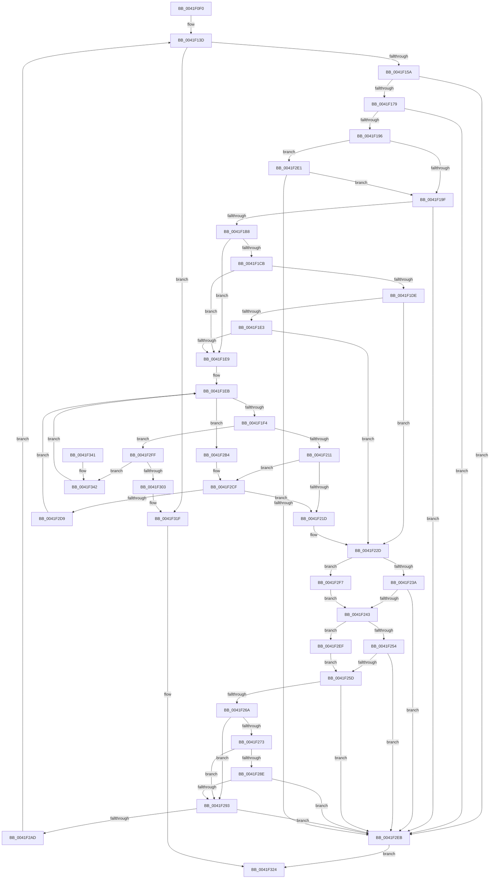

# MiDecommitPagesCoalesce

- RVA: `0x0041F0F0`–`0x0041F34B` (길이 `603` bytes)
- VA: `0x000000014041F0F0`
- 실행 섹션: `.text`
- PDB 이름 있음: `예`; PDB Function 태그: `아니요`
- unwind 정보 RVA: `0x0009FDDC`
- 디코드: `143`개 명령, `603/603` bytes 표시
- 미해석 바이트: `0` (있으면 어셈블리에 `.byte`로 보존)

> 이 문서는 커널 이미지의 기계어와 PDB 기호를 분석해 생성했습니다. 4번과 5번은 함수 원형과 자료형을 바이너리 사용 방식에서 추정한 C 해석이며 원본 소스 복구 결과는 아닙니다.

## 1. Dependencies

- 직접 호출 지점: **2**; 고유 호출 대상: **1**
- 직접 호출자로 확인된 함수: **1**
- RIP 상대 이미지 참조: **8**

### Outgoing calls
- `0x0041F2C9` → [KeBugCheckEx](../4F/KeBugCheckEx_function_004FD660.md) (function, `0x004FD660`)
- `0x0041F319` → [KeBugCheckEx](../4F/KeBugCheckEx_function_004FD660.md) (function, `0x004FD660`)

### Direct callers
- [MiDecommitFreePagesTail](MiDecommitFreePagesTail_function_0041ECE0.md) at `0x0041EF76`

### Static image references
- `0x0041F16C` → RVA `0x00E2DCE0` (`.data`; read)
- `0x0041F1B8` → RVA `0x00E2DBC0` (`.data`; read)
- `0x0041F1BF` → RVA `0x00E2DBC4` (`.data`; read)
- `0x0041F1D2` → RVA `0x00E2DC20` (`.data`; read)
- `0x0041F21D` → RVA `0x00E2DBC0` (`.data`; write)
- `0x0041F26A` → RVA `0x00E3CBE6` (`.data`; read)
- `0x0041F273` → RVA `0x00E3D240` (`.data`; read)
- `0x0041F297` → RVA `0x00E30088` (`.data`; read)

## 2. Other-region calls and transfers

- 다른 실행 섹션으로 향하는 call: **0**
- 별도 외부 분기/꼬리 이동을 확인하지 못했습니다.

## 3. Assembly (complete function range)

```asm
0041F0F0  48 89 5C 24 08                  mov qword ptr [rsp + 8], rbx
0041F0F5  48 89 6C 24 10                  mov qword ptr [rsp + 0x10], rbp
0041F0FA  48 89 74 24 20                  mov qword ptr [rsp + 0x20], rsi
0041F0FF  57                              push rdi
0041F100  41 54                           push r12
0041F102  41 55                           push r13
0041F104  41 56                           push r14
0041F106  41 57                           push r15
0041F108  48 83 EC 30                     sub rsp, 0x30
0041F10C  48 C7 C6 FF FF FF FF            mov rsi, 0xffffffffffffffff
0041F113  45 8D 70 10                     lea r14d, [r8 + 0x10]
0041F117  48 8B EE                        mov rbp, rsi
0041F11A  41 8B D8                        mov ebx, r8d
0041F11D  4C 8B FA                        mov r15, rdx
0041F120  4C 8B E1                        mov r12, rcx
0041F123  41 B9 FF FF FF FF               mov r9d, 0xffffffff
0041F129  49 BD FF FF FF FF FF 00 00 00   movabs r13, 0xffffffffff
0041F133  48 BF AB AA AA AA AA AA AA AA   movabs rdi, 0xaaaaaaaaaaaaaaab
0041F13D  48 BA 00 00 00 00 00 DE FF FF   movabs rdx, 0xffffde0000000000
0041F147  48 B8 28 00 00 00 00 DE FF FF   movabs rax, 0xffffde0000000028
0041F151  41 3B DE                        cmp ebx, r14d
0041F154  0F 83 C5 01 00 00               jae 0x14041f31f
0041F15A  44 8B C3                        mov r8d, ebx
0041F15D  4F 8B 84 C7 60 30 00 00         mov r8, qword ptr [r15 + r8*8 + 0x3060]
0041F165  49 C1 E8 0C                     shr r8, 0xc
0041F169  4D 23 C5                        and r8, r13
0041F16C  4C 3B 05 6D EB A0 00            cmp r8, qword ptr [rip + 0xa0eb6d]
0041F173  0F 87 72 01 00 00               ja 0x14041f2eb
0041F179  4B 8D 0C 40                     lea rcx, [r8 + r8*2]
0041F17D  48 C1 E1 04                     shl rcx, 4
0041F181  48 8B C0                        mov rax, rax
0041F184  48 8B 04 01                     mov rax, qword ptr [rcx + rax]
0041F188  48 C1 E8 36                     shr rax, 0x36
0041F18C  0F BA E0 00                     bt eax, 0
0041F190  0F 83 55 01 00 00               jae 0x14041f2eb
0041F196  4C 3B C6                        cmp r8, rsi
0041F199  0F 85 42 01 00 00               jne 0x14041f2e1
0041F19F  49 8D 70 01                     lea rsi, [r8 + 1]
0041F1A3  48 8B C2                        mov rax, rdx
0041F1A6  4C 8D 14 01                     lea r10, [rcx + rax]
0041F1AA  8B 44 01 20                     mov eax, dword ptr [rcx + rax + 0x20]
0041F1AE  66 83 F8 01                     cmp ax, 1
0041F1B2  0F 85 33 01 00 00               jne 0x14041f2eb
0041F1B8  48 63 15 01 EA A0 00            movsxd rdx, dword ptr [rip + 0xa0ea01]
0041F1BF  44 8B 1D FE E9 A0 00            mov r11d, dword ptr [rip + 0xa0e9fe]
0041F1C6  41 3B D3                        cmp edx, r11d
0041F1C9  77 1E                           ja 0x14041f1e9
0041F1CB  48 8B C2                        mov rax, rdx
0041F1CE  48 C1 E0 04                     shl rax, 4
0041F1D2  48 03 05 47 EA A0 00            add rax, qword ptr [rip + 0xa0ea47]
0041F1D9  4C 3B 00                        cmp r8, qword ptr [rax]
0041F1DC  72 0B                           jb 0x14041f1e9
0041F1DE  41 3B D3                        cmp edx, r11d
0041F1E1  74 4A                           je 0x14041f22d
0041F1E3  4C 3B 40 10                     cmp r8, qword ptr [rax + 0x10]
0041F1E7  72 44                           jb 0x14041f22d
0041F1E9  33 FF                           xor edi, edi
0041F1EB  44 3B DF                        cmp r11d, edi
0041F1EE  0F 8C C0 00 00 00               jl 0x14041f2b4
0041F1F4  42 8D 14 1F                     lea edx, [rdi + r11]
0041F1F8  D1 FA                           sar edx, 1
0041F1FA  48 63 C2                        movsxd rax, edx
0041F1FD  48 C1 E0 04                     shl rax, 4
0041F201  48 03 05 18 EA A0 00            add rax, qword ptr [rip + 0xa0ea18]
0041F208  4C 3B 00                        cmp r8, qword ptr [rax]
0041F20B  0F 82 EE 00 00 00               jb 0x14041f2ff
0041F211  3B 15 AD E9 A0 00               cmp edx, dword ptr [rip + 0xa0e9ad]
0041F217  0F 85 B2 00 00 00               jne 0x14041f2cf
0041F21D  89 15 9D E9 A0 00               mov dword ptr [rip + 0xa0e99d], edx
0041F223  48 BF AB AA AA AA AA AA AA AA   movabs rdi, 0xaaaaaaaaaaaaaaab
0041F22D  8B 40 08                        mov eax, dword ptr [rax + 8]
0041F230  41 83 F9 FF                     cmp r9d, -1
0041F234  0F 84 BD 00 00 00               je 0x14041f2f7
0041F23A  41 3B C1                        cmp eax, r9d
0041F23D  0F 85 A8 00 00 00               jne 0x14041f2eb
0041F243  49 8B 42 28                     mov rax, qword ptr [r10 + 0x28]
0041F247  49 23 C5                        and rax, r13
0041F24A  48 83 FD FF                     cmp rbp, -1
0041F24E  0F 84 9B 00 00 00               je 0x14041f2ef
0041F254  48 3B C5                        cmp rax, rbp
0041F257  0F 85 8E 00 00 00               jne 0x14041f2eb
0041F25D  49 8B 42 28                     mov rax, qword ptr [r10 + 0x28]
0041F261  48 85 C0                        test rax, rax
0041F264  0F 88 81 00 00 00               js 0x14041f2eb
0041F26A  80 3D 75 D9 A1 00 00            cmp byte ptr [rip + 0xa1d975], 0
0041F271  74 20                           je 0x14041f293
0041F273  48 8B 05 C6 DF A1 00            mov rax, qword ptr [rip + 0xa1dfc6]
0041F27A  48 C1 F9 04                     sar rcx, 4
0041F27E  48 0F AF CF                     imul rcx, rdi
0041F282  48 C1 E9 09                     shr rcx, 9
0041F286  0F B6 14 48                     movzx edx, byte ptr [rax + rcx*2]
0041F28A  85 D2                           test edx, edx
0041F28C  74 05                           je 0x14041f293
0041F28E  83 FA 0A                        cmp edx, 0xa
0041F291  75 58                           jne 0x14041f2eb
0041F293  49 8B 42 28                     mov rax, qword ptr [r10 + 0x28]
0041F297  48 8B 0D EA 0D A1 00            mov rcx, qword ptr [rip + 0xa10dea]
0041F29E  48 C1 E8 2B                     shr rax, 0x2b
0041F2A2  25 FF 03 00 00                  and eax, 0x3ff
0041F2A7  4C 39 24 C1                     cmp qword ptr [rcx + rax*8], r12
0041F2AB  75 3E                           jne 0x14041f2eb
0041F2AD  FF C3                           inc ebx
0041F2AF  E9 89 FE FF FF                  jmp 0x14041f13d
0041F2B4  45 33 C9                        xor r9d, r9d
0041F2B7  48 C7 44 24 20 00 00 00 00      mov qword ptr [rsp + 0x20], 0
0041F2C0  BA 80 51 00 00                  mov edx, 0x5180
0041F2C5  41 8D 49 1A                     lea ecx, [r9 + 0x1a]
0041F2C9  E8 92 E3 0D 00                  call 0x1404fd660
0041F2CE  CC                              int3
0041F2CF  4C 3B 40 10                     cmp r8, qword ptr [rax + 0x10]
0041F2D3  0F 82 44 FF FF FF               jb 0x14041f21d
0041F2D9  8D 7A 01                        lea edi, [rdx + 1]
0041F2DC  E9 0A FF FF FF                  jmp 0x14041f1eb
0041F2E1  48 83 FE FF                     cmp rsi, -1
0041F2E5  0F 84 B4 FE FF FF               je 0x14041f19f
0041F2EB  33 C0                           xor eax, eax
0041F2ED  EB 35                           jmp 0x14041f324
0041F2EF  48 8B E8                        mov rbp, rax
0041F2F2  E9 66 FF FF FF                  jmp 0x14041f25d
0041F2F7  44 8B C8                        mov r9d, eax
0041F2FA  E9 44 FF FF FF                  jmp 0x14041f243
0041F2FF  85 D2                           test edx, edx
0041F301  75 3F                           jne 0x14041f342
0041F303  4C 8B C8                        mov r9, rax
0041F306  48 C7 44 24 20 00 00 00 00      mov qword ptr [rsp + 0x20], 0
0041F30F  BA 80 51 00 00                  mov edx, 0x5180
0041F314  B9 1A 00 00 00                  mov ecx, 0x1a
0041F319  E8 42 E3 0D 00                  call 0x1404fd660
0041F31E  CC                              int3
0041F31F  B8 01 00 00 00                  mov eax, 1
0041F324  48 8B 5C 24 60                  mov rbx, qword ptr [rsp + 0x60]
0041F329  48 8B 6C 24 68                  mov rbp, qword ptr [rsp + 0x68]
0041F32E  48 8B 74 24 78                  mov rsi, qword ptr [rsp + 0x78]
0041F333  48 83 C4 30                     add rsp, 0x30
0041F337  41 5F                           pop r15
0041F339  41 5E                           pop r14
0041F33B  41 5D                           pop r13
0041F33D  41 5C                           pop r12
0041F33F  5F                              pop rdi
0041F340  C3                              ret
0041F341  CC                              int3
0041F342  44 8D 5A FF                     lea r11d, [rdx - 1]
0041F346  E9 A0 FE FF FF                  jmp 0x14041f1eb
```

## 4. C-style interpretation (structured pseudocode)

```c
__int64 __fastcall MiDecommitPagesCoalesce(__int64 a1, __int64 a2, __int64 a3)
{
    __int64 result;
    __int64 v_rbx;
    __int64 v_rdi;
    __int64 v_rsp;
    unsigned __int64 v_stack_m38;
    unsigned __int64 v_stack_p10;
    unsigned __int64 v_stack_p20;
    unsigned __int64 v_stack_p8;

    v_stack_p8 = v_rbx;
    v_stack_p10 = v_rbp;
    v_stack_p20 = v_rsi;
    v_rsp = (v_rsp) - (48);
loc_0041F13D:
    if (((unsigned int)((unsigned int)((unsigned int)(a3)))) >= ((unsigned int)(a3 + 16))) goto loc_0041F31F;
    a3 = (*(unsigned __int64 *)(a2 + (unsigned int)((unsigned int)((unsigned int)((unsigned int)(a3)))) * 8 + 12384)) >> (12);
    a3 = (a3) & (v_r13);
    if (a3 > (*(unsigned __int64 *)(v_rip + 10546029))) goto loc_0041F2EB;
    a1 = (a3 + a3 * 2) << (4);
    result = (*(unsigned __int64 *)(a1 + result * 1)) >> (54);
    if (condition_is_above_or_equal) goto loc_0041F2EB;
    if (a3 != -1) goto loc_0041F2E1;
loc_0041F19F:
    if (((unsigned __int16)((unsigned int)(*(unsigned int *)(a1 + a2 * 1 + 32)))) != 1) goto loc_0041F2EB;
    if (((unsigned int)((int)(*(unsigned int *)(v_rip + 10545665)))) > ((unsigned int)((unsigned int)(*(unsigned int *)(v_rip + 10545662))))) goto loc_0041F1E9;
    result = ((int)(*(unsigned int *)(v_rip + 10545665))) << (4);
    result = (result) + (*(unsigned __int64 *)(v_rip + 10545735));
    if (a3 < (*(unsigned __int64 *)(result))) goto loc_0041F1E9;
    if (((unsigned int)((int)(*(unsigned int *)(v_rip + 10545665)))) == ((unsigned int)((unsigned int)(*(unsigned int *)(v_rip + 10545662))))) goto loc_0041F22D;
    if (a3 < (*(unsigned __int64 *)(result + 16))) goto loc_0041F22D;
loc_0041F1E9:
    v_rdi = 0;
loc_0041F1EB:
    if (((unsigned int)((unsigned int)(*(unsigned int *)(v_rip + 10545662)))) < 0) goto loc_0041F2B4;
    a2 = (unsigned int)((v_rdi + (unsigned int)(*(unsigned int *)(v_rip + 10545662)) * 1) >> (1));
    result = ((int)((unsigned int)(a2))) << (4);
    result = (result) + (*(unsigned __int64 *)(v_rip + 10545688));
    if (a3 < (*(unsigned __int64 *)(result))) goto loc_0041F2FF;
    if (((unsigned int)(a2)) != (*(unsigned int *)(v_rip + 10545581))) goto loc_0041F2CF;
loc_0041F21D:
    *(unsigned int *)(v_rip + 10545565) = (unsigned int)(a2);
loc_0041F22D:
    if (((unsigned int)((unsigned int)(0xFFFFFFFFULL))) == -1) goto loc_0041F2F7;
    if (((unsigned int)((unsigned int)(*(unsigned int *)(result + 8)))) != ((unsigned int)((unsigned int)(0xFFFFFFFFULL)))) goto loc_0041F2EB;
loc_0041F243:
    result = (*(unsigned __int64 *)(a1 + a2 * 1 + 40)) & (v_r13);
    if (-1 == -1) goto loc_0041F2EF;
    if (result != -1) goto loc_0041F2EB;
loc_0041F25D:
    if (sign_flag) goto loc_0041F2EB;
    if ((*(unsigned __int8 *)(v_rip + 10606965)) == 0) goto loc_0041F293;
    a1 = (a1) >> (4);
    a1 = (a1) * (0);
    a1 = (a1) >> (9);
    if ((unsigned int)(*(unsigned __int8 *)(*(unsigned __int64 *)(v_rip + 10608582) + a1 * 2)) == 0) goto loc_0041F293;
    if (((unsigned int)(*(unsigned __int8 *)(*(unsigned __int64 *)(v_rip + 10608582) + a1 * 2))) != 10) goto loc_0041F2EB;
loc_0041F293:
    result = (*(unsigned __int64 *)(a1 + a2 * 1 + 40)) >> (43);
    result = (unsigned int)((result) & (0x3FFULL));
    if ((*(unsigned __int64 *)(*(unsigned __int64 *)(v_rip + 10554858) + result * 8)) != a1) goto loc_0041F2EB;
    v_rbx = (unsigned int)(((unsigned int)((unsigned int)(a3))) + 1);
    goto loc_0041F13D;
loc_0041F2B4:
    a4 = 0;
    v_stack_m38 = 0;
    result = KeBugCheckEx(a4 + 26, (unsigned int)(0x5180ULL), a3, a4);
loc_0041F2CF:
    if (a3 < (*(unsigned __int64 *)(result + 16))) goto loc_0041F21D;
    goto loc_0041F1EB;
loc_0041F2E1:
    if ((a3 + 1) == -1) goto loc_0041F19F;
loc_0041F2EB:
    result = 0;
    goto loc_0041F324;
loc_0041F2EF:
    goto loc_0041F25D;
loc_0041F2F7:
    goto loc_0041F243;
loc_0041F2FF:
    if ((unsigned int)((unsigned int)(0x5180ULL)) != 0) goto loc_0041F342;
    v_stack_m38 = 0;
    result = KeBugCheckEx(26, (unsigned int)(0x5180ULL), a3, 0);
loc_0041F31F:
loc_0041F324:
    v_rsp = (v_rsp) + (48);
    return 1;
loc_0041F342:
    goto loc_0041F1EB;
}
```

## 5. (Beta) C Style

```c
int64_t MiDecommitPagesCoalesce(int64_t Arg1, void *Arg2, void *Arg3)
{
    uint8_t *arg2 = (uint8_t *)Arg2;
    uint8_t *arg3 = (uint8_t *)Arg3;

    int64_t result;
    int64_t local_rbx;
    int64_t local_rdi;
    int64_t local_rsp;
    uint64_t v_stack_m38;
    uint64_t v_stack_p10;
    uint64_t v_stack_p20;
    uint64_t v_stack_p8;

    v_stack_p8 = local_rbx;
    v_stack_p10 = local_rbp;
    v_stack_p20 = local_rsi;
    local_rsp = (local_rsp) - (48);
loc_0041F13D:
    if (((uint32_t)((uint32_t)((uint32_t)(Arg3)))) >= ((uint32_t)(Arg3 + 16))) goto loc_0041F31F;
    Arg3 = (*(uint64_t *)(arg2 + (uint32_t)((uint32_t)((uint32_t)((uint32_t)(arg3)))) * 8 + 0x3060)) >> (12);
    Arg3 = (Arg3) & (local_r13);
    if (Arg3 > (*(uint64_t *)(v_rip + 0xA0EB6D))) goto loc_0041F2EB;
    Arg1 = (Arg3 + Arg3 * 2) << (4);
    result = (*(uint64_t *)(Arg1 + result * 1)) >> (54);
    if (condition_is_above_or_equal) goto loc_0041F2EB;
    if (Arg3 != -1) goto loc_0041F2E1;
loc_0041F19F:
    if (((uint16_t)((uint32_t)(*(uint32_t *)(Arg1 + arg2 * 1 + 0x20)))) != 1) goto loc_0041F2EB;
    if (((uint32_t)((int32_t)(*(uint32_t *)(v_rip + 0xA0EA01)))) > ((uint32_t)((uint32_t)(*(uint32_t *)(v_rip + 0xA0E9FE))))) goto loc_0041F1E9;
    result = ((int32_t)(*(uint32_t *)(v_rip + 0xA0EA01))) << (4);
    result = (result) + (*(uint64_t *)(v_rip + 0xA0EA47));
    if (Arg3 < (*(uint64_t *)(result))) goto loc_0041F1E9;
    if (((uint32_t)((int32_t)(*(uint32_t *)(v_rip + 0xA0EA01)))) == ((uint32_t)((uint32_t)(*(uint32_t *)(v_rip + 0xA0E9FE))))) goto loc_0041F22D;
    if (Arg3 < (*(uint64_t *)(result + 0x10))) goto loc_0041F22D;
loc_0041F1E9:
    local_rdi = 0;
loc_0041F1EB:
    if (((uint32_t)((uint32_t)(*(uint32_t *)(v_rip + 0xA0E9FE)))) < 0) goto loc_0041F2B4;
    Arg2 = (uint32_t)((local_rdi + (uint32_t)(*(uint32_t *)(v_rip + 0xA0E9FE)) * 1) >> (1));
    result = ((int32_t)((uint32_t)(Arg2))) << (4);
    result = (result) + (*(uint64_t *)(v_rip + 0xA0EA18));
    if (Arg3 < (*(uint64_t *)(result))) goto loc_0041F2FF;
    if (((uint32_t)(Arg2)) != (*(uint32_t *)(v_rip + 0xA0E9AD))) goto loc_0041F2CF;
loc_0041F21D:
    *(uint32_t *)(v_rip + 0xA0E99D) = (uint32_t)(Arg2);
loc_0041F22D:
    if (((uint32_t)((uint32_t)(0xFFFFFFFFULL))) == -1) goto loc_0041F2F7;
    if (((uint32_t)((uint32_t)(*(uint32_t *)(result + 0x8)))) != ((uint32_t)((uint32_t)(0xFFFFFFFFULL)))) goto loc_0041F2EB;
loc_0041F243:
    result = (*(uint64_t *)(Arg1 + arg2 * 1 + 0x28)) & (local_r13);
    if (-1 == -1) goto loc_0041F2EF;
    if (result != -1) goto loc_0041F2EB;
loc_0041F25D:
    if (sign_flag) goto loc_0041F2EB;
    if ((*(uint8_t *)(v_rip + 0xA1D975)) == 0) goto loc_0041F293;
    Arg1 = (Arg1) >> (4);
    Arg1 = (Arg1) * (0);
    Arg1 = (Arg1) >> (9);
    if ((uint32_t)(*(uint8_t *)(*(uint64_t *)(v_rip + 0xA1DFC6) + Arg1 * 2)) == 0) goto loc_0041F293;
    if (((uint32_t)(*(uint8_t *)(*(uint64_t *)(v_rip + 0xA1DFC6) + Arg1 * 2))) != 10) goto loc_0041F2EB;
loc_0041F293:
    result = (*(uint64_t *)(Arg1 + arg2 * 1 + 0x28)) >> (43);
    result = (uint32_t)((result) & (0x3FFULL));
    if ((*(uint64_t *)(*(uint64_t *)(v_rip + 0xA10DEA) + result * 8)) != Arg1) goto loc_0041F2EB;
    local_rbx = (uint32_t)(((uint32_t)((uint32_t)(Arg3))) + 1);
    goto loc_0041F13D;
loc_0041F2B4:
    a4 = 0;
    v_stack_m38 = 0;
    result = KeBugCheckEx(a4 + 26, (uint32_t)(0x5180ULL), Arg3, a4);
loc_0041F2CF:
    if (Arg3 < (*(uint64_t *)(result + 0x10))) goto loc_0041F21D;
    goto loc_0041F1EB;
loc_0041F2E1:
    if ((Arg3 + 1) == -1) goto loc_0041F19F;
loc_0041F2EB:
    result = 0;
    goto loc_0041F324;
loc_0041F2EF:
    goto loc_0041F25D;
loc_0041F2F7:
    goto loc_0041F243;
loc_0041F2FF:
    if ((uint32_t)((uint32_t)(0x5180ULL)) != 0) goto loc_0041F342;
    v_stack_m38 = 0;
    result = KeBugCheckEx(26, (uint32_t)(0x5180ULL), Arg3, 0);
loc_0041F31F:
loc_0041F324:
    local_rsp = (local_rsp) + (48);
    return 1;
loc_0041F342:
    goto loc_0041F1EB;
}
```

### 관측된 메모리 오프셋

구조체 형식이 확인되지 않은 접근은 인자 기준의 오프셋으로만 기록했습니다.

| 기준 인자 | 오프셋 표현 | 폭 (bit) | 접근 |
|---|---:|---:|---|
| `Arg2` | `+ 0x3060 + r8*8` | `64` | `R` |
| `Arg3` | `+ 0x10` | `32` | `R` |

## 6. Execution-region graph

[열기: 2D/3D 그래프와 함수 탐색 컨트롤 패널](../../../control-panel.html?section=text&rva=0x0041F0F0&view=graph)

- 2D 그래프는 위에서 아래로 흐르고, 3D 그래프는 빈 공간을 드래그해 회전합니다. Shift+드래그는 이동, 휠은 확대·축소, 함수 노드 선택은 대상 보고서 이동입니다.

### Static fallback


