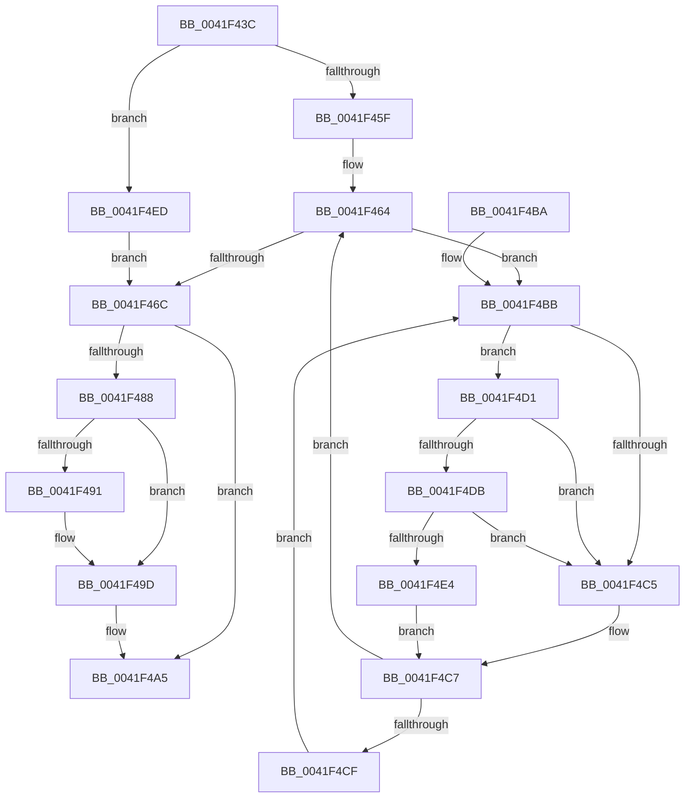

# MiDoubleUnlockMdlPage

- RVA: `0x0041F43C`–`0x0041F4FA` (길이 `190` bytes)
- VA: `0x000000014041F43C`
- 실행 섹션: `.text`
- PDB 이름 있음: `예`; PDB Function 태그: `아니요`
- unwind 정보 RVA: `0x00084FE8`
- 디코드: `53`개 명령, `190/190` bytes 표시
- 미해석 바이트: `0` (있으면 어셈블리에 `.byte`로 보존)

> 이 문서는 커널 이미지의 기계어와 PDB 기호를 분석해 생성했습니다. 4번과 5번은 함수 원형과 자료형을 바이너리 사용 방식에서 추정한 C 해석이며 원본 소스 복구 결과는 아닙니다.

## 1. Dependencies

- 직접 호출 지점: **5**; 고유 호출 대상: **5**
- 직접 호출자로 확인된 함수: **2**
- RIP 상대 이미지 참조: **3**

### Outgoing calls
- `0x0041F46F` → [MiRemoveLockedPageChargeAndDecRef](../24/MiRemoveLockedPageChargeAndDecRef_function_002459D0.md) (function, `0x002459D0`)
- `0x0041F498` → [KiLowerIrqlProcessIrqlFlags](../4F/KiLowerIrqlProcessIrqlFlags_function_004F5698.md) (function, `0x004F5698`)
- `0x0041F4DB` → [KiCheckVpBackingLongSpinWaitHypercall](../30/KiCheckVpBackingLongSpinWaitHypercall_function_0030F490.md) (function, `0x0030F490`)
- `0x0041F4E6` → [HvlNotifyLongSpinWait](../30/HvlNotifyLongSpinWait_function_0030F460.md) (function, `0x0030F460`)
- `0x0041F4ED` → [MiLockPageInline](../31/MiLockPageInline_function_0031A340.md) (function, `0x0031A340`)

### Direct callers
- [MiDecommitFreePagesTail](MiDecommitFreePagesTail_function_0041ECE0.md) at `0x0041F00A`
- [sub_00B2A4DA](../../page/B2/Unknown_function_00B2A4DA.md) at `0x00B2A50B`

### Static image references
- `0x0041F488` → RVA `0x00FC6D20` (`ALMOSTRO`; read)
- `0x0041F4BD` → RVA `0x00FC52AC` (`ALMOSTRO`; reference)
- `0x0041F4D1` → RVA `0x00FC6AB8` (`ALMOSTRO`; read)

## 2. Other-region calls and transfers

- 다른 실행 섹션으로 향하는 call: **0**
- 별도 외부 분기/꼬리 이동을 확인하지 못했습니다.

## 3. Assembly (complete function range)

```asm
0041F43C  48 89 5C 24 08                  mov qword ptr [rsp + 8], rbx
0041F441  48 89 6C 24 10                  mov qword ptr [rsp + 0x10], rbp
0041F446  48 89 74 24 18                  mov qword ptr [rsp + 0x18], rsi
0041F44B  57                              push rdi
0041F44C  48 83 EC 20                     sub rsp, 0x20
0041F450  48 8D 59 18                     lea rbx, [rcx + 0x18]
0041F454  48 8B E9                        mov rbp, rcx
0041F457  85 D2                           test edx, edx
0041F459  0F 84 8E 00 00 00               je 0x14041f4ed
0041F45F  40 B7 11                        mov dil, 0x11
0041F462  33 F6                           xor esi, esi
0041F464  F0 48 0F BA 2B 3F               lock bts qword ptr [rbx], 0x3f
0041F46A  72 4F                           jb 0x14041f4bb
0041F46C  48 8B CD                        mov rcx, rbp
0041F46F  E8 5C 65 E2 FF                  call 0x1402459d0
0041F474  48 B8 FF FF FF FF FF FF FF 7F   movabs rax, 0x7fffffffffffffff
0041F47E  F0 48 21 03                     lock and qword ptr [rbx], rax
0041F482  40 80 FF 02                     cmp dil, 2
0041F486  73 1D                           jae 0x14041f4a5
0041F488  83 3D 91 78 BA 00 00            cmp dword ptr [rip + 0xba7891], 0
0041F48F  74 0C                           je 0x14041f49d
0041F491  44 0F 20 C1                     mov rcx, cr8
0041F495  40 8A D7                        mov dl, dil
0041F498  E8 FB 61 0D 00                  call 0x1404f5698
0041F49D  40 0F B6 C7                     movzx eax, dil
0041F4A1  44 0F 22 C0                     mov cr8, rax
0041F4A5  48 8B 5C 24 30                  mov rbx, qword ptr [rsp + 0x30]
0041F4AA  48 8B 6C 24 38                  mov rbp, qword ptr [rsp + 0x38]
0041F4AF  48 8B 74 24 40                  mov rsi, qword ptr [rsp + 0x40]
0041F4B4  48 83 C4 20                     add rsp, 0x20
0041F4B8  5F                              pop rdi
0041F4B9  C3                              ret
0041F4BA  CC                              int3
0041F4BB  FF C6                           inc esi
0041F4BD  85 35 E9 5D BA 00               test dword ptr [rip + 0xba5de9], esi
0041F4C3  74 0C                           je 0x14041f4d1
0041F4C5  F3 90                           pause
0041F4C7  48 8B 03                        mov rax, qword ptr [rbx]
0041F4CA  48 85 C0                        test rax, rax
0041F4CD  79 95                           jns 0x14041f464
0041F4CF  EB EA                           jmp 0x14041f4bb
0041F4D1  8B 05 E1 75 BA 00               mov eax, dword ptr [rip + 0xba75e1]
0041F4D7  A8 40                           test al, 0x40
0041F4D9  74 EA                           je 0x14041f4c5
0041F4DB  E8 B0 FF EE FF                  call 0x14030f490
0041F4E0  84 C0                           test al, al
0041F4E2  74 E1                           je 0x14041f4c5
0041F4E4  8B CE                           mov ecx, esi
0041F4E6  E8 75 FF EE FF                  call 0x14030f460
0041F4EB  EB DA                           jmp 0x14041f4c7
0041F4ED  E8 4E AE EF FF                  call 0x14031a340
0041F4F2  40 8A F8                        mov dil, al
0041F4F5  E9 72 FF FF FF                  jmp 0x14041f46c
```

## 4. C-style interpretation (structured pseudocode)

```c
__int64 __fastcall MiDoubleUnlockMdlPage(__int64 a1, int a2)
{
    __int64 result;
    __int64 v_rsi;
    __int64 v_rsp;
    unsigned __int64 v_stack_p10;
    unsigned __int64 v_stack_p18;
    unsigned __int64 v_stack_p8;

    v_stack_p8 = v_rbx;
    v_stack_p10 = v_rbp;
    v_stack_p18 = v_rsi;
    v_rsp = (v_rsp) - (32);
    if (a2 == 0) goto loc_0041F4ED;
    v_rsi = 0;
loc_0041F464:
    if (condition_is_below) goto loc_0041F4BB;
loc_0041F46C:
    result = MiRemoveLockedPageChargeAndDecRef(a1, a2, a3, a4);
    if (17 >= 2) goto loc_0041F4A5;
    if ((*(unsigned int *)(v_rip + 12220561)) != 0) {
        a1 = v_cr8;
        a2 = 17;
        result = KiLowerIrqlProcessIrqlFlags(a1, a2, a3, a4);
    }
loc_0041F4A5:
    v_rsp = (v_rsp) + (32);
    return 17;
loc_0041F4BB:
    v_rsi = (unsigned int)((v_stack_p18) + 1);
    if (((*(unsigned int *)(v_rip + 12213737)) & ((unsigned int)(v_rsi))) == 0) goto loc_0041F4D1;
loc_0041F4C5:
loc_0041F4C7:
    if (!sign_flag) goto loc_0041F464;
    goto loc_0041F4BB;
loc_0041F4D1:
    if ((((unsigned __int8)((unsigned int)(*(unsigned int *)(v_rip + 12219873)))) & (64)) == 0) goto loc_0041F4C5;
    result = KiCheckVpBackingLongSpinWaitHypercall(a1, a2, a3, a4);
    if ((unsigned __int8)(result) == 0) goto loc_0041F4C5;
    result = HvlNotifyLongSpinWait((unsigned int)((unsigned int)(v_rsi)), a2, a3, a4);
    goto loc_0041F4C7;
loc_0041F4ED:
    result = MiLockPageInline((unsigned int)((unsigned int)(v_rsi)), a2, a3, a4);
    goto loc_0041F46C;
}
```

## 5. (Beta) C Style

```c
int64_t MiDoubleUnlockMdlPage(void *Arg1, int32_t Arg2)
{
    uint8_t *arg1 = (uint8_t *)Arg1;

    int64_t result;
    int64_t local_rsi;
    int64_t local_rsp;
    uint64_t v_stack_p10;
    uint64_t v_stack_p18;
    uint64_t v_stack_p8;

    v_stack_p8 = local_rbx;
    v_stack_p10 = local_rbp;
    v_stack_p18 = local_rsi;
    local_rsp = (local_rsp) - (32);
    if (Arg2 == 0) goto loc_0041F4ED;
    local_rsi = 0;
loc_0041F464:
    if (condition_is_below) goto loc_0041F4BB;
loc_0041F46C:
    result = MiRemoveLockedPageChargeAndDecRef(Arg1, Arg2, a3, a4);
    if (17 >= 2) goto loc_0041F4A5;
    if ((*(uint32_t *)(v_rip + 0xBA7891)) != 0) {
        Arg1 = v_cr8;
        Arg2 = 17;
        result = KiLowerIrqlProcessIrqlFlags(Arg1, Arg2, a3, a4);
    }
loc_0041F4A5:
    local_rsp = (local_rsp) + (32);
    return 17;
loc_0041F4BB:
    local_rsi = (uint32_t)((v_stack_p18) + 1);
    if (((*(uint32_t *)(v_rip + 0xBA5DE9)) & ((uint32_t)(local_rsi))) == 0) goto loc_0041F4D1;
loc_0041F4C5:
loc_0041F4C7:
    if (!sign_flag) goto loc_0041F464;
    goto loc_0041F4BB;
loc_0041F4D1:
    if ((((uint8_t)((uint32_t)(*(uint32_t *)(v_rip + 0xBA75E1)))) & (64)) == 0) goto loc_0041F4C5;
    result = KiCheckVpBackingLongSpinWaitHypercall(Arg1, Arg2, a3, a4);
    if ((uint8_t)(result) == 0) goto loc_0041F4C5;
    result = HvlNotifyLongSpinWait((uint32_t)((uint32_t)(local_rsi)), Arg2, a3, a4);
    goto loc_0041F4C7;
loc_0041F4ED:
    result = MiLockPageInline((uint32_t)((uint32_t)(local_rsi)), Arg2, a3, a4);
    goto loc_0041F46C;
}
```

### 관측된 메모리 오프셋

구조체 형식이 확인되지 않은 접근은 인자 기준의 오프셋으로만 기록했습니다.

| 기준 인자 | 오프셋 표현 | 폭 (bit) | 접근 |
|---|---:|---:|---|
| `Arg1` | `+ 0x0` | `64` | `R` |
| `Arg1` | `+ 0x0` | `64` | `R/W` |
| `Arg1` | `+ 0x18` | `64` | `R` |

## 6. Execution-region graph

[열기: 2D/3D 그래프와 함수 탐색 컨트롤 패널](../../../control-panel.html?section=text&rva=0x0041F43C&view=graph)

- 2D 그래프는 위에서 아래로 흐르고, 3D 그래프는 빈 공간을 드래그해 회전합니다. Shift+드래그는 이동, 휠은 확대·축소, 함수 노드 선택은 대상 보고서 이동입니다.

### Static fallback


