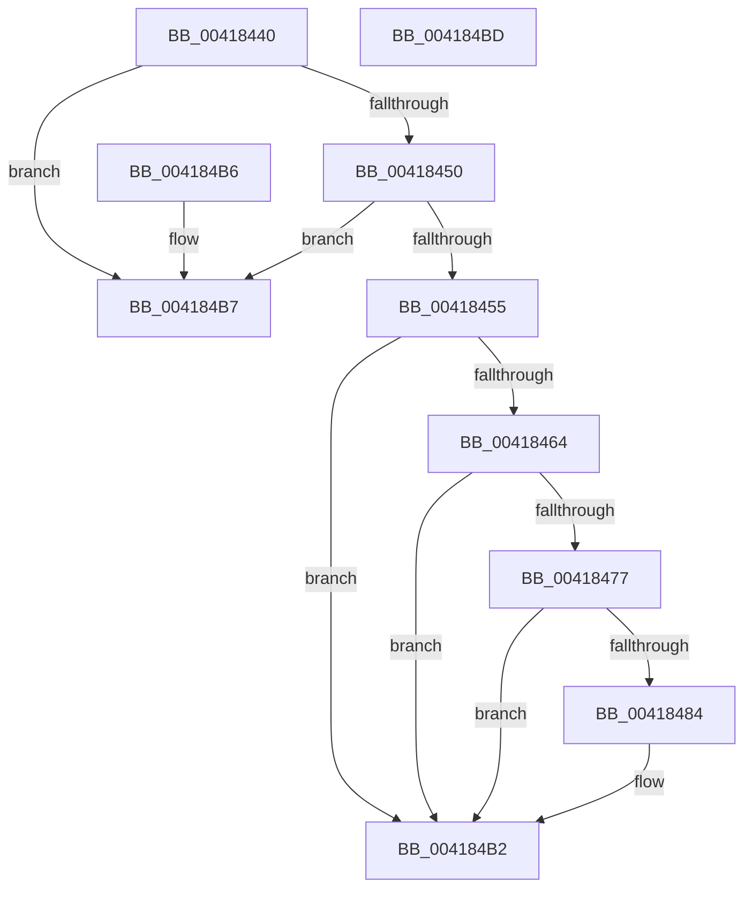

# MiFaultListPagesRemaining

- RVA: `0x00418440`–`0x004184BE` (길이 `126` bytes)
- VA: `0x0000000140418440`
- 실행 섹션: `.text`
- PDB 이름 있음: `예`; PDB Function 태그: `아니요`
- unwind 정보 RVA: `0x000DB714`
- 디코드: `37`개 명령, `126/126` bytes 표시
- 미해석 바이트: `0` (있으면 어셈블리에 `.byte`로 보존)

> 이 문서는 커널 이미지의 기계어와 PDB 기호를 분석해 생성했습니다. 4번과 5번은 함수 원형과 자료형을 바이너리 사용 방식에서 추정한 C 해석이며 원본 소스 복구 결과는 아닙니다.

## 1. Dependencies

- 직접 호출 지점: **0**; 고유 호출 대상: **0**
- 직접 호출자로 확인된 함수: **1**
- RIP 상대 이미지 참조: **0**

### Outgoing calls
- 직접 디코드된 call 명령이 없습니다.

### Direct callers
- [MiComputeMaximumFaultCluster](MiComputeMaximumFaultCluster_function_00418210.md) at `0x0041828A`

### Static image references
- 디코드된 RIP-relative 메모리 참조가 없습니다.

## 2. Other-region calls and transfers

- 다른 실행 섹션으로 향하는 call: **0**
- 별도 외부 분기/꼬리 이동을 확인하지 못했습니다.

## 3. Assembly (complete function range)

```asm
00418440  48 8B 51 10                     mov rdx, qword ptr [rcx + 0x10]
00418444  48 8B C2                        mov rax, rdx
00418447  48 83 E0 FE                     and rax, 0xfffffffffffffffe
0041844B  F6 C2 01                        test dl, 1
0041844E  74 67                           je 0x1404184b7
00418450  80 38 02                        cmp byte ptr [rax], 2
00418453  75 62                           jne 0x1404184b7
00418455  4C 8B 40 18                     mov r8, qword ptr [rax + 0x18]
00418459  BA 01 00 00 00                  mov edx, 1
0041845E  4C 3B 40 10                     cmp r8, qword ptr [rax + 0x10]
00418462  73 4E                           jae 0x1404184b2
00418464  4C 8B 09                        mov r9, qword ptr [rcx]
00418467  49 C1 E0 04                     shl r8, 4
0041846B  4C 03 40 08                     add r8, qword ptr [rax + 8]
0041846F  49 8B 08                        mov rcx, qword ptr [r8]
00418472  4C 3B C9                        cmp r9, rcx
00418475  72 3B                           jb 0x1404184b2
00418477  4D 8B 50 08                     mov r10, qword ptr [r8 + 8]
0041847B  49 8D 04 0A                     lea rax, [r10 + rcx]
0041847F  4C 3B C8                        cmp r9, rax
00418482  73 2E                           jae 0x1404184b2
00418484  49 81 E1 00 F0 FF FF            and r9, 0xfffffffffffff000
0041848B  48 8B C1                        mov rax, rcx
0041848E  81 E1 FF 0F 00 00               and ecx, 0xfff
00418494  48 25 00 F0 FF FF               and rax, 0xfffffffffffff000
0041849A  4C 2B C8                        sub r9, rax
0041849D  49 C1 E9 0C                     shr r9, 0xc
004184A1  48 8D 91 FF 0F 00 00            lea rdx, [rcx + 0xfff]
004184A8  49 03 D2                        add rdx, r10
004184AB  48 C1 EA 0C                     shr rdx, 0xc
004184AF  49 2B D1                        sub rdx, r9
004184B2  48 8B C2                        mov rax, rdx
004184B5  C3                              ret
004184B6  CC                              int3
004184B7  B8 01 00 00 00                  mov eax, 1
004184BC  C3                              ret
004184BD  CC                              int3
```

## 4. C-style interpretation (structured pseudocode)

```c
__int64 __fastcall MiFaultListPagesRemaining(__int64 a1)
{
    __int64 result;

    result = (*(unsigned __int64 *)(a1 + 16)) & (-2);
    if ((((unsigned __int8)(*(unsigned __int64 *)(a1 + 16))) & (1)) == 0) goto loc_004184B7;
    if ((*(unsigned __int8 *)(result)) != 2) goto loc_004184B7;
    if ((*(unsigned __int64 *)(result + 24)) >= (*(unsigned __int64 *)(result + 16))) goto loc_004184B2;
    a3 = (*(unsigned __int64 *)(result + 24)) << (4);
    a3 = (a3) + (*(unsigned __int64 *)(result + 8));
    if ((*(unsigned __int64 *)(a1)) < (*(unsigned __int64 *)(a3))) goto loc_004184B2;
    result = *(unsigned __int64 *)(a3 + 8) + *(unsigned __int64 *)(a3) * 1;
    if ((*(unsigned __int64 *)(a1)) < (*(unsigned __int64 *)(a3 + 8) + *(unsigned __int64 *)(a3) * 1)) {
        a4 = (*(unsigned __int64 *)(a1)) & (0xFFFFFFFFFFFFF000ULL);
        result = *(unsigned __int64 *)(a3);
        a1 = (unsigned int)((*(unsigned __int64 *)(a3)) & (0xFFFULL));
        result = (result) & (0xFFFFFFFFFFFFF000ULL);
        a4 = (a4) - (result);
        a4 = (a4) >> (12);
        a2 = a1 + 4095;
        a2 = (a2) + (*(unsigned __int64 *)(a3 + 8));
        a2 = (a2) >> (12);
        a2 = (a2) - (a4);
    }
    return a2;
loc_004184B7:
    return 1;
}
```

## 5. (Beta) C Style

```c
int64_t MiFaultListPagesRemaining(void *Arg1)
{
    uint8_t *arg1 = (uint8_t *)Arg1;

    int64_t result;

    result = (*(uint64_t *)(arg1 + 0x10)) & (-2);
    if ((((uint8_t)(*(uint64_t *)(arg1 + 0x10))) & (1)) == 0) goto loc_004184B7;
    if ((*(uint8_t *)(result)) != 2) goto loc_004184B7;
    if ((*(uint64_t *)(result + 0x18)) >= (*(uint64_t *)(result + 0x10))) goto loc_004184B2;
    a3 = (*(uint64_t *)(result + 0x18)) << (4);
    a3 = (a3) + (*(uint64_t *)(result + 0x8));
    if ((*(uint64_t *)(arg1)) < (*(uint64_t *)(a3))) goto loc_004184B2;
    result = *(uint64_t *)(a3 + 0x8) + *(uint64_t *)(a3) * 1;
    if ((*(uint64_t *)(arg1)) < (*(uint64_t *)(a3 + 0x8) + *(uint64_t *)(a3) * 1)) {
        a4 = (*(uint64_t *)(arg1)) & (0xFFFFFFFFFFFFF000ULL);
        result = *(uint64_t *)(a3);
        Arg1 = (uint32_t)((*(uint64_t *)(a3)) & (0xFFFULL));
        result = (result) & (0xFFFFFFFFFFFFF000ULL);
        a4 = (a4) - (result);
        a4 = (a4) >> (12);
        a2 = Arg1 + 4095;
        a2 = (a2) + (*(uint64_t *)(a3 + 0x8));
        a2 = (a2) >> (12);
        a2 = (a2) - (a4);
    }
    return a2;
loc_004184B7:
    return 1;
}
```

### 관측된 메모리 오프셋

구조체 형식이 확인되지 않은 접근은 인자 기준의 오프셋으로만 기록했습니다.

| 기준 인자 | 오프셋 표현 | 폭 (bit) | 접근 |
|---|---:|---:|---|
| `Arg1` | `+ 0x0` | `64` | `R` |
| `Arg1` | `+ 0x10` | `64` | `R` |

## 6. Execution-region graph

[열기: 2D/3D 그래프와 함수 탐색 컨트롤 패널](../../../control-panel.html?section=text&rva=0x00418440&view=graph)

- 2D 그래프는 위에서 아래로 흐르고, 3D 그래프는 빈 공간을 드래그해 회전합니다. Shift+드래그는 이동, 휠은 확대·축소, 함수 노드 선택은 대상 보고서 이동입니다.

### Static fallback


