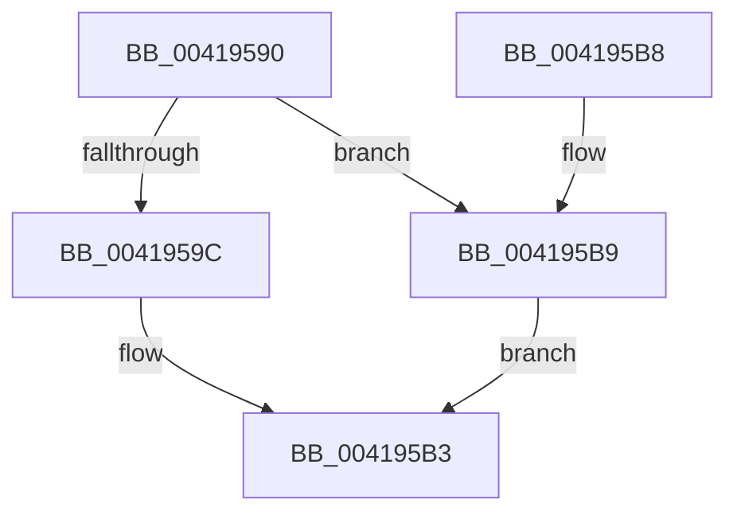

# MiFlushTbNowToAvoidOverflow

- RVA: `0x00419590`–`0x004195C0` (길이 `48` bytes)
- VA: `0x0000000140419590`
- 실행 섹션: `.text`
- PDB 이름 있음: `예`; PDB Function 태그: `아니요`
- unwind 정보 RVA: `0x0005CEE8`
- 디코드: `16`개 명령, `48/48` bytes 표시
- 미해석 바이트: `0` (있으면 어셈블리에 `.byte`로 보존)

> 이 문서는 커널 이미지의 기계어와 PDB 기호를 분석해 생성했습니다. 4번과 5번은 함수 원형과 자료형을 바이너리 사용 방식에서 추정한 C 해석이며 원본 소스 복구 결과는 아닙니다.

## 1. Dependencies

- 직접 호출 지점: **1**; 고유 호출 대상: **1**
- 직접 호출자로 확인된 함수: **1**
- RIP 상대 이미지 참조: **0**

### Outgoing calls
- `0x0041959C` → [MiTbFlushListPromoteThreshold](MiTbFlushListPromoteThreshold_function_004195D0.md) (function, `0x004195D0`)

### Direct callers
- [MiBuildPhysicalPageFreeChain](../68/MiBuildPhysicalPageFreeChain_function_00687C80.md) at `0x00687E1A`

### Static image references
- 디코드된 RIP-relative 메모리 참조가 없습니다.

## 2. Other-region calls and transfers

- 다른 실행 섹션으로 향하는 call: **0**
- 별도 외부 분기/꼬리 이동을 확인하지 못했습니다.

## 3. Assembly (complete function range)

```asm
00419590  48 83 EC 28                     sub rsp, 0x28
00419594  8B 41 0C                        mov eax, dword ptr [rcx + 0xc]
00419597  39 41 1C                        cmp dword ptr [rcx + 0x1c], eax
0041959A  74 1D                           je 0x1404195b9
0041959C  E8 2F 00 00 00                  call 0x1404195d0
004195A1  48 8B 49 20                     mov rcx, qword ptr [rcx + 0x20]
004195A5  48 8B D0                        mov rdx, rax
004195A8  33 C0                           xor eax, eax
004195AA  48 FF C1                        inc rcx
004195AD  48 3B CA                        cmp rcx, rdx
004195B0  0F 93 C0                        setae al
004195B3  48 83 C4 28                     add rsp, 0x28
004195B7  C3                              ret
004195B8  CC                              int3
004195B9  B8 01 00 00 00                  mov eax, 1
004195BE  EB F3                           jmp 0x1404195b3
```

## 4. C-style interpretation (structured pseudocode)

```c
__int64 __fastcall MiFlushTbNowToAvoidOverflow(__int64 a1)
{
    __int64 result;
    __int64 v_rsp;

    v_rsp = (v_rsp) - (40);
    if ((*(unsigned int *)(a1 + 28)) == ((unsigned int)((unsigned int)(*(unsigned int *)(a1 + 12))))) goto loc_004195B9;
    result = MiTbFlushListPromoteThreshold(a1, a2, a3, a4);
    result = 0;
    a1 = (*(unsigned __int64 *)(a1 + 32)) + 1;
    result = (a1 >= 0) ? 1 : 0;
loc_004195B3:
    v_rsp = (v_rsp) + (40);
    return result;
loc_004195B9:
    goto loc_004195B3;
}
```

## 5. (Beta) C Style

```c
int64_t MiFlushTbNowToAvoidOverflow(void *Arg1)
{
    uint8_t *arg1 = (uint8_t *)Arg1;

    int64_t result;
    int64_t local_rsp;

    local_rsp = (local_rsp) - (40);
    if ((*(uint32_t *)(arg1 + 0x1C)) == ((uint32_t)((uint32_t)(*(uint32_t *)(arg1 + 0xC))))) goto loc_004195B9;
    result = MiTbFlushListPromoteThreshold(Arg1, a2, a3, a4);
    result = 0;
    Arg1 = (*(uint64_t *)(arg1 + 0x20)) + 1;
    result = (Arg1 >= 0) ? 1 : 0;
loc_004195B3:
    local_rsp = (local_rsp) + (40);
    return result;
loc_004195B9:
    goto loc_004195B3;
}
```

### 관측된 메모리 오프셋

구조체 형식이 확인되지 않은 접근은 인자 기준의 오프셋으로만 기록했습니다.

| 기준 인자 | 오프셋 표현 | 폭 (bit) | 접근 |
|---|---:|---:|---|
| `Arg1` | `+ 0xC` | `32` | `R` |
| `Arg1` | `+ 0x1C` | `32` | `R` |

## 6. Execution-region graph

[열기: 2D/3D 그래프와 함수 탐색 컨트롤 패널](../../../control-panel.html?section=text&rva=0x00419590&view=graph)

- 2D 그래프는 위에서 아래로 흐르고, 3D 그래프는 빈 공간을 드래그해 회전합니다. Shift+드래그는 이동, 휠은 확대·축소, 함수 노드 선택은 대상 보고서 이동입니다.

### Static fallback


