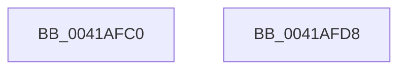

# MiGetPdeAddress

- RVA: `0x0041AFC0`–`0x0041AFD9` (길이 `25` bytes)
- VA: `0x000000014041AFC0`
- 실행 섹션: `.text`
- PDB 이름 있음: `예`; PDB Function 태그: `아니요`
- unwind 정보 RVA: `0x000DB714`
- 디코드: `6`개 명령, `25/25` bytes 표시
- 미해석 바이트: `0` (있으면 어셈블리에 `.byte`로 보존)

> 이 문서는 커널 이미지의 기계어와 PDB 기호를 분석해 생성했습니다. 4번과 5번은 함수 원형과 자료형을 바이너리 사용 방식에서 추정한 C 해석이며 원본 소스 복구 결과는 아닙니다.

## 1. Dependencies

- 직접 호출 지점: **0**; 고유 호출 대상: **0**
- 직접 호출자로 확인된 함수: **2**
- RIP 상대 이미지 참조: **0**

### Outgoing calls
- 직접 디코드된 call 명령이 없습니다.

### Direct callers
- [MiEliminateZeroPages](../../page/8C/MiEliminateZeroPages_function_008CF1A0.md) at `0x008CF27F`
- [MiReleaseDriverPtes](../../page/A7/MiReleaseDriverPtes_function_00A7F1B4.md) at `0x00A7F390`

### Static image references
- 디코드된 RIP-relative 메모리 참조가 없습니다.

## 2. Other-region calls and transfers

- 다른 실행 섹션으로 향하는 call: **0**
- 별도 외부 분기/꼬리 이동을 확인하지 못했습니다.

## 3. Assembly (complete function range)

```asm
0041AFC0  48 C1 E9 12                     shr rcx, 0x12
0041AFC4  81 E1 F8 FF FF 3F               and ecx, 0x3ffffff8
0041AFCA  48 B8 00 00 00 40 FB F6 FF FF   movabs rax, 0xfffff6fb40000000
0041AFD4  48 03 C1                        add rax, rcx
0041AFD7  C3                              ret
0041AFD8  CC                              int3
```

## 4. C-style interpretation (structured pseudocode)

```c
__int64 __fastcall MiGetPdeAddress(__int64 a1)
{
    __int64 result;

    a1 = (a1) >> (18);
    a1 = (unsigned int)((a1) & (0x3FFFFFF8ULL));
    result = (result) + (a1);
    return result;
}
```

## 5. (Beta) C Style

```c
int64_t MiGetPdeAddress(int64_t Arg1)
{
    int64_t result;

    Arg1 = (Arg1) >> (18);
    Arg1 = (uint32_t)((Arg1) & (0x3FFFFFF8ULL));
    result = (result) + (Arg1);
    return result;
}
```

## 6. Execution-region graph

[열기: 2D/3D 그래프와 함수 탐색 컨트롤 패널](../../../control-panel.html?section=text&rva=0x0041AFC0&view=graph)

- 2D 그래프는 위에서 아래로 흐르고, 3D 그래프는 빈 공간을 드래그해 회전합니다. Shift+드래그는 이동, 휠은 확대·축소, 함수 노드 선택은 대상 보고서 이동입니다.

### Static fallback


