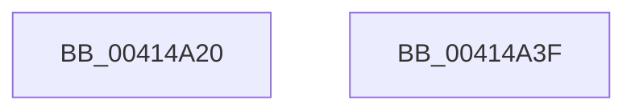

# MiGetSharedVm

- RVA: `0x00414A20`–`0x00414A40` (길이 `32` bytes)
- VA: `0x0000000140414A20`
- 실행 섹션: `.text`
- PDB 이름 있음: `예`; PDB Function 태그: `아니요`
- unwind 정보 RVA: `0x000DB714`
- 디코드: `8`개 명령, `32/32` bytes 표시
- 미해석 바이트: `0` (있으면 어셈블리에 `.byte`로 보존)

> 이 문서는 커널 이미지의 기계어와 PDB 기호를 분석해 생성했습니다. 4번과 5번은 함수 원형과 자료형을 바이너리 사용 방식에서 추정한 C 해석이며 원본 소스 복구 결과는 아닙니다.

## 1. Dependencies

- 직접 호출 지점: **0**; 고유 호출 대상: **0**
- 직접 호출자로 확인된 함수: **7**
- RIP 상대 이미지 참조: **1**

### Outgoing calls
- 직접 디코드된 call 명령이 없습니다.

### Direct callers
- [MmInitializeHandBuiltProcess](../../page/7F/MmInitializeHandBuiltProcess_function_007F83EC.md) at `0x007F845E`
- [MmInitializeProcessAddressSpace](../../page/8C/MmInitializeProcessAddressSpace_function_008CF6B0.md) at `0x008CF718`
- [MiRemoveVadCharges](../../page/9B/MiRemoveVadCharges_function_009BAEC4.md) at `0x009BAF87`
- [MmCleanProcessAddressSpace](../../page/A1/MmCleanProcessAddressSpace_function_00A17EC0.md) at `0x00A17F17`
- [MiCleanEmbryonicProcess](../../page/A1/MiCleanEmbryonicProcess_function_00A1816C.md) at `0x00A18183`
- [MmCreateProcessAddressSpace](../../page/A5/MmCreateProcessAddressSpace_function_00A5EE5C.md) at `0x00A5EF22`
- [MmDeleteProcessAddressSpace](../../page/AC/MmDeleteProcessAddressSpace_function_00AC804C.md) at `0x00AC8137`

### Static image references
- `0x00414A30` → RVA `0x00E38840` (`.data`; read)

## 2. Other-region calls and transfers

- 다른 실행 섹션으로 향하는 call: **0**
- 별도 외부 분기/꼬리 이동을 확인하지 못했습니다.

## 3. Assembly (complete function range)

```asm
00414A20  8B 91 B8 00 00 00               mov edx, dword ptr [rcx + 0xb8]
00414A26  48 8D 81 C0 00 00 00            lea rax, [rcx + 0xc0]
00414A2D  80 E2 0F                        and dl, 0xf
00414A30  48 8D 0D 09 3E A2 00            lea rcx, [rip + 0xa23e09]
00414A37  80 FA 01                        cmp dl, 1
00414A3A  48 0F 44 C1                     cmove rax, rcx
00414A3E  C3                              ret
00414A3F  CC                              int3
```

## 4. C-style interpretation (structured pseudocode)

```c
__int64 __fastcall MiGetSharedVm(__int64 a1)
{
    __int64 result;

    a2 = (unsigned __int8)(((unsigned int)(*(unsigned int *)(a1 + 184))) & (15));
    result = a1 + 192;
    if (((unsigned __int8)(a2)) == 1) { result = v_rip + 10632713; }
    return result;
}
```

## 5. (Beta) C Style

```c
int64_t MiGetSharedVm(void *Arg1)
{
    uint8_t *arg1 = (uint8_t *)Arg1;

    int64_t result;

    a2 = (uint8_t)(((uint32_t)(*(uint32_t *)(arg1 + 0xB8))) & (15));
    result = Arg1 + 192;
    if (((uint8_t)(a2)) == 1) { result = v_rip + 10632713; }
    return result;
}
```

### 관측된 메모리 오프셋

구조체 형식이 확인되지 않은 접근은 인자 기준의 오프셋으로만 기록했습니다.

| 기준 인자 | 오프셋 표현 | 폭 (bit) | 접근 |
|---|---:|---:|---|
| `Arg1` | `+ 0xB8` | `32` | `R` |
| `Arg1` | `+ 0xC0` | `64` | `R` |

## 6. Execution-region graph

[열기: 2D/3D 그래프와 함수 탐색 컨트롤 패널](../../../control-panel.html?section=text&rva=0x00414A20&view=graph)

- 2D 그래프는 위에서 아래로 흐르고, 3D 그래프는 빈 공간을 드래그해 회전합니다. Shift+드래그는 이동, 휠은 확대·축소, 함수 노드 선택은 대상 보고서 이동입니다.

### Static fallback


