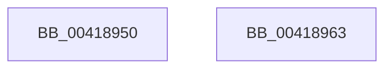

# MiGetVmPartition

- RVA: `0x00418950`–`0x00418964` (길이 `20` bytes)
- VA: `0x0000000140418950`
- 실행 섹션: `.text`
- PDB 이름 있음: `예`; PDB Function 태그: `아니요`
- unwind 정보 RVA: `0x000DB714`
- 디코드: `5`개 명령, `20/20` bytes 표시
- 미해석 바이트: `0` (있으면 어셈블리에 `.byte`로 보존)

> 이 문서는 커널 이미지의 기계어와 PDB 기호를 분석해 생성했습니다. 4번과 5번은 함수 원형과 자료형을 바이너리 사용 방식에서 추정한 C 해석이며 원본 소스 복구 결과는 아닙니다.

## 1. Dependencies

- 직접 호출 지점: **0**; 고유 호출 대상: **0**
- 직접 호출자로 확인된 함수: **3**
- RIP 상대 이미지 참조: **1**

### Outgoing calls
- 직접 디코드된 call 명령이 없습니다.

### Direct callers
- [MiCreateHardwareEnclave](../../page/80/MiCreateHardwareEnclave_function_00808500.md) at `0x0080857B`
- [MiCopyPagesIntoEnclave](../../page/A4/MiCopyPagesIntoEnclave_function_00A472AC.md) at `0x00A474E3`
- [MiBuildNewCloneDescriptor](../../page/A6/MiBuildNewCloneDescriptor_function_00A6C744.md) at `0x00A6C838`

### Static image references
- `0x00418957` → RVA `0x00E30088` (`.data`; read)

## 2. Other-region calls and transfers

- 다른 실행 섹션으로 향하는 call: **0**
- 별도 외부 분기/꼬리 이동을 확인하지 못했습니다.

## 3. Assembly (complete function range)

```asm
00418950  0F B7 91 AE 00 00 00            movzx edx, word ptr [rcx + 0xae]
00418957  48 8B 05 2A 77 A1 00            mov rax, qword ptr [rip + 0xa1772a]
0041895E  48 8B 04 D0                     mov rax, qword ptr [rax + rdx*8]
00418962  C3                              ret
00418963  CC                              int3
```

## 4. C-style interpretation (structured pseudocode)

```c
__int64 __fastcall MiGetVmPartition(__int64 a1)
{
    return *(unsigned __int64 *)(*(unsigned __int64 *)(v_rip + 10581802) + *(unsigned __int16 *)(a1 + 174) * 8);
}
```

## 5. (Beta) C Style

```c
int64_t MiGetVmPartition(void *Arg1)
{
    uint8_t *arg1 = (uint8_t *)Arg1;

    return *(uint64_t *)(*(uint64_t *)(v_rip + 0xA1772A) + *(uint16_t *)(arg1 + 0xAE) * 8);
}
```

### 관측된 메모리 오프셋

구조체 형식이 확인되지 않은 접근은 인자 기준의 오프셋으로만 기록했습니다.

| 기준 인자 | 오프셋 표현 | 폭 (bit) | 접근 |
|---|---:|---:|---|
| `Arg1` | `+ 0xAE` | `16` | `R` |

## 6. Execution-region graph

[열기: 2D/3D 그래프와 함수 탐색 컨트롤 패널](../../../control-panel.html?section=text&rva=0x00418950&view=graph)

- 2D 그래프는 위에서 아래로 흐르고, 3D 그래프는 빈 공간을 드래그해 회전합니다. Shift+드래그는 이동, 휠은 확대·축소, 함수 노드 선택은 대상 보고서 이동입니다.

### Static fallback


