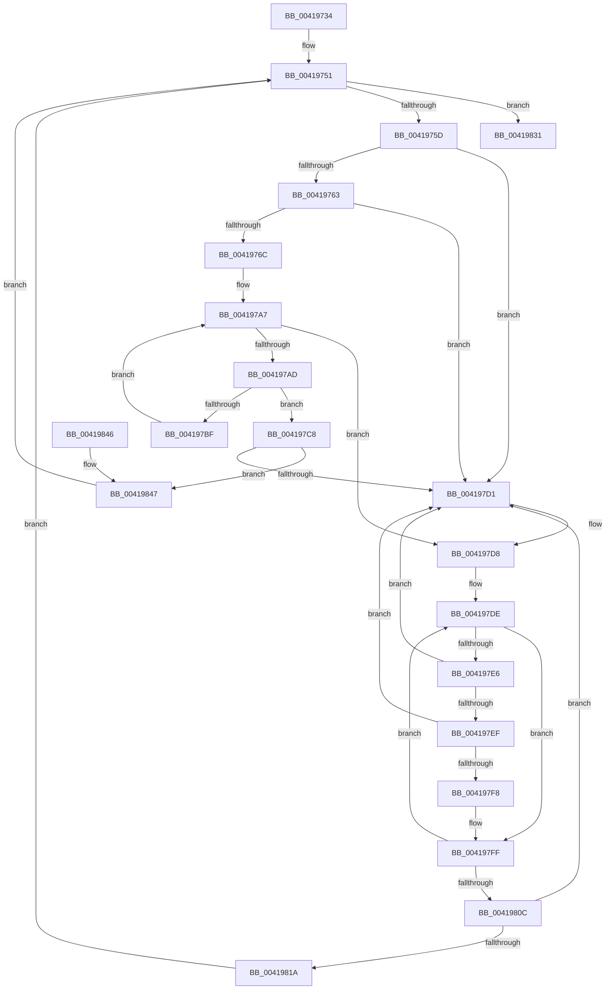

# MiInsertReadiedSystemCacheViews

- RVA: `0x00419734`–`0x0041985E` (길이 `298` bytes)
- VA: `0x0000000140419734`
- 실행 섹션: `.text`
- PDB 이름 있음: `예`; PDB Function 태그: `아니요`
- unwind 정보 RVA: `0x0009D144`
- 디코드: `81`개 명령, `298/298` bytes 표시
- 미해석 바이트: `0` (있으면 어셈블리에 `.byte`로 보존)

> 이 문서는 커널 이미지의 기계어와 PDB 기호를 분석해 생성했습니다. 4번과 5번은 함수 원형과 자료형을 바이너리 사용 방식에서 추정한 C 해석이며 원본 소스 복구 결과는 아닙니다.

## 1. Dependencies

- 직접 호출 지점: **0**; 고유 호출 대상: **0**
- 직접 호출자로 확인된 함수: **3**
- RIP 상대 이미지 참조: **0**

### Outgoing calls
- 직접 디코드된 call 명령이 없습니다.

### Direct callers
- [sub_00238B4C](../23/Unknown_function_00238B4C.md) at `0x00238B70`
- [sub_00238B4C](../23/Unknown_function_00238B4C.md) at `0x00238B9F`
- [sub_00238B4C](../23/Unknown_function_00238B4C.md) at `0x00238BCE`
- [sub_00238B4C](../23/Unknown_function_00238B4C.md) at `0x00238BFA`
- [MiConsumeSystemCacheTbFlushNeededView](MiConsumeSystemCacheTbFlushNeededView_function_004193B4.md) at `0x00419562`
- [MiRebalanceSystemCacheFreedViews](MiRebalanceSystemCacheFreedViews_function_00419620.md) at `0x00419699`
- [MiRebalanceSystemCacheFreedViews](MiRebalanceSystemCacheFreedViews_function_00419620.md) at `0x004196C1`
- [MiRebalanceSystemCacheFreedViews](MiRebalanceSystemCacheFreedViews_function_00419620.md) at `0x004196F1`
- [MiRebalanceSystemCacheFreedViews](MiRebalanceSystemCacheFreedViews_function_00419620.md) at `0x00419721`

### Static image references
- 디코드된 RIP-relative 메모리 참조가 없습니다.

## 2. Other-region calls and transfers

- 다른 실행 섹션으로 향하는 call: **0**
- 별도 외부 분기/꼬리 이동을 확인하지 못했습니다.

## 3. Assembly (complete function range)

```asm
00419734  48 89 5C 24 08                  mov qword ptr [rsp + 8], rbx
00419739  48 89 74 24 10                  mov qword ptr [rsp + 0x10], rsi
0041973E  48 89 7C 24 18                  mov qword ptr [rsp + 0x18], rdi
00419743  4C 8D 81 00 09 00 00            lea r8, [rcx + 0x900]
0041974A  4C 8D 89 20 09 00 00            lea r9, [rcx + 0x920]
00419751  48 8B 0A                        mov rcx, qword ptr [rdx]
00419754  48 3B CA                        cmp rcx, rdx
00419757  0F 84 D4 00 00 00               je 0x140419831
0041975D  48 39 51 08                     cmp qword ptr [rcx + 8], rdx
00419761  75 6E                           jne 0x1404197d1
00419763  48 8B 01                        mov rax, qword ptr [rcx]
00419766  48 39 48 08                     cmp qword ptr [rax + 8], rcx
0041976A  75 65                           jne 0x1404197d1
0041976C  48 89 02                        mov qword ptr [rdx], rax
0041976F  49 BA FF FF FF FF FF FF FF 3F   movabs r10, 0x3fffffffffffffff
00419779  48 89 50 08                     mov qword ptr [rax + 8], rdx
0041977D  48 8B 41 20                     mov rax, qword ptr [rcx + 0x20]
00419781  49 23 C2                        and rax, r10
00419784  4C 8B D1                        mov r10, rcx
00419787  48 89 41 20                     mov qword ptr [rcx + 0x20], rax
0041978B  8B 79 10                        mov edi, dword ptr [rcx + 0x10]
0041978E  48 C1 EF 12                     shr rdi, 0x12
00419792  83 E7 07                        and edi, 7
00419795  48 8D 04 BF                     lea rax, [rdi + rdi*4]
00419799  48 C1 E0 03                     shl rax, 3
0041979D  4C 2B D0                        sub r10, rax
004197A0  45 33 DB                        xor r11d, r11d
004197A3  49 8D 5A 20                     lea rbx, [r10 + 0x20]
004197A7  41 83 FB 08                     cmp r11d, 8
004197AB  73 2B                           jae 0x1404197d8
004197AD  48 8B 03                        mov rax, qword ptr [rbx]
004197B0  48 BE 00 00 00 00 00 00 00 40   movabs rsi, 0x4000000000000000
004197BA  48 3B C6                        cmp rax, rsi
004197BD  73 09                           jae 0x1404197c8
004197BF  48 83 C3 28                     add rbx, 0x28
004197C3  41 FF C3                        inc r11d
004197C6  EB DF                           jmp 0x1404197a7
004197C8  49 8B 40 08                     mov rax, qword ptr [r8 + 8]
004197CC  4C 39 00                        cmp qword ptr [rax], r8
004197CF  74 76                           je 0x140419847
004197D1  B9 03 00 00 00                  mov ecx, 3
004197D6  CD 29                           int 0x29
004197D8  49 8B CA                        mov rcx, r10
004197DB  45 33 DB                        xor r11d, r11d
004197DE  41 8B C3                        mov eax, r11d
004197E1  48 3B C7                        cmp rax, rdi
004197E4  74 19                           je 0x1404197ff
004197E6  48 8B 19                        mov rbx, qword ptr [rcx]
004197E9  48 39 4B 08                     cmp qword ptr [rbx + 8], rcx
004197ED  75 E2                           jne 0x1404197d1
004197EF  48 8B 41 08                     mov rax, qword ptr [rcx + 8]
004197F3  48 39 08                        cmp qword ptr [rax], rcx
004197F6  75 D9                           jne 0x1404197d1
004197F8  48 89 18                        mov qword ptr [rax], rbx
004197FB  48 89 43 08                     mov qword ptr [rbx + 8], rax
004197FF  48 83 C1 28                     add rcx, 0x28
00419803  41 FF C3                        inc r11d
00419806  41 83 FB 08                     cmp r11d, 8
0041980A  72 D2                           jb 0x1404197de
0041980C  49 83 40 10 F9                  add qword ptr [r8 + 0x10], -7
00419811  49 8B 41 08                     mov rax, qword ptr [r9 + 8]
00419815  4C 39 08                        cmp qword ptr [rax], r9
00419818  75 B7                           jne 0x1404197d1
0041981A  4D 89 0A                        mov qword ptr [r10], r9
0041981D  49 89 42 08                     mov qword ptr [r10 + 8], rax
00419821  4C 89 10                        mov qword ptr [rax], r10
00419824  4D 89 51 08                     mov qword ptr [r9 + 8], r10
00419828  49 FF 41 10                     inc qword ptr [r9 + 0x10]
0041982C  E9 20 FF FF FF                  jmp 0x140419751
00419831  48 83 62 10 00                  and qword ptr [rdx + 0x10], 0
00419836  48 8B 5C 24 08                  mov rbx, qword ptr [rsp + 8]
0041983B  48 8B 74 24 10                  mov rsi, qword ptr [rsp + 0x10]
00419840  48 8B 7C 24 18                  mov rdi, qword ptr [rsp + 0x18]
00419845  C3                              ret
00419846  CC                              int3
00419847  4C 89 01                        mov qword ptr [rcx], r8
0041984A  48 89 41 08                     mov qword ptr [rcx + 8], rax
0041984E  48 89 08                        mov qword ptr [rax], rcx
00419851  49 89 48 08                     mov qword ptr [r8 + 8], rcx
00419855  49 FF 40 10                     inc qword ptr [r8 + 0x10]
00419859  E9 F3 FE FF FF                  jmp 0x140419751
```

## 4. C-style interpretation (structured pseudocode)

```c
__int64 __fastcall MiInsertReadiedSystemCacheViews(__int64 a1, __int64 a2)
{
    __int64 result;
    __int64 v_r10;
    __int64 v_r11;
    __int64 v_rbx;
    __int64 v_rdi;
    unsigned __int64 v_stack_p10;
    unsigned __int64 v_stack_p18;
    unsigned __int64 v_stack_p8;

    v_stack_p8 = v_rbx;
    v_stack_p10 = v_rsi;
    v_stack_p18 = v_rdi;
loc_00419751:
    if ((*(unsigned __int64 *)(a2)) == a2) goto loc_00419831;
    if ((*(unsigned __int64 *)(*(unsigned __int64 *)(a2) + 8)) != a2) goto loc_004197D1;
    if ((*(unsigned __int64 *)(*(unsigned __int64 *)(*(unsigned __int64 *)(a2)) + 8)) != (*(unsigned __int64 *)(a2))) goto loc_004197D1;
    *(unsigned __int64 *)(a2) = *(unsigned __int64 *)(*(unsigned __int64 *)(a2));
    *(unsigned __int64 *)(*(unsigned __int64 *)(*(unsigned __int64 *)(a2)) + 8) = a2;
    result = (*(unsigned __int64 *)(*(unsigned __int64 *)(a2) + 32)) & (v_r10);
    *(unsigned __int64 *)(*(unsigned __int64 *)(a2) + 32) = result;
    v_rdi = ((unsigned int)(*(unsigned int *)(*(unsigned __int64 *)(a2) + 16))) >> (18);
    v_rdi = (unsigned int)((v_rdi) & (7));
    result = (v_rdi + v_rdi * 4) << (3);
    v_r10 = (*(unsigned __int64 *)(a2)) - (result);
    v_r11 = 0;
loc_004197A7:
    if (0 >= 8) goto loc_004197D8;
    if ((*(unsigned __int64 *)(v_r10 + 32)) >= v_rsi) goto loc_004197C8;
    v_rbx = (v_r10 + 32) + (40);
    v_r11 = (unsigned int)((v_r11) + 1);
    goto loc_004197A7;
loc_004197C8:
    if ((*(unsigned __int64 *)(*(unsigned __int64 *)(a1 + 2304 + 8))) == (a1 + 2304)) goto loc_00419847;
loc_004197D1:
loc_004197D8:
    v_r11 = 0;
loc_004197DE:
    if (0 == v_rdi) goto loc_004197FF;
    if ((*(unsigned __int64 *)(*(unsigned __int64 *)(v_r10) + 8)) != v_r10) goto loc_004197D1;
    if ((*(unsigned __int64 *)(*(unsigned __int64 *)(v_r10 + 8))) != v_r10) goto loc_004197D1;
    *(unsigned __int64 *)(*(unsigned __int64 *)(v_r10 + 8)) = *(unsigned __int64 *)(v_r10);
    *(unsigned __int64 *)(*(unsigned __int64 *)(v_r10) + 8) = *(unsigned __int64 *)(v_r10 + 8);
loc_004197FF:
    a1 = (v_r10) + (40);
    v_r11 = (unsigned int)((v_r11) + 1);
    if (((unsigned int)(v_r11)) < 8) goto loc_004197DE;
    if ((*(unsigned __int64 *)(*(unsigned __int64 *)(a1 + 2336 + 8))) != (a1 + 2336)) goto loc_004197D1;
    *(unsigned __int64 *)(v_r10) = a1 + 2336;
    *(unsigned __int64 *)(v_r10 + 8) = *(unsigned __int64 *)(a1 + 2336 + 8);
    *(unsigned __int64 *)(*(unsigned __int64 *)(a1 + 2336 + 8)) = v_r10;
    *(unsigned __int64 *)(a1 + 2336 + 8) = v_r10;
    goto loc_00419751;
loc_00419831:
    return *(unsigned __int64 *)(a1 + 2336 + 8);
loc_00419847:
    *(unsigned __int64 *)(a1) = a1 + 2304;
    *(unsigned __int64 *)(a1 + 8) = *(unsigned __int64 *)(a1 + 2336 + 8);
    *(unsigned __int64 *)(*(unsigned __int64 *)(a1 + 2336 + 8)) = a1;
    *(unsigned __int64 *)(a1 + 2304 + 8) = a1;
    goto loc_00419751;
}
```

## 5. (Beta) C Style

```c
int64_t MiInsertReadiedSystemCacheViews(void *Arg1, void *Arg2)
{
    uint8_t *arg1 = (uint8_t *)Arg1;
    uint8_t *arg2 = (uint8_t *)Arg2;

    int64_t result;
    int64_t local_r10;
    int64_t local_r11;
    int64_t local_rbx;
    int64_t local_rdi;
    uint64_t v_stack_p10;
    uint64_t v_stack_p18;
    uint64_t v_stack_p8;

    v_stack_p8 = local_rbx;
    v_stack_p10 = local_rsi;
    v_stack_p18 = local_rdi;
loc_00419751:
    if ((*(uint64_t *)(arg2)) == Arg2) goto loc_00419831;
    if ((*(uint64_t *)(*(uint64_t *)(arg2) + 0x8)) != Arg2) goto loc_004197D1;
    if ((*(uint64_t *)(*(uint64_t *)(*(uint64_t *)(arg2)) + 0x8)) != (*(uint64_t *)(arg2))) goto loc_004197D1;
    *(uint64_t *)(arg2) = *(uint64_t *)(*(uint64_t *)(arg2));
    *(void **)(*(uint64_t *)(*(uint64_t *)(arg2)) + 0x8) = Arg2;
    result = (*(uint64_t *)(*(uint64_t *)(arg2) + 0x20)) & (local_r10);
    *(uint64_t *)(*(uint64_t *)(arg2) + 0x20) = result;
    local_rdi = ((uint32_t)(*(uint32_t *)(*(uint64_t *)(arg2) + 0x10))) >> (18);
    local_rdi = (uint32_t)((local_rdi) & (7));
    result = (local_rdi + local_rdi * 4) << (3);
    local_r10 = (*(uint64_t *)(arg2)) - (result);
    local_r11 = 0;
loc_004197A7:
    if (0 >= 8) goto loc_004197D8;
    if ((*(uint64_t *)(local_r10 + 0x20)) >= local_rsi) goto loc_004197C8;
    local_rbx = (local_r10 + 32) + (40);
    local_r11 = (uint32_t)((local_r11) + 1);
    goto loc_004197A7;
loc_004197C8:
    if ((*(uint64_t *)(*(uint64_t *)(arg1 + 0x900 + 0x8))) == (Arg1 + 2304)) goto loc_00419847;
loc_004197D1:
loc_004197D8:
    local_r11 = 0;
loc_004197DE:
    if (0 == local_rdi) goto loc_004197FF;
    if ((*(uint64_t *)(*(uint64_t *)(local_r10) + 0x8)) != local_r10) goto loc_004197D1;
    if ((*(uint64_t *)(*(uint64_t *)(local_r10 + 0x8))) != local_r10) goto loc_004197D1;
    *(uint64_t *)(*(uint64_t *)(local_r10 + 0x8)) = *(uint64_t *)(local_r10);
    *(uint64_t *)(*(uint64_t *)(local_r10) + 0x8) = *(uint64_t *)(local_r10 + 0x8);
loc_004197FF:
    Arg1 = (local_r10) + (40);
    local_r11 = (uint32_t)((local_r11) + 1);
    if (((uint32_t)(local_r11)) < 8) goto loc_004197DE;
    if ((*(uint64_t *)(*(uint64_t *)(arg1 + 0x920 + 0x8))) != (Arg1 + 2336)) goto loc_004197D1;
    *(void **)(local_r10) = Arg1 + 2336;
    *(uint64_t *)(local_r10 + 0x8) = *(uint64_t *)(arg1 + 0x920 + 0x8);
    *(uint64_t *)(*(uint64_t *)(arg1 + 0x920 + 0x8)) = local_r10;
    *(uint64_t *)(arg1 + 0x920 + 0x8) = local_r10;
    goto loc_00419751;
loc_00419831:
    return *(uint64_t *)(arg1 + 0x920 + 0x8);
loc_00419847:
    *(void **)(arg1) = Arg1 + 2304;
    *(uint64_t *)(arg1 + 0x8) = *(uint64_t *)(arg1 + 0x920 + 0x8);
    *(void **)(*(uint64_t *)(arg1 + 0x920 + 0x8)) = Arg1;
    *(void **)(arg1 + 0x900 + 0x8) = Arg1;
    goto loc_00419751;
}
```

### 관측된 메모리 오프셋

구조체 형식이 확인되지 않은 접근은 인자 기준의 오프셋으로만 기록했습니다.

| 기준 인자 | 오프셋 표현 | 폭 (bit) | 접근 |
|---|---:|---:|---|
| `Arg1` | `+ 0x8` | `64` | `R` |
| `Arg1` | `+ 0x8` | `64` | `W` |
| `Arg1` | `+ 0x10` | `64` | `R/W` |
| `Arg1` | `+ 0x900` | `64` | `R` |
| `Arg1` | `+ 0x920` | `64` | `R` |
| `Arg2` | `+ 0x0` | `64` | `R` |
| `Arg2` | `+ 0x0` | `64` | `W` |
| `Arg2` | `+ 0x10` | `64` | `R/W` |

## 6. Execution-region graph

[열기: 2D/3D 그래프와 함수 탐색 컨트롤 패널](../../../control-panel.html?section=text&rva=0x00419734&view=graph)

- 2D 그래프는 위에서 아래로 흐르고, 3D 그래프는 빈 공간을 드래그해 회전합니다. Shift+드래그는 이동, 휠은 확대·축소, 함수 노드 선택은 대상 보고서 이동입니다.

### Static fallback


