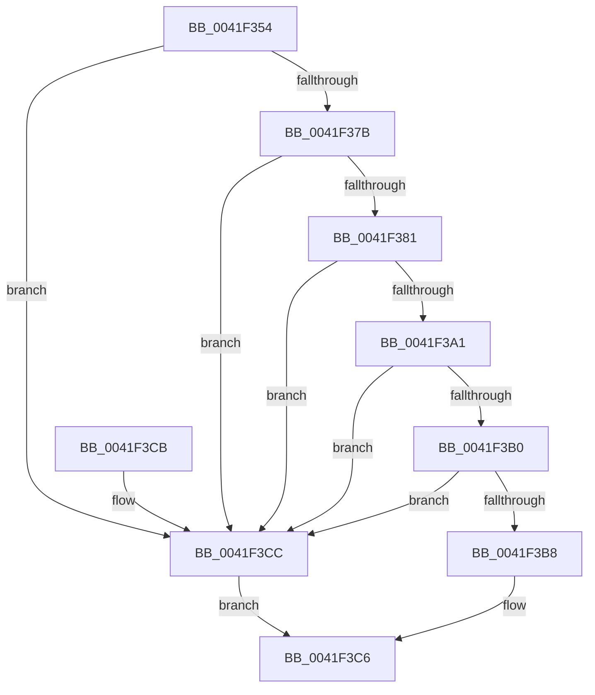

# MiIsPfnLocked

- RVA: `0x0041F354`–`0x0041F3D1` (길이 `125` bytes)
- VA: `0x000000014041F354`
- 실행 섹션: `.text`
- PDB 이름 있음: `예`; PDB Function 태그: `아니요`
- unwind 정보 RVA: `0x0009FDFC`
- 디코드: `35`개 명령, `125/125` bytes 표시
- 미해석 바이트: `0` (있으면 어셈블리에 `.byte`로 보존)

> 이 문서는 커널 이미지의 기계어와 PDB 기호를 분석해 생성했습니다. 4번과 5번은 함수 원형과 자료형을 바이너리 사용 방식에서 추정한 C 해석이며 원본 소스 복구 결과는 아닙니다.

## 1. Dependencies

- 직접 호출 지점: **1**; 고유 호출 대상: **1**
- 직접 호출자로 확인된 함수: **2**
- RIP 상대 이미지 참조: **0**

### Outgoing calls
- `0x0041F3B8` → [MiPfnIsNonPagedPool](MiPfnIsNonPagedPool_function_0041F3D8.md) (function, `0x0041F3D8`)

### Direct callers
- [MiDecommitFreePagesTail](MiDecommitFreePagesTail_function_0041ECE0.md) at `0x0041EFEB`
- [MmIsMdlPageLocked](../../pagevrfy/BB/MmIsMdlPageLocked_function_00BB46E8.md) at `0x00BB4758`

### Static image references
- 디코드된 RIP-relative 메모리 참조가 없습니다.

## 2. Other-region calls and transfers

- 다른 실행 섹션으로 향하는 call: **0**
- 별도 외부 분기/꼬리 이동을 확인하지 못했습니다.

## 3. Assembly (complete function range)

```asm
0041F354  48 83 EC 28                     sub rsp, 0x28
0041F358  8B 51 20                        mov edx, dword ptr [rcx + 0x20]
0041F35B  49 B8 FF FF FF FF FF FF FF 3F   movabs r8, 0x3fffffffffffffff
0041F365  48 8B 41 18                     mov rax, qword ptr [rcx + 0x18]
0041F369  41 B9 01 00 00 00               mov r9d, 1
0041F36F  49 23 C0                        and rax, r8
0041F372  44 0F B7 C2                     movzx r8d, dx
0041F376  4C 3B C0                        cmp r8, rax
0041F379  77 51                           ja 0x14041f3cc
0041F37B  66 41 3B D1                     cmp dx, r9w
0041F37F  77 4B                           ja 0x14041f3cc
0041F381  48 8B 41 28                     mov rax, qword ptr [rcx + 0x28]
0041F385  48 BA FF FF FF FF FF 00 00 00   movabs rdx, 0xffffffffff
0041F38F  48 23 C2                        and rax, rdx
0041F392  48 BA FE FF FF FF 3F 00 00 00   movabs rdx, 0x3ffffffffe
0041F39C  48 3B C2                        cmp rax, rdx
0041F39F  74 2B                           je 0x14041f3cc
0041F3A1  48 8B 41 28                     mov rax, qword ptr [rcx + 0x28]
0041F3A5  48 C1 E8 3C                     shr rax, 0x3c
0041F3A9  24 07                           and al, 7
0041F3AB  41 3A C1                        cmp al, r9b
0041F3AE  74 1C                           je 0x14041f3cc
0041F3B0  48 8B 01                        mov rax, qword ptr [rcx]
0041F3B3  41 84 C1                        test r9b, al
0041F3B6  74 14                           je 0x14041f3cc
0041F3B8  E8 1B 00 00 00                  call 0x14041f3d8
0041F3BD  33 C9                           xor ecx, ecx
0041F3BF  85 C0                           test eax, eax
0041F3C1  0F 95 C1                        setne cl
0041F3C4  8B C1                           mov eax, ecx
0041F3C6  48 83 C4 28                     add rsp, 0x28
0041F3CA  C3                              ret
0041F3CB  CC                              int3
0041F3CC  41 8B C1                        mov eax, r9d
0041F3CF  EB F5                           jmp 0x14041f3c6
```

## 4. C-style interpretation (structured pseudocode)

```c
__int64 __fastcall MiIsPfnLocked(__int64 a1)
{
    __int64 result;
    __int64 v_rsp;

    v_rsp = (v_rsp) - (40);
    result = (*(unsigned __int64 *)(a1 + 24)) & (a3);
    if (((unsigned __int16)((unsigned int)(*(unsigned int *)(a1 + 32)))) > result) goto loc_0041F3CC;
    if (((unsigned __int16)((unsigned int)(*(unsigned int *)(a1 + 32)))) > 1) goto loc_0041F3CC;
    result = (*(unsigned __int64 *)(a1 + 40)) & ((unsigned int)(*(unsigned int *)(a1 + 32)));
    if (result == ((unsigned int)(*(unsigned int *)(a1 + 32)))) goto loc_0041F3CC;
    result = (*(unsigned __int64 *)(a1 + 40)) >> (60);
    result = (unsigned __int8)((result) & (7));
    if (((unsigned __int8)(result)) == 1) goto loc_0041F3CC;
    if (((1) & ((unsigned __int8)(*(unsigned __int64 *)(a1)))) == 0) goto loc_0041F3CC;
    result = MiPfnIsNonPagedPool(a1, (unsigned int)(*(unsigned int *)(a1 + 32)), (unsigned __int16)((unsigned int)(*(unsigned int *)(a1 + 32))), 1);
    a1 = 0;
    a1 = ((unsigned int)(result) != 0) ? 1 : 0;
loc_0041F3C6:
    v_rsp = (v_rsp) + (40);
    return (unsigned int)((unsigned int)(a1));
loc_0041F3CC:
    goto loc_0041F3C6;
}
```

## 5. (Beta) C Style

```c
int64_t MiIsPfnLocked(void *Arg1)
{
    uint8_t *arg1 = (uint8_t *)Arg1;

    int64_t result;
    int64_t local_rsp;

    local_rsp = (local_rsp) - (40);
    result = (*(uint64_t *)(arg1 + 0x18)) & (a3);
    if (((uint16_t)((uint32_t)(*(uint32_t *)(arg1 + 0x20)))) > result) goto loc_0041F3CC;
    if (((uint16_t)((uint32_t)(*(uint32_t *)(arg1 + 0x20)))) > 1) goto loc_0041F3CC;
    result = (*(uint64_t *)(arg1 + 0x28)) & ((uint32_t)(*(uint32_t *)(arg1 + 0x20)));
    if (result == ((uint32_t)(*(uint32_t *)(arg1 + 0x20)))) goto loc_0041F3CC;
    result = (*(uint64_t *)(arg1 + 0x28)) >> (60);
    result = (uint8_t)((result) & (7));
    if (((uint8_t)(result)) == 1) goto loc_0041F3CC;
    if (((1) & ((uint8_t)(*(uint64_t *)(arg1)))) == 0) goto loc_0041F3CC;
    result = MiPfnIsNonPagedPool(Arg1, (uint32_t)(*(uint32_t *)(arg1 + 0x20)), (uint16_t)((uint32_t)(*(uint32_t *)(arg1 + 0x20))), 1);
    Arg1 = 0;
    Arg1 = ((uint32_t)(result) != 0) ? 1 : 0;
loc_0041F3C6:
    local_rsp = (local_rsp) + (40);
    return (uint32_t)((uint32_t)(Arg1));
loc_0041F3CC:
    goto loc_0041F3C6;
}
```

### 관측된 메모리 오프셋

구조체 형식이 확인되지 않은 접근은 인자 기준의 오프셋으로만 기록했습니다.

| 기준 인자 | 오프셋 표현 | 폭 (bit) | 접근 |
|---|---:|---:|---|
| `Arg1` | `+ 0x0` | `64` | `R` |
| `Arg1` | `+ 0x18` | `64` | `R` |
| `Arg1` | `+ 0x20` | `32` | `R` |
| `Arg1` | `+ 0x28` | `64` | `R` |

## 6. Execution-region graph

[열기: 2D/3D 그래프와 함수 탐색 컨트롤 패널](../../../control-panel.html?section=text&rva=0x0041F354&view=graph)

- 2D 그래프는 위에서 아래로 흐르고, 3D 그래프는 빈 공간을 드래그해 회전합니다. Shift+드래그는 이동, 휠은 확대·축소, 함수 노드 선택은 대상 보고서 이동입니다.

### Static fallback


