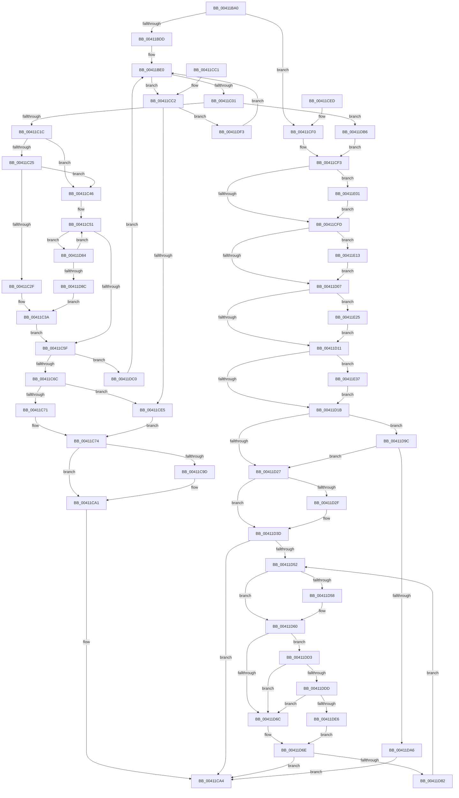

# MiLockPageListAndLastPage

- RVA: `0x00411BA0`–`0x00411E49` (길이 `681` bytes)
- VA: `0x0000000140411BA0`
- 실행 섹션: `.text`
- PDB 이름 있음: `예`; PDB Function 태그: `아니요`
- unwind 정보 RVA: `0x0009BE7C`
- 디코드: `167`개 명령, `681/681` bytes 표시
- 미해석 바이트: `0` (있으면 어셈블리에 `.byte`로 보존)

> 이 문서는 커널 이미지의 기계어와 PDB 기호를 분석해 생성했습니다. 4번과 5번은 함수 원형과 자료형을 바이너리 사용 방식에서 추정한 C 해석이며 원본 소스 복구 결과는 아닙니다.

## 1. Dependencies

- 직접 호출 지점: **9**; 고유 호출 대상: **8**
- 직접 호출자로 확인된 함수: **1**
- RIP 상대 이미지 참조: **4**

### Outgoing calls
- `0x00411C35` → [ExpAcquireSpinLockSharedAtDpcLevelInstrumented](../27/ExpAcquireSpinLockSharedAtDpcLevelInstrumented_function_0027CD20.md) (function, `0x0027CD20`)
- `0x00411CC9` → [ExAcquireSpinLockSharedAtDpcLevel](../24/ExAcquireSpinLockSharedAtDpcLevel_function_00248E30.md) (function, `0x00248E30`)
- `0x00411D35` → [ExpWaitForSpinLockExclusiveAndAcquire](../32/ExpWaitForSpinLockExclusiveAndAcquire_function_003239A0.md) (function, `0x003239A0`)
- `0x00411D92` → [ExpWaitForSpinLockSharedAndAcquire](../36/ExpWaitForSpinLockSharedAndAcquire_function_00362380.md) (function, `0x00362380`)
- `0x00411DAC` → [ExpAcquireSpinLockExclusiveAtDpcLevelInstrumented](../32/ExpAcquireSpinLockExclusiveAtDpcLevelInstrumented_function_00323A70.md) (function, `0x00323A70`)
- `0x00411DC4` → [ExReleaseSpinLockSharedFromDpcLevel](../24/ExReleaseSpinLockSharedFromDpcLevel_function_0024A590.md) (function, `0x0024A590`)
- `0x00411DDD` → [KiCheckVpBackingLongSpinWaitHypercall](../30/KiCheckVpBackingLongSpinWaitHypercall_function_0030F490.md) (function, `0x0030F490`)
- `0x00411DE9` → [HvlNotifyLongSpinWait](../30/HvlNotifyLongSpinWait_function_0030F460.md) (function, `0x0030F460`)
- `0x00411DF7` → [ExReleaseSpinLockSharedFromDpcLevel](../24/ExReleaseSpinLockSharedFromDpcLevel_function_0024A590.md) (function, `0x0024A590`)

### Direct callers
- [MiInsertPageInList](../2B/MiInsertPageInList_function_002BA000.md) at `0x002BA1D0`
- [MiInsertPageInList](../2B/MiInsertPageInList_function_002BA000.md) at `0x002BA6E6`
- [MiInsertPageInList](../2B/MiInsertPageInList_function_002BA000.md) at `0x002BA81A`

### Static image references
- `0x00411C1C` → RVA `0x00FC6B06` (`ALMOSTRO`; read)
- `0x00411C25` → RVA `0x00F0DE58` (`.data`; read)
- `0x00411D63` → RVA `0x00FC52AC` (`ALMOSTRO`; reference)
- `0x00411DD3` → RVA `0x00FC6AB8` (`ALMOSTRO`; read)

## 2. Other-region calls and transfers

- 다른 실행 섹션으로 향하는 call: **0**
- 별도 외부 분기/꼬리 이동을 확인하지 못했습니다.

## 3. Assembly (complete function range)

```asm
00411BA0  48 89 5C 24 10                  mov qword ptr [rsp + 0x10], rbx
00411BA5  48 89 6C 24 18                  mov qword ptr [rsp + 0x18], rbp
00411BAA  48 89 74 24 20                  mov qword ptr [rsp + 0x20], rsi
00411BAF  57                              push rdi
00411BB0  41 54                           push r12
00411BB2  41 55                           push r13
00411BB4  41 56                           push r14
00411BB6  41 57                           push r15
00411BB8  48 83 EC 20                     sub rsp, 0x20
00411BBC  F0 48 0F BA 69 40 3F            lock bts qword ptr [rcx + 0x40], 0x3f
00411BC3  48 8D 79 28                     lea rdi, [rcx + 0x28]
00411BC7  48 8B DA                        mov rbx, rdx
00411BCA  48 8B F1                        mov rsi, rcx
00411BCD  49 BD FF FF FF FF FF FF FF 7F   movabs r13, 0x7fffffffffffffff
00411BD7  0F 82 13 01 00 00               jb 0x140411cf0
00411BDD  45 33 E4                        xor r12d, r12d
00411BE0  4C 8B 76 18                     mov r14, qword ptr [rsi + 0x18]
00411BE4  49 BA FF FF FF FF 3F 00 00 00   movabs r10, 0x3fffffffff
00411BEE  48 B8 00 00 00 00 00 DE FF FF   movabs rax, 0xffffde0000000000
00411BF8  4D 3B F2                        cmp r14, r10
00411BFB  0F 84 C1 00 00 00               je 0x140411cc2
00411C01  4B 8D 2C 76                     lea rbp, [r14 + r14*2]
00411C05  48 C1 E5 04                     shl rbp, 4
00411C09  48 8B C0                        mov rax, rax
00411C0C  48 03 E8                        add rbp, rax
00411C0F  F0 48 0F BA 6D 18 3F            lock bts qword ptr [rbp + 0x18], 0x3f
00411C16  0F 82 9A 01 00 00               jb 0x140411db6
00411C1C  F6 05 E3 4E BB 00 21            test byte ptr [rip + 0xbb4ee3], 0x21
00411C23  74 21                           je 0x140411c46
00411C25  8B 05 2D C2 AF 00               mov eax, dword ptr [rip + 0xafc22d]
00411C2B  85 C0                           test eax, eax
00411C2D  75 17                           jne 0x140411c46
00411C2F  B2 FF                           mov dl, 0xff
00411C31  48 8D 4E 20                     lea rcx, [rsi + 0x20]
00411C35  E8 E6 B0 E6 FF                  call 0x14027cd20
00411C3A  49 BA FF FF FF FF 3F 00 00 00   movabs r10, 0x3fffffffff
00411C44  EB 19                           jmp 0x140411c5f
00411C46  0F 0D 4E 20                     prefetchw byte ptr [rsi + 0x20]
00411C4A  8B 46 20                        mov eax, dword ptr [rsi + 0x20]
00411C4D  0F BA F0 1F                     btr eax, 0x1f
00411C51  8D 48 01                        lea ecx, [rax + 1]
00411C54  F0 0F B1 4E 20                  lock cmpxchg dword ptr [rsi + 0x20], ecx
00411C59  0F 85 25 01 00 00               jne 0x140411d84
00411C5F  48 8B 46 18                     mov rax, qword ptr [rsi + 0x18]
00411C63  4C 3B F0                        cmp r14, rax
00411C66  0F 85 54 01 00 00               jne 0x140411dc0
00411C6C  48 85 ED                        test rbp, rbp
00411C6F  74 74                           je 0x140411ce5
00411C71  48 8B D5                        mov rdx, rbp
00411C74  B9 10 00 00 00                  mov ecx, 0x10
00411C79  B8 08 00 00 00                  mov eax, 8
00411C7E  4C 8B CB                        mov r9, rbx
00411C81  4C 8B C3                        mov r8, rbx
00411C84  48 89 14 19                     mov qword ptr [rcx + rbx], rdx
00411C88  4C 89 34 18                     mov qword ptr [rax + rbx], r14
00411C8C  C6 43 18 01                     mov byte ptr [rbx + 0x18], 1
00411C90  48 89 7B 28                     mov qword ptr [rbx + 0x28], rdi
00411C94  4C 89 53 20                     mov qword ptr [rbx + 0x20], r10
00411C98  48 85 ED                        test rbp, rbp
00411C9B  74 04                           je 0x140411ca1
00411C9D  C6 43 30 01                     mov byte ptr [rbx + 0x30], 1
00411CA1  C6 03 01                        mov byte ptr [rbx], 1
00411CA4  48 8B 5C 24 58                  mov rbx, qword ptr [rsp + 0x58]
00411CA9  48 8B 6C 24 60                  mov rbp, qword ptr [rsp + 0x60]
00411CAE  48 8B 74 24 68                  mov rsi, qword ptr [rsp + 0x68]
00411CB3  48 83 C4 20                     add rsp, 0x20
00411CB7  41 5F                           pop r15
00411CB9  41 5E                           pop r14
00411CBB  41 5D                           pop r13
00411CBD  41 5C                           pop r12
00411CBF  5F                              pop rdi
00411CC0  C3                              ret
00411CC1  CC                              int3
00411CC2  48 8D 4E 20                     lea rcx, [rsi + 0x20]
00411CC6  49 8B EC                        mov rbp, r12
00411CC9  E8 62 71 E3 FF                  call 0x140248e30
00411CCE  48 8B 46 18                     mov rax, qword ptr [rsi + 0x18]
00411CD2  49 BA FF FF FF FF 3F 00 00 00   movabs r10, 0x3fffffffff
00411CDC  49 3B C2                        cmp rax, r10
00411CDF  0F 85 0E 01 00 00               jne 0x140411df3
00411CE5  4D 8B F2                        mov r14, r10
00411CE8  48 8B D7                        mov rdx, rdi
00411CEB  EB 87                           jmp 0x140411c74
00411CED  0F 1F 00                        nop dword ptr [rax]
00411CF0  45 33 E4                        xor r12d, r12d
00411CF3  80 7B 18 00                     cmp byte ptr [rbx + 0x18], 0
00411CF7  0F 85 04 01 00 00               jne 0x140411e01
00411CFD  80 7B 30 00                     cmp byte ptr [rbx + 0x30], 0
00411D01  0F 85 0C 01 00 00               jne 0x140411e13
00411D07  80 7B 48 00                     cmp byte ptr [rbx + 0x48], 0
00411D0B  0F 85 14 01 00 00               jne 0x140411e25
00411D11  80 7B 60 00                     cmp byte ptr [rbx + 0x60], 0
00411D15  0F 85 1C 01 00 00               jne 0x140411e37
00411D1B  C6 03 00                        mov byte ptr [rbx], 0
00411D1E  F6 05 E1 4D BB 00 21            test byte ptr [rip + 0xbb4de1], 0x21
00411D25  75 75                           jne 0x140411d9c
00411D27  F0 0F BA 6E 20 1F               lock bts dword ptr [rsi + 0x20], 0x1f
00411D2D  73 0E                           jae 0x140411d3d
00411D2F  B2 FF                           mov dl, 0xff
00411D31  48 8D 4E 20                     lea rcx, [rsi + 0x20]
00411D35  E8 66 1C F1 FF                  call 0x1403239a0
00411D3A  44 8B E0                        mov r12d, eax
00411D3D  8B 56 20                        mov edx, dword ptr [rsi + 0x20]
00411D40  8B CA                           mov ecx, edx
00411D42  0F BA F1 1E                     btr ecx, 0x1e
00411D46  81 F9 00 00 00 80               cmp ecx, 0x80000000
00411D4C  0F 84 52 FF FF FF               je 0x140411ca4
00411D52  0F BA E2 1E                     bt edx, 0x1e
00411D56  72 08                           jb 0x140411d60
00411D58  F0 81 4E 20 00 00 00 40         lock or dword ptr [rsi + 0x20], 0x40000000
00411D60  41 FF C4                        inc r12d
00411D63  44 85 25 42 35 BB 00            test dword ptr [rip + 0xbb3542], r12d
00411D6A  74 67                           je 0x140411dd3
00411D6C  F3 90                           pause
00411D6E  8B 56 20                        mov edx, dword ptr [rsi + 0x20]
00411D71  8B C2                           mov eax, edx
00411D73  0F BA F0 1E                     btr eax, 0x1e
00411D77  3D 00 00 00 80                  cmp eax, 0x80000000
00411D7C  0F 84 22 FF FF FF               je 0x140411ca4
00411D82  EB CE                           jmp 0x140411d52
00411D84  85 C0                           test eax, eax
00411D86  0F 89 C5 FE FF FF               jns 0x140411c51
00411D8C  B2 FF                           mov dl, 0xff
00411D8E  48 8D 4E 20                     lea rcx, [rsi + 0x20]
00411D92  E8 E9 05 F5 FF                  call 0x140362380
00411D97  E9 9E FE FF FF                  jmp 0x140411c3a
00411D9C  8B 05 B6 C0 AF 00               mov eax, dword ptr [rip + 0xafc0b6]
00411DA2  85 C0                           test eax, eax
00411DA4  75 81                           jne 0x140411d27
00411DA6  B2 FF                           mov dl, 0xff
00411DA8  48 8D 4E 20                     lea rcx, [rsi + 0x20]
00411DAC  E8 BF 1C F1 FF                  call 0x140323a70
00411DB1  E9 EE FE FF FF                  jmp 0x140411ca4
00411DB6  F0 4C 21 6F 18                  lock and qword ptr [rdi + 0x18], r13
00411DBB  E9 33 FF FF FF                  jmp 0x140411cf3
00411DC0  48 8D 4E 20                     lea rcx, [rsi + 0x20]
00411DC4  E8 C7 87 E3 FF                  call 0x14024a590
00411DC9  F0 4C 21 6D 18                  lock and qword ptr [rbp + 0x18], r13
00411DCE  E9 0D FE FF FF                  jmp 0x140411be0
00411DD3  8B 05 DF 4C BB 00               mov eax, dword ptr [rip + 0xbb4cdf]
00411DD9  A8 40                           test al, 0x40
00411DDB  74 8F                           je 0x140411d6c
00411DDD  E8 AE D6 EF FF                  call 0x14030f490
00411DE2  84 C0                           test al, al
00411DE4  74 86                           je 0x140411d6c
00411DE6  41 8B CC                        mov ecx, r12d
00411DE9  E8 72 D6 EF FF                  call 0x14030f460
00411DEE  E9 7B FF FF FF                  jmp 0x140411d6e
00411DF3  48 8D 4E 20                     lea rcx, [rsi + 0x20]
00411DF7  E8 94 87 E3 FF                  call 0x14024a590
00411DFC  E9 DF FD FF FF                  jmp 0x140411be0
00411E01  48 8B 43 10                     mov rax, qword ptr [rbx + 0x10]
00411E05  F0 4C 21 68 18                  lock and qword ptr [rax + 0x18], r13
00411E0A  C6 43 18 00                     mov byte ptr [rbx + 0x18], 0
00411E0E  E9 EA FE FF FF                  jmp 0x140411cfd
00411E13  48 8B 43 28                     mov rax, qword ptr [rbx + 0x28]
00411E17  F0 4C 21 68 18                  lock and qword ptr [rax + 0x18], r13
00411E1C  C6 43 30 00                     mov byte ptr [rbx + 0x30], 0
00411E20  E9 E2 FE FF FF                  jmp 0x140411d07
00411E25  48 8B 43 40                     mov rax, qword ptr [rbx + 0x40]
00411E29  F0 4C 21 68 18                  lock and qword ptr [rax + 0x18], r13
00411E2E  C6 43 48 00                     mov byte ptr [rbx + 0x48], 0
00411E32  E9 DA FE FF FF                  jmp 0x140411d11
00411E37  48 8B 43 58                     mov rax, qword ptr [rbx + 0x58]
00411E3B  F0 4C 21 68 18                  lock and qword ptr [rax + 0x18], r13
00411E40  C6 43 60 00                     mov byte ptr [rbx + 0x60], 0
00411E44  E9 D2 FE FF FF                  jmp 0x140411d1b
```

## 4. C-style interpretation (structured pseudocode)

```c
__int64 __fastcall MiLockPageListAndLastPage(__int64 a1, __int64 a2)
{
    __int64 result;
    __int64 v_r12;
    __int64 v_rbp;
    __int64 v_rsp;
    unsigned __int64 v_stack_p10;
    unsigned __int64 v_stack_p18;
    unsigned __int64 v_stack_p20;

    v_stack_p10 = v_rbx;
    v_stack_p18 = v_rbp;
    v_stack_p20 = v_rsi;
    v_rsp = (v_rsp) - (32);
    if (condition_is_below) goto loc_00411CF0;
    v_r12 = 0;
loc_00411BE0:
    if ((*(unsigned __int64 *)(a1 + 24)) == v_r10) goto loc_00411CC2;
    v_rbp = (*(unsigned __int64 *)(a1 + 24) + *(unsigned __int64 *)(a1 + 24) * 2) << (4);
    v_rbp = (v_rbp) + (result);
    if (condition_is_below) goto loc_00411DB6;
    if (((*(unsigned __int8 *)(v_rip + 12275427)) & (33)) == 0) goto loc_00411C46;
    if ((unsigned int)((unsigned int)(*(unsigned int *)(v_rip + 11518509))) != 0) goto loc_00411C46;
    result = ExpAcquireSpinLockSharedAtDpcLevelInstrumented(a1 + 32, 255, a3, a4);
loc_00411C3A:
    goto loc_00411C5F;
loc_00411C46:
loc_00411C51:
    if ((unsigned int)((unsigned int)(*(unsigned int *)(v_rip + 11518509))) != 0) goto loc_00411D84;
loc_00411C5F:
    if ((*(unsigned __int64 *)(a1 + 24)) != (*(unsigned __int64 *)(a1 + 24))) goto loc_00411DC0;
    if (v_rbp == 0) goto loc_00411CE5;
loc_00411C74:
    *(unsigned __int64 *)(16 + a2 * 1) = v_rbp;
    *(unsigned __int64 *)(8 + a2 * 1) = *(unsigned __int64 *)(a1 + 24);
    *(unsigned __int8 *)(a2 + 24) = 1;
    *(unsigned __int64 *)(a2 + 40) = a1 + 40;
    *(unsigned __int64 *)(a2 + 32) = v_r10;
    if (v_rbp != 0) {
        *(unsigned __int8 *)(a2 + 48) = 1;
    }
    *(unsigned __int8 *)(a2) = 1;
loc_00411CA4:
    v_rsp = (v_rsp) + (32);
    return 8;
loc_00411CC2:
    result = ExAcquireSpinLockSharedAtDpcLevel(v_stack_p20 + 32, v_rbp, a2, a2);
    if ((*(unsigned __int64 *)(v_stack_p20 + 24)) != v_r10) goto loc_00411DF3;
loc_00411CE5:
    goto loc_00411C74;
loc_00411CF0:
    v_r12 = 0;
loc_00411CF3:
    if ((*(unsigned __int8 *)(v_stack_p10 + 24)) != 0) goto loc_00411E01;
loc_00411CFD:
    if ((*(unsigned __int8 *)(v_stack_p10 + 48)) != 0) goto loc_00411E13;
loc_00411D07:
    if ((*(unsigned __int8 *)(v_stack_p10 + 72)) != 0) goto loc_00411E25;
loc_00411D11:
    if ((*(unsigned __int8 *)(v_stack_p10 + 96)) != 0) goto loc_00411E37;
loc_00411D1B:
    *(unsigned __int8 *)(v_stack_p10) = 0;
    if (((*(unsigned __int8 *)(v_rip + 12275169)) & (33)) != 0) goto loc_00411D9C;
loc_00411D27:
    result = *(unsigned __int64 *)(v_stack_p20 + 24);
    if (!(condition_is_above_or_equal)) {
        a2 = 255;
        a1 = v_stack_p20 + 32;
        result = ExpWaitForSpinLockExclusiveAndAcquire(a1, a2, a2, a2);
        v_r12 = (unsigned int)(result);
    }
    if (((unsigned int)((unsigned int)((unsigned int)((unsigned int)(*(unsigned int *)(v_stack_p20 + 32)))))) == 0x80000000ULL) goto loc_00411CA4;
loc_00411D52:
    if (((unsigned int)((unsigned int)((unsigned int)((unsigned int)(*(unsigned int *)(v_stack_p20 + 32)))))) >= 0x80000000ULL) {
    }
    v_r12 = (unsigned int)((v_r12) + 1);
    if (((*(unsigned int *)(v_rip + 12268866)) & ((unsigned int)(v_r12))) == 0) goto loc_00411DD3;
loc_00411D6C:
loc_00411D6E:
    if (((unsigned int)((unsigned int)((unsigned int)((unsigned int)(*(unsigned int *)(v_stack_p20 + 32)))))) == 0x80000000ULL) goto loc_00411CA4;
    goto loc_00411D52;
loc_00411D84:
    if (!sign_flag) goto loc_00411C51;
    result = ExpWaitForSpinLockSharedAndAcquire(v_stack_p20 + 32, 255, a2, a2);
    goto loc_00411C3A;
loc_00411D9C:
    if ((unsigned int)((unsigned int)(*(unsigned int *)(v_rip + 11518134))) != 0) goto loc_00411D27;
    result = ExpAcquireSpinLockExclusiveAtDpcLevelInstrumented(v_stack_p20 + 32, 255, a2, a2);
    goto loc_00411CA4;
loc_00411DB6:
    goto loc_00411CF3;
loc_00411DC0:
    result = ExReleaseSpinLockSharedFromDpcLevel(v_stack_p20 + 32, 255, a2, a2);
    goto loc_00411BE0;
loc_00411DD3:
    if ((((unsigned __int8)((unsigned int)(*(unsigned int *)(v_rip + 12274911)))) & (64)) == 0) goto loc_00411D6C;
    result = KiCheckVpBackingLongSpinWaitHypercall(v_stack_p20 + 32, 255, a2, a2);
    if ((unsigned __int8)(result) == 0) goto loc_00411D6C;
    result = HvlNotifyLongSpinWait((unsigned int)((unsigned int)(v_r12)), 255, a2, a2);
    goto loc_00411D6E;
loc_00411DF3:
    result = ExReleaseSpinLockSharedFromDpcLevel(v_stack_p20 + 32, 255, a2, a2);
    goto loc_00411BE0;
loc_00411E01:
    *(unsigned __int8 *)(v_stack_p10 + 24) = 0;
    goto loc_00411CFD;
loc_00411E13:
    *(unsigned __int8 *)(v_stack_p10 + 48) = 0;
    goto loc_00411D07;
loc_00411E25:
    *(unsigned __int8 *)(v_stack_p10 + 72) = 0;
    goto loc_00411D11;
loc_00411E37:
    *(unsigned __int8 *)(v_stack_p10 + 96) = 0;
    goto loc_00411D1B;
}
```

## 5. (Beta) C Style

```c
int64_t MiLockPageListAndLastPage(void *Arg1, void *Arg2)
{
    uint8_t *arg1 = (uint8_t *)Arg1;
    uint8_t *arg2 = (uint8_t *)Arg2;

    int64_t result;
    int64_t local_r12;
    int64_t local_rbp;
    int64_t local_rsp;
    uint64_t v_stack_p10;
    uint64_t v_stack_p18;
    uint64_t v_stack_p20;

    v_stack_p10 = local_rbx;
    v_stack_p18 = local_rbp;
    v_stack_p20 = local_rsi;
    local_rsp = (local_rsp) - (32);
    if (condition_is_below) goto loc_00411CF0;
    local_r12 = 0;
loc_00411BE0:
    if ((*(uint64_t *)(arg1 + 0x18)) == local_r10) goto loc_00411CC2;
    local_rbp = (*(uint64_t *)(arg1 + 0x18) + *(uint64_t *)(arg1 + 0x18) * 2) << (4);
    local_rbp = (local_rbp) + (result);
    if (condition_is_below) goto loc_00411DB6;
    if (((*(uint8_t *)(v_rip + 0xBB4EE3)) & (33)) == 0) goto loc_00411C46;
    if ((uint32_t)((uint32_t)(*(uint32_t *)(v_rip + 0xAFC22D))) != 0) goto loc_00411C46;
    result = ExpAcquireSpinLockSharedAtDpcLevelInstrumented(Arg1 + 32, 255, a3, a4);
loc_00411C3A:
    goto loc_00411C5F;
loc_00411C46:
loc_00411C51:
    if ((uint32_t)((uint32_t)(*(uint32_t *)(v_rip + 0xAFC22D))) != 0) goto loc_00411D84;
loc_00411C5F:
    if ((*(uint64_t *)(arg1 + 0x18)) != (*(uint64_t *)(arg1 + 0x18))) goto loc_00411DC0;
    if (local_rbp == 0) goto loc_00411CE5;
loc_00411C74:
    *(uint64_t *)(16 + arg2 * 1) = local_rbp;
    *(uint64_t *)(8 + arg2 * 1) = *(uint64_t *)(arg1 + 0x18);
    *(uint8_t *)(arg2 + 0x18) = 1;
    *(void **)(arg2 + 0x28) = Arg1 + 40;
    *(uint64_t *)(arg2 + 0x20) = local_r10;
    if (local_rbp != 0) {
        *(uint8_t *)(arg2 + 0x30) = 1;
    }
    *(uint8_t *)(arg2) = 1;
loc_00411CA4:
    local_rsp = (local_rsp) + (32);
    return 8;
loc_00411CC2:
    result = ExAcquireSpinLockSharedAtDpcLevel(v_stack_p20 + 32, local_rbp, Arg2, Arg2);
    if ((*(uint64_t *)(v_stack_p20 + 0x18)) != local_r10) goto loc_00411DF3;
loc_00411CE5:
    goto loc_00411C74;
loc_00411CF0:
    local_r12 = 0;
loc_00411CF3:
    if ((*(uint8_t *)(v_stack_p10 + 0x18)) != 0) goto loc_00411E01;
loc_00411CFD:
    if ((*(uint8_t *)(v_stack_p10 + 0x30)) != 0) goto loc_00411E13;
loc_00411D07:
    if ((*(uint8_t *)(v_stack_p10 + 0x48)) != 0) goto loc_00411E25;
loc_00411D11:
    if ((*(uint8_t *)(v_stack_p10 + 0x60)) != 0) goto loc_00411E37;
loc_00411D1B:
    *(uint8_t *)(v_stack_p10) = 0;
    if (((*(uint8_t *)(v_rip + 0xBB4DE1)) & (33)) != 0) goto loc_00411D9C;
loc_00411D27:
    result = *(uint64_t *)(v_stack_p20 + 0x18);
    if (!(condition_is_above_or_equal)) {
        Arg2 = 255;
        Arg1 = v_stack_p20 + 32;
        result = ExpWaitForSpinLockExclusiveAndAcquire(Arg1, Arg2, Arg2, Arg2);
        local_r12 = (uint32_t)(result);
    }
    if (((uint32_t)((uint32_t)((uint32_t)((uint32_t)(*(uint32_t *)(v_stack_p20 + 0x20)))))) == 0x80000000ULL) goto loc_00411CA4;
loc_00411D52:
    if (((uint32_t)((uint32_t)((uint32_t)((uint32_t)(*(uint32_t *)(v_stack_p20 + 0x20)))))) >= 0x80000000ULL) {
    }
    local_r12 = (uint32_t)((local_r12) + 1);
    if (((*(uint32_t *)(v_rip + 0xBB3542)) & ((uint32_t)(local_r12))) == 0) goto loc_00411DD3;
loc_00411D6C:
loc_00411D6E:
    if (((uint32_t)((uint32_t)((uint32_t)((uint32_t)(*(uint32_t *)(v_stack_p20 + 0x20)))))) == 0x80000000ULL) goto loc_00411CA4;
    goto loc_00411D52;
loc_00411D84:
    if (!sign_flag) goto loc_00411C51;
    result = ExpWaitForSpinLockSharedAndAcquire(v_stack_p20 + 32, 255, Arg2, Arg2);
    goto loc_00411C3A;
loc_00411D9C:
    if ((uint32_t)((uint32_t)(*(uint32_t *)(v_rip + 0xAFC0B6))) != 0) goto loc_00411D27;
    result = ExpAcquireSpinLockExclusiveAtDpcLevelInstrumented(v_stack_p20 + 32, 255, Arg2, Arg2);
    goto loc_00411CA4;
loc_00411DB6:
    goto loc_00411CF3;
loc_00411DC0:
    result = ExReleaseSpinLockSharedFromDpcLevel(v_stack_p20 + 32, 255, Arg2, Arg2);
    goto loc_00411BE0;
loc_00411DD3:
    if ((((uint8_t)((uint32_t)(*(uint32_t *)(v_rip + 0xBB4CDF)))) & (64)) == 0) goto loc_00411D6C;
    result = KiCheckVpBackingLongSpinWaitHypercall(v_stack_p20 + 32, 255, Arg2, Arg2);
    if ((uint8_t)(result) == 0) goto loc_00411D6C;
    result = HvlNotifyLongSpinWait((uint32_t)((uint32_t)(local_r12)), 255, Arg2, Arg2);
    goto loc_00411D6E;
loc_00411DF3:
    result = ExReleaseSpinLockSharedFromDpcLevel(v_stack_p20 + 32, 255, Arg2, Arg2);
    goto loc_00411BE0;
loc_00411E01:
    *(uint8_t *)(v_stack_p10 + 0x18) = 0;
    goto loc_00411CFD;
loc_00411E13:
    *(uint8_t *)(v_stack_p10 + 0x30) = 0;
    goto loc_00411D07;
loc_00411E25:
    *(uint8_t *)(v_stack_p10 + 0x48) = 0;
    goto loc_00411D11;
loc_00411E37:
    *(uint8_t *)(v_stack_p10 + 0x60) = 0;
    goto loc_00411D1B;
}
```

### 관측된 메모리 오프셋

구조체 형식이 확인되지 않은 접근은 인자 기준의 오프셋으로만 기록했습니다.

| 기준 인자 | 오프셋 표현 | 폭 (bit) | 접근 |
|---|---:|---:|---|
| `Arg1` | `+ 0x18` | `64` | `R` |
| `Arg1` | `+ 0x18` | `64` | `R/W` |
| `Arg1` | `+ 0x20` | `8` | `R` |
| `Arg1` | `+ 0x20` | `32` | `R` |
| `Arg1` | `+ 0x20` | `32` | `R/W` |
| `Arg1` | `+ 0x20` | `64` | `R` |
| `Arg1` | `+ 0x28` | `64` | `R` |
| `Arg1` | `+ 0x40` | `64` | `R/W` |
| `Arg2` | `+ 0x0` | `8` | `W` |
| `Arg2` | `+ 0x10` | `64` | `R` |
| `Arg2` | `+ 0x18` | `8` | `R` |
| `Arg2` | `+ 0x18` | `8` | `W` |
| `Arg2` | `+ 0x20` | `64` | `W` |
| `Arg2` | `+ 0x28` | `64` | `R` |
| `Arg2` | `+ 0x28` | `64` | `W` |
| `Arg2` | `+ 0x30` | `8` | `R` |
| `Arg2` | `+ 0x30` | `8` | `W` |
| `Arg2` | `+ 0x40` | `64` | `R` |
| `Arg2` | `+ 0x48` | `8` | `R` |
| `Arg2` | `+ 0x48` | `8` | `W` |
| `Arg2` | `+ 0x58` | `64` | `R` |
| `Arg2` | `+ 0x60` | `8` | `R` |
| `Arg2` | `+ 0x60` | `8` | `W` |

## 6. Execution-region graph

[열기: 2D/3D 그래프와 함수 탐색 컨트롤 패널](../../../control-panel.html?section=text&rva=0x00411BA0&view=graph)

- 2D 그래프는 위에서 아래로 흐르고, 3D 그래프는 빈 공간을 드래그해 회전합니다. Shift+드래그는 이동, 휠은 확대·축소, 함수 노드 선택은 대상 보고서 이동입니다.

### Static fallback


