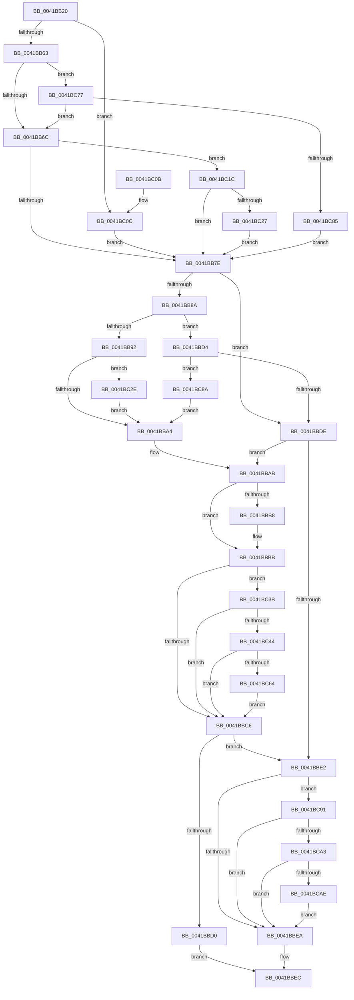

# MiNoFaultFound

- RVA: `0x0041BB20`–`0x0041BCC8` (길이 `424` bytes)
- VA: `0x000000014041BB20`
- 실행 섹션: `.text`
- PDB 이름 있음: `예`; PDB Function 태그: `아니요`
- unwind 정보 RVA: `0x0009D5A0`
- 디코드: `105`개 명령, `424/424` bytes 표시
- 미해석 바이트: `0` (있으면 어셈블리에 `.byte`로 보존)

> 이 문서는 커널 이미지의 기계어와 PDB 기호를 분석해 생성했습니다. 4번과 5번은 함수 원형과 자료형을 바이너리 사용 방식에서 추정한 C 해석이며 원본 소스 복구 결과는 아닙니다.

## 1. Dependencies

- 직접 호출 지점: **2**; 고유 호출 대상: **2**
- 직접 호출자로 확인된 함수: **4**
- RIP 상대 이미지 참조: **1**

### Outgoing calls
- `0x0041BC6D` → [MiCheckLinearProtectedPteAccessedBit](../29/MiCheckLinearProtectedPteAccessedBit_function_00292D80.md) (function, `0x00292D80`)
- `0x0041BCBE` → [MiFlushSingleTbEntry](../28/MiFlushSingleTbEntry_function_0028E730.md) (function, `0x0028E730`)

### Direct callers
- [MiValidFault](../32/MiValidFault_function_003280B4.md) at `0x003281FE`
- [MiRaisedIrqlFault](../34/MiRaisedIrqlFault_function_0034A6C8.md) at `0x0034A962`
- [MiSystemFault](../34/MiSystemFault_function_0034AA64.md) at `0x0034AF10`
- [MiLargePageFault](../3F/MiLargePageFault_function_003F01C4.md) at `0x003F02AA`

### Static image references
- `0x0041BB6C` → RVA `0x00FC6A88` (`ALMOSTRO`; read)

## 2. Other-region calls and transfers

- 다른 실행 섹션으로 향하는 call: **0**
- 별도 외부 분기/꼬리 이동을 확인하지 못했습니다.

## 3. Assembly (complete function range)

```asm
0041BB20  48 89 5C 24 08                  mov qword ptr [rsp + 8], rbx
0041BB25  48 89 6C 24 10                  mov qword ptr [rsp + 0x10], rbp
0041BB2A  48 89 74 24 18                  mov qword ptr [rsp + 0x18], rsi
0041BB2F  48 89 7C 24 20                  mov qword ptr [rsp + 0x20], rdi
0041BB34  41 54                           push r12
0041BB36  41 56                           push r14
0041BB38  41 57                           push r15
0041BB3A  48 83 EC 20                     sub rsp, 0x20
0041BB3E  48 8B 7C 24 68                  mov rdi, qword ptr [rsp + 0x68]
0041BB43  33 F6                           xor esi, esi
0041BB45  4C 8B 51 08                     mov r10, qword ptr [rcx + 8]
0041BB49  4C 8B F2                        mov r14, rdx
0041BB4C  4D 8B F8                        mov r15, r8
0041BB4F  8B CE                           mov ecx, esi
0041BB51  8B EE                           mov ebp, esi
0041BB53  48 8B DF                        mov rbx, rdi
0041BB56  8D 56 01                        lea edx, [rsi + 1]
0041BB59  40 F6 C7 20                     test dil, 0x20
0041BB5D  0F 84 A9 00 00 00               je 0x14041bc0c
0041BB63  44 84 CA                        test dl, r9b
0041BB66  0F 85 0B 01 00 00               jne 0x14041bc77
0041BB6C  48 8B 05 15 AF BA 00            mov rax, qword ptr [rip + 0xbaaf15]
0041BB73  48 0F BA E0 08                  bt rax, 8
0041BB78  0F 83 9E 00 00 00               jae 0x14041bc1c
0041BB7E  41 BC 80 00 00 00               mov r12d, 0x80
0041BB84  41 F6 C2 02                     test r10b, 2
0041BB88  74 54                           je 0x14041bbde
0041BB8A  48 8B C3                        mov rax, rbx
0041BB8D  83 E0 42                        and eax, 0x42
0041BB90  75 42                           jne 0x14041bbd4
0041BB92  48 8B 05 EF AE BA 00            mov rax, qword ptr [rip + 0xbaaeef]
0041BB99  48 0F BA E0 08                  bt rax, 8
0041BB9E  0F 83 8A 00 00 00               jae 0x14041bc2e
0041BBA4  83 CD 10                        or ebp, 0x10
0041BBA7  48 83 CB 42                     or rbx, 0x42
0041BBAB  48 F7 05 D2 AE BA 00 00 00 00 02  test qword ptr [rip + 0xbaaed2], 0x2000000
0041BBB6  74 03                           je 0x14041bbbb
0041BBB8  0F AE E8                        lfence
0041BBBB  48 0F BA 25 C4 AE BA 00 24      bt qword ptr [rip + 0xbaaec4], 0x24
0041BBC4  72 75                           jb 0x14041bc3b
0041BBC6  48 8B C7                        mov rax, rdi
0041BBC9  F0 49 0F B1 1E                  lock cmpxchg qword ptr [r14], rbx
0041BBCE  74 12                           je 0x14041bbe2
0041BBD0  33 C0                           xor eax, eax
0041BBD2  EB 18                           jmp 0x14041bbec
0041BBD4  48 83 F8 40                     cmp rax, 0x40
0041BBD8  0F 84 AC 00 00 00               je 0x14041bc8a
0041BBDE  85 C9                           test ecx, ecx
0041BBE0  75 C9                           jne 0x14041bbab
0041BBE2  85 F6                           test esi, esi
0041BBE4  0F 85 A7 00 00 00               jne 0x14041bc91
0041BBEA  8B C6                           mov eax, esi
0041BBEC  48 8B 5C 24 40                  mov rbx, qword ptr [rsp + 0x40]
0041BBF1  48 8B 6C 24 48                  mov rbp, qword ptr [rsp + 0x48]
0041BBF6  48 8B 74 24 50                  mov rsi, qword ptr [rsp + 0x50]
0041BBFB  48 8B 7C 24 58                  mov rdi, qword ptr [rsp + 0x58]
0041BC00  48 83 C4 20                     add rsp, 0x20
0041BC04  41 5F                           pop r15
0041BC06  41 5E                           pop r14
0041BC08  41 5C                           pop r12
0041BC0A  C3                              ret
0041BC0B  CC                              int3
0041BC0C  BD 04 00 00 00                  mov ebp, 4
0041BC11  48 83 CB 20                     or rbx, 0x20
0041BC15  8B CA                           mov ecx, edx
0041BC17  E9 62 FF FF FF                  jmp 0x14041bb7e
0041BC1C  48 0F BA E0 09                  bt rax, 9
0041BC21  0F 82 57 FF FF FF               jb 0x14041bb7e
0041BC27  8B F2                           mov esi, edx
0041BC29  E9 50 FF FF FF                  jmp 0x14041bb7e
0041BC2E  48 0F BA E0 09                  bt rax, 9
0041BC33  0F 43 F2                        cmovae esi, edx
0041BC36  E9 69 FF FF FF                  jmp 0x14041bba4
0041BC3B  0F B6 C3                        movzx eax, bl
0041BC3E  24 21                           and al, 0x21
0041BC40  3A C2                           cmp al, dl
0041BC42  75 82                           jne 0x14041bbc6
0041BC44  48 B8 00 00 00 00 80 F6 FF FF   movabs rax, 0xfffff68000000000
0041BC4E  48 B9 00 00 00 00 40 00 00 00   movabs rcx, 0x4000000000
0041BC58  48 03 C1                        add rax, rcx
0041BC5B  4C 3B F0                        cmp r14, rax
0041BC5E  0F 82 62 FF FF FF               jb 0x14041bbc6
0041BC64  45 8B C4                        mov r8d, r12d
0041BC67  48 8B D3                        mov rdx, rbx
0041BC6A  49 8B CE                        mov rcx, r14
0041BC6D  E8 0E 71 E7 FF                  call 0x140292d80
0041BC72  E9 4F FF FF FF                  jmp 0x14041bbc6
0041BC77  49 83 E1 FE                     and r9, 0xfffffffffffffffe
0041BC7B  41 80 39 05                     cmp byte ptr [r9], 5
0041BC7F  0F 85 E7 FE FF FF               jne 0x14041bb6c
0041BC85  E9 F4 FE FF FF                  jmp 0x14041bb7e
0041BC8A  8B F2                           mov esi, edx
0041BC8C  E9 13 FF FF FF                  jmp 0x14041bba4
0041BC91  48 8B 0D F0 AD BA 00            mov rcx, qword ptr [rip + 0xbaadf0]
0041BC98  48 0F BA E1 08                  bt rcx, 8
0041BC9D  0F 82 47 FF FF FF               jb 0x14041bbea
0041BCA3  48 0F BA E1 09                  bt rcx, 9
0041BCA8  0F 82 3C FF FF FF               jb 0x14041bbea
0041BCAE  8B 54 24 60                     mov edx, dword ptr [rsp + 0x60]
0041BCB2  85 ED                           test ebp, ebp
0041BCB4  49 8B CF                        mov rcx, r15
0041BCB7  41 0F 44 EC                     cmove ebp, r12d
0041BCBB  44 8B C5                        mov r8d, ebp
0041BCBE  E8 6D 2A E7 FF                  call 0x14028e730
0041BCC3  E9 22 FF FF FF                  jmp 0x14041bbea
```

## 4. C-style interpretation (structured pseudocode)

```c
__int64 __fastcall MiNoFaultFound(__int64 a1, __int64 a2, __int64 a3, __int64 a4, unsigned int a5, __int64 a6)
{
    __int64 result;
    __int64 v_rbp;
    __int64 v_rbx;
    __int64 v_rsi;
    __int64 v_rsp;
    unsigned __int64 v_stack_p10;
    unsigned __int64 v_stack_p18;
    unsigned __int64 v_stack_p20;
    unsigned __int64 v_stack_p8;

    v_stack_p8 = v_rbx;
    v_stack_p10 = v_rbp;
    v_stack_p18 = v_rsi;
    v_stack_p20 = v_rdi;
    v_rsp = (v_rsp) - (32);
    v_rsi = 0;
    if ((((unsigned __int8)(a6)) & (32)) == 0) goto loc_0041BC0C;
    if ((((unsigned __int8)(v_rsi + 1)) & ((unsigned __int8)(a4))) != 0) goto loc_0041BC77;
loc_0041BB6C:
    if (condition_is_above_or_equal) goto loc_0041BC1C;
loc_0041BB7E:
    if ((((unsigned __int8)(*(unsigned __int64 *)(a1 + 8))) & (2)) == 0) goto loc_0041BBDE;
    result = (unsigned int)((a6) & (66));
    if (condition_is_not_equal) goto loc_0041BBD4;
    if (condition_is_above_or_equal) goto loc_0041BC2E;
loc_0041BBA4:
    v_rbp = (unsigned int)((0) | (16));
    v_rbx = (a6) | (66);
loc_0041BBAB:
    if (((*(unsigned __int64 *)(v_rip + 12234450)) & (0x2000000ULL)) != 0) {
    }
    if (condition_is_below) goto loc_0041BC3B;
loc_0041BBC6:
    if (((*(unsigned __int64 *)(v_rip + 12234450)) & (0x2000000ULL)) == 0) goto loc_0041BBE2;
    result = 0;
    goto loc_0041BBEC;
loc_0041BBD4:
    if (0 == 64) goto loc_0041BC8A;
loc_0041BBDE:
    if (0 != 0) goto loc_0041BBAB;
loc_0041BBE2:
    if (0 != 0) goto loc_0041BC91;
loc_0041BBEA:
loc_0041BBEC:
    v_rsp = (v_rsp) + (32);
    return 0;
loc_0041BC0C:
    v_rbx = (v_stack_p8) | (32);
    goto loc_0041BB7E;
loc_0041BC1C:
    if (condition_is_below) goto loc_0041BB7E;
    goto loc_0041BB7E;
loc_0041BC2E:
    v_rsi = (unsigned int)((unsigned int)(v_rsi + 1));
    if (condition_is_above_or_equal) { v_rsi = (unsigned int)(v_rsi + 1); }
    goto loc_0041BBA4;
loc_0041BC3B:
    result = (unsigned __int8)(((unsigned __int8)(v_rbx)) & (33));
    if (((unsigned __int8)(result)) != ((unsigned __int8)(v_rsi + 1))) goto loc_0041BBC6;
    result = (result) + ((unsigned int)((unsigned int)(v_rsi + 1)));
    if (a2 < result) goto loc_0041BBC6;
    result = MiCheckLinearProtectedPteAccessedBit(a2, v_rbx, 128, a4);
    goto loc_0041BBC6;
loc_0041BC77:
    a4 = (a4) & (-2);
    if ((*(unsigned __int8 *)(a4)) != 5) goto loc_0041BB6C;
    goto loc_0041BB7E;
loc_0041BC8A:
    goto loc_0041BBA4;
loc_0041BC91:
    if ((*(unsigned __int8 *)(a4)) < 5) goto loc_0041BBEA;
    if ((*(unsigned __int8 *)(a4)) < 5) goto loc_0041BBEA;
    v_rbp = 4;
    if (4 == 0) { v_rbp = 128; }
    result = MiFlushSingleTbEntry(a3, (unsigned int)(a5), (unsigned int)((unsigned int)(v_rbp)), a4);
    goto loc_0041BBEA;
}
```

## 5. (Beta) C Style

```c
int64_t MiNoFaultFound(void *Arg1, int64_t Arg2, int64_t Arg3, void *Arg4, uint32_t Arg5, int64_t Arg6)
{
    uint8_t *arg1 = (uint8_t *)Arg1;
    uint8_t *arg4 = (uint8_t *)Arg4;

    int64_t result;
    int64_t local_rbp;
    int64_t local_rbx;
    int64_t local_rsi;
    int64_t local_rsp;
    uint64_t v_stack_p10;
    uint64_t v_stack_p18;
    uint64_t v_stack_p20;
    uint64_t v_stack_p8;

    v_stack_p8 = local_rbx;
    v_stack_p10 = local_rbp;
    v_stack_p18 = local_rsi;
    v_stack_p20 = local_rdi;
    local_rsp = (local_rsp) - (32);
    local_rsi = 0;
    if ((((uint8_t)(Arg6)) & (32)) == 0) goto loc_0041BC0C;
    if ((((uint8_t)(local_rsi + 1)) & ((uint8_t)(Arg4))) != 0) goto loc_0041BC77;
loc_0041BB6C:
    if (condition_is_above_or_equal) goto loc_0041BC1C;
loc_0041BB7E:
    if ((((uint8_t)(*(uint64_t *)(arg1 + 0x8))) & (2)) == 0) goto loc_0041BBDE;
    result = (uint32_t)((Arg6) & (66));
    if (condition_is_not_equal) goto loc_0041BBD4;
    if (condition_is_above_or_equal) goto loc_0041BC2E;
loc_0041BBA4:
    local_rbp = (uint32_t)((0) | (16));
    local_rbx = (Arg6) | (66);
loc_0041BBAB:
    if (((*(uint64_t *)(v_rip + 0xBAAED2)) & (0x2000000ULL)) != 0) {
    }
    if (condition_is_below) goto loc_0041BC3B;
loc_0041BBC6:
    if (((*(uint64_t *)(v_rip + 0xBAAED2)) & (0x2000000ULL)) == 0) goto loc_0041BBE2;
    result = 0;
    goto loc_0041BBEC;
loc_0041BBD4:
    if (0 == 64) goto loc_0041BC8A;
loc_0041BBDE:
    if (0 != 0) goto loc_0041BBAB;
loc_0041BBE2:
    if (0 != 0) goto loc_0041BC91;
loc_0041BBEA:
loc_0041BBEC:
    local_rsp = (local_rsp) + (32);
    return 0;
loc_0041BC0C:
    local_rbx = (v_stack_p8) | (32);
    goto loc_0041BB7E;
loc_0041BC1C:
    if (condition_is_below) goto loc_0041BB7E;
    goto loc_0041BB7E;
loc_0041BC2E:
    local_rsi = (uint32_t)((uint32_t)(local_rsi + 1));
    if (condition_is_above_or_equal) { local_rsi = (uint32_t)(local_rsi + 1); }
    goto loc_0041BBA4;
loc_0041BC3B:
    result = (uint8_t)(((uint8_t)(local_rbx)) & (33));
    if (((uint8_t)(result)) != ((uint8_t)(local_rsi + 1))) goto loc_0041BBC6;
    result = (result) + ((uint32_t)((uint32_t)(local_rsi + 1)));
    if (Arg2 < result) goto loc_0041BBC6;
    result = MiCheckLinearProtectedPteAccessedBit(Arg2, local_rbx, 128, Arg4);
    goto loc_0041BBC6;
loc_0041BC77:
    Arg4 = (Arg4) & (-2);
    if ((*(uint8_t *)(arg4)) != 5) goto loc_0041BB6C;
    goto loc_0041BB7E;
loc_0041BC8A:
    goto loc_0041BBA4;
loc_0041BC91:
    if ((*(uint8_t *)(arg4)) < 5) goto loc_0041BBEA;
    if ((*(uint8_t *)(arg4)) < 5) goto loc_0041BBEA;
    local_rbp = 4;
    if (4 == 0) { local_rbp = 128; }
    result = MiFlushSingleTbEntry(Arg3, (uint32_t)(Arg5), (uint32_t)((uint32_t)(local_rbp)), Arg4);
    goto loc_0041BBEA;
}
```

### 관측된 메모리 오프셋

구조체 형식이 확인되지 않은 접근은 인자 기준의 오프셋으로만 기록했습니다.

| 기준 인자 | 오프셋 표현 | 폭 (bit) | 접근 |
|---|---:|---:|---|
| `Arg1` | `+ 0x8` | `64` | `R` |
| `Arg4` | `+ 0x0` | `8` | `R` |

## 6. Execution-region graph

[열기: 2D/3D 그래프와 함수 탐색 컨트롤 패널](../../../control-panel.html?section=text&rva=0x0041BB20&view=graph)

- 2D 그래프는 위에서 아래로 흐르고, 3D 그래프는 빈 공간을 드래그해 회전합니다. Shift+드래그는 이동, 휠은 확대·축소, 함수 노드 선택은 대상 보고서 이동입니다.

### Static fallback


