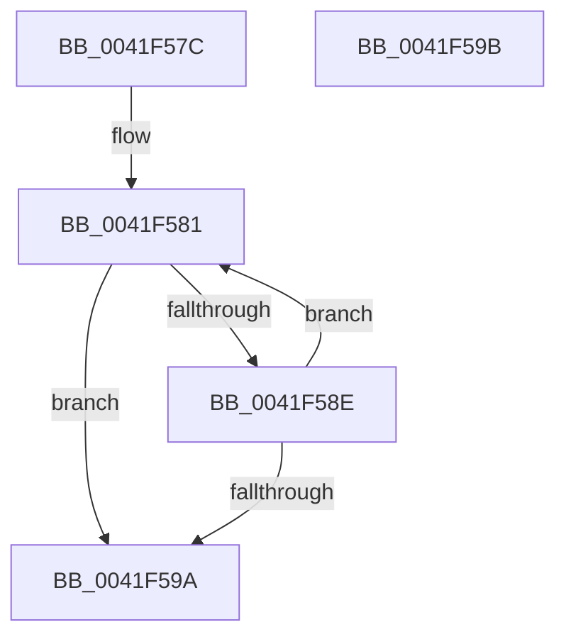

# MiPageSizeToPteLevel

- RVA: `0x0041F57C`–`0x0041F59C` (길이 `32` bytes)
- VA: `0x000000014041F57C`
- 실행 섹션: `.text`
- PDB 이름 있음: `예`; PDB Function 태그: `아니요`
- unwind 정보 RVA: `0x000DB714`
- 디코드: `11`개 명령, `32/32` bytes 표시
- 미해석 바이트: `0` (있으면 어셈블리에 `.byte`로 보존)

> 이 문서는 커널 이미지의 기계어와 PDB 기호를 분석해 생성했습니다. 4번과 5번은 함수 원형과 자료형을 바이너리 사용 방식에서 추정한 C 해석이며 원본 소스 복구 결과는 아닙니다.

## 1. Dependencies

- 직접 호출 지점: **0**; 고유 호출 대상: **0**
- 직접 호출자로 확인된 함수: **5**
- RIP 상대 이미지 참조: **1**

### Outgoing calls
- 직접 디코드된 call 명령이 없습니다.

### Direct callers
- [MiVadPageTableChargeLevel](MiVadPageTableChargeLevel_function_0041F500.md) at `0x0041F569`
- [MiWriteAwePtes](../4C/MiWriteAwePtes_function_004C51E0.md) at `0x004C529C`
- [MiProtectAweRegion](../4C/MiProtectAweRegion_function_004CE62C.md) at `0x004CE893`
- [MiComputeAweCharges](../../page/6F/MiComputeAweCharges_function_006FE84C.md) at `0x006FE887`
- [NtMapUserPhysicalPages](../../page/80/NtMapUserPhysicalPages_function_0080B460.md) at `0x0080B596`

### Static image references
- `0x0041F581` → RVA `0x00011C60` (`.rdata`; read)

## 2. Other-region calls and transfers

- 다른 실행 섹션으로 향하는 call: **0**
- 별도 외부 분기/꼬리 이동을 확인하지 못했습니다.

## 3. Assembly (complete function range)

```asm
0041F57C  33 C0                           xor eax, eax
0041F57E  8D 50 10                        lea edx, [rax + 0x10]
0041F581  4C 8D 05 D8 26 BF FF            lea r8, [rip - 0x40d928]
0041F588  4A 3B 0C 02                     cmp rcx, qword ptr [rdx + r8]
0041F58C  76 0C                           jbe 0x14041f59a
0041F58E  FF C0                           inc eax
0041F590  48 83 EA 08                     sub rdx, 8
0041F594  48 83 FA F8                     cmp rdx, -8
0041F598  7D E7                           jge 0x14041f581
0041F59A  C3                              ret
0041F59B  CC                              int3
```

## 4. C-style interpretation (structured pseudocode)

```c
__int64 __fastcall MiPageSizeToPteLevel(__int64 a1)
{
    __int64 result;

    result = 0;
loc_0041F581:
    if (a1 <= (*(unsigned __int64 *)(result + 16 + v_rip - 4249896 * 1))) goto loc_0041F59A;
    result = (unsigned int)((result) + 1);
    a2 = (result + 16) - (8);
    if (a2 >= -8) goto loc_0041F581;
loc_0041F59A:
    return result;
}
```

## 5. (Beta) C Style

```c
int64_t MiPageSizeToPteLevel(int64_t Arg1)
{
    int64_t result;

    result = 0;
loc_0041F581:
    if (Arg1 <= (*(uint64_t *)(result + 0x10 + v_rip - 0x40D928 * 1))) goto loc_0041F59A;
    result = (uint32_t)((result) + 1);
    a2 = (result + 16) - (8);
    if (a2 >= -8) goto loc_0041F581;
loc_0041F59A:
    return result;
}
```

## 6. Execution-region graph

[열기: 2D/3D 그래프와 함수 탐색 컨트롤 패널](../../../control-panel.html?section=text&rva=0x0041F57C&view=graph)

- 2D 그래프는 위에서 아래로 흐르고, 3D 그래프는 빈 공간을 드래그해 회전합니다. Shift+드래그는 이동, 휠은 확대·축소, 함수 노드 선택은 대상 보고서 이동입니다.

### Static fallback


