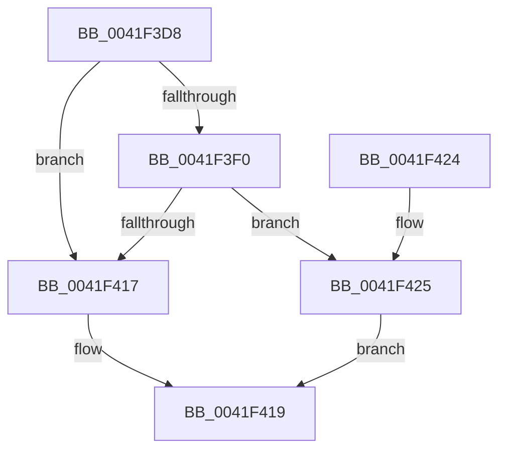

# MiPfnIsNonPagedPool

- RVA: `0x0041F3D8`–`0x0041F435` (길이 `93` bytes)
- VA: `0x000000014041F3D8`
- 실행 섹션: `.text`
- PDB 이름 있음: `예`; PDB Function 태그: `아니요`
- unwind 정보 RVA: `0x0009D5D8`
- 디코드: `29`개 명령, `93/93` bytes 표시
- 미해석 바이트: `0` (있으면 어셈블리에 `.byte`로 보존)

> 이 문서는 커널 이미지의 기계어와 PDB 기호를 분석해 생성했습니다. 4번과 5번은 함수 원형과 자료형을 바이너리 사용 방식에서 추정한 C 해석이며 원본 소스 복구 결과는 아닙니다.

## 1. Dependencies

- 직접 호출 지점: **1**; 고유 호출 대상: **1**
- 직접 호출자로 확인된 함수: **1**
- RIP 상대 이미지 참조: **0**

### Outgoing calls
- `0x0041F40D` → [MiGetSystemRegionType](../28/MiGetSystemRegionType_function_0028EC80.md) (function, `0x0028EC80`)

### Direct callers
- [MiIsPfnLocked](MiIsPfnLocked_function_0041F354.md) at `0x0041F3B8`

### Static image references
- 디코드된 RIP-relative 메모리 참조가 없습니다.

## 2. Other-region calls and transfers

- 다른 실행 섹션으로 향하는 call: **0**
- 별도 외부 분기/꼬리 이동을 확인하지 못했습니다.

## 3. Assembly (complete function range)

```asm
0041F3D8  48 89 5C 24 08                  mov qword ptr [rsp + 8], rbx
0041F3DD  57                              push rdi
0041F3DE  48 83 EC 20                     sub rsp, 0x20
0041F3E2  48 8B 41 28                     mov rax, qword ptr [rcx + 0x28]
0041F3E6  33 DB                           xor ebx, ebx
0041F3E8  48 8B F9                        mov rdi, rcx
0041F3EB  48 85 C0                        test rax, rax
0041F3EE  78 27                           js 0x14041f417
0041F3F0  48 8B 49 08                     mov rcx, qword ptr [rcx + 8]
0041F3F4  48 C1 E1 19                     shl rcx, 0x19
0041F3F8  48 BA 00 00 00 00 80 F6 FF FF   movabs rdx, 0xfffff68000000000
0041F402  48 C1 E2 19                     shl rdx, 0x19
0041F406  48 2B CA                        sub rcx, rdx
0041F409  48 C1 F9 10                     sar rcx, 0x10
0041F40D  E8 6E F8 E6 FF                  call 0x14028ec80
0041F412  83 F8 04                        cmp eax, 4
0041F415  74 0E                           je 0x14041f425
0041F417  33 C0                           xor eax, eax
0041F419  48 8B 5C 24 30                  mov rbx, qword ptr [rsp + 0x30]
0041F41E  48 83 C4 20                     add rsp, 0x20
0041F422  5F                              pop rdi
0041F423  C3                              ret
0041F424  CC                              int3
0041F425  8A 4F 22                        mov cl, byte ptr [rdi + 0x22]
0041F428  80 E1 07                        and cl, 7
0041F42B  80 F9 06                        cmp cl, 6
0041F42E  0F 94 C3                        sete bl
0041F431  8B C3                           mov eax, ebx
0041F433  EB E4                           jmp 0x14041f419
```

## 4. C-style interpretation (structured pseudocode)

```c
__int64 __fastcall MiPfnIsNonPagedPool(__int64 a1)
{
    __int64 result;
    __int64 v_rbx;
    __int64 v_rsp;
    unsigned __int64 v_stack_p8;

    v_stack_p8 = v_rbx;
    v_rsp = (v_rsp) - (32);
    v_rbx = 0;
    if (sign_flag) goto loc_0041F417;
    a1 = (*(unsigned __int64 *)(a1 + 8)) << (25);
    a2 = (a2) << (25);
    a1 = (a1) - (a2);
    a1 = (a1) >> (16);
    result = MiGetSystemRegionType(a1, a2, a3, a4);
    if (((unsigned int)(result)) == 4) goto loc_0041F425;
loc_0041F417:
    result = 0;
loc_0041F419:
    v_rsp = (v_rsp) + (32);
    return result;
loc_0041F425:
    a1 = (unsigned __int8)((*(unsigned __int8 *)(a1 + 34)) & (7));
    v_rbx = (((unsigned __int8)(a1)) == 6) ? 1 : 0;
    goto loc_0041F419;
}
```

## 5. (Beta) C Style

```c
int64_t MiPfnIsNonPagedPool(void *Arg1)
{
    uint8_t *arg1 = (uint8_t *)Arg1;

    int64_t result;
    int64_t local_rbx;
    int64_t local_rsp;
    uint64_t v_stack_p8;

    v_stack_p8 = local_rbx;
    local_rsp = (local_rsp) - (32);
    local_rbx = 0;
    if (sign_flag) goto loc_0041F417;
    Arg1 = (*(uint64_t *)(arg1 + 0x8)) << (25);
    a2 = (a2) << (25);
    Arg1 = (Arg1) - (a2);
    Arg1 = (Arg1) >> (16);
    result = MiGetSystemRegionType(Arg1, a2, a3, a4);
    if (((uint32_t)(result)) == 4) goto loc_0041F425;
loc_0041F417:
    result = 0;
loc_0041F419:
    local_rsp = (local_rsp) + (32);
    return result;
loc_0041F425:
    Arg1 = (uint8_t)((*(uint8_t *)(arg1 + 0x22)) & (7));
    local_rbx = (((uint8_t)(Arg1)) == 6) ? 1 : 0;
    goto loc_0041F419;
}
```

### 관측된 메모리 오프셋

구조체 형식이 확인되지 않은 접근은 인자 기준의 오프셋으로만 기록했습니다.

| 기준 인자 | 오프셋 표현 | 폭 (bit) | 접근 |
|---|---:|---:|---|
| `Arg1` | `+ 0x8` | `64` | `R` |
| `Arg1` | `+ 0x22` | `8` | `R` |
| `Arg1` | `+ 0x28` | `64` | `R` |

## 6. Execution-region graph

[열기: 2D/3D 그래프와 함수 탐색 컨트롤 패널](../../../control-panel.html?section=text&rva=0x0041F3D8&view=graph)

- 2D 그래프는 위에서 아래로 흐르고, 3D 그래프는 빈 공간을 드래그해 회전합니다. Shift+드래그는 이동, 휠은 확대·축소, 함수 노드 선택은 대상 보고서 이동입니다.

### Static fallback


