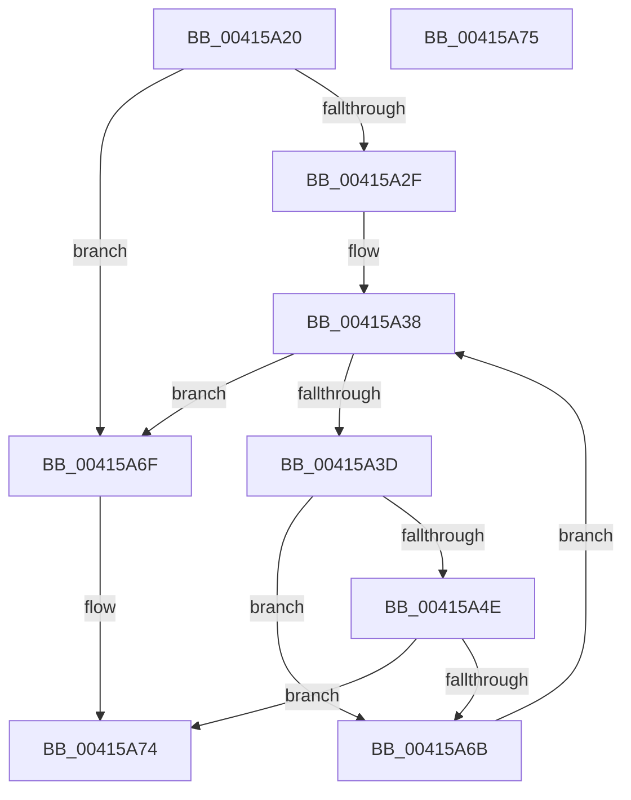

# MiPfnLargeBitSet

- RVA: `0x00415A20`–`0x00415A76` (길이 `86` bytes)
- VA: `0x0000000140415A20`
- 실행 섹션: `.text`
- PDB 이름 있음: `예`; PDB Function 태그: `아니요`
- unwind 정보 RVA: `0x000DB714`
- 디코드: `25`개 명령, `86/86` bytes 표시
- 미해석 바이트: `0` (있으면 어셈블리에 `.byte`로 보존)

> 이 문서는 커널 이미지의 기계어와 PDB 기호를 분석해 생성했습니다. 4번과 5번은 함수 원형과 자료형을 바이너리 사용 방식에서 추정한 C 해석이며 원본 소스 복구 결과는 아닙니다.

## 1. Dependencies

- 직접 호출 지점: **0**; 고유 호출 대상: **0**
- 직접 호출자로 확인된 함수: **2**
- RIP 상대 이미지 참조: **1**

### Outgoing calls
- 직접 디코드된 call 명령이 없습니다.

### Direct callers
- [MiTradePage](../28/MiTradePage_function_0028D160.md) at `0x0028DB38`
- [MiPfnsWorthTrying](../31/MiPfnsWorthTrying_function_0031B0C0.md) at `0x0031B9CB`

### Static image references
- `0x00415A31` → RVA `0x000135E8` (`.rdata`; read)

## 2. Other-region calls and transfers

- 다른 실행 섹션으로 향하는 call: **0**
- 별도 외부 분기/꼬리 이동을 확인하지 못했습니다.

## 3. Assembly (complete function range)

```asm
00415A20  80 B9 E6 3E 00 00 00            cmp byte ptr [rcx + 0x3ee6], 0
00415A27  4C 8B D2                        mov r10, rdx
00415A2A  4C 8B C1                        mov r8, rcx
00415A2D  74 40                           je 0x140415a6f
00415A2F  33 C0                           xor eax, eax
00415A31  4C 8D 1D B0 DB BF FF            lea r11, [rip - 0x402450]
00415A38  83 F8 02                        cmp eax, 2
00415A3B  73 32                           jae 0x140415a6f
00415A3D  44 8B C8                        mov r9d, eax
00415A40  4D 03 C9                        add r9, r9
00415A43  4B 83 BC C8 C8 3F 00 00 00      cmp qword ptr [r8 + r9*8 + 0x3fc8], 0
00415A4C  74 1D                           je 0x140415a6b
00415A4E  41 8B 0C 83                     mov ecx, dword ptr [r11 + rax*4]
00415A52  49 8B D2                        mov rdx, r10
00415A55  48 D3 EA                        shr rdx, cl
00415A58  4B 8B 8C C8 D0 3F 00 00         mov rcx, qword ptr [r8 + r9*8 + 0x3fd0]
00415A60  48 0F A3 11                     bt qword ptr [rcx], rdx
00415A64  0F 92 C1                        setb cl
00415A67  84 C9                           test cl, cl
00415A69  75 09                           jne 0x140415a74
00415A6B  FF C0                           inc eax
00415A6D  EB C9                           jmp 0x140415a38
00415A6F  B8 03 00 00 00                  mov eax, 3
00415A74  C3                              ret
00415A75  CC                              int3
```

## 4. C-style interpretation (structured pseudocode)

```c
__int64 __fastcall MiPfnLargeBitSet(__int64 a1, __int64 a2)
{
    __int64 result;

    if ((*(unsigned __int8 *)(a1 + 16102)) == 0) goto loc_00415A6F;
    result = 0;
loc_00415A38:
    if (0 >= 2) goto loc_00415A6F;
    a4 = (0) + (0);
    if ((*(unsigned __int64 *)(a1 + a4 * 8 + 16328)) == 0) goto loc_00415A6B;
    a2 = (a2) >> ((unsigned __int8)((unsigned int)(*(unsigned int *)(v_rip - 4203600 + result * 4))));
    a1 = (condition_is_below) ? 1 : 0;
    if ((unsigned __int8)(a1) != 0) goto loc_00415A74;
loc_00415A6B:
    result = (unsigned int)((result) + 1);
    goto loc_00415A38;
loc_00415A6F:
loc_00415A74:
    return 3;
}
```

## 5. (Beta) C Style

```c
int64_t MiPfnLargeBitSet(void *Arg1, int64_t Arg2)
{
    uint8_t *arg1 = (uint8_t *)Arg1;

    int64_t result;

    if ((*(uint8_t *)(arg1 + 0x3EE6)) == 0) goto loc_00415A6F;
    result = 0;
loc_00415A38:
    if (0 >= 2) goto loc_00415A6F;
    a4 = (0) + (0);
    if ((*(uint64_t *)(arg1 + a4 * 8 + 0x3FC8)) == 0) goto loc_00415A6B;
    Arg2 = (Arg2) >> ((uint8_t)((uint32_t)(*(uint32_t *)(v_rip - 0x402450 + result * 4))));
    Arg1 = (condition_is_below) ? 1 : 0;
    if ((uint8_t)(Arg1) != 0) goto loc_00415A74;
loc_00415A6B:
    result = (uint32_t)((result) + 1);
    goto loc_00415A38;
loc_00415A6F:
loc_00415A74:
    return 3;
}
```

### 관측된 메모리 오프셋

구조체 형식이 확인되지 않은 접근은 인자 기준의 오프셋으로만 기록했습니다.

| 기준 인자 | 오프셋 표현 | 폭 (bit) | 접근 |
|---|---:|---:|---|
| `Arg1` | `+ 0x3EE6` | `8` | `R` |
| `Arg1` | `+ 0x3FC8 + r9*8` | `64` | `R` |
| `Arg1` | `+ 0x3FD0 + r9*8` | `64` | `R` |

## 6. Execution-region graph

[열기: 2D/3D 그래프와 함수 탐색 컨트롤 패널](../../../control-panel.html?section=text&rva=0x00415A20&view=graph)

- 2D 그래프는 위에서 아래로 흐르고, 3D 그래프는 빈 공간을 드래그해 회전합니다. Shift+드래그는 이동, 휠은 확대·축소, 함수 노드 선택은 대상 보고서 이동입니다.

### Static fallback


