# MiRebalanceSystemCacheFreedViews

- RVA: `0x00419620`–`0x0041972B` (길이 `267` bytes)
- VA: `0x0000000140419620`
- 실행 섹션: `.text`
- PDB 이름 있음: `예`; PDB Function 태그: `아니요`
- unwind 정보 RVA: `0x0009D12C`
- 디코드: `83`개 명령, `267/267` bytes 표시
- 미해석 바이트: `0` (있으면 어셈블리에 `.byte`로 보존)

> 이 문서는 커널 이미지의 기계어와 PDB 기호를 분석해 생성했습니다. 4번과 5번은 함수 원형과 자료형을 바이너리 사용 방식에서 추정한 C 해석이며 원본 소스 복구 결과는 아닙니다.

## 1. Dependencies

- 직접 호출 지점: **4**; 고유 호출 대상: **1**
- 직접 호출자로 확인된 함수: **3**
- RIP 상대 이미지 참조: **0**

### Outgoing calls
- `0x00419699` → [MiInsertReadiedSystemCacheViews](MiInsertReadiedSystemCacheViews_function_00419734.md) (function, `0x00419734`)
- `0x004196C1` → [MiInsertReadiedSystemCacheViews](MiInsertReadiedSystemCacheViews_function_00419734.md) (function, `0x00419734`)
- `0x004196F1` → [MiInsertReadiedSystemCacheViews](MiInsertReadiedSystemCacheViews_function_00419734.md) (function, `0x00419734`)
- `0x00419721` → [MiInsertReadiedSystemCacheViews](MiInsertReadiedSystemCacheViews_function_00419734.md) (function, `0x00419734`)

### Direct callers
- [MiReleaseSystemCacheView](../29/MiReleaseSystemCacheView_function_00294CE0.md) at `0x00294D5A`
- [MiConsumeSystemCacheTbFlushNeededView](MiConsumeSystemCacheTbFlushNeededView_function_004193B4.md) at `0x0041957D`
- [MiDeleteUnmappedSystemCacheViews](../67/MiDeleteUnmappedSystemCacheViews_function_0067C9A0.md) at `0x0067C9DF`
- [MiDeleteUnmappedSystemCacheViews](../67/MiDeleteUnmappedSystemCacheViews_function_0067C9A0.md) at `0x0067CA15`

### Static image references
- 디코드된 RIP-relative 메모리 참조가 없습니다.

## 2. Other-region calls and transfers

- 다른 실행 섹션으로 향하는 call: **0**
- 별도 외부 분기/꼬리 이동을 확인하지 못했습니다.

## 3. Assembly (complete function range)

```asm
00419620  48 89 5C 24 08                  mov qword ptr [rsp + 8], rbx
00419625  48 89 6C 24 10                  mov qword ptr [rsp + 0x10], rbp
0041962A  48 89 74 24 18                  mov qword ptr [rsp + 0x18], rsi
0041962F  57                              push rdi
00419630  48 83 EC 20                     sub rsp, 0x20
00419634  48 8D 99 80 08 00 00            lea rbx, [rcx + 0x880]
0041963B  41 8B F0                        mov esi, r8d
0041963E  48 83 7B 10 00                  cmp qword ptr [rbx + 0x10], 0
00419643  8B FA                           mov edi, edx
00419645  48 8B E9                        mov rbp, rcx
00419648  75 2F                           jne 0x140419679
0041964A  48 83 7B 30 00                  cmp qword ptr [rbx + 0x30], 0
0041964F  75 4F                           jne 0x1404196a0
00419651  48 83 7B 50 00                  cmp qword ptr [rbx + 0x50], 0
00419656  75 70                           jne 0x1404196c8
00419658  48 83 7B 70 00                  cmp qword ptr [rbx + 0x70], 0
0041965D  0F 85 98 00 00 00               jne 0x1404196fb
00419663  48 8B 5C 24 30                  mov rbx, qword ptr [rsp + 0x30]
00419668  48 8B 6C 24 38                  mov rbp, qword ptr [rsp + 0x38]
0041966D  48 8B 74 24 40                  mov rsi, qword ptr [rsp + 0x40]
00419672  48 83 C4 20                     add rsp, 0x20
00419676  5F                              pop rdi
00419677  C3                              ret
00419678  CC                              int3
00419679  8B 4B 18                        mov ecx, dword ptr [rbx + 0x18]
0041967C  8B C7                           mov eax, edi
0041967E  2B C1                           sub eax, ecx
00419680  85 F6                           test esi, esi
00419682  75 0F                           jne 0x140419693
00419684  83 F8 02                        cmp eax, 2
00419687  77 0A                           ja 0x140419693
00419689  F6 C1 01                        test cl, 1
0041968C  75 BC                           jne 0x14041964a
0041968E  83 F8 02                        cmp eax, 2
00419691  72 B7                           jb 0x14041964a
00419693  48 8B D3                        mov rdx, rbx
00419696  48 8B CD                        mov rcx, rbp
00419699  E8 96 00 00 00                  call 0x140419734
0041969E  EB AA                           jmp 0x14041964a
004196A0  8B 4B 38                        mov ecx, dword ptr [rbx + 0x38]
004196A3  8B C7                           mov eax, edi
004196A5  2B C1                           sub eax, ecx
004196A7  85 F6                           test esi, esi
004196A9  75 0F                           jne 0x1404196ba
004196AB  83 F8 02                        cmp eax, 2
004196AE  77 0A                           ja 0x1404196ba
004196B0  F6 C1 01                        test cl, 1
004196B3  75 9C                           jne 0x140419651
004196B5  83 F8 02                        cmp eax, 2
004196B8  72 97                           jb 0x140419651
004196BA  48 8D 53 20                     lea rdx, [rbx + 0x20]
004196BE  48 8B CD                        mov rcx, rbp
004196C1  E8 6E 00 00 00                  call 0x140419734
004196C6  EB 89                           jmp 0x140419651
004196C8  8B 4B 58                        mov ecx, dword ptr [rbx + 0x58]
004196CB  8B C7                           mov eax, edi
004196CD  2B C1                           sub eax, ecx
004196CF  85 F6                           test esi, esi
004196D1  75 17                           jne 0x1404196ea
004196D3  83 F8 02                        cmp eax, 2
004196D6  77 12                           ja 0x1404196ea
004196D8  F6 C1 01                        test cl, 1
004196DB  0F 85 77 FF FF FF               jne 0x140419658
004196E1  83 F8 02                        cmp eax, 2
004196E4  0F 82 6E FF FF FF               jb 0x140419658
004196EA  48 8D 53 40                     lea rdx, [rbx + 0x40]
004196EE  48 8B CD                        mov rcx, rbp
004196F1  E8 3E 00 00 00                  call 0x140419734
004196F6  E9 5D FF FF FF                  jmp 0x140419658
004196FB  8B 43 78                        mov eax, dword ptr [rbx + 0x78]
004196FE  2B F8                           sub edi, eax
00419700  85 F6                           test esi, esi
00419702  75 16                           jne 0x14041971a
00419704  83 FF 02                        cmp edi, 2
00419707  77 11                           ja 0x14041971a
00419709  A8 01                           test al, 1
0041970B  0F 85 52 FF FF FF               jne 0x140419663
00419711  83 FF 02                        cmp edi, 2
00419714  0F 82 49 FF FF FF               jb 0x140419663
0041971A  48 8D 53 60                     lea rdx, [rbx + 0x60]
0041971E  48 8B CD                        mov rcx, rbp
00419721  E8 0E 00 00 00                  call 0x140419734
00419726  E9 38 FF FF FF                  jmp 0x140419663
```

## 4. C-style interpretation (structured pseudocode)

```c
__int64 __fastcall MiRebalanceSystemCacheFreedViews(__int64 a1, int a2, int a3)
{
    __int64 result;
    __int64 v_rdi;
    __int64 v_rsp;
    unsigned __int64 v_stack_p10;
    unsigned __int64 v_stack_p18;
    unsigned __int64 v_stack_p8;

    v_stack_p8 = v_rbx;
    v_stack_p10 = v_rbp;
    v_stack_p18 = v_rsi;
    v_rsp = (v_rsp) - (32);
    if ((*(unsigned __int64 *)(a1 + 2176 + 16)) != 0) goto loc_00419679;
loc_0041964A:
    if ((*(unsigned __int64 *)(a1 + 2176 + 48)) != 0) goto loc_004196A0;
loc_00419651:
    if ((*(unsigned __int64 *)(a1 + 2176 + 80)) != 0) goto loc_004196C8;
loc_00419658:
    if ((*(unsigned __int64 *)(a1 + 2176 + 112)) != 0) goto loc_004196FB;
loc_00419663:
    v_rsp = (v_rsp) + (32);
    return result;
loc_00419679:
    result = (unsigned int)(((unsigned int)((unsigned int)((unsigned int)(a2)))) - ((unsigned int)((unsigned int)(*(unsigned int *)(v_stack_p8 + 24)))));
    if ((unsigned int)(v_stack_p18) != 0) goto loc_00419693;
    if (((unsigned int)(result)) > 2) goto loc_00419693;
    if ((((unsigned __int8)((unsigned int)(*(unsigned int *)(v_stack_p8 + 24)))) & (1)) != 0) goto loc_0041964A;
    if (((unsigned int)(result)) < 2) goto loc_0041964A;
loc_00419693:
    result = MiInsertReadiedSystemCacheViews(v_stack_p10, v_stack_p8, a3, a4);
    goto loc_0041964A;
loc_004196A0:
    result = (unsigned int)(((unsigned int)((unsigned int)((unsigned int)(a2)))) - ((unsigned int)((unsigned int)(*(unsigned int *)(v_stack_p8 + 56)))));
    if ((unsigned int)(v_stack_p18) != 0) goto loc_004196BA;
    if (((unsigned int)(result)) > 2) goto loc_004196BA;
    if ((((unsigned __int8)((unsigned int)(*(unsigned int *)(v_stack_p8 + 56)))) & (1)) != 0) goto loc_00419651;
    if (((unsigned int)(result)) < 2) goto loc_00419651;
loc_004196BA:
    result = MiInsertReadiedSystemCacheViews(v_stack_p10, v_stack_p8 + 32, a3, a4);
    goto loc_00419651;
loc_004196C8:
    result = (unsigned int)(((unsigned int)((unsigned int)((unsigned int)(a2)))) - ((unsigned int)((unsigned int)(*(unsigned int *)(v_stack_p8 + 88)))));
    if ((unsigned int)(v_stack_p18) != 0) goto loc_004196EA;
    if (((unsigned int)(result)) > 2) goto loc_004196EA;
    if ((((unsigned __int8)((unsigned int)(*(unsigned int *)(v_stack_p8 + 88)))) & (1)) != 0) goto loc_00419658;
    if (((unsigned int)(result)) < 2) goto loc_00419658;
loc_004196EA:
    result = MiInsertReadiedSystemCacheViews(v_stack_p10, v_stack_p8 + 64, a3, a4);
    goto loc_00419658;
loc_004196FB:
    v_rdi = (unsigned int)(((unsigned int)(a2)) - ((unsigned int)((unsigned int)(*(unsigned int *)(v_stack_p8 + 120)))));
    if ((unsigned int)(v_stack_p18) != 0) goto loc_0041971A;
    if (((unsigned int)(v_rdi)) > 2) goto loc_0041971A;
    if ((((unsigned __int8)((unsigned int)(*(unsigned int *)(v_stack_p8 + 120)))) & (1)) != 0) goto loc_00419663;
    if (((unsigned int)(v_rdi)) < 2) goto loc_00419663;
loc_0041971A:
    result = MiInsertReadiedSystemCacheViews(v_stack_p10, v_stack_p8 + 96, a3, a4);
    goto loc_00419663;
}
```

## 5. (Beta) C Style

```c
int64_t MiRebalanceSystemCacheFreedViews(void *Arg1, int32_t Arg2, int32_t Arg3)
{
    uint8_t *arg1 = (uint8_t *)Arg1;

    int64_t result;
    int64_t local_rdi;
    int64_t local_rsp;
    uint64_t v_stack_p10;
    uint64_t v_stack_p18;
    uint64_t v_stack_p8;

    v_stack_p8 = local_rbx;
    v_stack_p10 = local_rbp;
    v_stack_p18 = local_rsi;
    local_rsp = (local_rsp) - (32);
    if ((*(uint64_t *)(arg1 + 0x880 + 0x10)) != 0) goto loc_00419679;
loc_0041964A:
    if ((*(uint64_t *)(arg1 + 0x880 + 0x30)) != 0) goto loc_004196A0;
loc_00419651:
    if ((*(uint64_t *)(arg1 + 0x880 + 0x50)) != 0) goto loc_004196C8;
loc_00419658:
    if ((*(uint64_t *)(arg1 + 0x880 + 0x70)) != 0) goto loc_004196FB;
loc_00419663:
    local_rsp = (local_rsp) + (32);
    return result;
loc_00419679:
    result = (uint32_t)(((uint32_t)((uint32_t)((uint32_t)(Arg2)))) - ((uint32_t)((uint32_t)(*(uint32_t *)(v_stack_p8 + 0x18)))));
    if ((uint32_t)(v_stack_p18) != 0) goto loc_00419693;
    if (((uint32_t)(result)) > 2) goto loc_00419693;
    if ((((uint8_t)((uint32_t)(*(uint32_t *)(v_stack_p8 + 0x18)))) & (1)) != 0) goto loc_0041964A;
    if (((uint32_t)(result)) < 2) goto loc_0041964A;
loc_00419693:
    result = MiInsertReadiedSystemCacheViews(v_stack_p10, v_stack_p8, Arg3, a4);
    goto loc_0041964A;
loc_004196A0:
    result = (uint32_t)(((uint32_t)((uint32_t)((uint32_t)(Arg2)))) - ((uint32_t)((uint32_t)(*(uint32_t *)(v_stack_p8 + 0x38)))));
    if ((uint32_t)(v_stack_p18) != 0) goto loc_004196BA;
    if (((uint32_t)(result)) > 2) goto loc_004196BA;
    if ((((uint8_t)((uint32_t)(*(uint32_t *)(v_stack_p8 + 0x38)))) & (1)) != 0) goto loc_00419651;
    if (((uint32_t)(result)) < 2) goto loc_00419651;
loc_004196BA:
    result = MiInsertReadiedSystemCacheViews(v_stack_p10, v_stack_p8 + 32, Arg3, a4);
    goto loc_00419651;
loc_004196C8:
    result = (uint32_t)(((uint32_t)((uint32_t)((uint32_t)(Arg2)))) - ((uint32_t)((uint32_t)(*(uint32_t *)(v_stack_p8 + 0x58)))));
    if ((uint32_t)(v_stack_p18) != 0) goto loc_004196EA;
    if (((uint32_t)(result)) > 2) goto loc_004196EA;
    if ((((uint8_t)((uint32_t)(*(uint32_t *)(v_stack_p8 + 0x58)))) & (1)) != 0) goto loc_00419658;
    if (((uint32_t)(result)) < 2) goto loc_00419658;
loc_004196EA:
    result = MiInsertReadiedSystemCacheViews(v_stack_p10, v_stack_p8 + 64, Arg3, a4);
    goto loc_00419658;
loc_004196FB:
    local_rdi = (uint32_t)(((uint32_t)(Arg2)) - ((uint32_t)((uint32_t)(*(uint32_t *)(v_stack_p8 + 0x78)))));
    if ((uint32_t)(v_stack_p18) != 0) goto loc_0041971A;
    if (((uint32_t)(local_rdi)) > 2) goto loc_0041971A;
    if ((((uint8_t)((uint32_t)(*(uint32_t *)(v_stack_p8 + 0x78)))) & (1)) != 0) goto loc_00419663;
    if (((uint32_t)(local_rdi)) < 2) goto loc_00419663;
loc_0041971A:
    result = MiInsertReadiedSystemCacheViews(v_stack_p10, v_stack_p8 + 96, Arg3, a4);
    goto loc_00419663;
}
```

### 관측된 메모리 오프셋

구조체 형식이 확인되지 않은 접근은 인자 기준의 오프셋으로만 기록했습니다.

| 기준 인자 | 오프셋 표현 | 폭 (bit) | 접근 |
|---|---:|---:|---|
| `Arg1` | `+ 0x10` | `64` | `R` |
| `Arg1` | `+ 0x18` | `32` | `R` |
| `Arg1` | `+ 0x20` | `64` | `R` |
| `Arg1` | `+ 0x30` | `64` | `R` |
| `Arg1` | `+ 0x38` | `32` | `R` |
| `Arg1` | `+ 0x40` | `64` | `R` |
| `Arg1` | `+ 0x50` | `64` | `R` |
| `Arg1` | `+ 0x58` | `32` | `R` |
| `Arg1` | `+ 0x60` | `64` | `R` |
| `Arg1` | `+ 0x70` | `64` | `R` |
| `Arg1` | `+ 0x78` | `32` | `R` |
| `Arg1` | `+ 0x880` | `64` | `R` |

## 6. Execution-region graph

[열기: 2D/3D 그래프와 함수 탐색 컨트롤 패널](../../../control-panel.html?section=text&rva=0x00419620&view=graph)

- 2D 그래프는 위에서 아래로 흐르고, 3D 그래프는 빈 공간을 드래그해 회전합니다. Shift+드래그는 이동, 휠은 확대·축소, 함수 노드 선택은 대상 보고서 이동입니다.

### Static fallback

```mermaid
flowchart TD
  bb_00419620[BB_00419620]
  bb_0041964A[BB_0041964A]
  bb_00419651[BB_00419651]
  bb_00419658[BB_00419658]
  bb_00419663[BB_00419663]
  bb_00419678[BB_00419678]
  bb_00419679[BB_00419679]
  bb_00419684[BB_00419684]
  bb_00419689[BB_00419689]
  bb_0041968E[BB_0041968E]
  bb_00419693[BB_00419693]
  bb_004196A0[BB_004196A0]
  bb_004196AB[BB_004196AB]
  bb_004196B0[BB_004196B0]
  bb_004196B5[BB_004196B5]
  bb_004196BA[BB_004196BA]
  bb_004196C8[BB_004196C8]
  bb_004196D3[BB_004196D3]
  bb_004196D8[BB_004196D8]
  bb_004196E1[BB_004196E1]
  bb_004196EA[BB_004196EA]
  bb_004196FB[BB_004196FB]
  bb_00419704[BB_00419704]
  bb_00419709[BB_00419709]
  bb_00419711[BB_00419711]
  bb_0041971A[BB_0041971A]
  bb_00419620 -->|branch| bb_00419679
  bb_00419620 -->|fallthrough| bb_0041964A
  bb_0041964A -->|branch| bb_004196A0
  bb_0041964A -->|fallthrough| bb_00419651
  bb_00419651 -->|branch| bb_004196C8
  bb_00419651 -->|fallthrough| bb_00419658
  bb_00419658 -->|branch| bb_004196FB
  bb_00419658 -->|fallthrough| bb_00419663
  bb_00419678 -->|flow| bb_00419679
  bb_00419679 -->|branch| bb_00419693
  bb_00419679 -->|fallthrough| bb_00419684
  bb_00419684 -->|branch| bb_00419693
  bb_00419684 -->|fallthrough| bb_00419689
  bb_00419689 -->|branch| bb_0041964A
  bb_00419689 -->|fallthrough| bb_0041968E
  bb_0041968E -->|branch| bb_0041964A
  bb_0041968E -->|fallthrough| bb_00419693
  bb_00419693 -->|branch| bb_0041964A
  bb_004196A0 -->|branch| bb_004196BA
  bb_004196A0 -->|fallthrough| bb_004196AB
  bb_004196AB -->|branch| bb_004196BA
  bb_004196AB -->|fallthrough| bb_004196B0
  bb_004196B0 -->|branch| bb_00419651
  bb_004196B0 -->|fallthrough| bb_004196B5
  bb_004196B5 -->|branch| bb_00419651
  bb_004196B5 -->|fallthrough| bb_004196BA
  bb_004196BA -->|branch| bb_00419651
  bb_004196C8 -->|branch| bb_004196EA
  bb_004196C8 -->|fallthrough| bb_004196D3
  bb_004196D3 -->|branch| bb_004196EA
  bb_004196D3 -->|fallthrough| bb_004196D8
  bb_004196D8 -->|branch| bb_00419658
  bb_004196D8 -->|fallthrough| bb_004196E1
  bb_004196E1 -->|branch| bb_00419658
  bb_004196E1 -->|fallthrough| bb_004196EA
  bb_004196EA -->|branch| bb_00419658
  bb_004196FB -->|branch| bb_0041971A
  bb_004196FB -->|fallthrough| bb_00419704
  bb_00419704 -->|branch| bb_0041971A
  bb_00419704 -->|fallthrough| bb_00419709
  bb_00419709 -->|branch| bb_00419663
  bb_00419709 -->|fallthrough| bb_00419711
  bb_00419711 -->|branch| bb_00419663
  bb_00419711 -->|fallthrough| bb_0041971A
  bb_0041971A -->|branch| bb_00419663
```


