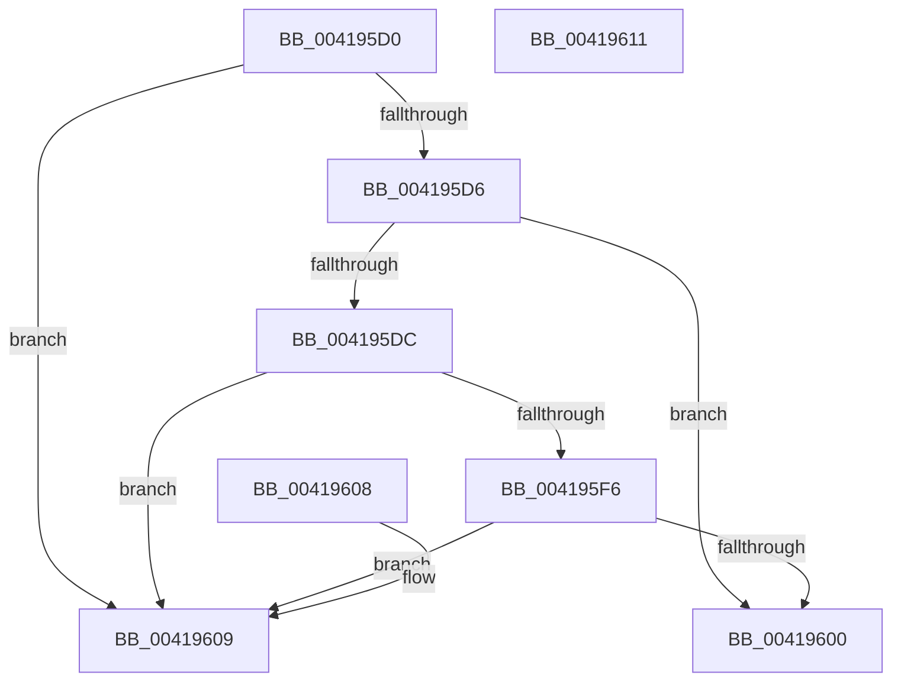

# MiTbFlushListPromoteThreshold

- RVA: `0x004195D0`–`0x00419612` (길이 `66` bytes)
- VA: `0x00000001404195D0`
- 실행 섹션: `.text`
- PDB 이름 있음: `예`; PDB Function 태그: `아니요`
- unwind 정보 RVA: `0x000DB714`
- 디코드: `16`개 명령, `66/66` bytes 표시
- 미해석 바이트: `0` (있으면 어셈블리에 `.byte`로 보존)

> 이 문서는 커널 이미지의 기계어와 PDB 기호를 분석해 생성했습니다. 4번과 5번은 함수 원형과 자료형을 바이너리 사용 방식에서 추정한 C 해석이며 원본 소스 복구 결과는 아닙니다.

## 1. Dependencies

- 직접 호출 지점: **0**; 고유 호출 대상: **0**
- 직접 호출자로 확인된 함수: **3**
- RIP 상대 이미지 참조: **1**

### Outgoing calls
- 직접 디코드된 call 명령이 없습니다.

### Direct callers
- [sub_00237DE0](../23/Unknown_function_00237DE0.md) at `0x00238482`
- [sub_00237DE0](../23/Unknown_function_00237DE0.md) at `0x002384A7`
- [MiConsumeSystemCacheTbFlushNeededView](MiConsumeSystemCacheTbFlushNeededView_function_004193B4.md) at `0x00419466`
- [MiFlushTbNowToAvoidOverflow](MiFlushTbNowToAvoidOverflow_function_00419590.md) at `0x0041959C`

### Static image references
- `0x00419600` → RVA `0x00E2DCD0` (`.data`; read)

## 2. Other-region calls and transfers

- 다른 실행 섹션으로 향하는 call: **0**
- 별도 외부 분기/꼬리 이동을 확인하지 못했습니다.

## 3. Assembly (complete function range)

```asm
004195D0  80 79 18 00                     cmp byte ptr [rcx + 0x18], 0
004195D4  75 33                           jne 0x140419609
004195D6  83 79 08 01                     cmp dword ptr [rcx + 8], 1
004195DA  75 24                           jne 0x140419600
004195DC  65 48 8B 04 25 88 01 00 00      mov rax, qword ptr gs:[0x188]
004195E5  48 8B 80 B8 00 00 00            mov rax, qword ptr [rax + 0xb8]
004195EC  48 83 B8 70 06 00 00 00         cmp qword ptr [rax + 0x670], 0
004195F4  75 13                           jne 0x140419609
004195F6  48 83 B8 70 01 00 00 00         cmp qword ptr [rax + 0x170], 0
004195FE  75 09                           jne 0x140419609
00419600  48 8B 05 C9 46 A1 00            mov rax, qword ptr [rip + 0xa146c9]
00419607  C3                              ret
00419608  CC                              int3
00419609  48 C7 C0 FF FF FF FF            mov rax, 0xffffffffffffffff
00419610  C3                              ret
00419611  CC                              int3
```

## 4. C-style interpretation (structured pseudocode)

```c
__int64 __fastcall MiTbFlushListPromoteThreshold(__int64 a1)
{
    if ((*(unsigned __int8 *)(a1 + 24)) != 0) goto loc_00419609;
    if ((*(unsigned int *)(a1 + 8)) != 1) goto loc_00419600;
    if ((*(unsigned __int64 *)(*(unsigned __int64 *)(*(unsigned __int64 *)(gs_base + (0 + 392)) + 184) + 1648)) != 0) goto loc_00419609;
    if ((*(unsigned __int64 *)(*(unsigned __int64 *)(*(unsigned __int64 *)(gs_base + (0 + 392)) + 184) + 368)) != 0) goto loc_00419609;
loc_00419600:
    return *(unsigned __int64 *)(v_rip + 10569417);
loc_00419609:
    return -1;
}
```

## 5. (Beta) C Style

```c
int64_t MiTbFlushListPromoteThreshold(void *Arg1)
{
    uint8_t *arg1 = (uint8_t *)Arg1;

    if ((*(uint8_t *)(arg1 + 0x18)) != 0) goto loc_00419609;
    if ((*(uint32_t *)(arg1 + 0x8)) != 1) goto loc_00419600;
    if ((*(uint64_t *)(*(uint64_t *)(*(uint64_t *)(gs_base + (0 + 0x188)) + 0xB8) + 0x670)) != 0) goto loc_00419609;
    if ((*(uint64_t *)(*(uint64_t *)(*(uint64_t *)(gs_base + (0 + 0x188)) + 0xB8) + 0x170)) != 0) goto loc_00419609;
loc_00419600:
    return *(uint64_t *)(v_rip + 0xA146C9);
loc_00419609:
    return -1;
}
```

### 관측된 메모리 오프셋

구조체 형식이 확인되지 않은 접근은 인자 기준의 오프셋으로만 기록했습니다.

| 기준 인자 | 오프셋 표현 | 폭 (bit) | 접근 |
|---|---:|---:|---|
| `Arg1` | `+ 0x8` | `32` | `R` |
| `Arg1` | `+ 0x18` | `8` | `R` |

## 6. Execution-region graph

[열기: 2D/3D 그래프와 함수 탐색 컨트롤 패널](../../../control-panel.html?section=text&rva=0x004195D0&view=graph)

- 2D 그래프는 위에서 아래로 흐르고, 3D 그래프는 빈 공간을 드래그해 회전합니다. Shift+드래그는 이동, 휠은 확대·축소, 함수 노드 선택은 대상 보고서 이동입니다.

### Static fallback


