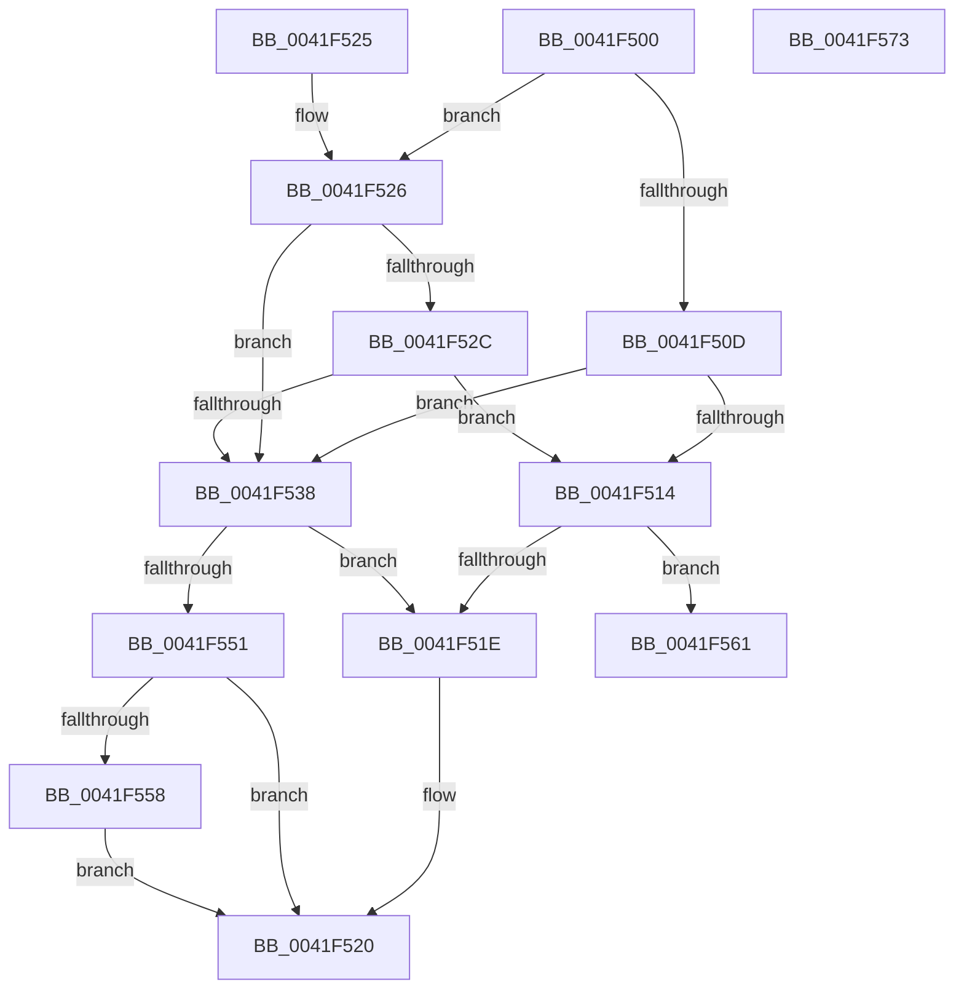

# MiVadPageTableChargeLevel

- RVA: `0x0041F500`–`0x0041F574` (길이 `116` bytes)
- VA: `0x000000014041F500`
- 실행 섹션: `.text`
- PDB 이름 있음: `예`; PDB Function 태그: `아니요`
- unwind 정보 RVA: `0x0009FE2C`
- 디코드: `38`개 명령, `116/116` bytes 표시
- 미해석 바이트: `0` (있으면 어셈블리에 `.byte`로 보존)

> 이 문서는 커널 이미지의 기계어와 PDB 기호를 분석해 생성했습니다. 4번과 5번은 함수 원형과 자료형을 바이너리 사용 방식에서 추정한 C 해석이며 원본 소스 복구 결과는 아닙니다.

## 1. Dependencies

- 직접 호출 지점: **2**; 고유 호출 대상: **2**
- 직접 호출자로 확인된 함수: **2**
- RIP 상대 이미지 참조: **1**

### Outgoing calls
- `0x0041F561` → [MiGetAweVadPageSize](../../page/AD/MiGetAweVadPageSize_function_00AD58F8.md) (function, `0x00AD58F8`)
- `0x0041F569` → [MiPageSizeToPteLevel](MiPageSizeToPteLevel_function_0041F57C.md) (function, `0x0041F57C`)

### Direct callers
- [MiCommitPageTablesForVad](../../page/88/MiCommitPageTablesForVad_function_00886D50.md) at `0x00886E53`
- [sub_009E57A9](../../page/9E/Unknown_function_009E57A9.md) at `0x009E581C`

### Static image references
- `0x0041F53B` → RVA `0x00013F10` (`.rdata`; read)

## 2. Other-region calls and transfers

- 다른 실행 섹션으로 향하는 call: **1**
  - `0x0041F561` → [MiGetAweVadPageSize](../../page/AD/MiGetAweVadPageSize_function_00AD58F8.md) (`.text` → `PAGE`)
- 별도 외부 분기/꼬리 이동을 확인하지 못했습니다.

## 3. Assembly (complete function range)

```asm
0041F500  48 83 EC 28                     sub rsp, 0x28
0041F504  8B 41 30                        mov eax, dword ptr [rcx + 0x30]
0041F507  0F BA E0 15                     bt eax, 0x15
0041F50B  72 19                           jb 0x14041f526
0041F50D  8B 41 40                        mov eax, dword ptr [rcx + 0x40]
0041F510  A8 01                           test al, 1
0041F512  75 24                           jne 0x14041f538
0041F514  8B 41 30                        mov eax, dword ptr [rcx + 0x30]
0041F517  83 E0 70                        and eax, 0x70
0041F51A  3C 30                           cmp al, 0x30
0041F51C  74 43                           je 0x14041f561
0041F51E  33 C0                           xor eax, eax
0041F520  48 83 C4 28                     add rsp, 0x28
0041F524  C3                              ret
0041F525  CC                              int3
0041F526  0F BA E0 17                     bt eax, 0x17
0041F52A  72 0C                           jb 0x14041f538
0041F52C  25 00 00 18 00                  and eax, 0x180000
0041F531  3D 00 00 10 00                  cmp eax, 0x100000
0041F536  72 DC                           jb 0x14041f514
0041F538  8B 41 30                        mov eax, dword ptr [rcx + 0x30]
0041F53B  48 8D 0D CE 49 BF FF            lea rcx, [rip - 0x40b632]
0041F542  48 C1 E8 13                     shr rax, 0x13
0041F546  83 E0 03                        and eax, 3
0041F549  8B 0C 81                        mov ecx, dword ptr [rcx + rax*4]
0041F54C  83 F9 01                        cmp ecx, 1
0041F54F  77 CD                           ja 0x14041f51e
0041F551  B8 01 00 00 00                  mov eax, 1
0041F556  73 C8                           jae 0x14041f520
0041F558  B8 02 00 00 00                  mov eax, 2
0041F55D  2B C1                           sub eax, ecx
0041F55F  EB BF                           jmp 0x14041f520
0041F561  E8 92 63 6B 00                  call 0x140ad58f8
0041F566  48 8B C8                        mov rcx, rax
0041F569  E8 0E 00 00 00                  call 0x14041f57c
0041F56E  48 83 C4 28                     add rsp, 0x28
0041F572  C3                              ret
0041F573  CC                              int3
```

## 4. C-style interpretation (structured pseudocode)

```c
__int64 __fastcall MiVadPageTableChargeLevel(__int64 a1)
{
    __int64 result;
    __int64 v_rsp;

    v_rsp = (v_rsp) - (40);
    if (condition_is_below) goto loc_0041F526;
    if ((((unsigned __int8)((unsigned int)(*(unsigned int *)(a1 + 64)))) & (1)) != 0) goto loc_0041F538;
loc_0041F514:
    result = (unsigned int)(((unsigned int)(*(unsigned int *)(a1 + 48))) & (112));
    if (((unsigned __int8)(result)) == 48) goto loc_0041F561;
loc_0041F51E:
    result = 0;
loc_0041F520:
    v_rsp = (v_rsp) + (40);
    return result;
loc_0041F526:
    if (condition_is_below) goto loc_0041F538;
    result = (unsigned int)((result) & (0x180000ULL));
    if (((unsigned int)(result)) < 0x100000ULL) goto loc_0041F514;
loc_0041F538:
    result = ((unsigned int)(*(unsigned int *)(a1 + 48))) >> (19);
    result = (unsigned int)((result) & (3));
    if (((unsigned int)((unsigned int)(*(unsigned int *)(v_rip - 4240946 + result * 4)))) > 1) goto loc_0041F51E;
    if (((unsigned int)((unsigned int)(*(unsigned int *)(v_rip - 4240946 + result * 4)))) >= 1) goto loc_0041F520;
    result = (unsigned int)((2) - ((unsigned int)((unsigned int)(*(unsigned int *)(v_rip - 4240946 + result * 4)))));
    goto loc_0041F520;
loc_0041F561:
    result = MiGetAweVadPageSize((unsigned int)(*(unsigned int *)(v_rip - 4240946 + result * 4)), a2, a3, a4);
    result = MiPageSizeToPteLevel(result, a2, a3, a4);
    v_rsp = (v_rsp) + (40);
    return result;
}
```

## 5. (Beta) C Style

```c
int64_t MiVadPageTableChargeLevel(void *Arg1)
{
    uint8_t *arg1 = (uint8_t *)Arg1;

    int64_t result;
    int64_t local_rsp;

    local_rsp = (local_rsp) - (40);
    if (condition_is_below) goto loc_0041F526;
    if ((((uint8_t)((uint32_t)(*(uint32_t *)(arg1 + 0x40)))) & (1)) != 0) goto loc_0041F538;
loc_0041F514:
    result = (uint32_t)(((uint32_t)(*(uint32_t *)(arg1 + 0x30))) & (112));
    if (((uint8_t)(result)) == 48) goto loc_0041F561;
loc_0041F51E:
    result = 0;
loc_0041F520:
    local_rsp = (local_rsp) + (40);
    return result;
loc_0041F526:
    if (condition_is_below) goto loc_0041F538;
    result = (uint32_t)((result) & (0x180000ULL));
    if (((uint32_t)(result)) < 0x100000ULL) goto loc_0041F514;
loc_0041F538:
    result = ((uint32_t)(*(uint32_t *)(arg1 + 0x30))) >> (19);
    result = (uint32_t)((result) & (3));
    if (((uint32_t)((uint32_t)(*(uint32_t *)(v_rip - 0x40B632 + result * 4)))) > 1) goto loc_0041F51E;
    if (((uint32_t)((uint32_t)(*(uint32_t *)(v_rip - 0x40B632 + result * 4)))) >= 1) goto loc_0041F520;
    result = (uint32_t)((2) - ((uint32_t)((uint32_t)(*(uint32_t *)(v_rip - 0x40B632 + result * 4)))));
    goto loc_0041F520;
loc_0041F561:
    result = MiGetAweVadPageSize((uint32_t)(*(uint32_t *)(v_rip - 0x40B632 + result * 4)), a2, a3, a4);
    result = MiPageSizeToPteLevel(result, a2, a3, a4);
    local_rsp = (local_rsp) + (40);
    return result;
}
```

### 관측된 메모리 오프셋

구조체 형식이 확인되지 않은 접근은 인자 기준의 오프셋으로만 기록했습니다.

| 기준 인자 | 오프셋 표현 | 폭 (bit) | 접근 |
|---|---:|---:|---|
| `Arg1` | `+ 0x30` | `32` | `R` |
| `Arg1` | `+ 0x40` | `32` | `R` |

## 6. Execution-region graph

[열기: 2D/3D 그래프와 함수 탐색 컨트롤 패널](../../../control-panel.html?section=text&rva=0x0041F500&view=graph)

- 2D 그래프는 위에서 아래로 흐르고, 3D 그래프는 빈 공간을 드래그해 회전합니다. Shift+드래그는 이동, 휠은 확대·축소, 함수 노드 선택은 대상 보고서 이동입니다.

### Static fallback


