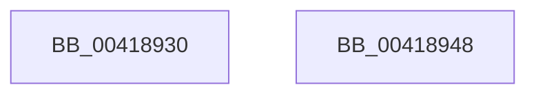

# MmGetCurrentProcessorColor

- RVA: `0x00418930`–`0x00418949` (길이 `25` bytes)
- VA: `0x0000000140418930`
- 실행 섹션: `.text`
- PDB 이름 있음: `예`; PDB Function 태그: `아니요`
- unwind 정보 RVA: `0x000DB714`
- 디코드: `5`개 명령, `25/25` bytes 표시
- 미해석 바이트: `0` (있으면 어셈블리에 `.byte`로 보존)

> 이 문서는 커널 이미지의 기계어와 PDB 기호를 분석해 생성했습니다. 4번과 5번은 함수 원형과 자료형을 바이너리 사용 방식에서 추정한 C 해석이며 원본 소스 복구 결과는 아닙니다.

## 1. Dependencies

- 직접 호출 지점: **0**; 고유 호출 대상: **0**
- 직접 호출자로 확인된 함수: **5**
- RIP 상대 이미지 참조: **0**

### Outgoing calls
- 직접 디코드된 call 명령이 없습니다.

### Direct callers
- [sub_008873D4](../../page/88/Unknown_function_008873D4.md) at `0x008873E0`
- [MmPrefetchPagesEx](../../page/93/MmPrefetchPagesEx_function_0093C9A0.md) at `0x0093C9E6`
- [MiAllocateReadList](../../page/93/MiAllocateReadList_function_0093D4F0.md) at `0x0093D4F6`
- [MiAddSecureEntry](../../page/98/MiAddSecureEntry_function_00980250.md) at `0x00980290`
- [MiSecureVad](../../page/9F/MiSecureVad_function_009F5788.md) at `0x009F5804`

### Static image references
- 디코드된 RIP-relative 메모리 참조가 없습니다.

## 2. Other-region calls and transfers

- 다른 실행 섹션으로 향하는 call: **0**
- 별도 외부 분기/꼬리 이동을 확인하지 못했습니다.

## 3. Assembly (complete function range)

```asm
00418930  65 48 8B 04 25 20 00 00 00      mov rax, qword ptr gs:[0x20]
00418939  48 8B 88 C0 00 00 00            mov rcx, qword ptr [rax + 0xc0]
00418940  0F B7 81 8A 00 00 00            movzx eax, word ptr [rcx + 0x8a]
00418947  C3                              ret
00418948  CC                              int3
```

## 4. C-style interpretation (structured pseudocode)

```c
__int64 __fastcall MmGetCurrentProcessorColor(void)
{
    return *(unsigned __int16 *)(*(unsigned __int64 *)(*(unsigned __int64 *)(gs_base + (0 + 32)) + 192) + 138);
}
```

## 5. (Beta) C Style

```c
void MmGetCurrentProcessorColor(void)
{
    return *(uint16_t *)(*(uint64_t *)(*(uint64_t *)(gs_base + (0 + 0x20)) + 0xC0) + 0x8A);
}
```

## 6. Execution-region graph

[열기: 2D/3D 그래프와 함수 탐색 컨트롤 패널](../../../control-panel.html?section=text&rva=0x00418930&view=graph)

- 2D 그래프는 위에서 아래로 흐르고, 3D 그래프는 빈 공간을 드래그해 회전합니다. Shift+드래그는 이동, 휠은 확대·축소, 함수 노드 선택은 대상 보고서 이동입니다.

### Static fallback


