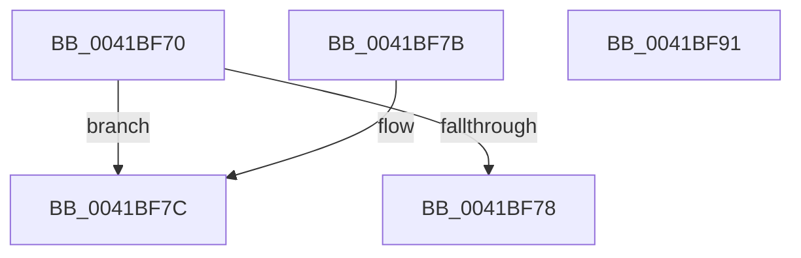

# OBJECT_HEADER_TO_AUDIT_INFO

- RVA: `0x0041BF70`–`0x0041BF92` (길이 `34` bytes)
- VA: `0x000000014041BF70`
- 실행 섹션: `.text`
- PDB 이름 있음: `예`; PDB Function 태그: `아니요`
- unwind 정보 RVA: `0x000DB714`
- 디코드: `13`개 명령, `34/34` bytes 표시
- 미해석 바이트: `0` (있으면 어셈블리에 `.byte`로 보존)

> 이 문서는 커널 이미지의 기계어와 PDB 기호를 분석해 생성했습니다. 4번과 5번은 함수 원형과 자료형을 바이너리 사용 방식에서 추정한 C 해석이며 원본 소스 복구 결과는 아닙니다.

## 1. Dependencies

- 직접 호출 지점: **0**; 고유 호출 대상: **0**
- 직접 호출자로 확인된 함수: **3**
- RIP 상대 이미지 참조: **1**

### Outgoing calls
- 직접 디코드된 call 명령이 없습니다.

### Direct callers
- [ObpSetObjectAuditInfo](../../page/8B/ObpSetObjectAuditInfo_function_008BD1F8.md) at `0x008BD22F`
- [ObDuplicateObject](../../page/8C/ObDuplicateObject_function_008C4FA0.md) at `0x008C5C97`
- [ObpAuditObjectAccess](../../page/94/ObpAuditObjectAccess_function_0094C270.md) at `0x0094C337`

### Static image references
- `0x0041BF7F` → RVA `0x00F0FF80` (`.data`; read)

## 2. Other-region calls and transfers

- 다른 실행 섹션으로 향하는 call: **0**
- 별도 외부 분기/꼬리 이동을 확인하지 못했습니다.

## 3. Assembly (complete function range)

```asm
0041BF70  0F B6 41 1A                     movzx eax, byte ptr [rcx + 0x1a]
0041BF74  A8 20                           test al, 0x20
0041BF76  75 04                           jne 0x14041bf7c
0041BF78  33 C0                           xor eax, eax
0041BF7A  C3                              ret
0041BF7B  CC                              int3
0041BF7C  83 E0 3F                        and eax, 0x3f
0041BF7F  48 8D 15 FA 3F AF 00            lea rdx, [rip + 0xaf3ffa]
0041BF86  0F B6 04 10                     movzx eax, byte ptr [rax + rdx]
0041BF8A  48 2B C8                        sub rcx, rax
0041BF8D  48 8B C1                        mov rax, rcx
0041BF90  C3                              ret
0041BF91  CC                              int3
```

## 4. C-style interpretation (structured pseudocode)

```c
__int64 __fastcall OBJECT_HEADER_TO_AUDIT_INFO(__int64 a1)
{
    __int64 result;

    if ((((unsigned __int8)(*(unsigned __int8 *)(a1 + 26))) & (32)) != 0) goto loc_0041BF7C;
    result = 0;
    return result;
loc_0041BF7C:
    result = (unsigned int)((result) & (63));
    a1 = (a1) - (*(unsigned __int8 *)(result + v_rip + 11485178 * 1));
    return a1;
}
```

## 5. (Beta) C Style

```c
int64_t OBJECT_HEADER_TO_AUDIT_INFO(void *Arg1)
{
    uint8_t *arg1 = (uint8_t *)Arg1;

    int64_t result;

    if ((((uint8_t)(*(uint8_t *)(arg1 + 0x1A))) & (32)) != 0) goto loc_0041BF7C;
    result = 0;
    return result;
loc_0041BF7C:
    result = (uint32_t)((result) & (63));
    Arg1 = (Arg1) - (*(uint8_t *)(result + v_rip + 0xAF3FFA * 1));
    return Arg1;
}
```

### 관측된 메모리 오프셋

구조체 형식이 확인되지 않은 접근은 인자 기준의 오프셋으로만 기록했습니다.

| 기준 인자 | 오프셋 표현 | 폭 (bit) | 접근 |
|---|---:|---:|---|
| `Arg1` | `+ 0x1A` | `8` | `R` |

## 6. Execution-region graph

[열기: 2D/3D 그래프와 함수 탐색 컨트롤 패널](../../../control-panel.html?section=text&rva=0x0041BF70&view=graph)

- 2D 그래프는 위에서 아래로 흐르고, 3D 그래프는 빈 공간을 드래그해 회전합니다. Shift+드래그는 이동, 휠은 확대·축소, 함수 노드 선택은 대상 보고서 이동입니다.

### Static fallback


