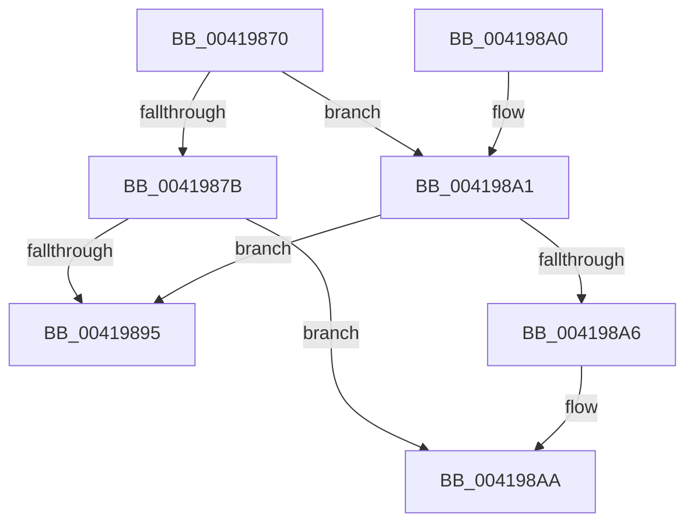

# ObReferenceObjectByPointerWithTag

- RVA: `0x00419870`–`0x004198B2` (길이 `66` bytes)
- VA: `0x0000000140419870`
- 실행 섹션: `.text`
- PDB 이름 있음: `예`; PDB Function 태그: `아니요`
- unwind 정보 RVA: `0x0009D158`
- 디코드: `21`개 명령, `66/66` bytes 표시
- 미해석 바이트: `0` (있으면 어셈블리에 `.byte`로 보존)

> 이 문서는 커널 이미지의 기계어와 PDB 기호를 분석해 생성했습니다. 4번과 5번은 함수 원형과 자료형을 바이너리 사용 방식에서 추정한 C 해석이며 원본 소스 복구 결과는 아닙니다.

## 1. Dependencies

- 직접 호출 지점: **0**; 고유 호출 대상: **0**
- 직접 호출자로 확인된 함수: **6**
- RIP 상대 이미지 참조: **1**

### Outgoing calls
- 직접 디코드된 call 명령이 없습니다.

### Direct callers
- [DifObReferenceObjectByPointerWithTagWrapper](../63/DifObReferenceObjectByPointerWithTagWrapper_function_00638210.md) at `0x00638310`
- [DifObReferenceObjectByPointerWrapper](../63/DifObReferenceObjectByPointerWrapper_function_006383B0.md) at `0x006384AB`
- [ObOpenObjectByPointer](../../page/8B/ObOpenObjectByPointer_function_008B7420.md) at `0x008B74AE`
- [IoRegisterPlugPlayNotification](../../page/95/IoRegisterPlugPlayNotification_function_009535A0.md) at `0x009535F6`
- [PspSchedulerSharedDataRegionCreate](../../page/98/PspSchedulerSharedDataRegionCreate_function_009825DC.md) at `0x009826DB`
- [PspSchedulerSharedDataRegionSlotAllocate](../../page/A2/PspSchedulerSharedDataRegionSlotAllocate_function_00A268C8.md) at `0x00A26946`

### Static image references
- `0x00419889` → RVA `0x00FC6E4C` (`ALMOSTRO`; read)

## 2. Other-region calls and transfers

- 다른 실행 섹션으로 향하는 call: **0**
- 별도 외부 분기/꼬리 이동을 확인하지 못했습니다.

## 3. Assembly (complete function range)

```asm
00419870  40 53                           push rbx
00419872  48 83 EC 30                     sub rsp, 0x30
00419876  4D 85 C0                        test r8, r8
00419879  74 26                           je 0x1404198a1
0041987B  48 8D 59 D0                     lea rbx, [rcx - 0x30]
0041987F  48 8B C3                        mov rax, rbx
00419882  48 C1 E8 08                     shr rax, 8
00419886  32 43 18                        xor al, byte ptr [rbx + 0x18]
00419889  32 05 BD D5 BA 00               xor al, byte ptr [rip + 0xbad5bd]
0041988F  41 3A 40 28                     cmp al, byte ptr [r8 + 0x28]
00419893  74 15                           je 0x1404198aa
00419895  B8 24 00 00 C0                  mov eax, 0xc0000024
0041989A  48 83 C4 30                     add rsp, 0x30
0041989E  5B                              pop rbx
0041989F  C3                              ret
004198A0  CC                              int3
004198A1  45 84 C9                        test r9b, r9b
004198A4  75 EF                           jne 0x140419895
004198A6  48 8D 59 D0                     lea rbx, [rcx - 0x30]
004198AA  44 8B 44 24 60                  mov r8d, dword ptr [rsp + 0x60]
004198AF  48 8B CB                        mov rcx, rbx
```

## 4. C-style interpretation (structured pseudocode)

```c
__int64 __fastcall ObReferenceObjectByPointerWithTag(__int64 a1, __int64 a2, __int64 a3, unsigned __int8 a4, unsigned int a5)
{
    __int64 result;
    __int64 v_rsp;

    v_rsp = (v_rsp) - (48);
    if (a3 == 0) goto loc_004198A1;
    result = (a1 - 48) >> (8);
    result = (unsigned __int8)((result) ^ (*(unsigned __int8 *)(a1 - 48 + 24)));
    result = (unsigned __int8)((result) ^ (*(unsigned __int8 *)(v_rip + 12244413)));
    if (((unsigned __int8)(result)) == (*(unsigned __int8 *)(a3 + 40))) goto loc_004198AA;
loc_00419895:
    v_rsp = (v_rsp) + (48);
    return (unsigned int)(0xC0000024ULL);
loc_004198A1:
    if (a4 != 0) goto loc_00419895;
loc_004198AA:
    return (unsigned int)(0xC0000024ULL);
}
```

## 5. (Beta) C Style

```c
int64_t ObReferenceObjectByPointerWithTag(void *Arg1, int64_t Arg2, int64_t Arg3, uint8_t Arg4, uint32_t Arg5)
{
    uint8_t *arg1 = (uint8_t *)Arg1;

    int64_t result;
    int64_t local_rsp;

    local_rsp = (local_rsp) - (48);
    if (Arg3 == 0) goto loc_004198A1;
    result = (Arg1 - 48) >> (8);
    result = (uint8_t)((result) ^ (*(uint8_t *)(arg1 - 0x30 + 0x18)));
    result = (uint8_t)((result) ^ (*(uint8_t *)(v_rip + 0xBAD5BD)));
    if (((uint8_t)(result)) == (*(uint8_t *)(Arg3 + 0x28))) goto loc_004198AA;
loc_00419895:
    local_rsp = (local_rsp) + (48);
    return (uint32_t)(0xC0000024ULL);
loc_004198A1:
    if (Arg4 != 0) goto loc_00419895;
loc_004198AA:
    return (uint32_t)(0xC0000024ULL);
}
```

### 관측된 메모리 오프셋

구조체 형식이 확인되지 않은 접근은 인자 기준의 오프셋으로만 기록했습니다.

| 기준 인자 | 오프셋 표현 | 폭 (bit) | 접근 |
|---|---:|---:|---|
| `Arg1` | `- 0x30` | `64` | `R` |
| `Arg1` | `+ 0x18` | `8` | `R` |

## 6. Execution-region graph

[열기: 2D/3D 그래프와 함수 탐색 컨트롤 패널](../../../control-panel.html?section=text&rva=0x00419870&view=graph)

- 2D 그래프는 위에서 아래로 흐르고, 3D 그래프는 빈 공간을 드래그해 회전합니다. Shift+드래그는 이동, 휠은 확대·축소, 함수 노드 선택은 대상 보고서 이동입니다.

### Static fallback


