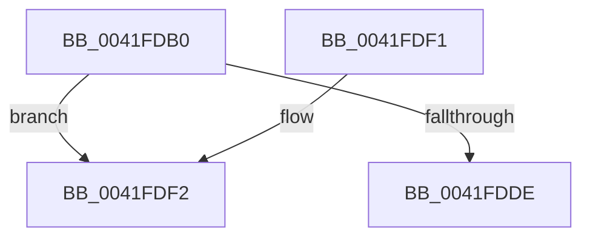

# ObReferenceObjectExWithTag

- RVA: `0x0041FDB0`–`0x0041FE0F` (길이 `95` bytes)
- VA: `0x000000014041FDB0`
- 실행 섹션: `.text`
- PDB 이름 있음: `예`; PDB Function 태그: `아니요`
- unwind 정보 RVA: `0x000A00E0`
- 디코드: `28`개 명령, `95/95` bytes 표시
- 미해석 바이트: `0` (있으면 어셈블리에 `.byte`로 보존)

> 이 문서는 커널 이미지의 기계어와 PDB 기호를 분석해 생성했습니다. 4번과 5번은 함수 원형과 자료형을 바이너리 사용 방식에서 추정한 C 해석이며 원본 소스 복구 결과는 아닙니다.

## 1. Dependencies

- 직접 호출 지점: **2**; 고유 호출 대상: **2**
- 직접 호출자로 확인된 함수: **3**
- RIP 상대 이미지 참조: **0**

### Outgoing calls
- `0x0041FDCB` → [ObpTraceObjectReferenceIfActive](../21/ObpTraceObjectReferenceIfActive_function_00210780.md) (function, `0x00210780`)
- `0x0041FE09` → [KeBugCheckEx](../4F/KeBugCheckEx_function_004FD660.md) (function, `0x004FD660`)

### Direct callers
- [ObpCreateHandle](../../page/86/ObpCreateHandle_function_0086B950.md) at `0x0086BF87`
- [sub_00984B34](../../page/98/Unknown_function_00984B34.md) at `0x00984CA9`
- [PspInsertThread](../../page/9F/PspInsertThread_function_009F0314.md) at `0x009F086B`

### Static image references
- 디코드된 RIP-relative 메모리 참조가 없습니다.

## 2. Other-region calls and transfers

- 다른 실행 섹션으로 향하는 call: **0**
- 별도 외부 분기/꼬리 이동을 확인하지 못했습니다.

## 3. Assembly (complete function range)

```asm
0041FDB0  48 89 5C 24 08                  mov qword ptr [rsp + 8], rbx
0041FDB5  48 89 74 24 10                  mov qword ptr [rsp + 0x10], rsi
0041FDBA  57                              push rdi
0041FDBB  48 83 EC 30                     sub rsp, 0x30
0041FDBF  48 63 DA                        movsxd rbx, edx
0041FDC2  48 8B F1                        mov rsi, rcx
0041FDC5  8B D3                           mov edx, ebx
0041FDC7  48 83 C1 D0                     add rcx, -0x30
0041FDCB  E8 B0 09 DF FF                  call 0x140210780
0041FDD0  48 8B C3                        mov rax, rbx
0041FDD3  F0 48 0F C1 46 D0               lock xadd qword ptr [rsi - 0x30], rax
0041FDD9  48 85 C0                        test rax, rax
0041FDDC  7E 14                           jle 0x14041fdf2
0041FDDE  48 8B 74 24 48                  mov rsi, qword ptr [rsp + 0x48]
0041FDE3  48 03 C3                        add rax, rbx
0041FDE6  48 8B 5C 24 40                  mov rbx, qword ptr [rsp + 0x40]
0041FDEB  48 83 C4 30                     add rsp, 0x30
0041FDEF  5F                              pop rdi
0041FDF0  C3                              ret
0041FDF1  CC                              int3
0041FDF2  48 8D 0C 03                     lea rcx, [rbx + rax]
0041FDF6  33 D2                           xor edx, edx
0041FDF8  48 89 4C 24 20                  mov qword ptr [rsp + 0x20], rcx
0041FDFD  41 B9 10 00 00 00               mov r9d, 0x10
0041FE03  4C 8B C6                        mov r8, rsi
0041FE06  8D 4A 18                        lea ecx, [rdx + 0x18]
0041FE09  E8 52 D8 0D 00                  call 0x1404fd660
0041FE0E  CC                              int3
```

## 4. C-style interpretation (structured pseudocode)

```c
__int64 __fastcall ObReferenceObjectExWithTag(__int64 a1, int a2)
{
    __int64 result;
    __int64 v_rsp;
    unsigned __int64 v_stack_p10;
    unsigned __int64 v_stack_p20;
    unsigned __int64 v_stack_p8;

    v_stack_p8 = v_rbx;
    v_stack_p10 = v_rsi;
    v_rsp = (v_rsp) - (48);
    a1 = (a1) + (-48);
    result = ObpTraceObjectReferenceIfActive(a1, (unsigned int)((unsigned int)((int)(a2))), a3, a4);
    if (condition_is_less_or_equal) goto loc_0041FDF2;
    result = ((int)(a2)) + ((int)(a2));
    v_rsp = (v_rsp) + (48);
    return result;
loc_0041FDF2:
    a2 = 0;
    v_stack_p20 = v_stack_p8 + result * 1;
    result = KeBugCheckEx(a2 + 24, a2, v_stack_p10, 16);
    return result;
}
```

## 5. (Beta) C Style

```c
int64_t ObReferenceObjectExWithTag(void *Arg1, void *Arg2)
{
    uint8_t *arg1 = (uint8_t *)Arg1;
    uint8_t *arg2 = (uint8_t *)Arg2;

    int64_t result;
    int64_t local_rsp;
    uint64_t v_stack_p10;
    uint64_t v_stack_p20;
    uint64_t v_stack_p8;

    v_stack_p8 = local_rbx;
    v_stack_p10 = local_rsi;
    local_rsp = (local_rsp) - (48);
    Arg1 = (Arg1) + (-48);
    result = ObpTraceObjectReferenceIfActive(Arg1, (uint32_t)((uint32_t)((int32_t)(Arg2))), a3, a4);
    if (condition_is_less_or_equal) goto loc_0041FDF2;
    result = ((int32_t)(Arg2)) + ((int32_t)(Arg2));
    local_rsp = (local_rsp) + (48);
    return result;
loc_0041FDF2:
    Arg2 = 0;
    v_stack_p20 = v_stack_p8 + result * 1;
    result = KeBugCheckEx(Arg2 + 24, Arg2, v_stack_p10, 16);
    return result;
}
```

### 관측된 메모리 오프셋

구조체 형식이 확인되지 않은 접근은 인자 기준의 오프셋으로만 기록했습니다.

| 기준 인자 | 오프셋 표현 | 폭 (bit) | 접근 |
|---|---:|---:|---|
| `Arg1` | `- 0x30` | `64` | `R/W` |
| `Arg2` | `+ 0x0 + rax*1` | `64` | `R` |

## 6. Execution-region graph

[열기: 2D/3D 그래프와 함수 탐색 컨트롤 패널](../../../control-panel.html?section=text&rva=0x0041FDB0&view=graph)

- 2D 그래프는 위에서 아래로 흐르고, 3D 그래프는 빈 공간을 드래그해 회전합니다. Shift+드래그는 이동, 휠은 확대·축소, 함수 노드 선택은 대상 보고서 이동입니다.

### Static fallback


