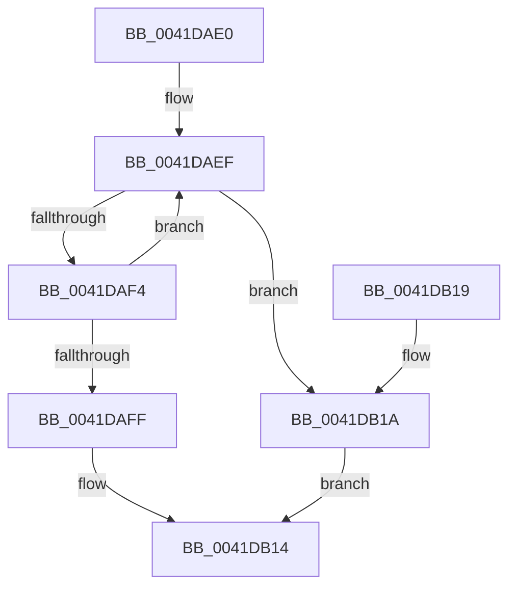

# ObReferenceObjectSafe

- RVA: `0x0041DAE0`–`0x0041DB1C` (길이 `60` bytes)
- VA: `0x000000014041DAE0`
- 실행 섹션: `.text`
- PDB 이름 있음: `예`; PDB Function 태그: `아니요`
- unwind 정보 RVA: `0x0005DDFC`
- 디코드: `18`개 명령, `60/60` bytes 표시
- 미해석 바이트: `0` (있으면 어셈블리에 `.byte`로 보존)

> 이 문서는 커널 이미지의 기계어와 PDB 기호를 분석해 생성했습니다. 4번과 5번은 함수 원형과 자료형을 바이너리 사용 방식에서 추정한 C 해석이며 원본 소스 복구 결과는 아닙니다.

## 1. Dependencies

- 직접 호출 지점: **1**; 고유 호출 대상: **1**
- 직접 호출자로 확인된 함수: **17**
- RIP 상대 이미지 참조: **0**

### Outgoing calls
- `0x0041DB0D` → [ObpTraceObjectReferenceIfActive](../21/ObpTraceObjectReferenceIfActive_function_00210780.md) (function, `0x00210780`)

### Direct callers
- [AlpcpPortQueryServerInfo](../../page/74/AlpcpPortQueryServerInfo_function_0074C784.md) at `0x0074C91B`
- [AlpcpPortQueryServerInfo](../../page/74/AlpcpPortQueryServerInfo_function_0074C784.md) at `0x0074C95D`
- [CmUnRegisterCallback](../../page/7E/CmUnRegisterCallback_function_007E1510.md) at `0x007E16BB`
- [AlpcpDispatchNewMessage](../../page/88/AlpcpDispatchNewMessage_function_0088DD20.md) at `0x0088DDCB`
- [AlpcpDispatchNewMessage](../../page/88/AlpcpDispatchNewMessage_function_0088DD20.md) at `0x0088DDE0`
- [AlpcpDispatchReplyToPort](../../page/88/AlpcpDispatchReplyToPort_function_0088F880.md) at `0x0088F95D`
- [AlpcpDispatchReplyToPort](../../page/88/AlpcpDispatchReplyToPort_function_0088F880.md) at `0x0088F975`
- [AlpcpReferenceAndLockTargetPortsAndCommunicationInfo](../../page/88/AlpcpReferenceAndLockTargetPortsAndCommunicationInfo_function_0088FEE0.md) at `0x0088FF62`
- [AlpcpReferenceAndLockTargetPortsAndCommunicationInfo](../../page/88/AlpcpReferenceAndLockTargetPortsAndCommunicationInfo_function_0088FEE0.md) at `0x0088FF77`
- [AlpcpCancelMessage](../../page/89/AlpcpCancelMessage_function_00894120.md) at `0x008942C2`
- [AlpcpCancelMessage](../../page/89/AlpcpCancelMessage_function_00894120.md) at `0x008942DB`
- [AlpcpCancelMessage](../../page/89/AlpcpCancelMessage_function_00894120.md) at `0x0089463A`
- [AlpcpCancelMessage](../../page/89/AlpcpCancelMessage_function_00894120.md) at `0x00894674`
- [AlpcpReceiveLegacyMessage](../../page/89/AlpcpReceiveLegacyMessage_function_00895DE0.md) at `0x00896131`
- [AlpcpProcessSynchronousRequest](../../page/92/AlpcpProcessSynchronousRequest_function_00921FCC.md) at `0x0092245C`
- [AlpcpDispatchConnectionRequest](../../page/92/AlpcpDispatchConnectionRequest_function_0092353C.md) at `0x009235E3`
- [AlpcpDisconnectPort](../../page/92/AlpcpDisconnectPort_function_00924A68.md) at `0x00924B6D`
- [AlpcpDisconnectPort](../../page/92/AlpcpDisconnectPort_function_00924A68.md) at `0x00924C8F`
- [AlpcpFlushMessagesPort](../../page/92/AlpcpFlushMessagesPort_function_00925554.md) at `0x00925776`
- [AlpcpFlushMessagesPort](../../page/92/AlpcpFlushMessagesPort_function_00925554.md) at `0x00925967`
- [sub_009CB0C2](../../page/9C/Unknown_function_009CB0C2.md) at `0x009CB0D3`
- [WmipProcessEvent](../../page/9D/WmipProcessEvent_function_009DFA40.md) at `0x009DFAEF`
- [AlpcpReferenceMessageByWaitingThread](../../page/A4/AlpcpReferenceMessageByWaitingThread_function_00A47DFC.md) at `0x00A47E7E`
- [AlpcpQueryRemoteView](../../page/A4/AlpcpQueryRemoteView_function_00A49744.md) at `0x00A497CA`
- [sub_00B2FC68](../../page/B2/Unknown_function_00B2FC68.md) at `0x00B2FC71`
- [IovpBuildDriverObjectList](../../pagevrfy/B9/IovpBuildDriverObjectList_function_00B92884.md) at `0x00B928B8`

### Static image references
- 디코드된 RIP-relative 메모리 참조가 없습니다.

## 2. Other-region calls and transfers

- 다른 실행 섹션으로 향하는 call: **0**
- 별도 외부 분기/꼬리 이동을 확인하지 못했습니다.

## 3. Assembly (complete function range)

```asm
0041DAE0  48 83 EC 28                     sub rsp, 0x28
0041DAE4  4C 8D 49 D0                     lea r9, [rcx - 0x30]
0041DAE8  41 0F 0D 09                     prefetchw byte ptr [r9]
0041DAEC  49 8B 01                        mov rax, qword ptr [r9]
0041DAEF  48 85 C0                        test rax, rax
0041DAF2  74 26                           je 0x14041db1a
0041DAF4  48 8D 48 01                     lea rcx, [rax + 1]
0041DAF8  F0 49 0F B1 09                  lock cmpxchg qword ptr [r9], rcx
0041DAFD  75 F0                           jne 0x14041daef
0041DAFF  BA 01 00 00 00                  mov edx, 1
0041DB04  41 B8 44 66 6C 74               mov r8d, 0x746c6644
0041DB0A  49 8B C9                        mov rcx, r9
0041DB0D  E8 6E 2C DF FF                  call 0x140210780
0041DB12  B0 01                           mov al, 1
0041DB14  48 83 C4 28                     add rsp, 0x28
0041DB18  C3                              ret
0041DB19  CC                              int3
0041DB1A  EB F8                           jmp 0x14041db14
```

## 4. C-style interpretation (structured pseudocode)

```c
__int64 __fastcall ObReferenceObjectSafe(__int64 a1)
{
    __int64 result;
    __int64 v_rsp;

    v_rsp = (v_rsp) - (40);
loc_0041DAEF:
    if (*(unsigned __int64 *)(a1 - 48) == 0) goto loc_0041DB1A;
    if (*(unsigned __int64 *)(a1 - 48) != 0) goto loc_0041DAEF;
    result = ObpTraceObjectReferenceIfActive(a1 - 48, 1, (unsigned int)(0x746C6644ULL), a1 - 48);
loc_0041DB14:
    v_rsp = (v_rsp) + (40);
    return 1;
loc_0041DB1A:
    goto loc_0041DB14;
}
```

## 5. (Beta) C Style

```c
int64_t ObReferenceObjectSafe(void *Arg1)
{
    uint8_t *arg1 = (uint8_t *)Arg1;

    int64_t result;
    int64_t local_rsp;

    local_rsp = (local_rsp) - (40);
loc_0041DAEF:
    if (*(uint64_t *)(arg1 - 0x30) == 0) goto loc_0041DB1A;
    if (*(uint64_t *)(arg1 - 0x30) != 0) goto loc_0041DAEF;
    result = ObpTraceObjectReferenceIfActive(Arg1 - 48, 1, (uint32_t)(0x746C6644ULL), Arg1 - 48);
loc_0041DB14:
    local_rsp = (local_rsp) + (40);
    return 1;
loc_0041DB1A:
    goto loc_0041DB14;
}
```

### 관측된 메모리 오프셋

구조체 형식이 확인되지 않은 접근은 인자 기준의 오프셋으로만 기록했습니다.

| 기준 인자 | 오프셋 표현 | 폭 (bit) | 접근 |
|---|---:|---:|---|
| `Arg1` | `- 0x30` | `64` | `R` |
| `Arg1` | `+ 0x0` | `8` | `R` |
| `Arg1` | `+ 0x0` | `64` | `R` |

## 6. Execution-region graph

[열기: 2D/3D 그래프와 함수 탐색 컨트롤 패널](../../../control-panel.html?section=text&rva=0x0041DAE0&view=graph)

- 2D 그래프는 위에서 아래로 흐르고, 3D 그래프는 빈 공간을 드래그해 회전합니다. Shift+드래그는 이동, 휠은 확대·축소, 함수 노드 선택은 대상 보고서 이동입니다.

### Static fallback


