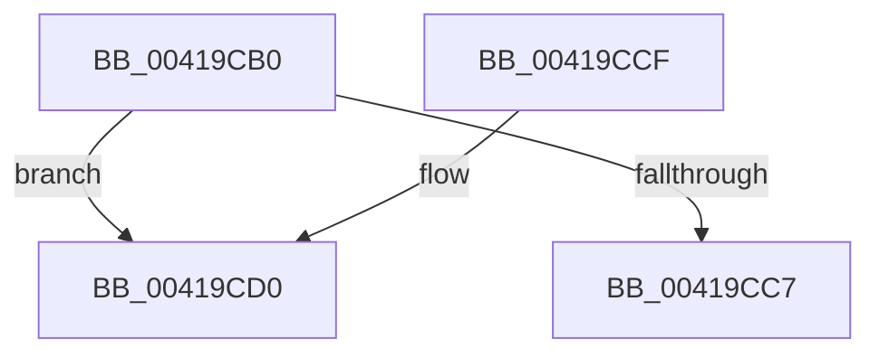

# ObpIncrPointerCountEx

- RVA: `0x00419CB0`–`0x00419CEC` (길이 `60` bytes)
- VA: `0x0000000140419CB0`
- 실행 섹션: `.text`
- PDB 이름 있음: `예`; PDB Function 태그: `아니요`
- unwind 정보 RVA: `0x00068878`
- 디코드: `19`개 명령, `60/60` bytes 표시
- 미해석 바이트: `0` (있으면 어셈블리에 `.byte`로 보존)

> 이 문서는 커널 이미지의 기계어와 PDB 기호를 분석해 생성했습니다. 4번과 5번은 함수 원형과 자료형을 바이너리 사용 방식에서 추정한 C 해석이며 원본 소스 복구 결과는 아닙니다.

## 1. Dependencies

- 직접 호출 지점: **1**; 고유 호출 대상: **1**
- 직접 호출자로 확인된 함수: **3**
- RIP 상대 이미지 참조: **0**

### Outgoing calls
- `0x00419CE6` → [KeBugCheckEx](../4F/KeBugCheckEx_function_004FD660.md) (function, `0x004FD660`)

### Direct callers
- [NtWriteFile](../../page/8E/NtWriteFile_function_008E92D0.md) at `0x008E9702`
- [sub_0094C011](../../page/94/Unknown_function_0094C011.md) at `0x0094C13D`
- [ObInitializeFastReference](../../page/9F/ObInitializeFastReference_function_009F0D24.md) at `0x009F0D42`

### Static image references
- 디코드된 RIP-relative 메모리 참조가 없습니다.

## 2. Other-region calls and transfers

- 다른 실행 섹션으로 향하는 call: **0**
- 별도 외부 분기/꼬리 이동을 확인하지 못했습니다.

## 3. Assembly (complete function range)

```asm
00419CB0  48 83 EC 38                     sub rsp, 0x38
00419CB4  4C 63 C2                        movsxd r8, edx
00419CB7  4C 8B C9                        mov r9, rcx
00419CBA  49 8B C0                        mov rax, r8
00419CBD  F0 48 0F C1 01                  lock xadd qword ptr [rcx], rax
00419CC2  48 85 C0                        test rax, rax
00419CC5  7E 09                           jle 0x140419cd0
00419CC7  49 03 C0                        add rax, r8
00419CCA  48 83 C4 38                     add rsp, 0x38
00419CCE  C3                              ret
00419CCF  CC                              int3
00419CD0  49 8D 0C 00                     lea rcx, [r8 + rax]
00419CD4  33 D2                           xor edx, edx
00419CD6  4D 8D 41 30                     lea r8, [r9 + 0x30]
00419CDA  48 89 4C 24 20                  mov qword ptr [rsp + 0x20], rcx
00419CDF  8D 4A 18                        lea ecx, [rdx + 0x18]
00419CE2  44 8D 4A 10                     lea r9d, [rdx + 0x10]
00419CE6  E8 75 39 0E 00                  call 0x1404fd660
00419CEB  CC                              int3
```

## 4. C-style interpretation (structured pseudocode)

```c
__int64 __fastcall ObpIncrPointerCountEx(__int64 a1, int a2)
{
    __int64 result;
    __int64 v_rsp;
    unsigned __int64 v_stack_p20;

    v_rsp = (v_rsp) - (56);
    if (condition_is_less_or_equal) goto loc_00419CD0;
    result = ((int)(a2)) + ((int)(a2));
    v_rsp = (v_rsp) + (56);
    return result;
loc_00419CD0:
    a2 = 0;
    v_stack_p20 = (int)(a2) + result * 1;
    result = KeBugCheckEx(a2 + 24, a2, a1 + 48, a2 + 16);
    return result;
}
```

## 5. (Beta) C Style

```c
int64_t ObpIncrPointerCountEx(void *Arg1, void *Arg2)
{
    uint8_t *arg1 = (uint8_t *)Arg1;
    uint8_t *arg2 = (uint8_t *)Arg2;

    int64_t result;
    int64_t local_rsp;
    uint64_t v_stack_p20;

    local_rsp = (local_rsp) - (56);
    if (condition_is_less_or_equal) goto loc_00419CD0;
    result = ((int32_t)(Arg2)) + ((int32_t)(Arg2));
    local_rsp = (local_rsp) + (56);
    return result;
loc_00419CD0:
    Arg2 = 0;
    v_stack_p20 = (int32_t)(Arg2) + result * 1;
    result = KeBugCheckEx(Arg2 + 24, Arg2, Arg1 + 48, Arg2 + 16);
    return result;
}
```

### 관측된 메모리 오프셋

구조체 형식이 확인되지 않은 접근은 인자 기준의 오프셋으로만 기록했습니다.

| 기준 인자 | 오프셋 표현 | 폭 (bit) | 접근 |
|---|---:|---:|---|
| `Arg1` | `+ 0x0` | `64` | `R/W` |
| `Arg1` | `+ 0x30` | `64` | `R` |
| `Arg2` | `+ 0x0 + rax*1` | `64` | `R` |

## 6. Execution-region graph

[열기: 2D/3D 그래프와 함수 탐색 컨트롤 패널](../../../control-panel.html?section=text&rva=0x00419CB0&view=graph)

- 2D 그래프는 위에서 아래로 흐르고, 3D 그래프는 빈 공간을 드래그해 회전합니다. Shift+드래그는 이동, 휠은 확대·축소, 함수 노드 선택은 대상 보고서 이동입니다.

### Static fallback


