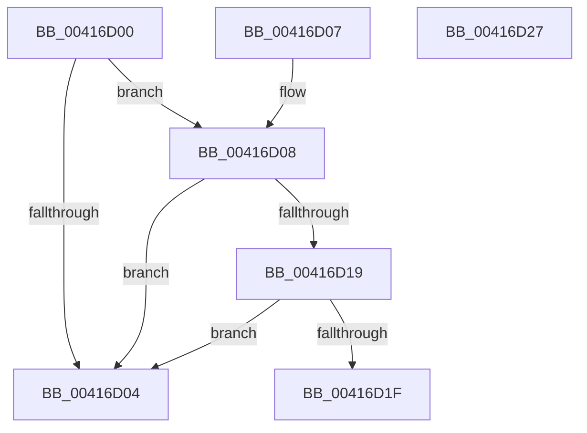

# ObpIsKernelHandle

- RVA: `0x00416D00`–`0x00416D28` (길이 `40` bytes)
- VA: `0x0000000140416D00`
- 실행 섹션: `.text`
- PDB 이름 있음: `예`; PDB Function 태그: `아니요`
- unwind 정보 RVA: `0x000DB714`
- 디코드: `15`개 명령, `40/40` bytes 표시
- 미해석 바이트: `0` (있으면 어셈블리에 `.byte`로 보존)

> 이 문서는 커널 이미지의 기계어와 PDB 기호를 분석해 생성했습니다. 4번과 5번은 함수 원형과 자료형을 바이너리 사용 방식에서 추정한 C 해석이며 원본 소스 복구 결과는 아닙니다.

## 1. Dependencies

- 직접 호출 지점: **0**; 고유 호출 대상: **0**
- 직접 호출자로 확인된 함수: **2**
- RIP 상대 이미지 참조: **0**

### Outgoing calls
- 직접 디코드된 call 명령이 없습니다.

### Direct callers
- [NtClose](../../page/86/NtClose_function_00868870.md) at `0x00868AB7`
- [ObCloseHandle](../../page/8A/ObCloseHandle_function_008A1870.md) at `0x008A18AA`

### Static image references
- 디코드된 RIP-relative 메모리 참조가 없습니다.

## 2. Other-region calls and transfers

- 다른 실행 섹션으로 향하는 call: **0**
- 별도 외부 분기/꼬리 이동을 확인하지 못했습니다.

## 3. Assembly (complete function range)

```asm
00416D00  84 D2                           test dl, dl
00416D02  74 04                           je 0x140416d08
00416D04  32 C0                           xor al, al
00416D06  C3                              ret
00416D07  CC                              int3
00416D08  48 8B C1                        mov rax, rcx
00416D0B  48 25 00 00 00 80               and rax, 0xffffffff80000000
00416D11  48 3D 00 00 00 80               cmp rax, -0x80000000
00416D17  75 EB                           jne 0x140416d04
00416D19  48 83 F9 FE                     cmp rcx, -2
00416D1D  74 E5                           je 0x140416d04
00416D1F  48 83 F9 FF                     cmp rcx, -1
00416D23  0F 95 C0                        setne al
00416D26  C3                              ret
00416D27  CC                              int3
```

## 4. C-style interpretation (structured pseudocode)

```c
__int64 __fastcall ObpIsKernelHandle(__int64 a1, unsigned __int8 a2)
{
    __int64 result;

    if (a2 == 0) goto loc_00416D08;
loc_00416D04:
    result = 0;
    return result;
loc_00416D08:
    result = (a1) & (0xFFFFFFFF80000000ULL);
    if (result != 0xFFFFFFFF80000000ULL) goto loc_00416D04;
    if (a1 == -2) goto loc_00416D04;
    result = (a1 != -1) ? 1 : 0;
    return result;
}
```

## 5. (Beta) C Style

```c
int64_t ObpIsKernelHandle(int64_t Arg1, uint8_t Arg2)
{
    int64_t result;

    if (Arg2 == 0) goto loc_00416D08;
loc_00416D04:
    result = 0;
    return result;
loc_00416D08:
    result = (Arg1) & (0xFFFFFFFF80000000ULL);
    if (result != 0xFFFFFFFF80000000ULL) goto loc_00416D04;
    if (Arg1 == -2) goto loc_00416D04;
    result = (Arg1 != -1) ? 1 : 0;
    return result;
}
```

## 6. Execution-region graph

[열기: 2D/3D 그래프와 함수 탐색 컨트롤 패널](../../../control-panel.html?section=text&rva=0x00416D00&view=graph)

- 2D 그래프는 위에서 아래로 흐르고, 3D 그래프는 빈 공간을 드래그해 회전합니다. Shift+드래그는 이동, 휠은 확대·축소, 함수 노드 선택은 대상 보고서 이동입니다.

### Static fallback


