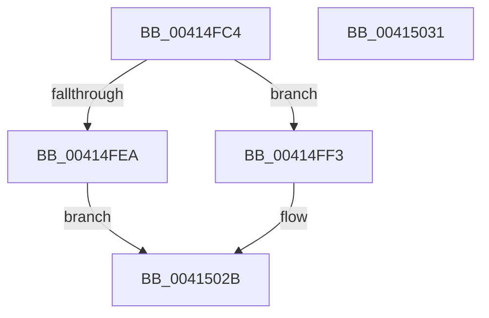

# PerfLogSpinLockAcquire

- RVA: `0x00414FC4`–`0x00415032` (길이 `110` bytes)
- VA: `0x0000000140414FC4`
- 실행 섹션: `.text`
- PDB 이름 있음: `예`; PDB Function 태그: `아니요`
- unwind 정보 RVA: `0x00071750`
- 디코드: `24`개 명령, `110/110` bytes 표시
- 미해석 바이트: `0` (있으면 어셈블리에 `.byte`로 보존)

> 이 문서는 커널 이미지의 기계어와 PDB 기호를 분석해 생성했습니다. 4번과 5번은 함수 원형과 자료형을 바이너리 사용 방식에서 추정한 C 해석이며 원본 소스 복구 결과는 아닙니다.

## 1. Dependencies

- 직접 호출 지점: **0**; 고유 호출 대상: **0**
- 직접 호출자로 확인된 함수: **9**
- RIP 상대 이미지 참조: **0**

### Outgoing calls
- 직접 디코드된 call 명령이 없습니다.

### Direct callers
- [KiAcquireSpinLockInstrumented](../20/KiAcquireSpinLockInstrumented_function_002084F0.md) at `0x002085AE`
- [KiAcquireQueuedSpinLockInstrumented](../27/KiAcquireQueuedSpinLockInstrumented_function_00275850.md) at `0x002758F2`
- [sub_0027CDDA](../27/Unknown_function_0027CDDA.md) at `0x0027CDF8`
- [KiTryToAcquireQueuedSpinLockInstrumented](../2A/KiTryToAcquireQueuedSpinLockInstrumented_function_002ADF38.md) at `0x002ADFD1`
- [ExpTryAcquireSpinLockExclusiveAtDpcLevelInstrumented](../2B/ExpTryAcquireSpinLockExclusiveAtDpcLevelInstrumented_function_002BE6A0.md) at `0x002BE724`
- [ExpTryConvertSharedSpinLockExclusiveInstrumented](../2E/ExpTryConvertSharedSpinLockExclusiveInstrumented_function_002EF988.md) at `0x002EFAC1`
- [sub_00323B76](../32/Unknown_function_00323B76.md) at `0x00323B98`
- [ExpTryAcquireSpinLockSharedAtDpcLevelInstrumented](ExpTryAcquireSpinLockSharedAtDpcLevelInstrumented_function_004109EC.md) at `0x00410A70`
- [KiTryToAcquireSpinLockInstrumented](../46/KiTryToAcquireSpinLockInstrumented_function_0046BE58.md) at `0x0046BEE0`

### Static image references
- 디코드된 RIP-relative 메모리 참조가 없습니다.

## 2. Other-region calls and transfers

- 다른 실행 섹션으로 향하는 call: **0**
- 별도 외부 분기/꼬리 이동을 확인하지 못했습니다.

## 3. Assembly (complete function range)

```asm
00414FC4  48 89 5C 24 08                  mov qword ptr [rsp + 8], rbx
00414FC9  65 48 8B 04 25 20 00 00 00      mov rax, qword ptr gs:[0x20]
00414FD2  48 8B D9                        mov rbx, rcx
00414FD5  4C 8B 90 A8 8B 00 00            mov r10, qword ptr [rax + 0x8ba8]
00414FDC  45 0F B6 9A 10 01 00 00         movzx r11d, byte ptr [r10 + 0x110]
00414FE4  41 80 FB 08                     cmp r11b, 8
00414FE8  72 09                           jb 0x140414ff3
00414FEA  41 FF 82 14 01 00 00            inc dword ptr [r10 + 0x114]
00414FF1  EB 38                           jmp 0x14041502b
00414FF3  41 8D 43 01                     lea eax, [r11 + 1]
00414FF7  49 8B CB                        mov rcx, r11
00414FFA  41 88 82 10 01 00 00            mov byte ptr [r10 + 0x110], al
00415001  8B 44 24 28                     mov eax, dword ptr [rsp + 0x28]
00415005  48 C1 E1 05                     shl rcx, 5
00415009  42 89 44 11 28                  mov dword ptr [rcx + r10 + 0x28], eax
0041500E  8A 44 24 30                     mov al, byte ptr [rsp + 0x30]
00415012  42 88 44 11 2C                  mov byte ptr [rcx + r10 + 0x2c], al
00415017  4A 89 54 11 10                  mov qword ptr [rcx + r10 + 0x10], rdx
0041501C  46 89 4C 11 24                  mov dword ptr [rcx + r10 + 0x24], r9d
00415021  4A 89 5C 11 18                  mov qword ptr [rcx + r10 + 0x18], rbx
00415026  46 89 44 11 20                  mov dword ptr [rcx + r10 + 0x20], r8d
0041502B  48 8B 5C 24 08                  mov rbx, qword ptr [rsp + 8]
00415030  C3                              ret
00415031  CC                              int3
```

## 4. C-style interpretation (structured pseudocode)

```c
__int64 __fastcall PerfLogSpinLockAcquire(__int64 a1, __int64 a2, int a3, int a4, unsigned int a5, unsigned __int8 a6)
{
    unsigned __int64 v_stack_p8;

    v_stack_p8 = v_rbx;
    if (((unsigned __int8)(*(unsigned __int8 *)(*(unsigned __int64 *)(*(unsigned __int64 *)(gs_base + (0 + 32)) + 35752) + 272))) < 8) goto loc_00414FF3;
    goto loc_0041502B;
loc_00414FF3:
    *(unsigned __int8 *)(*(unsigned __int64 *)(*(unsigned __int64 *)(gs_base + (0 + 32)) + 35752) + 272) = (unsigned __int8)(*(unsigned __int8 *)(*(unsigned __int64 *)(*(unsigned __int64 *)(gs_base + (0 + 32)) + 35752) + 272) + 1);
    a1 = (*(unsigned __int8 *)(*(unsigned __int64 *)(*(unsigned __int64 *)(gs_base + (0 + 32)) + 35752) + 272)) << (5);
    *(unsigned int *)(a1 + *(unsigned __int64 *)(*(unsigned __int64 *)(gs_base + (0 + 32)) + 35752) * 1 + 40) = (unsigned int)((unsigned int)(a5));
    *(unsigned __int8 *)(a1 + *(unsigned __int64 *)(*(unsigned __int64 *)(gs_base + (0 + 32)) + 35752) * 1 + 44) = a6;
    *(unsigned __int64 *)(a1 + *(unsigned __int64 *)(*(unsigned __int64 *)(gs_base + (0 + 32)) + 35752) * 1 + 16) = a2;
    *(unsigned int *)(a1 + *(unsigned __int64 *)(*(unsigned __int64 *)(gs_base + (0 + 32)) + 35752) * 1 + 36) = a4;
    *(unsigned __int64 *)(a1 + *(unsigned __int64 *)(*(unsigned __int64 *)(gs_base + (0 + 32)) + 35752) * 1 + 24) = a1;
    *(unsigned int *)(a1 + *(unsigned __int64 *)(*(unsigned __int64 *)(gs_base + (0 + 32)) + 35752) * 1 + 32) = a3;
loc_0041502B:
    return a6;
}
```

## 5. (Beta) C Style

```c
int64_t PerfLogSpinLockAcquire(int64_t Arg1, int64_t Arg2, int32_t Arg3, int32_t Arg4, uint32_t Arg5, uint8_t Arg6)
{
    uint64_t v_stack_p8;

    v_stack_p8 = local_rbx;
    if (((uint8_t)(*(uint8_t *)(*(uint64_t *)(*(uint64_t *)(gs_base + (0 + 0x20)) + 0x8BA8) + 0x110))) < 8) goto loc_00414FF3;
    goto loc_0041502B;
loc_00414FF3:
    *(uint8_t *)(*(uint64_t *)(*(uint64_t *)(gs_base + (0 + 0x20)) + 0x8BA8) + 0x110) = (uint8_t)(*(uint8_t *)(*(uint64_t *)(*(uint64_t *)(gs_base + (0 + 0x20)) + 0x8BA8) + 0x110) + 1);
    Arg1 = (*(uint8_t *)(*(uint64_t *)(*(uint64_t *)(gs_base + (0 + 0x20)) + 0x8BA8) + 0x110)) << (5);
    *(uint32_t *)(Arg1 + *(uint64_t *)(*(uint64_t *)(gs_base + (0 + 0x20)) + 0x8BA8) * 1 + 0x28) = (uint32_t)((uint32_t)(Arg5));
    *(uint8_t *)(Arg1 + *(uint64_t *)(*(uint64_t *)(gs_base + (0 + 0x20)) + 0x8BA8) * 1 + 0x2C) = Arg6;
    *(uint64_t *)(Arg1 + *(uint64_t *)(*(uint64_t *)(gs_base + (0 + 0x20)) + 0x8BA8) * 1 + 0x10) = Arg2;
    *(uint32_t *)(Arg1 + *(uint64_t *)(*(uint64_t *)(gs_base + (0 + 0x20)) + 0x8BA8) * 1 + 0x24) = Arg4;
    *(uint64_t *)(Arg1 + *(uint64_t *)(*(uint64_t *)(gs_base + (0 + 0x20)) + 0x8BA8) * 1 + 0x18) = Arg1;
    *(uint32_t *)(Arg1 + *(uint64_t *)(*(uint64_t *)(gs_base + (0 + 0x20)) + 0x8BA8) * 1 + 0x20) = Arg3;
loc_0041502B:
    return Arg6;
}
```

## 6. Execution-region graph

[열기: 2D/3D 그래프와 함수 탐색 컨트롤 패널](../../../control-panel.html?section=text&rva=0x00414FC4&view=graph)

- 2D 그래프는 위에서 아래로 흐르고, 3D 그래프는 빈 공간을 드래그해 회전합니다. Shift+드래그는 이동, 휠은 확대·축소, 함수 노드 선택은 대상 보고서 이동입니다.

### Static fallback


