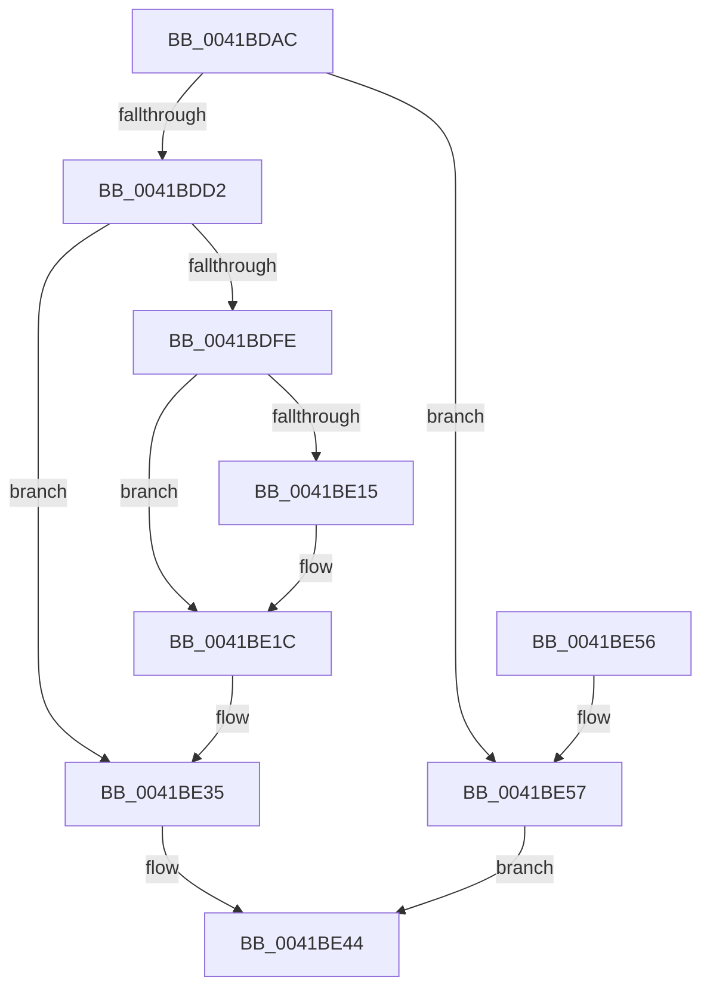

# PfSnActivateTrace

- RVA: `0x0041BDAC`–`0x0041BE5E` (길이 `178` bytes)
- VA: `0x000000014041BDAC`
- 실행 섹션: `.text`
- PDB 이름 있음: `예`; PDB Function 태그: `아니요`
- unwind 정보 RVA: `0x0006383C`
- 디코드: `44`개 명령, `178/178` bytes 표시
- 미해석 바이트: `0` (있으면 어셈블리에 `.byte`로 보존)

> 이 문서는 커널 이미지의 기계어와 PDB 기호를 분석해 생성했습니다. 4번과 5번은 함수 원형과 자료형을 바이너리 사용 방식에서 추정한 C 해석이며 원본 소스 복구 결과는 아닙니다.

## 1. Dependencies

- 직접 호출 지점: **4**; 고유 호출 대상: **4**
- 직접 호출자로 확인된 함수: **1**
- RIP 상대 이미지 참조: **6**

### Outgoing calls
- `0x0041BDC5` → [ExAcquireRundownProtection](../21/ExAcquireRundownProtection_function_00216620.md) (function, `0x00216620`)
- `0x0041BDE1` → [KeAcquireSpinLockRaiseToDpc](../20/KeAcquireSpinLockRaiseToDpc_function_00208470.md) (function, `0x00208470`)
- `0x0041BDF3` → [PfSnAddProcessTrace](PfSnAddProcessTrace_function_0041BE64.md) (function, `0x0041BE64`)
- `0x0041BE3F` → [KeReleaseSpinLock](../39/KeReleaseSpinLock_function_00392BA0.md) (function, `0x00392BA0`)

### Direct callers
- [PfSnBeginTrace](../../page/96/PfSnBeginTrace_function_00960DE8.md) at `0x0096100F`

### Static image references
- `0x0041BDBE` → RVA `0x00E671F0` (`.data`; read)
- `0x0041BDDA` → RVA `0x00E67260` (`.data`; read)
- `0x0041BDFE` → RVA `0x00E67258` (`.data`; read)
- `0x0041BE05` → RVA `0x00E67250` (`.data`; read)
- `0x0041BE1C` → RVA `0x00E67248` (`.data`; read/write)
- `0x0041BE2E` → RVA `0x00E67258` (`.data`; write)

## 2. Other-region calls and transfers

- 다른 실행 섹션으로 향하는 call: **0**
- 별도 외부 분기/꼬리 이동을 확인하지 못했습니다.

## 3. Assembly (complete function range)

```asm
0041BDAC  48 89 5C 24 08                  mov qword ptr [rsp + 8], rbx
0041BDB1  48 89 74 24 10                  mov qword ptr [rsp + 0x10], rsi
0041BDB6  57                              push rdi
0041BDB7  48 83 EC 20                     sub rsp, 0x20
0041BDBB  48 8B F9                        mov rdi, rcx
0041BDBE  48 8D 0D 2B B4 A4 00            lea rcx, [rip + 0xa4b42b]
0041BDC5  E8 56 A8 DF FF                  call 0x140216620
0041BDCA  84 C0                           test al, al
0041BDCC  0F 84 85 00 00 00               je 0x14041be57
0041BDD2  66 83 8F E6 01 00 00 02         or word ptr [rdi + 0x1e6], 2
0041BDDA  48 8D 0D 7F B4 A4 00            lea rcx, [rip + 0xa4b47f]
0041BDE1  E8 8A C6 DE FF                  call 0x140208470
0041BDE6  48 8B 8F 60 01 00 00            mov rcx, qword ptr [rdi + 0x160]
0041BDED  48 8B D7                        mov rdx, rdi
0041BDF0  40 8A F0                        mov sil, al
0041BDF3  E8 6C 00 00 00                  call 0x14041be64
0041BDF8  8B D8                           mov ebx, eax
0041BDFA  85 C0                           test eax, eax
0041BDFC  78 37                           js 0x14041be35
0041BDFE  48 8B 15 53 B4 A4 00            mov rdx, qword ptr [rip + 0xa4b453]
0041BE05  48 8D 05 44 B4 A4 00            lea rax, [rip + 0xa4b444]
0041BE0C  48 8D 4F 08                     lea rcx, [rdi + 8]
0041BE10  48 39 02                        cmp qword ptr [rdx], rax
0041BE13  74 07                           je 0x14041be1c
0041BE15  B9 03 00 00 00                  mov ecx, 3
0041BE1A  CD 29                           int 0x29
0041BE1C  FF 05 26 B4 A4 00               inc dword ptr [rip + 0xa4b426]
0041BE22  48 89 01                        mov qword ptr [rcx], rax
0041BE25  33 DB                           xor ebx, ebx
0041BE27  48 89 51 08                     mov qword ptr [rcx + 8], rdx
0041BE2B  48 89 0A                        mov qword ptr [rdx], rcx
0041BE2E  48 89 0D 23 B4 A4 00            mov qword ptr [rip + 0xa4b423], rcx
0041BE35  40 8A D6                        mov dl, sil
0041BE38  48 8D 0D 21 B4 A4 00            lea rcx, [rip + 0xa4b421]
0041BE3F  E8 5C 6D F7 FF                  call 0x140392ba0
0041BE44  48 8B 74 24 38                  mov rsi, qword ptr [rsp + 0x38]
0041BE49  8B C3                           mov eax, ebx
0041BE4B  48 8B 5C 24 30                  mov rbx, qword ptr [rsp + 0x30]
0041BE50  48 83 C4 20                     add rsp, 0x20
0041BE54  5F                              pop rdi
0041BE55  C3                              ret
0041BE56  CC                              int3
0041BE57  BB B9 02 00 C0                  mov ebx, 0xc00002b9
0041BE5C  EB E6                           jmp 0x14041be44
```

## 4. C-style interpretation (structured pseudocode)

```c
__int64 __fastcall PfSnActivateTrace(__int64 a1)
{
    __int64 result;
    __int64 v_rbx;
    __int64 v_rsp;
    unsigned __int64 v_stack_p10;
    unsigned __int64 v_stack_p8;

    v_stack_p8 = v_rbx;
    v_stack_p10 = v_rsi;
    v_rsp = (v_rsp) - (32);
    result = ExAcquireRundownProtection(v_rip + 10794027, a2, a3, a4);
    if ((unsigned __int8)(result) == 0) goto loc_0041BE57;
    result = KeAcquireSpinLockRaiseToDpc(v_rip + 10794111, a2, a3, a4);
    result = PfSnAddProcessTrace(*(unsigned __int64 *)(a1 + 352), a1, a3, a4);
    if (sign_flag) goto loc_0041BE35;
    if ((*(unsigned __int64 *)(*(unsigned __int64 *)(v_rip + 10794067))) != (v_rip + 10794052)) {
        a1 = 3;
    }
    *(unsigned __int64 *)(a1) = v_rip + 10794052;
    v_rbx = 0;
    *(unsigned __int64 *)(a1 + 8) = *(unsigned __int64 *)(v_rip + 10794067);
    *(unsigned __int64 *)(*(unsigned __int64 *)(v_rip + 10794067)) = a1;
    *(unsigned __int64 *)(v_rip + 10794019) = a1;
loc_0041BE35:
    result = KeReleaseSpinLock(v_rip + 10794017, (unsigned __int8)((unsigned __int8)(result)), a3, a4);
loc_0041BE44:
    v_rsp = (v_rsp) + (32);
    return 0;
loc_0041BE57:
    goto loc_0041BE44;
}
```

## 5. (Beta) C Style

```c
int64_t PfSnActivateTrace(void *Arg1)
{
    uint8_t *arg1 = (uint8_t *)Arg1;

    int64_t result;
    int64_t local_rbx;
    int64_t local_rsp;
    uint64_t v_stack_p10;
    uint64_t v_stack_p8;

    v_stack_p8 = local_rbx;
    v_stack_p10 = local_rsi;
    local_rsp = (local_rsp) - (32);
    result = ExAcquireRundownProtection(v_rip + 10794027, a2, a3, a4);
    if ((uint8_t)(result) == 0) goto loc_0041BE57;
    result = KeAcquireSpinLockRaiseToDpc(v_rip + 10794111, a2, a3, a4);
    result = PfSnAddProcessTrace(*(uint64_t *)(arg1 + 0x160), Arg1, a3, a4);
    if (sign_flag) goto loc_0041BE35;
    if ((*(uint64_t *)(*(uint64_t *)(v_rip + 0xA4B453))) != (v_rip + 10794052)) {
        Arg1 = 3;
    }
    *(uint64_t *)(arg1) = v_rip + 10794052;
    local_rbx = 0;
    *(uint64_t *)(arg1 + 0x8) = *(uint64_t *)(v_rip + 0xA4B453);
    *(void **)(*(uint64_t *)(v_rip + 0xA4B453)) = Arg1;
    *(void **)(v_rip + 0xA4B423) = Arg1;
loc_0041BE35:
    result = KeReleaseSpinLock(v_rip + 10794017, (uint8_t)((uint8_t)(result)), a3, a4);
loc_0041BE44:
    local_rsp = (local_rsp) + (32);
    return 0;
loc_0041BE57:
    goto loc_0041BE44;
}
```

### 관측된 메모리 오프셋

구조체 형식이 확인되지 않은 접근은 인자 기준의 오프셋으로만 기록했습니다.

| 기준 인자 | 오프셋 표현 | 폭 (bit) | 접근 |
|---|---:|---:|---|
| `Arg1` | `+ 0x8` | `64` | `R` |
| `Arg1` | `+ 0x160` | `64` | `R` |
| `Arg1` | `+ 0x1E6` | `16` | `R/W` |

## 6. Execution-region graph

[열기: 2D/3D 그래프와 함수 탐색 컨트롤 패널](../../../control-panel.html?section=text&rva=0x0041BDAC&view=graph)

- 2D 그래프는 위에서 아래로 흐르고, 3D 그래프는 빈 공간을 드래그해 회전합니다. Shift+드래그는 이동, 휠은 확대·축소, 함수 노드 선택은 대상 보고서 이동입니다.

### Static fallback


