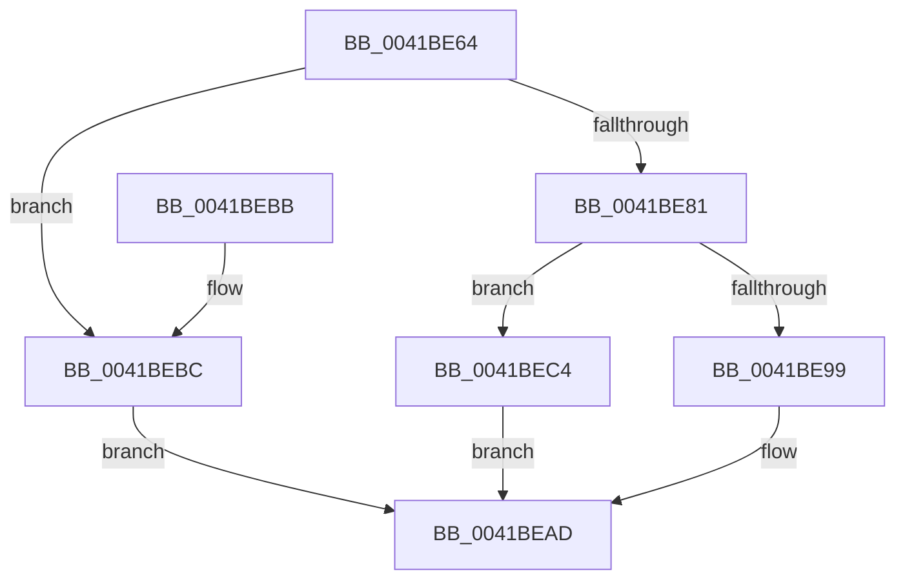

# PfSnAddProcessTrace

- RVA: `0x0041BE64`–`0x0041BECC` (길이 `104` bytes)
- VA: `0x000000014041BE64`
- 실행 섹션: `.text`
- PDB 이름 있음: `예`; PDB Function 태그: `아니요`
- unwind 정보 RVA: `0x0009D5D8`
- 디코드: `28`개 명령, `104/104` bytes 표시
- 미해석 바이트: `0` (있으면 어셈블리에 `.byte`로 보존)

> 이 문서는 커널 이미지의 기계어와 PDB 기호를 분석해 생성했습니다. 4번과 5번은 함수 원형과 자료형을 바이너리 사용 방식에서 추정한 C 해석이며 원본 소스 복구 결과는 아닙니다.

## 1. Dependencies

- 직접 호출 지점: **1**; 고유 호출 대상: **1**
- 직접 호출자로 확인된 함수: **1**
- RIP 상대 이미지 참조: **0**

### Outgoing calls
- `0x0041BE8D` → [ExAcquireRundownProtectionEx](ExAcquireRundownProtectionEx_function_0041BEE0.md) (function, `0x0041BEE0`)

### Direct callers
- [PfSnActivateTrace](PfSnActivateTrace_function_0041BDAC.md) at `0x0041BDF3`

### Static image references
- 디코드된 RIP-relative 메모리 참조가 없습니다.

## 2. Other-region calls and transfers

- 다른 실행 섹션으로 향하는 call: **0**
- 별도 외부 분기/꼬리 이동을 확인하지 못했습니다.

## 3. Assembly (complete function range)

```asm
0041BE64  48 89 5C 24 08                  mov qword ptr [rsp + 8], rbx
0041BE69  57                              push rdi
0041BE6A  48 83 EC 20                     sub rsp, 0x20
0041BE6E  48 F7 81 90 03 00 00 F0 FF FF FF  test qword ptr [rcx + 0x390], -0x10
0041BE79  48 8B DA                        mov rbx, rdx
0041BE7C  48 8B F9                        mov rdi, rcx
0041BE7F  75 3B                           jne 0x14041bebc
0041BE81  48 8D 8A 68 01 00 00            lea rcx, [rdx + 0x168]
0041BE88  BA 10 00 00 00                  mov edx, 0x10
0041BE8D  E8 4E 00 00 00                  call 0x14041bee0
0041BE92  45 33 C0                        xor r8d, r8d
0041BE95  84 C0                           test al, al
0041BE97  74 2B                           je 0x14041bec4
0041BE99  48 8D 53 0F                     lea rdx, [rbx + 0xf]
0041BE9D  48 F7 DB                        neg rbx
0041BEA0  48 1B C9                        sbb rcx, rcx
0041BEA3  48 23 CA                        and rcx, rdx
0041BEA6  48 89 8F 90 03 00 00            mov qword ptr [rdi + 0x390], rcx
0041BEAD  48 8B 5C 24 30                  mov rbx, qword ptr [rsp + 0x30]
0041BEB2  41 8B C0                        mov eax, r8d
0041BEB5  48 83 C4 20                     add rsp, 0x20
0041BEB9  5F                              pop rdi
0041BEBA  C3                              ret
0041BEBB  CC                              int3
0041BEBC  41 B8 21 00 00 C0               mov r8d, 0xc0000021
0041BEC2  EB E9                           jmp 0x14041bead
0041BEC4  41 B8 89 01 00 C0               mov r8d, 0xc0000189
0041BECA  EB E1                           jmp 0x14041bead
```

## 4. C-style interpretation (structured pseudocode)

```c
__int64 __fastcall PfSnAddProcessTrace(__int64 a1, __int64 a2, int a3)
{
    __int64 result;
    __int64 v_rbx;
    __int64 v_rsp;
    unsigned __int64 v_stack_p8;

    v_stack_p8 = v_rbx;
    v_rsp = (v_rsp) - (32);
    if (((*(unsigned __int64 *)(a1 + 912)) & (-16)) != 0) goto loc_0041BEBC;
    result = ExAcquireRundownProtectionEx(a2 + 360, 16, a3, a4);
    a3 = 0;
    if ((unsigned __int8)(result) == 0) goto loc_0041BEC4;
    v_rbx = -(a2);
    a1 = (a2 + 360) & (a2 + 15);
    *(unsigned __int64 *)(a1 + 912) = a1;
loc_0041BEAD:
    v_rsp = (v_rsp) + (32);
    return 0;
loc_0041BEBC:
    goto loc_0041BEAD;
loc_0041BEC4:
    goto loc_0041BEAD;
}
```

## 5. (Beta) C Style

```c
int64_t PfSnAddProcessTrace(void *Arg1, void *Arg2, int32_t Arg3)
{
    uint8_t *arg1 = (uint8_t *)Arg1;
    uint8_t *arg2 = (uint8_t *)Arg2;

    int64_t result;
    int64_t local_rbx;
    int64_t local_rsp;
    uint64_t v_stack_p8;

    v_stack_p8 = local_rbx;
    local_rsp = (local_rsp) - (32);
    if (((*(uint64_t *)(arg1 + 0x390)) & (-16)) != 0) goto loc_0041BEBC;
    result = ExAcquireRundownProtectionEx(Arg2 + 360, 16, Arg3, a4);
    Arg3 = 0;
    if ((uint8_t)(result) == 0) goto loc_0041BEC4;
    local_rbx = -(Arg2);
    Arg1 = (Arg2 + 360) & (Arg2 + 15);
    *(void **)(arg1 + 0x390) = Arg1;
loc_0041BEAD:
    local_rsp = (local_rsp) + (32);
    return 0;
loc_0041BEBC:
    goto loc_0041BEAD;
loc_0041BEC4:
    goto loc_0041BEAD;
}
```

### 관측된 메모리 오프셋

구조체 형식이 확인되지 않은 접근은 인자 기준의 오프셋으로만 기록했습니다.

| 기준 인자 | 오프셋 표현 | 폭 (bit) | 접근 |
|---|---:|---:|---|
| `Arg1` | `+ 0x390` | `64` | `R` |
| `Arg1` | `+ 0x390` | `64` | `W` |
| `Arg2` | `+ 0xF` | `64` | `R` |
| `Arg2` | `+ 0x168` | `64` | `R` |

## 6. Execution-region graph

[열기: 2D/3D 그래프와 함수 탐색 컨트롤 패널](../../../control-panel.html?section=text&rva=0x0041BE64&view=graph)

- 2D 그래프는 위에서 아래로 흐르고, 3D 그래프는 빈 공간을 드래그해 회전합니다. Shift+드래그는 이동, 휠은 확대·축소, 함수 노드 선택은 대상 보고서 이동입니다.

### Static fallback


