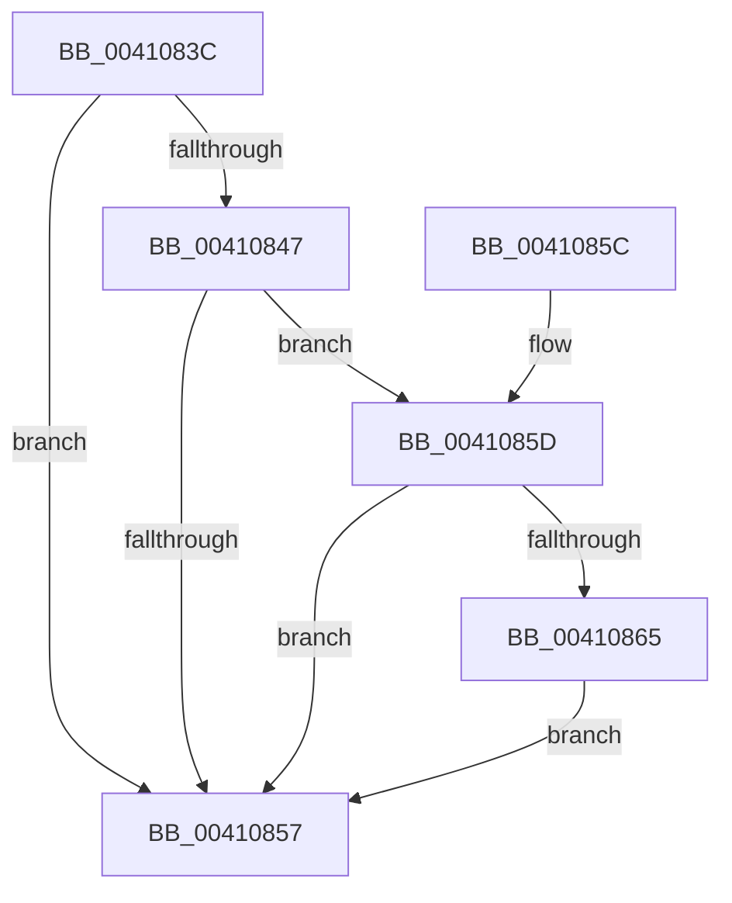

# PnpCheckForWaitingReportedDevice

- RVA: `0x0041083C`–`0x00410898` (길이 `92` bytes)
- VA: `0x000000014041083C`
- 실행 섹션: `.text`
- PDB 이름 있음: `예`; PDB Function 태그: `아니요`
- unwind 정보 RVA: `0x0009BCD0`
- 디코드: `25`개 명령, `92/92` bytes 표시
- 미해석 바이트: `0` (있으면 어셈블리에 `.byte`로 보존)

> 이 문서는 커널 이미지의 기계어와 PDB 기호를 분석해 생성했습니다. 4번과 5번은 함수 원형과 자료형을 바이너리 사용 방식에서 추정한 C 해석이며 원본 소스 복구 결과는 아닙니다.

## 1. Dependencies

- 직접 호출 지점: **1**; 고유 호출 대상: **1**
- 직접 호출자로 확인된 함수: **1**
- RIP 상대 이미지 참조: **0**

### Outgoing calls
- `0x00410891` → [PnpRequestDeviceAction](../47/PnpRequestDeviceAction_function_00477FF8.md) (function, `0x00477FF8`)

### Direct callers
- [IopAttachDeviceToDeviceStackSafe](IopAttachDeviceToDeviceStackSafe_function_00410574.md) at `0x004106F7`

### Static image references
- 디코드된 RIP-relative 메모리 참조가 없습니다.

## 2. Other-region calls and transfers

- 다른 실행 섹션으로 향하는 call: **0**
- 별도 외부 분기/꼬리 이동을 확인하지 못했습니다.

## 3. Assembly (complete function range)

```asm
0041083C  48 83 EC 58                     sub rsp, 0x58
00410840  33 D2                           xor edx, edx
00410842  48 85 C9                        test rcx, rcx
00410845  74 10                           je 0x140410857
00410847  48 8B 81 38 01 00 00            mov rax, qword ptr [rcx + 0x138]
0041084E  48 8B 48 28                     mov rcx, qword ptr [rax + 0x28]
00410852  48 85 C9                        test rcx, rcx
00410855  75 06                           jne 0x14041085d
00410857  48 83 C4 58                     add rsp, 0x58
0041085B  C3                              ret
0041085C  CC                              int3
0041085D  39 91 8C 01 00 00               cmp dword ptr [rcx + 0x18c], edx
00410863  7D F2                           jge 0x140410857
00410865  48 89 54 24 30                  mov qword ptr [rsp + 0x30], rdx
0041086A  4C 8D 4C 24 40                  lea r9, [rsp + 0x40]
0041086F  48 89 54 24 28                  mov qword ptr [rsp + 0x28], rdx
00410874  45 33 C0                        xor r8d, r8d
00410877  0F 57 C0                        xorps xmm0, xmm0
0041087A  48 89 54 24 20                  mov qword ptr [rsp + 0x20], rdx
0041087F  0F 11 44 24 40                  movups xmmword ptr [rsp + 0x40], xmm0
00410884  C6 44 24 48 01                  mov byte ptr [rsp + 0x48], 1
00410889  48 8B 49 20                     mov rcx, qword ptr [rcx + 0x20]
0041088D  41 8D 50 08                     lea edx, [r8 + 8]
00410891  E8 62 77 06 00                  call 0x140477ff8
00410896  EB BF                           jmp 0x140410857
```

## 4. C-style interpretation (structured pseudocode)

```c
__int64 __fastcall PnpCheckForWaitingReportedDevice(__int64 a1, int a2, int a3)
{
    __int64 result;
    __int64 v_rsp;
    unsigned __int64 v_stack_p20;
    unsigned __int64 v_stack_p28;
    unsigned __int64 v_stack_p30;
    unsigned __int64 v_stack_p40;
    unsigned __int8 v_stack_p48;

    v_rsp = (v_rsp) - (88);
    a2 = 0;
    if (a1 == 0) goto loc_00410857;
    if (*(unsigned __int64 *)(*(unsigned __int64 *)(a1 + 312) + 40) != 0) goto loc_0041085D;
loc_00410857:
    v_rsp = (v_rsp) + (88);
    return *(unsigned __int64 *)(a1 + 312);
loc_0041085D:
    if ((*(unsigned int *)(*(unsigned __int64 *)(*(unsigned __int64 *)(a1 + 312) + 40) + 396)) >= 0) goto loc_00410857;
    v_stack_p30 = 0;
    v_stack_p28 = 0;
    a3 = 0;
    v_stack_p20 = 0;
    v_stack_p40 = v_xmm0;
    v_stack_p48 = 1;
    result = PnpRequestDeviceAction(*(unsigned __int64 *)(*(unsigned __int64 *)(*(unsigned __int64 *)(a1 + 312) + 40) + 32), a3 + 8, a3, v_stack_p40);
    goto loc_00410857;
}
```

## 5. (Beta) C Style

```c
int64_t PnpCheckForWaitingReportedDevice(int64_t Arg1, int32_t Arg2, int32_t Arg3)
{
    int64_t result;
    int64_t local_rsp;
    uint64_t v_stack_p20;
    uint64_t v_stack_p28;
    uint64_t v_stack_p30;
    uint64_t v_stack_p40;
    uint8_t v_stack_p48;

    local_rsp = (local_rsp) - (88);
    Arg2 = 0;
    if (Arg1 == 0) goto loc_00410857;
    if (*(uint64_t *)(*(uint64_t *)(Arg1 + 0x138) + 0x28) != 0) goto loc_0041085D;
loc_00410857:
    local_rsp = (local_rsp) + (88);
    return *(uint64_t *)(Arg1 + 0x138);
loc_0041085D:
    if ((*(uint32_t *)(*(uint64_t *)(*(uint64_t *)(Arg1 + 0x138) + 0x28) + 0x18C)) >= 0) goto loc_00410857;
    v_stack_p30 = 0;
    v_stack_p28 = 0;
    Arg3 = 0;
    v_stack_p20 = 0;
    v_stack_p40 = v_xmm0;
    v_stack_p48 = 1;
    result = PnpRequestDeviceAction(*(uint64_t *)(*(uint64_t *)(*(uint64_t *)(Arg1 + 0x138) + 0x28) + 0x20), Arg3 + 8, Arg3, v_stack_p40);
    goto loc_00410857;
}
```

## 6. Execution-region graph

[열기: 2D/3D 그래프와 함수 탐색 컨트롤 패널](../../../control-panel.html?section=text&rva=0x0041083C&view=graph)

- 2D 그래프는 위에서 아래로 흐르고, 3D 그래프는 빈 공간을 드래그해 회전합니다. Shift+드래그는 이동, 휠은 확대·축소, 함수 노드 선택은 대상 보고서 이동입니다.

### Static fallback


