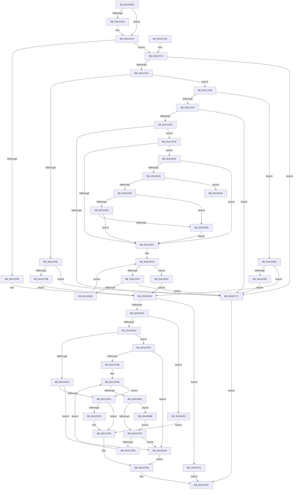

# PopCaptureReasonContext

- RVA: `0x0041CE0C`–`0x0041D0A6` (길이 `666` bytes)
- VA: `0x000000014041CE0C`
- 실행 섹션: `.text`
- PDB 이름 있음: `예`; PDB Function 태그: `아니요`
- unwind 정보 RVA: `0x0009EE5C`
- 디코드: `196`개 명령, `666/666` bytes 표시
- 미해석 바이트: `0` (있으면 어셈블리에 `.byte`로 보존)

> 이 문서는 커널 이미지의 기계어와 PDB 기호를 분석해 생성했습니다. 4번과 5번은 함수 원형과 자료형을 바이너리 사용 방식에서 추정한 C 해석이며 원본 소스 복구 결과는 아닙니다.

## 1. Dependencies

- 직접 호출 지점: **5**; 고유 호출 대상: **4**
- 직접 호출자로 확인된 함수: **1**
- RIP 상대 이미지 참조: **0**

### Outgoing calls
- `0x0041CE86` → [ExAllocatePool2](../../poolcode/B8/ExAllocatePool2_function_00B820F0.md) (function, `0x00B820F0`)
- `0x0041CEDF` → [PopSafeCopyUnicodeString](PopSafeCopyUnicodeString_function_0041D0AC.md) (function, `0x0041D0AC`)
- `0x0041CFD0` → [PopSafeCopyUnicodeString](PopSafeCopyUnicodeString_function_0041D0AC.md) (function, `0x0041D0AC`)
- `0x0041D023` → [ExFreePoolWithTag](../../poolcode/B8/ExFreePoolWithTag_function_00B82870.md) (function, `0x00B82870`)
- `0x0041D0A0` → [ExRaiseDatatypeMisalignment](../../page/89/ExRaiseDatatypeMisalignment_function_00899FD0.md) (function, `0x00899FD0`)

### Direct callers
- [PoCaptureReasonContext](../23/PoCaptureReasonContext_function_00230A38.md) at `0x00230AD5`
- [PoCaptureReasonContext](../23/PoCaptureReasonContext_function_00230A38.md) at `0x00230B10`

### Static image references
- 디코드된 RIP-relative 메모리 참조가 없습니다.

## 2. Other-region calls and transfers

- 다른 실행 섹션으로 향하는 call: **3**
  - `0x0041CE86` → [ExAllocatePool2](../../poolcode/B8/ExAllocatePool2_function_00B820F0.md) (`.text` → `POOLCODE`)
  - `0x0041D023` → [ExFreePoolWithTag](../../poolcode/B8/ExFreePoolWithTag_function_00B82870.md) (`.text` → `POOLCODE`)
  - `0x0041D0A0` → [ExRaiseDatatypeMisalignment](../../page/89/ExRaiseDatatypeMisalignment_function_00899FD0.md) (`.text` → `PAGE`)
- 별도 외부 분기/꼬리 이동을 확인하지 못했습니다.

## 3. Assembly (complete function range)

```asm
0041CE0C  4C 89 4C 24 20                  mov qword ptr [rsp + 0x20], r9
0041CE11  88 54 24 10                     mov byte ptr [rsp + 0x10], dl
0041CE15  55                              push rbp
0041CE16  53                              push rbx
0041CE17  56                              push rsi
0041CE18  57                              push rdi
0041CE19  41 54                           push r12
0041CE1B  41 55                           push r13
0041CE1D  41 56                           push r14
0041CE1F  41 57                           push r15
0041CE21  48 8B EC                        mov rbp, rsp
0041CE24  48 83 EC 58                     sub rsp, 0x58
0041CE28  4D 8B E8                        mov r13, r8
0041CE2B  0F 57 C0                        xorps xmm0, xmm0
0041CE2E  45 33 C0                        xor r8d, r8d
0041CE31  49 8B F1                        mov rsi, r9
0041CE34  4D 89 01                        mov qword ptr [r9], r8
0041CE37  48 8B F9                        mov rdi, rcx
0041CE3A  BB 38 00 00 00                  mov ebx, 0x38
0041CE3F  0F 11 45 E8                     movups xmmword ptr [rbp - 0x18], xmm0
0041CE43  4D 85 ED                        test r13, r13
0041CE46  74 04                           je 0x14041ce4c
0041CE48  45 88 45 00                     mov byte ptr [r13], r8b
0041CE4C  44 89 45 48                     mov dword ptr [rbp + 0x48], r8d
0041CE50  4D 8B E0                        mov r12, r8
0041CE53  49 B9 00 00 FF FF FF 7F 00 00   movabs r9, 0x7fffffff0000
0041CE5D  48 85 FF                        test rdi, rdi
0041CE60  0F 85 B9 00 00 00               jne 0x14041cf1f
0041CE66  41 BF 00 00 00 80               mov r15d, 0x80000000
0041CE6C  8A C2                           mov al, dl
0041CE6E  41 B8 50 52 43 78               mov r8d, 0x78435250
0041CE74  F6 D8                           neg al
0041CE76  48 8B D3                        mov rdx, rbx
0041CE79  48 1B C9                        sbb rcx, rcx
0041CE7C  48 F7 D9                        neg rcx
0041CE7F  48 81 C1 00 01 00 00            add rcx, 0x100
0041CE86  E8 65 52 76 00                  call 0x140b820f0
0041CE8B  4C 8B F0                        mov r14, rax
0041CE8E  48 85 C0                        test rax, rax
0041CE91  0F 84 AD 00 00 00               je 0x14041cf44
0041CE97  48 89 06                        mov qword ptr [rsi], rax
0041CE9A  45 85 FF                        test r15d, r15d
0041CE9D  0F 88 92 01 00 00               js 0x14041d035
0041CEA3  48 8D 70 3F                     lea rsi, [rax + 0x3f]
0041CEA7  48 83 E6 F8                     and rsi, 0xfffffffffffffff8
0041CEAB  48 8D 4F 08                     lea rcx, [rdi + 8]
0041CEAF  48 2B C6                        sub rax, rsi
0041CEB2  48 8D 55 58                     lea rdx, [rbp + 0x58]
0041CEB6  48 03 C3                        add rax, rbx
0041CEB9  49 89 46 30                     mov qword ptr [r14 + 0x30], rax
0041CEBD  48 8D 46 20                     lea rax, [rsi + 0x20]
0041CEC1  44 89 3E                        mov dword ptr [rsi], r15d
0041CEC4  48 89 45 58                     mov qword ptr [rbp + 0x58], rax
0041CEC8  49 8D 04 1E                     lea rax, [r14 + rbx]
0041CECC  48 C7 46 08 20 00 00 00         mov qword ptr [rsi + 8], 0x20
0041CED4  4C 8B C0                        mov r8, rax
0041CED7  44 8A 4D 50                     mov r9b, byte ptr [rbp + 0x50]
0041CEDB  48 89 45 C8                     mov qword ptr [rbp - 0x38], rax
0041CEDF  E8 C8 01 00 00                  call 0x14041d0ac
0041CEE4  8B D8                           mov ebx, eax
0041CEE6  41 F6 C7 01                     test r15b, 1
0041CEEA  0F 84 93 00 00 00               je 0x14041cf83
0041CEF0  85 C0                           test eax, eax
0041CEF2  0F 88 23 01 00 00               js 0x14041d01b
0041CEF8  4D 85 ED                        test r13, r13
0041CEFB  74 0C                           je 0x14041cf09
0041CEFD  8B 47 04                        mov eax, dword ptr [rdi + 4]
0041CF00  C1 E8 02                        shr eax, 2
0041CF03  24 01                           and al, 1
0041CF05  41 88 45 00                     mov byte ptr [r13], al
0041CF09  33 DB                           xor ebx, ebx
0041CF0B  8B C3                           mov eax, ebx
0041CF0D  48 83 C4 58                     add rsp, 0x58
0041CF11  41 5F                           pop r15
0041CF13  41 5E                           pop r14
0041CF15  41 5D                           pop r13
0041CF17  41 5C                           pop r12
0041CF19  5F                              pop rdi
0041CF1A  5E                              pop rsi
0041CF1B  5B                              pop rbx
0041CF1C  5D                              pop rbp
0041CF1D  C3                              ret
0041CF1E  CC                              int3
0041CF1F  44 39 01                        cmp dword ptr [rcx], r8d
0041CF22  77 58                           ja 0x14041cf7c
0041CF24  44 8B 79 04                     mov r15d, dword ptr [rcx + 4]
0041CF28  41 F6 C7 01                     test r15b, 1
0041CF2C  74 1D                           je 0x14041cf4b
0041CF2E  0F B7 59 08                     movzx ebx, word ptr [rcx + 8]
0041CF32  48 83 C3 02                     add rbx, 2
0041CF36  F6 C3 01                        test bl, 1
0041CF39  75 41                           jne 0x14041cf7c
0041CF3B  48 83 C3 58                     add rbx, 0x58
0041CF3F  E9 28 FF FF FF                  jmp 0x14041ce6c
0041CF44  B8 9A 00 00 C0                  mov eax, 0xc000009a
0041CF49  EB C2                           jmp 0x14041cf0d
0041CF4B  41 F6 C7 02                     test r15b, 2
0041CF4F  0F 84 08 01 00 00               je 0x14041d05d
0041CF55  0F B7 59 08                     movzx ebx, word ptr [rcx + 8]
0041CF59  48 83 C3 02                     add rbx, 2
0041CF5D  F6 C3 01                        test bl, 1
0041CF60  75 1A                           jne 0x14041cf7c
0041CF62  8B 71 1C                        mov esi, dword ptr [rcx + 0x1c]
0041CF65  48 83 C3 58                     add rbx, 0x58
0041CF69  8B C6                           mov eax, esi
0041CF6B  89 75 48                        mov dword ptr [rbp + 0x48], esi
0041CF6E  48 C1 E0 04                     shl rax, 4
0041CF72  B9 FF FF FF FF                  mov ecx, 0xffffffff
0041CF77  48 3B C1                        cmp rax, rcx
0041CF7A  76 63                           jbe 0x14041cfdf
0041CF7C  B8 0D 00 00 C0                  mov eax, 0xc000000d
0041CF81  EB 8A                           jmp 0x14041cf0d
0041CF83  85 C0                           test eax, eax
0041CF85  0F 88 90 00 00 00               js 0x14041d01b
0041CF8B  0F B7 47 18                     movzx eax, word ptr [rdi + 0x18]
0041CF8F  44 8B 7D 48                     mov r15d, dword ptr [rbp + 0x48]
0041CF93  66 89 46 10                     mov word ptr [rsi + 0x10], ax
0041CF97  48 8B 45 58                     mov rax, qword ptr [rbp + 0x58]
0041CF9B  48 2B C6                        sub rax, rsi
0041CF9E  44 89 7E 14                     mov dword ptr [rsi + 0x14], r15d
0041CFA2  48 89 46 18                     mov qword ptr [rsi + 0x18], rax
0041CFA6  33 F6                           xor esi, esi
0041CFA8  41 3B F7                        cmp esi, r15d
0041CFAB  0F 83 47 FF FF FF               jae 0x14041cef8
0041CFB1  8A 55 50                        mov dl, byte ptr [rbp + 0x50]
0041CFB4  8B CE                           mov ecx, esi
0041CFB6  48 C1 E1 04                     shl rcx, 4
0041CFBA  49 03 CC                        add rcx, r12
0041CFBD  84 D2                           test dl, dl
0041CFBF  0F 85 A6 00 00 00               jne 0x14041d06b
0041CFC5  4C 8B 45 C8                     mov r8, qword ptr [rbp - 0x38]
0041CFC9  44 8A CA                        mov r9b, dl
0041CFCC  48 8D 55 58                     lea rdx, [rbp + 0x58]
0041CFD0  E8 D7 00 00 00                  call 0x14041d0ac
0041CFD5  8B D8                           mov ebx, eax
0041CFD7  85 C0                           test eax, eax
0041CFD9  78 40                           js 0x14041d01b
0041CFDB  FF C6                           inc esi
0041CFDD  EB C9                           jmp 0x14041cfa8
0041CFDF  4C 8B 67 20                     mov r12, qword ptr [rdi + 0x20]
0041CFE3  84 D2                           test dl, dl
0041CFE5  75 58                           jne 0x14041d03f
0041CFE7  41 8B C8                        mov ecx, r8d
0041CFEA  3B CE                           cmp ecx, esi
0041CFEC  73 21                           jae 0x14041d00f
0041CFEE  8B C1                           mov eax, ecx
0041CFF0  48 03 C0                        add rax, rax
0041CFF3  41 0F B7 14 C4                  movzx edx, word ptr [r12 + rax*8]
0041CFF8  48 83 C2 02                     add rdx, 2
0041CFFC  48 03 D3                        add rdx, rbx
0041CFFF  48 3B D3                        cmp rdx, rbx
0041D002  0F 82 74 FF FF FF               jb 0x14041cf7c
0041D008  48 8B DA                        mov rbx, rdx
0041D00B  FF C1                           inc ecx
0041D00D  EB DB                           jmp 0x14041cfea
0041D00F  8A 55 50                        mov dl, byte ptr [rbp + 0x50]
0041D012  48 8B 75 60                     mov rsi, qword ptr [rbp + 0x60]
0041D016  E9 51 FE FF FF                  jmp 0x14041ce6c
0041D01B  BA 50 52 43 78                  mov edx, 0x78435250
0041D020  49 8B CE                        mov rcx, r14
0041D023  E8 48 58 76 00                  call 0x140b82870
0041D028  48 8B 45 60                     mov rax, qword ptr [rbp + 0x60]
0041D02C  48 83 20 00                     and qword ptr [rax], 0
0041D030  E9 D6 FE FF FF                  jmp 0x14041cf0b
0041D035  48 83 60 30 00                  and qword ptr [rax + 0x30], 0
0041D03A  E9 CA FE FF FF                  jmp 0x14041cf09
0041D03F  85 C0                           test eax, eax
0041D041  74 A4                           je 0x14041cfe7
0041D043  41 F6 C4 03                     test r12b, 3
0041D047  75 57                           jne 0x14041d0a0
0041D049  8B C8                           mov ecx, eax
0041D04B  49 03 CC                        add rcx, r12
0041D04E  49 3B C9                        cmp rcx, r9
0041D051  77 05                           ja 0x14041d058
0041D053  49 3B CC                        cmp rcx, r12
0041D056  73 8F                           jae 0x14041cfe7
0041D058  41 8A 01                        mov al, byte ptr [r9]
0041D05B  EB 8A                           jmp 0x14041cfe7
0041D05D  45 85 FF                        test r15d, r15d
0041D060  0F 88 06 FE FF FF               js 0x14041ce6c
0041D066  E9 11 FF FF FF                  jmp 0x14041cf7c
0041D06B  83 65 DC 00                     and dword ptr [rbp - 0x24], 0
0041D06F  48 B8 00 00 FF FF FF 7F 00 00   movabs rax, 0x7fffffff0000
0041D079  48 3B C8                        cmp rcx, rax
0041D07C  90                              nop
0041D07D  48 0F 43 C8                     cmovae rcx, rax
0041D081  8B 01                           mov eax, dword ptr [rcx]
0041D083  89 45 D8                        mov dword ptr [rbp - 0x28], eax
0041D086  48 8B 41 08                     mov rax, qword ptr [rcx + 8]
0041D08A  48 8D 4D E8                     lea rcx, [rbp - 0x18]
0041D08E  48 89 45 E0                     mov qword ptr [rbp - 0x20], rax
0041D092  0F 28 45 D8                     movaps xmm0, xmmword ptr [rbp - 0x28]
0041D096  66 0F 7F 45 E8                  movdqa xmmword ptr [rbp - 0x18], xmm0
0041D09B  E9 25 FF FF FF                  jmp 0x14041cfc5
0041D0A0  E8 2B CF 47 00                  call 0x140899fd0
0041D0A5  CC                              int3
```

## 4. C-style interpretation (structured pseudocode)

```c
__int64 __fastcall PopCaptureReasonContext(__int64 a1, unsigned __int8 a2, __int64 a3, __int64 a4)
{
    __int64 result;
    __int64 v_rbx;
    __int64 v_rsi;
    __int64 v_rsp;
    unsigned __int64 v_stack_m58;
    unsigned __int64 v_stack_m60;
    unsigned int v_stack_m64;
    unsigned int v_stack_m68;
    unsigned __int64 v_stack_m78;
    unsigned __int8 v_stack_p10;
    unsigned __int64 v_stack_p18;
    unsigned __int64 v_stack_p20;
    unsigned int v_stack_p8;

    v_stack_p20 = a4;
    v_stack_p10 = a2;
    v_rsp = (v_rsp) - (88);
    a3 = 0;
    *(unsigned __int64 *)(a4) = 0;
    v_stack_m58 = v_xmm0;
    if (0 != 0) {
        *(unsigned __int8 *)(a3) = 0;
    }
    v_stack_p8 = 0;
    if (a1 != 0) goto loc_0041CF1F;
loc_0041CE6C:
    result = (unsigned __int8)(-(a2));
    a1 = -(a1);
    a1 = (a1) + (256);
    result = ExAllocatePool2(a1, 56, (unsigned int)(0x78435250ULL), a4);
    if (result == 0) goto loc_0041CF44;
    *(unsigned __int64 *)(a4) = result;
    if (sign_flag) goto loc_0041D035;
    v_rsi = (result + 63) & (-8);
    result = (result) - (v_rsi);
    result = (result) + (56);
    *(unsigned __int64 *)(result + 48) = result;
    *(unsigned int *)(v_rsi) = (unsigned int)((unsigned int)(0x80000000ULL));
    v_stack_p18 = v_rsi + 32;
    *(unsigned __int64 *)(v_rsi + 8) = 32;
    v_stack_m78 = result + 56 * 1;
    result = PopSafeCopyUnicodeString(a1 + 8, v_stack_p18, result + 56 * 1, v_stack_p10);
    if ((((unsigned __int8)((unsigned int)(0x80000000ULL))) & (1)) == 0) goto loc_0041CF83;
    if (sign_flag) goto loc_0041D01B;
loc_0041CEF8:
    if (0 != 0) {
        result = *(unsigned int *)(a1 + 4);
        result = (unsigned int)((result) >> (2));
        result = (unsigned __int8)((result) & (1));
        *(unsigned __int8 *)(a3) = (unsigned __int8)(result);
    }
    v_rbx = 0;
loc_0041CF0B:
loc_0041CF0D:
    v_rsp = (v_rsp) + (88);
    return 0;
loc_0041CF1F:
    if ((*(unsigned int *)(a1 + 8)) > ((unsigned int)(result + 56 * 1))) goto loc_0041CF7C;
    if ((((unsigned __int8)((unsigned int)(*(unsigned int *)(a1 + 8 + 4)))) & (1)) == 0) goto loc_0041CF4B;
    v_rbx = (*(unsigned __int16 *)(a1 + 8 + 8)) + (2);
    if ((((unsigned __int8)(v_rbx)) & (1)) != 0) goto loc_0041CF7C;
    v_rbx = (v_rbx) + (88);
    goto loc_0041CE6C;
loc_0041CF44:
    goto loc_0041CF0D;
loc_0041CF4B:
    if ((((unsigned __int8)((unsigned int)(*(unsigned int *)(a1 + 8 + 4)))) & (2)) == 0) goto loc_0041D05D;
    v_rbx = (*(unsigned __int16 *)(a1 + 8 + 8)) + (2);
    if ((((unsigned __int8)(v_rbx)) & (1)) != 0) goto loc_0041CF7C;
    v_rbx = (v_rbx) + (88);
    v_stack_p8 = (unsigned int)((unsigned int)(*(unsigned int *)(a1 + 8 + 28)));
    result = ((unsigned int)((unsigned int)((unsigned int)(*(unsigned int *)(a1 + 8 + 28))))) << (4);
    if (result <= ((unsigned int)(0xFFFFFFFFULL))) goto loc_0041CFDF;
loc_0041CF7C:
    goto loc_0041CF0D;
loc_0041CF83:
    if (sign_flag) goto loc_0041D01B;
    *(unsigned __int16 *)((unsigned int)(*(unsigned int *)(a1 + 8 + 28)) + 16) = (unsigned __int16)(*(unsigned __int16 *)(a1 + 24));
    result = (v_stack_p18) - ((unsigned int)(*(unsigned int *)(a1 + 8 + 28)));
    *(unsigned int *)((unsigned int)(*(unsigned int *)(a1 + 8 + 28)) + 20) = (unsigned int)((unsigned int)(v_stack_p8));
    *(unsigned __int64 *)((unsigned int)(*(unsigned int *)(a1 + 8 + 28)) + 24) = result;
    v_rsi = 0;
loc_0041CFA8:
    if (0 >= ((unsigned int)((unsigned int)(v_stack_p8)))) goto loc_0041CEF8;
    a1 = (0) << (4);
    a1 = (a1) + (0);
    if ((unsigned __int8)(v_stack_p10) != 0) goto loc_0041D06B;
loc_0041CFC5:
    result = PopSafeCopyUnicodeString(a1, v_stack_p18, v_stack_m78, (unsigned __int8)(v_stack_p10));
    if (sign_flag) goto loc_0041D01B;
    v_rsi = (unsigned int)((v_rsi) + 1);
    goto loc_0041CFA8;
loc_0041CFDF:
    if ((unsigned __int8)(v_stack_p18) != 0) goto loc_0041D03F;
loc_0041CFE7:
loc_0041CFEA:
    if (((unsigned int)((unsigned int)((unsigned int)(v_stack_m78)))) >= ((unsigned int)(v_rsi))) goto loc_0041D00F;
    result = ((unsigned int)((unsigned int)((unsigned int)((unsigned int)(v_stack_m78))))) + ((unsigned int)((unsigned int)((unsigned int)((unsigned int)(v_stack_m78)))));
    a2 = (*(unsigned __int16 *)(*(unsigned __int64 *)(a1 + 32) + result * 8)) + (2);
    a2 = (a2) + ((unsigned int)((unsigned int)(result)));
    if (a2 < ((unsigned int)((unsigned int)(result)))) goto loc_0041CF7C;
    a1 = (unsigned int)(((unsigned int)((unsigned int)(v_stack_m78))) + 1);
    goto loc_0041CFEA;
loc_0041D00F:
    goto loc_0041CE6C;
loc_0041D01B:
    result = ExFreePoolWithTag(result, (unsigned int)(0x78435250ULL), v_stack_m78, (unsigned __int8)(v_stack_p10));
    goto loc_0041CF0B;
loc_0041D035:
    goto loc_0041CF09;
loc_0041D03F:
    if ((unsigned int)(v_stack_p20) == 0) goto loc_0041CFE7;
    if ((((unsigned __int8)(*(unsigned __int64 *)(a1 + 32))) & (3)) != 0) goto loc_0041D0A0;
    a1 = ((unsigned int)((unsigned int)(v_stack_p20))) + (*(unsigned __int64 *)(a1 + 32));
    if (a1 > ((unsigned __int8)(v_stack_p10))) goto loc_0041D058;
    if (a1 >= (*(unsigned __int64 *)(a1 + 32))) goto loc_0041CFE7;
loc_0041D058:
    goto loc_0041CFE7;
loc_0041D05D:
    if (sign_flag) goto loc_0041CE6C;
    goto loc_0041CF7C;
loc_0041D06B:
    if (a1 >= (*(unsigned __int8 *)((unsigned __int8)(v_stack_p10)))) { a1 = *(unsigned __int8 *)((unsigned __int8)(v_stack_p10)); }
    v_stack_m68 = (unsigned int)((unsigned int)(*(unsigned int *)(a1)));
    v_stack_m60 = *(unsigned __int64 *)(a1 + 8);
    v_stack_m58 = v_xmm0;
    goto loc_0041CFC5;
loc_0041D0A0:
    result = ExRaiseDatatypeMisalignment(v_stack_m58, (unsigned int)(0x78435250ULL), v_stack_m78, (unsigned __int8)(v_stack_p10));
    return result;
}
```

## 5. (Beta) C Style

```c
int64_t PopCaptureReasonContext(void *Arg1, uint8_t Arg2, int64_t Arg3, void *Arg4)
{
    uint8_t *arg1 = (uint8_t *)Arg1;
    uint8_t *arg4 = (uint8_t *)Arg4;

    int64_t result;
    int64_t local_rbx;
    int64_t local_rsi;
    int64_t local_rsp;
    uint64_t v_stack_m58;
    uint64_t v_stack_m60;
    uint32_t v_stack_m64;
    uint32_t v_stack_m68;
    uint64_t v_stack_m78;
    uint8_t v_stack_p10;
    uint64_t v_stack_p18;
    uint64_t v_stack_p20;
    uint32_t v_stack_p8;

    v_stack_p20 = Arg4;
    v_stack_p10 = Arg2;
    local_rsp = (local_rsp) - (88);
    Arg3 = 0;
    *(uint64_t *)(arg4) = 0;
    v_stack_m58 = v_xmm0;
    if (0 != 0) {
        *(uint8_t *)(Arg3) = 0;
    }
    v_stack_p8 = 0;
    if (Arg1 != NULL) goto loc_0041CF1F;
loc_0041CE6C:
    result = (uint8_t)(-(Arg2));
    Arg1 = -(Arg1);
    Arg1 = (Arg1) + (256);
    result = ExAllocatePool2(Arg1, 56, (uint32_t)(0x78435250ULL), Arg4);
    if (result == 0) goto loc_0041CF44;
    *(uint64_t *)(arg4) = result;
    if (sign_flag) goto loc_0041D035;
    local_rsi = (result + 63) & (-8);
    result = (result) - (local_rsi);
    result = (result) + (56);
    *(uint64_t *)(result + 0x30) = result;
    *(uint32_t *)(local_rsi) = (uint32_t)((uint32_t)(0x80000000ULL));
    v_stack_p18 = local_rsi + 32;
    *(uint64_t *)(local_rsi + 0x8) = 32;
    v_stack_m78 = result + 56 * 1;
    result = PopSafeCopyUnicodeString(Arg1 + 8, v_stack_p18, result + 56 * 1, v_stack_p10);
    if ((((uint8_t)((uint32_t)(0x80000000ULL))) & (1)) == 0) goto loc_0041CF83;
    if (sign_flag) goto loc_0041D01B;
loc_0041CEF8:
    if (0 != 0) {
        result = *(uint32_t *)(arg1 + 0x4);
        result = (uint32_t)((result) >> (2));
        result = (uint8_t)((result) & (1));
        *(uint8_t *)(Arg3) = (uint8_t)(result);
    }
    local_rbx = 0;
loc_0041CF0B:
loc_0041CF0D:
    local_rsp = (local_rsp) + (88);
    return 0;
loc_0041CF1F:
    if ((*(uint32_t *)(arg1 + 0x8)) > ((uint32_t)(result + 56 * 1))) goto loc_0041CF7C;
    if ((((uint8_t)((uint32_t)(*(uint32_t *)(arg1 + 0x8 + 0x4)))) & (1)) == 0) goto loc_0041CF4B;
    local_rbx = (*(uint16_t *)(arg1 + 0x8 + 0x8)) + (2);
    if ((((uint8_t)(local_rbx)) & (1)) != 0) goto loc_0041CF7C;
    local_rbx = (local_rbx) + (88);
    goto loc_0041CE6C;
loc_0041CF44:
    goto loc_0041CF0D;
loc_0041CF4B:
    if ((((uint8_t)((uint32_t)(*(uint32_t *)(arg1 + 0x8 + 0x4)))) & (2)) == 0) goto loc_0041D05D;
    local_rbx = (*(uint16_t *)(arg1 + 0x8 + 0x8)) + (2);
    if ((((uint8_t)(local_rbx)) & (1)) != 0) goto loc_0041CF7C;
    local_rbx = (local_rbx) + (88);
    v_stack_p8 = (uint32_t)((uint32_t)(*(uint32_t *)(arg1 + 0x8 + 0x1C)));
    result = ((uint32_t)((uint32_t)((uint32_t)(*(uint32_t *)(arg1 + 0x8 + 0x1C))))) << (4);
    if (result <= ((uint32_t)(0xFFFFFFFFULL))) goto loc_0041CFDF;
loc_0041CF7C:
    goto loc_0041CF0D;
loc_0041CF83:
    if (sign_flag) goto loc_0041D01B;
    *(uint16_t *)((uint32_t)(*(uint32_t *)(arg1 + 0x8 + 0x1C)) + 0x10) = (uint16_t)(*(uint16_t *)(arg1 + 0x18));
    result = (v_stack_p18) - ((uint32_t)(*(uint32_t *)(arg1 + 0x8 + 0x1C)));
    *(uint32_t *)((uint32_t)(*(uint32_t *)(arg1 + 0x8 + 0x1C)) + 0x14) = (uint32_t)((uint32_t)(v_stack_p8));
    *(uint64_t *)((uint32_t)(*(uint32_t *)(arg1 + 0x8 + 0x1C)) + 0x18) = result;
    local_rsi = 0;
loc_0041CFA8:
    if (0 >= ((uint32_t)((uint32_t)(v_stack_p8)))) goto loc_0041CEF8;
    Arg1 = (0) << (4);
    Arg1 = (Arg1) + (0);
    if ((uint8_t)(v_stack_p10) != 0) goto loc_0041D06B;
loc_0041CFC5:
    result = PopSafeCopyUnicodeString(Arg1, v_stack_p18, v_stack_m78, (uint8_t)(v_stack_p10));
    if (sign_flag) goto loc_0041D01B;
    local_rsi = (uint32_t)((local_rsi) + 1);
    goto loc_0041CFA8;
loc_0041CFDF:
    if ((uint8_t)(v_stack_p18) != 0) goto loc_0041D03F;
loc_0041CFE7:
loc_0041CFEA:
    if (((uint32_t)((uint32_t)((uint32_t)(v_stack_m78)))) >= ((uint32_t)(local_rsi))) goto loc_0041D00F;
    result = ((uint32_t)((uint32_t)((uint32_t)((uint32_t)(v_stack_m78))))) + ((uint32_t)((uint32_t)((uint32_t)((uint32_t)(v_stack_m78)))));
    Arg2 = (*(uint16_t *)(*(uint64_t *)(arg1 + 0x20) + result * 8)) + (2);
    Arg2 = (Arg2) + ((uint32_t)((uint32_t)(result)));
    if (Arg2 < ((uint32_t)((uint32_t)(result)))) goto loc_0041CF7C;
    Arg1 = (uint32_t)(((uint32_t)((uint32_t)(v_stack_m78))) + 1);
    goto loc_0041CFEA;
loc_0041D00F:
    goto loc_0041CE6C;
loc_0041D01B:
    result = ExFreePoolWithTag(result, (uint32_t)(0x78435250ULL), v_stack_m78, (uint8_t)(v_stack_p10));
    goto loc_0041CF0B;
loc_0041D035:
    goto loc_0041CF09;
loc_0041D03F:
    if ((uint32_t)(v_stack_p20) == 0) goto loc_0041CFE7;
    if ((((uint8_t)(*(uint64_t *)(arg1 + 0x20))) & (3)) != 0) goto loc_0041D0A0;
    Arg1 = ((uint32_t)((uint32_t)(v_stack_p20))) + (*(uint64_t *)(arg1 + 0x20));
    if (Arg1 > ((uint8_t)(v_stack_p10))) goto loc_0041D058;
    if (Arg1 >= (*(uint64_t *)(arg1 + 0x20))) goto loc_0041CFE7;
loc_0041D058:
    goto loc_0041CFE7;
loc_0041D05D:
    if (sign_flag) goto loc_0041CE6C;
    goto loc_0041CF7C;
loc_0041D06B:
    if (Arg1 >= (*(uint8_t *)((uint8_t)(v_stack_p10)))) { Arg1 = *(uint8_t *)((uint8_t)(v_stack_p10)); }
    v_stack_m68 = (uint32_t)((uint32_t)(*(uint32_t *)(arg1)));
    v_stack_m60 = *(uint64_t *)(arg1 + 0x8);
    v_stack_m58 = v_xmm0;
    goto loc_0041CFC5;
loc_0041D0A0:
    result = ExRaiseDatatypeMisalignment(v_stack_m58, (uint32_t)(0x78435250ULL), v_stack_m78, (uint8_t)(v_stack_p10));
    return result;
}
```

### 관측된 메모리 오프셋

구조체 형식이 확인되지 않은 접근은 인자 기준의 오프셋으로만 기록했습니다.

| 기준 인자 | 오프셋 표현 | 폭 (bit) | 접근 |
|---|---:|---:|---|
| `Arg1` | `+ 0x0` | `32` | `R` |
| `Arg1` | `+ 0x4` | `32` | `R` |
| `Arg1` | `+ 0x8` | `16` | `R` |
| `Arg1` | `+ 0x1C` | `32` | `R` |
| `Arg4` | `+ 0x0` | `64` | `W` |

## 6. Execution-region graph

[열기: 2D/3D 그래프와 함수 탐색 컨트롤 패널](../../../control-panel.html?section=text&rva=0x0041CE0C&view=graph)

- 2D 그래프는 위에서 아래로 흐르고, 3D 그래프는 빈 공간을 드래그해 회전합니다. Shift+드래그는 이동, 휠은 확대·축소, 함수 노드 선택은 대상 보고서 이동입니다.

### Static fallback


