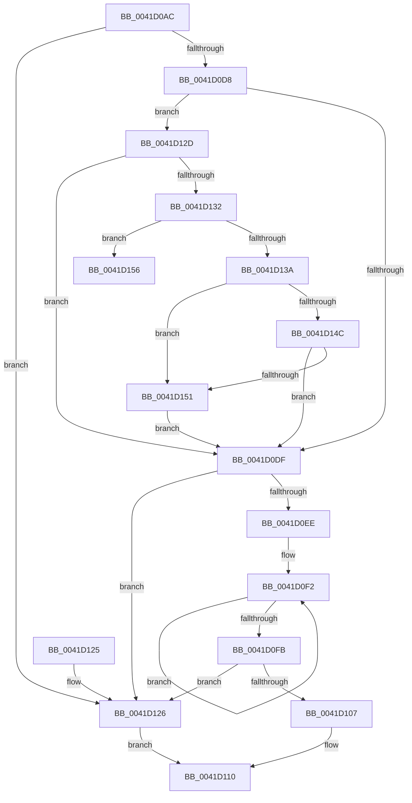

# PopSafeCopyUnicodeString

- RVA: `0x0041D0AC`–`0x0041D15C` (길이 `176` bytes)
- VA: `0x000000014041D0AC`
- 실행 섹션: `.text`
- PDB 이름 있음: `예`; PDB Function 태그: `아니요`
- unwind 정보 RVA: `0x0009EE78`
- 디코드: `56`개 명령, `176/176` bytes 표시
- 미해석 바이트: `0` (있으면 어셈블리에 `.byte`로 보존)

> 이 문서는 커널 이미지의 기계어와 PDB 기호를 분석해 생성했습니다. 4번과 5번은 함수 원형과 자료형을 바이너리 사용 방식에서 추정한 C 해석이며 원본 소스 복구 결과는 아닙니다.

## 1. Dependencies

- 직접 호출 지점: **2**; 고유 호출 대상: **2**
- 직접 호출자로 확인된 함수: **1**
- RIP 상대 이미지 참조: **0**

### Outgoing calls
- `0x0041D0E5` → [RtlStringCbCopyUnicodeString](RtlStringCbCopyUnicodeString_function_0041D164.md) (function, `0x0041D164`)
- `0x0041D156` → [ExRaiseDatatypeMisalignment](../../page/89/ExRaiseDatatypeMisalignment_function_00899FD0.md) (function, `0x00899FD0`)

### Direct callers
- [PopCaptureReasonContext](PopCaptureReasonContext_function_0041CE0C.md) at `0x0041CEDF`
- [PopCaptureReasonContext](PopCaptureReasonContext_function_0041CE0C.md) at `0x0041CFD0`

### Static image references
- 디코드된 RIP-relative 메모리 참조가 없습니다.

## 2. Other-region calls and transfers

- 다른 실행 섹션으로 향하는 call: **1**
  - `0x0041D156` → [ExRaiseDatatypeMisalignment](../../page/89/ExRaiseDatatypeMisalignment_function_00899FD0.md) (`.text` → `PAGE`)
- 별도 외부 분기/꼬리 이동을 확인하지 못했습니다.

## 3. Assembly (complete function range)

```asm
0041D0AC  48 89 5C 24 08                  mov qword ptr [rsp + 8], rbx
0041D0B1  48 89 6C 24 10                  mov qword ptr [rsp + 0x10], rbp
0041D0B6  48 89 74 24 18                  mov qword ptr [rsp + 0x18], rsi
0041D0BB  57                              push rdi
0041D0BC  48 83 EC 20                     sub rsp, 0x20
0041D0C0  48 8B 32                        mov rsi, qword ptr [rdx]
0041D0C3  48 8B D9                        mov rbx, rcx
0041D0C6  0F B7 09                        movzx ecx, word ptr [rcx]
0041D0C9  48 8B FA                        mov rdi, rdx
0041D0CC  4C 2B C6                        sub r8, rsi
0041D0CF  48 8D 51 02                     lea rdx, [rcx + 2]
0041D0D3  49 3B D0                        cmp rdx, r8
0041D0D6  77 4E                           ja 0x14041d126
0041D0D8  33 ED                           xor ebp, ebp
0041D0DA  45 84 C9                        test r9b, r9b
0041D0DD  75 4E                           jne 0x14041d12d
0041D0DF  4C 8B C3                        mov r8, rbx
0041D0E2  48 8B CE                        mov rcx, rsi
0041D0E5  E8 7A 00 00 00                  call 0x14041d164
0041D0EA  85 C0                           test eax, eax
0041D0EC  78 38                           js 0x14041d126
0041D0EE  48 83 C8 FF                     or rax, 0xffffffffffffffff
0041D0F2  48 FF C0                        inc rax
0041D0F5  66 39 2C 46                     cmp word ptr [rsi + rax*2], bp
0041D0F9  75 F7                           jne 0x14041d0f2
0041D0FB  48 8D 0C 00                     lea rcx, [rax + rax]
0041D0FF  0F B7 03                        movzx eax, word ptr [rbx]
0041D102  48 3B C1                        cmp rax, rcx
0041D105  75 1F                           jne 0x14041d126
0041D107  48 8D 41 02                     lea rax, [rcx + 2]
0041D10B  48 01 07                        add qword ptr [rdi], rax
0041D10E  33 C0                           xor eax, eax
0041D110  48 8B 5C 24 30                  mov rbx, qword ptr [rsp + 0x30]
0041D115  48 8B 6C 24 38                  mov rbp, qword ptr [rsp + 0x38]
0041D11A  48 8B 74 24 40                  mov rsi, qword ptr [rsp + 0x40]
0041D11F  48 83 C4 20                     add rsp, 0x20
0041D123  5F                              pop rdi
0041D124  C3                              ret
0041D125  CC                              int3
0041D126  B8 0D 00 00 C0                  mov eax, 0xc000000d
0041D12B  EB E3                           jmp 0x14041d110
0041D12D  66 85 C9                        test cx, cx
0041D130  74 AD                           je 0x14041d0df
0041D132  48 8B 43 08                     mov rax, qword ptr [rbx + 8]
0041D136  A8 01                           test al, 1
0041D138  75 1C                           jne 0x14041d156
0041D13A  48 03 C8                        add rcx, rax
0041D13D  49 B8 00 00 FF FF FF 7F 00 00   movabs r8, 0x7fffffff0000
0041D147  49 3B C8                        cmp rcx, r8
0041D14A  77 05                           ja 0x14041d151
0041D14C  48 3B C8                        cmp rcx, rax
0041D14F  73 8E                           jae 0x14041d0df
0041D151  41 8A 00                        mov al, byte ptr [r8]
0041D154  EB 89                           jmp 0x14041d0df
0041D156  E8 75 CE 47 00                  call 0x140899fd0
0041D15B  CC                              int3
```

## 4. C-style interpretation (structured pseudocode)

```c
__int64 __fastcall PopSafeCopyUnicodeString(__int64 a1, __int64 a2, __int64 a3, unsigned __int8 a4)
{
    __int64 result;
    __int64 v_rbp;
    __int64 v_rsp;
    unsigned __int64 v_stack_p10;
    unsigned __int64 v_stack_p18;
    unsigned __int64 v_stack_p8;

    v_stack_p8 = v_rbx;
    v_stack_p10 = v_rbp;
    v_stack_p18 = v_rsi;
    v_rsp = (v_rsp) - (32);
    a3 = (a3) - (*(unsigned __int64 *)(a2));
    if ((*(unsigned __int16 *)(a1) + 2) > a3) goto loc_0041D126;
    v_rbp = 0;
    if (a4 != 0) goto loc_0041D12D;
loc_0041D0DF:
    result = RtlStringCbCopyUnicodeString(*(unsigned __int64 *)(a2), *(unsigned __int16 *)(a1) + 2, a1, a4);
    if (sign_flag) goto loc_0041D126;
    result = (result) | (-1);
loc_0041D0F2:
    result = (result) + 1;
    if ((*(unsigned __int16 *)(*(unsigned __int64 *)(a2) + result * 2)) != 0) goto loc_0041D0F2;
    if ((*(unsigned __int16 *)(a1)) != (result + result * 1)) goto loc_0041D126;
    result = 0;
loc_0041D110:
    v_rsp = (v_rsp) + (32);
    return result;
loc_0041D126:
    goto loc_0041D110;
loc_0041D12D:
    if ((unsigned __int16)(result + result * 1) == 0) goto loc_0041D0DF;
    if ((((unsigned __int8)(*(unsigned __int64 *)(v_stack_p8 + 8))) & (1)) != 0) goto loc_0041D156;
    a1 = (result + result * 1) + (*(unsigned __int64 *)(v_stack_p8 + 8));
    if (a1 > a1) goto loc_0041D151;
    if (a1 >= (*(unsigned __int64 *)(v_stack_p8 + 8))) goto loc_0041D0DF;
loc_0041D151:
    goto loc_0041D0DF;
loc_0041D156:
    result = ExRaiseDatatypeMisalignment(a1, *(unsigned __int16 *)(a1) + 2, a1, a4);
    return result;
}
```

## 5. (Beta) C Style

```c
int64_t PopSafeCopyUnicodeString(void *Arg1, void *Arg2, int64_t Arg3, uint8_t Arg4)
{
    uint8_t *arg1 = (uint8_t *)Arg1;
    uint8_t *arg2 = (uint8_t *)Arg2;

    int64_t result;
    int64_t local_rbp;
    int64_t local_rsp;
    uint64_t v_stack_p10;
    uint64_t v_stack_p18;
    uint64_t v_stack_p8;

    v_stack_p8 = local_rbx;
    v_stack_p10 = local_rbp;
    v_stack_p18 = local_rsi;
    local_rsp = (local_rsp) - (32);
    Arg3 = (Arg3) - (*(uint64_t *)(arg2));
    if ((*(uint16_t *)(arg1) + 2) > Arg3) goto loc_0041D126;
    local_rbp = 0;
    if (Arg4 != 0) goto loc_0041D12D;
loc_0041D0DF:
    result = RtlStringCbCopyUnicodeString(*(uint64_t *)(arg2), *(uint16_t *)(arg1) + 2, Arg1, Arg4);
    if (sign_flag) goto loc_0041D126;
    result = (result) | (-1);
loc_0041D0F2:
    result = (result) + 1;
    if ((*(uint16_t *)(*(uint64_t *)(arg2) + result * 2)) != 0) goto loc_0041D0F2;
    if ((*(uint16_t *)(arg1)) != (result + result * 1)) goto loc_0041D126;
    result = 0;
loc_0041D110:
    local_rsp = (local_rsp) + (32);
    return result;
loc_0041D126:
    goto loc_0041D110;
loc_0041D12D:
    if ((uint16_t)(result + result * 1) == 0) goto loc_0041D0DF;
    if ((((uint8_t)(*(uint64_t *)(v_stack_p8 + 0x8))) & (1)) != 0) goto loc_0041D156;
    Arg1 = (result + result * 1) + (*(uint64_t *)(v_stack_p8 + 0x8));
    if (Arg1 > Arg1) goto loc_0041D151;
    if (Arg1 >= (*(uint64_t *)(v_stack_p8 + 0x8))) goto loc_0041D0DF;
loc_0041D151:
    goto loc_0041D0DF;
loc_0041D156:
    result = ExRaiseDatatypeMisalignment(Arg1, *(uint16_t *)(arg1) + 2, Arg1, Arg4);
    return result;
}
```

### 관측된 메모리 오프셋

구조체 형식이 확인되지 않은 접근은 인자 기준의 오프셋으로만 기록했습니다.

| 기준 인자 | 오프셋 표현 | 폭 (bit) | 접근 |
|---|---:|---:|---|
| `Arg1` | `+ 0x0` | `16` | `R` |
| `Arg1` | `+ 0x8` | `64` | `R` |
| `Arg2` | `+ 0x0` | `64` | `R` |
| `Arg2` | `+ 0x0` | `64` | `R/W` |

## 6. Execution-region graph

[열기: 2D/3D 그래프와 함수 탐색 컨트롤 패널](../../../control-panel.html?section=text&rva=0x0041D0AC&view=graph)

- 2D 그래프는 위에서 아래로 흐르고, 3D 그래프는 빈 공간을 드래그해 회전합니다. Shift+드래그는 이동, 휠은 확대·축소, 함수 노드 선택은 대상 보고서 이동입니다.

### Static fallback


