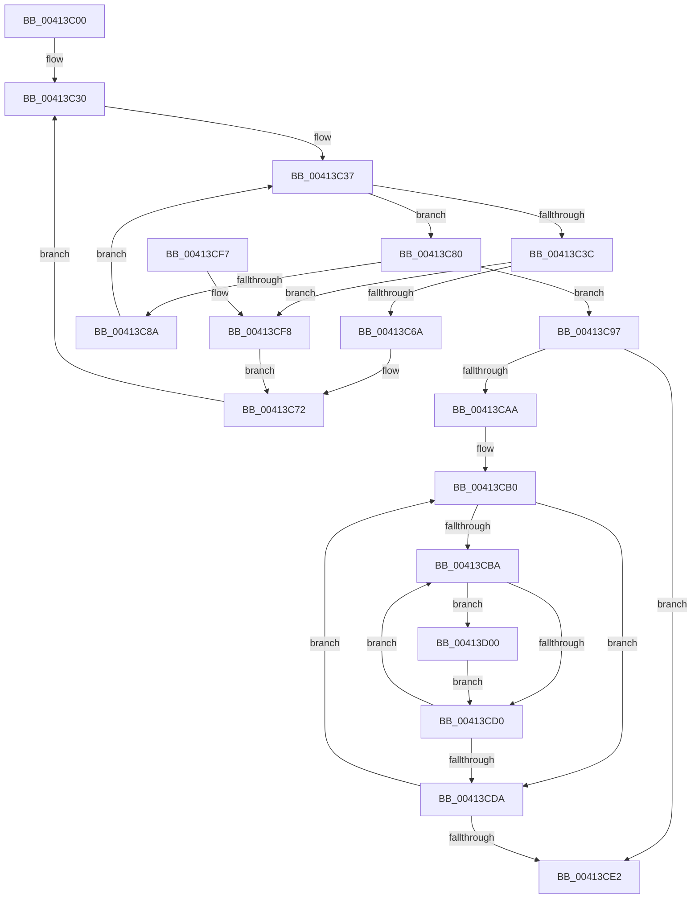

# PpmCheckSnapAllUtility

- RVA: `0x00413C00`–`0x00413D0A` (길이 `266` bytes)
- VA: `0x0000000140413C00`
- 실행 섹션: `.text`
- PDB 이름 있음: `예`; PDB Function 태그: `아니요`
- unwind 정보 RVA: `0x0009AD28`
- 디코드: `71`개 명령, `266/266` bytes 표시
- 미해석 바이트: `0` (있으면 어셈블리에 `.byte`로 보존)

> 이 문서는 커널 이미지의 기계어와 PDB 기호를 분석해 생성했습니다. 4번과 5번은 함수 원형과 자료형을 바이너리 사용 방식에서 추정한 C 해석이며 원본 소스 복구 결과는 아닙니다.

## 1. Dependencies

- 직접 호출 지점: **3**; 고유 호출 대상: **2**
- 직접 호출자로 확인된 함수: **0**
- RIP 상대 이미지 참조: **6**

### Outgoing calls
- `0x00413C12` → [PpmParkSnapNodeStatistics](PpmParkSnapNodeStatistics_function_0041419C.md) (function, `0x0041419C`)
- `0x00413C79` → [PpmPerfSnapUtility](PpmPerfSnapUtility_function_00413D10.md) (function, `0x00413D10`)
- `0x00413D03` → [PpmPerfSnapUtility](PpmPerfSnapUtility_function_00413D10.md) (function, `0x00413D10`)

### Direct callers
- 이 함수 시작 RVA로 연결되는 직접 call은 확인되지 않았습니다. 간접 호출은 완전히 역산할 수 없습니다.

### Static image references
- `0x00413C17` → RVA `0x00E0B5A8` (`.data`; read)
- `0x00413C1E` → RVA `0x00000000` (`image boundary/outside`; read)
- `0x00413C30` → RVA `0x00E0B5A0` (`.data`; read)
- `0x00413C52` → RVA `0x00F231B8` (`.data`; read)
- `0x00413C5C` → RVA `0x00FC6A80` (`ALMOSTRO`; read)
- `0x00413C97` → RVA `0x00FC6BA8` (`ALMOSTRO`; read)

## 2. Other-region calls and transfers

- 다른 실행 섹션으로 향하는 call: **0**
- 별도 외부 분기/꼬리 이동을 확인하지 못했습니다.

## 3. Assembly (complete function range)

```asm
00413C00  48 89 5C 24 10                  mov qword ptr [rsp + 0x10], rbx
00413C05  48 89 6C 24 18                  mov qword ptr [rsp + 0x18], rbp
00413C0A  56                              push rsi
00413C0B  57                              push rdi
00413C0C  41 56                           push r14
00413C0E  48 83 EC 20                     sub rsp, 0x20
00413C12  E8 85 05 00 00                  call 0x14041419c
00413C17  48 8B 1D 8A 79 9F 00            mov rbx, qword ptr [rip + 0x9f798a]
00413C1E  4C 8D 35 DB C3 BE FF            lea r14, [rip - 0x413c25]
00413C25  33 F6                           xor esi, esi
00413C27  0F B7 FE                        movzx edi, si
00413C2A  66 0F 1F 44 00 00               nop word ptr [rax + rax]
00413C30  0F B7 0D 69 79 9F 00            movzx ecx, word ptr [rip + 0x9f7969]
00413C37  48 85 DB                        test rbx, rbx
00413C3A  74 44                           je 0x140413c80
00413C3C  48 0F BC D3                     bsf rdx, rbx
00413C40  0F B7 CF                        movzx ecx, di
00413C43  0F B6 C2                        movzx eax, dl
00413C46  48 0F B3 C3                     btr rbx, rax
00413C4A  C1 E1 06                        shl ecx, 6
00413C4D  0F B6 C2                        movzx eax, dl
00413C50  03 C8                           add ecx, eax
00413C52  48 8B 05 5F F5 B0 00            mov rax, qword ptr [rip + 0xb0f55f]
00413C59  8B 14 88                        mov edx, dword ptr [rax + rcx*4]
00413C5C  8B 05 1E 2E BB 00               mov eax, dword ptr [rip + 0xbb2e1e]
00413C62  3B D0                           cmp edx, eax
00413C64  0F 83 8E 00 00 00               jae 0x140413cf8
00413C6A  49 8B 8C D6 40 8C FC 00         mov rcx, qword ptr [r14 + rdx*8 + 0xfc8c40]
00413C72  48 81 C1 B0 89 00 00            add rcx, 0x89b0
00413C79  E8 92 00 00 00                  call 0x140413d10
00413C7E  EB B0                           jmp 0x140413c30
00413C80  66 FF C7                        inc di
00413C83  0F B7 C7                        movzx eax, di
00413C86  3B C1                           cmp eax, ecx
00413C88  73 0D                           jae 0x140413c97
00413C8A  0F B7 C7                        movzx eax, di
00413C8D  49 8B 9C C6 A8 B5 E0 00         mov rbx, qword ptr [r14 + rax*8 + 0xe0b5a8]
00413C95  EB A0                           jmp 0x140413c37
00413C97  48 8B 1D 0A 2F BB 00            mov rbx, qword ptr [rip + 0xbb2f0a]
00413C9E  48 8D 2D 03 2F BB 00            lea rbp, [rip + 0xbb2f03]
00413CA5  48 3B DD                        cmp rbx, rbp
00413CA8  74 38                           je 0x140413ce2
00413CAA  66 0F 1F 44 00 00               nop word ptr [rax + rax]
00413CB0  8B FE                           mov edi, esi
00413CB2  39 B3 28 01 00 00               cmp dword ptr [rbx + 0x128], esi
00413CB8  76 20                           jbe 0x140413cda
00413CBA  8B C7                           mov eax, edi
00413CBC  48 69 C8 A8 04 00 00            imul rcx, rax, 0x4a8
00413CC3  48 03 8B 38 01 00 00            add rcx, qword ptr [rbx + 0x138]
00413CCA  83 79 10 01                     cmp dword ptr [rcx + 0x10], 1
00413CCE  74 30                           je 0x140413d00
00413CD0  FF C7                           inc edi
00413CD2  3B BB 28 01 00 00               cmp edi, dword ptr [rbx + 0x128]
00413CD8  72 E0                           jb 0x140413cba
00413CDA  48 8B 1B                        mov rbx, qword ptr [rbx]
00413CDD  48 3B DD                        cmp rbx, rbp
00413CE0  75 CE                           jne 0x140413cb0
00413CE2  48 8B 5C 24 48                  mov rbx, qword ptr [rsp + 0x48]
00413CE7  B0 01                           mov al, 1
00413CE9  48 8B 6C 24 50                  mov rbp, qword ptr [rsp + 0x50]
00413CEE  48 83 C4 20                     add rsp, 0x20
00413CF2  41 5E                           pop r14
00413CF4  5F                              pop rdi
00413CF5  5E                              pop rsi
00413CF6  C3                              ret
00413CF7  CC                              int3
00413CF8  48 8B CE                        mov rcx, rsi
00413CFB  E9 72 FF FF FF                  jmp 0x140413c72
00413D00  48 8B 09                        mov rcx, qword ptr [rcx]
00413D03  E8 08 00 00 00                  call 0x140413d10
00413D08  EB C6                           jmp 0x140413cd0
```

## 4. C-style interpretation (structured pseudocode)

```c
__int64 __fastcall PpmCheckSnapAllUtility(void)
{
    __int64 result;
    __int64 v_rdi;
    __int64 v_rsi;
    __int64 v_rsp;
    unsigned __int64 v_stack_p10;
    unsigned __int64 v_stack_p18;

    v_stack_p10 = v_rbx;
    v_stack_p18 = v_rbp;
    v_rsp = (v_rsp) - (32);
    result = PpmParkSnapNodeStatistics(a1, a2, a3, a4);
    v_rsi = 0;
loc_00413C30:
loc_00413C37:
    if (*(unsigned __int64 *)(v_rip + 10451338) == 0) goto loc_00413C80;
    a1 = (unsigned int)((0) << (6));
    a1 = (unsigned int)((a1) + ((unsigned int)((unsigned __int8)(a2))));
    if (((unsigned int)((unsigned int)(*(unsigned int *)(*(unsigned __int64 *)(v_rip + 11597151) + a1 * 4)))) >= ((unsigned int)((unsigned int)(*(unsigned int *)(v_rip + 12267038))))) goto loc_00413CF8;
loc_00413C72:
    a1 = (*(unsigned __int64 *)(v_rip - 4275237 + (unsigned int)(*(unsigned int *)(*(unsigned __int64 *)(v_rip + 11597151) + a1 * 4)) * 8 + 16550976)) + (0x89B0ULL);
    result = PpmPerfSnapUtility(a1, (unsigned int)(*(unsigned int *)(*(unsigned __int64 *)(v_rip + 11597151) + a1 * 4)), a3, a4);
    goto loc_00413C30;
loc_00413C80:
    v_rdi = (unsigned __int16)((0) + 1);
    if (((unsigned int)((unsigned __int16)(v_rdi))) >= ((unsigned int)(a1))) goto loc_00413C97;
    goto loc_00413C37;
loc_00413C97:
    if ((*(unsigned __int64 *)(v_rip + 12267274)) == (v_rip + 12267267)) goto loc_00413CE2;
loc_00413CB0:
    if ((*(unsigned int *)(*(unsigned __int64 *)(v_rip + 12267274) + 296)) <= 0) goto loc_00413CDA;
loc_00413CBA:
    a1 = (a1) * (0);
    a1 = (a1) + (*(unsigned __int64 *)(*(unsigned __int64 *)(v_rip + 12267274) + 312));
    if ((*(unsigned int *)(a1 + 16)) == 1) goto loc_00413D00;
loc_00413CD0:
    v_rdi = (unsigned int)((0) + 1);
    if (((unsigned int)(v_rdi)) < (*(unsigned int *)(*(unsigned __int64 *)(v_rip + 12267274) + 296))) goto loc_00413CBA;
loc_00413CDA:
    if ((*(unsigned __int64 *)(*(unsigned __int64 *)(v_rip + 12267274))) != (v_rip + 12267267)) goto loc_00413CB0;
loc_00413CE2:
    v_rsp = (v_rsp) + (32);
    return 1;
loc_00413CF8:
    goto loc_00413C72;
loc_00413D00:
    result = PpmPerfSnapUtility(*(unsigned __int64 *)(0), (unsigned int)(*(unsigned int *)(*(unsigned __int64 *)(v_rip + 11597151) + a1 * 4)), a3, a4);
    goto loc_00413CD0;
}
```

## 5. (Beta) C Style

```c
void PpmCheckSnapAllUtility(void)
{
    int64_t result;
    int64_t local_rdi;
    int64_t local_rsi;
    int64_t local_rsp;
    uint64_t v_stack_p10;
    uint64_t v_stack_p18;

    v_stack_p10 = local_rbx;
    v_stack_p18 = local_rbp;
    local_rsp = (local_rsp) - (32);
    result = PpmParkSnapNodeStatistics(a1, a2, a3, a4);
    local_rsi = 0;
loc_00413C30:
loc_00413C37:
    if (*(uint64_t *)(v_rip + 0x9F798A) == 0) goto loc_00413C80;
    a1 = (uint32_t)((0) << (6));
    a1 = (uint32_t)((a1) + ((uint32_t)((uint8_t)(a2))));
    if (((uint32_t)((uint32_t)(*(uint32_t *)(*(uint64_t *)(v_rip + 0xB0F55F) + a1 * 4)))) >= ((uint32_t)((uint32_t)(*(uint32_t *)(v_rip + 0xBB2E1E))))) goto loc_00413CF8;
loc_00413C72:
    a1 = (*(uint64_t *)(v_rip - 0x413C25 + (uint32_t)(*(uint32_t *)(*(uint64_t *)(v_rip + 0xB0F55F) + a1 * 4)) * 8 + 0xFC8C40)) + (0x89B0ULL);
    result = PpmPerfSnapUtility(a1, (uint32_t)(*(uint32_t *)(*(uint64_t *)(v_rip + 0xB0F55F) + a1 * 4)), a3, a4);
    goto loc_00413C30;
loc_00413C80:
    local_rdi = (uint16_t)((0) + 1);
    if (((uint32_t)((uint16_t)(local_rdi))) >= ((uint32_t)(a1))) goto loc_00413C97;
    goto loc_00413C37;
loc_00413C97:
    if ((*(uint64_t *)(v_rip + 0xBB2F0A)) == (v_rip + 12267267)) goto loc_00413CE2;
loc_00413CB0:
    if ((*(uint32_t *)(*(uint64_t *)(v_rip + 0xBB2F0A) + 0x128)) <= 0) goto loc_00413CDA;
loc_00413CBA:
    a1 = (a1) * (0);
    a1 = (a1) + (*(uint64_t *)(*(uint64_t *)(v_rip + 0xBB2F0A) + 0x138));
    if ((*(uint32_t *)(a1 + 0x10)) == 1) goto loc_00413D00;
loc_00413CD0:
    local_rdi = (uint32_t)((0) + 1);
    if (((uint32_t)(local_rdi)) < (*(uint32_t *)(*(uint64_t *)(v_rip + 0xBB2F0A) + 0x128))) goto loc_00413CBA;
loc_00413CDA:
    if ((*(uint64_t *)(*(uint64_t *)(v_rip + 0xBB2F0A))) != (v_rip + 12267267)) goto loc_00413CB0;
loc_00413CE2:
    local_rsp = (local_rsp) + (32);
    return 1;
loc_00413CF8:
    goto loc_00413C72;
loc_00413D00:
    result = PpmPerfSnapUtility(*(uint64_t *)(0), (uint32_t)(*(uint32_t *)(*(uint64_t *)(v_rip + 0xB0F55F) + a1 * 4)), a3, a4);
    goto loc_00413CD0;
}
```

## 6. Execution-region graph

[열기: 2D/3D 그래프와 함수 탐색 컨트롤 패널](../../../control-panel.html?section=text&rva=0x00413C00&view=graph)

- 2D 그래프는 위에서 아래로 흐르고, 3D 그래프는 빈 공간을 드래그해 회전합니다. Shift+드래그는 이동, 휠은 확대·축소, 함수 노드 선택은 대상 보고서 이동입니다.

### Static fallback


