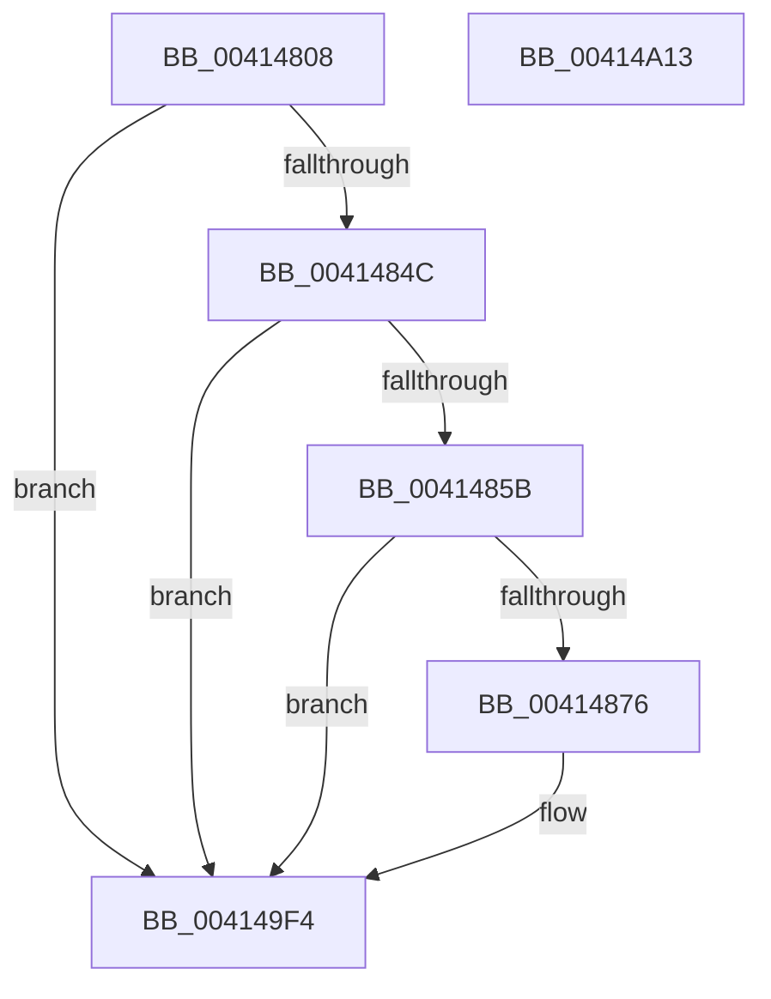

# PpmEventHgsContainmentUnparkedCount

- RVA: `0x00414808`–`0x00414A14` (길이 `524` bytes)
- VA: `0x0000000140414808`
- 실행 섹션: `.text`
- PDB 이름 있음: `예`; PDB Function 태그: `아니요`
- unwind 정보 RVA: `0x0009C14C`
- 디코드: `119`개 명령, `524/524` bytes 표시
- 미해석 바이트: `0` (있으면 어셈블리에 `.byte`로 보존)

> 이 문서는 커널 이미지의 기계어와 PDB 기호를 분석해 생성했습니다. 4번과 5번은 함수 원형과 자료형을 바이너리 사용 방식에서 추정한 C 해석이며 원본 소스 복구 결과는 아닙니다.

## 1. Dependencies

- 직접 호출 지점: **3**; 고유 호출 대상: **3**
- 직접 호출자로 확인된 함수: **1**
- RIP 상대 이미지 참조: **5**

### Outgoing calls
- `0x00414869` → [EtwEventEnabled](../39/EtwEventEnabled_function_00392450.md) (function, `0x00392450`)
- `0x004149EF` → [EtwWriteEx](../25/EtwWriteEx_function_0025F0D0.md) (function, `0x0025F0D0`)
- `0x004149FB` → [_security_check_cookie](../6A/_security_check_cookie_function_006AC640.md) (function, `0x006AC640`)

### Direct callers
- [PpmHeteroHgsCalculateContainmentCount](PpmHeteroHgsCalculateContainmentCount_function_004144E4.md) at `0x00414693`

### Static image references
- `0x00414827` → RVA `0x00E0A740` (`.data`; read)
- `0x00414835` → RVA `0x00FC501C` (`ALMOSTRO`; read)
- `0x0041484E` → RVA `0x00E67A39` (`.data`; read)
- `0x0041485B` → RVA `0x00F083E8` (`.data`; read)
- `0x00414862` → RVA `0x00013598` (`.rdata`; read)

## 2. Other-region calls and transfers

- 다른 실행 섹션으로 향하는 call: **0**
- 별도 외부 분기/꼬리 이동을 확인하지 못했습니다.

## 3. Assembly (complete function range)

```asm
00414808  48 8B C4                        mov rax, rsp
0041480B  48 89 58 20                     mov qword ptr [rax + 0x20], rbx
0041480F  44 88 40 18                     mov byte ptr [rax + 0x18], r8b
00414813  88 50 10                        mov byte ptr [rax + 0x10], dl
00414816  88 48 08                        mov byte ptr [rax + 8], cl
00414819  55                              push rbp
0041481A  56                              push rsi
0041481B  57                              push rdi
0041481C  48 8D 68 88                     lea rbp, [rax - 0x78]
00414820  48 81 EC 60 01 00 00            sub rsp, 0x160
00414827  48 8B 05 12 5F 9F 00            mov rax, qword ptr [rip + 0x9f5f12]
0041482E  48 33 C4                        xor rax, rsp
00414831  48 89 45 50                     mov qword ptr [rbp + 0x50], rax
00414835  8B 05 E1 07 BB 00               mov eax, dword ptr [rip + 0xbb07e1]
0041483B  BE 04 00 00 00                  mov esi, 4
00414840  49 8B D9                        mov rbx, r9
00414843  40 84 C6                        test sil, al
00414846  0F 84 A8 01 00 00               je 0x1404149f4
0041484C  33 FF                           xor edi, edi
0041484E  40 38 3D E4 31 A5 00            cmp byte ptr [rip + 0xa531e4], dil
00414855  0F 84 99 01 00 00               je 0x1404149f4
0041485B  48 8B 0D 86 3B AF 00            mov rcx, qword ptr [rip + 0xaf3b86]
00414862  48 8D 15 2F ED BF FF            lea rdx, [rip - 0x4012d1]
00414869  E8 E2 DB F7 FF                  call 0x140392450
0041486E  84 C0                           test al, al
00414870  0F 84 7E 01 00 00               je 0x1404149f4
00414876  48 8B 8B 00 05 00 00            mov rcx, qword ptr [rbx + 0x500]
0041487D  8D 56 FD                        lea edx, [rsi - 3]
00414880  8B 05 96 07 BB 00               mov eax, dword ptr [rip + 0xbb0796]
00414886  C1 E8 03                        shr eax, 3
00414889  23 C2                           and eax, edx
0041488B  40 38 BD B0 00 00 00            cmp byte ptr [rbp + 0xb0], dil
00414892  89 44 24 4C                     mov dword ptr [rsp + 0x4c], eax
00414896  8A 83 F0 04 00 00               mov al, byte ptr [rbx + 0x4f0]
0041489C  88 44 24 40                     mov byte ptr [rsp + 0x40], al
004148A0  8A 83 F2 04 00 00               mov al, byte ptr [rbx + 0x4f2]
004148A6  88 44 24 41                     mov byte ptr [rsp + 0x41], al
004148AA  8B 41 04                        mov eax, dword ptr [rcx + 4]
004148AD  89 44 24 48                     mov dword ptr [rsp + 0x48], eax
004148B1  8B C7                           mov eax, edi
004148B3  0F 95 C0                        setne al
004148B6  89 44 24 44                     mov dword ptr [rsp + 0x44], eax
004148BA  8B C7                           mov eax, edi
004148BC  40 38 B9 38 03 00 00            cmp byte ptr [rcx + 0x338], dil
004148C3  0F 95 C0                        setne al
004148C6  89 44 24 50                     mov dword ptr [rsp + 0x50], eax
004148CA  8B C7                           mov eax, edi
004148CC  40 38 B9 39 03 00 00            cmp byte ptr [rcx + 0x339], dil
004148D3  0F 95 C0                        setne al
004148D6  89 44 24 54                     mov dword ptr [rsp + 0x54], eax
004148DA  8B C7                           mov eax, edi
004148DC  40 38 B9 3A 03 00 00            cmp byte ptr [rcx + 0x33a], dil
004148E3  48 89 55 88                     mov qword ptr [rbp - 0x78], rdx
004148E7  0F 95 C0                        setne al
004148EA  48 89 55 98                     mov qword ptr [rbp - 0x68], rdx
004148EE  89 44 24 58                     mov dword ptr [rsp + 0x58], eax
004148F2  45 33 C9                        xor r9d, r9d
004148F5  48 8D 81 34 03 00 00            lea rax, [rcx + 0x334]
004148FC  48 89 55 A8                     mov qword ptr [rbp - 0x58], rdx
00414900  48 89 44 24 60                  mov qword ptr [rsp + 0x60], rax
00414905  45 33 C0                        xor r8d, r8d
00414908  48 8D 44 24 44                  lea rax, [rsp + 0x44]
0041490D  48 89 55 B8                     mov qword ptr [rbp - 0x48], rdx
00414911  48 89 44 24 70                  mov qword ptr [rsp + 0x70], rax
00414916  48 8D 85 A0 00 00 00            lea rax, [rbp + 0xa0]
0041491D  48 89 45 80                     mov qword ptr [rbp - 0x80], rax
00414921  48 8D 85 A8 00 00 00            lea rax, [rbp + 0xa8]
00414928  48 89 45 90                     mov qword ptr [rbp - 0x70], rax
0041492C  48 8D 44 24 48                  lea rax, [rsp + 0x48]
00414931  48 89 45 A0                     mov qword ptr [rbp - 0x60], rax
00414935  48 8D 85 80 00 00 00            lea rax, [rbp + 0x80]
0041493C  48 89 45 B0                     mov qword ptr [rbp - 0x50], rax
00414940  48 8D 85 88 00 00 00            lea rax, [rbp + 0x88]
00414947  48 89 45 C0                     mov qword ptr [rbp - 0x40], rax
0041494B  48 8D 85 90 00 00 00            lea rax, [rbp + 0x90]
00414952  48 89 45 D0                     mov qword ptr [rbp - 0x30], rax
00414956  48 8D 44 24 40                  lea rax, [rsp + 0x40]
0041495B  48 89 45 E0                     mov qword ptr [rbp - 0x20], rax
0041495F  48 8D 44 24 41                  lea rax, [rsp + 0x41]
00414964  48 89 45 F0                     mov qword ptr [rbp - 0x10], rax
00414968  48 8B 85 B8 00 00 00            mov rax, qword ptr [rbp + 0xb8]
0041496F  48 89 45 00                     mov qword ptr [rbp], rax
00414973  48 8D 44 24 4C                  lea rax, [rsp + 0x4c]
00414978  48 89 45 10                     mov qword ptr [rbp + 0x10], rax
0041497C  48 8D 44 24 50                  lea rax, [rsp + 0x50]
00414981  48 89 45 20                     mov qword ptr [rbp + 0x20], rax
00414985  48 8D 44 24 54                  lea rax, [rsp + 0x54]
0041498A  48 89 45 30                     mov qword ptr [rbp + 0x30], rax
0041498E  48 8D 44 24 58                  lea rax, [rsp + 0x58]
00414993  48 89 45 40                     mov qword ptr [rbp + 0x40], rax
00414997  48 8D 44 24 60                  lea rax, [rsp + 0x60]
0041499C  48 89 44 24 38                  mov qword ptr [rsp + 0x38], rax
004149A1  C7 44 24 30 0F 00 00 00         mov dword ptr [rsp + 0x30], 0xf
004149A9  48 89 7C 24 28                  mov qword ptr [rsp + 0x28], rdi
004149AE  48 89 55 C8                     mov qword ptr [rbp - 0x38], rdx
004149B2  48 89 55 D8                     mov qword ptr [rbp - 0x28], rdx
004149B6  48 89 55 E8                     mov qword ptr [rbp - 0x18], rdx
004149BA  48 89 55 F8                     mov qword ptr [rbp - 8], rdx
004149BE  48 8D 15 D3 EB BF FF            lea rdx, [rip - 0x40142d]
004149C5  48 89 7C 24 20                  mov qword ptr [rsp + 0x20], rdi
004149CA  48 89 74 24 68                  mov qword ptr [rsp + 0x68], rsi
004149CF  48 89 74 24 78                  mov qword ptr [rsp + 0x78], rsi
004149D4  48 89 75 08                     mov qword ptr [rbp + 8], rsi
004149D8  48 89 75 18                     mov qword ptr [rbp + 0x18], rsi
004149DC  48 89 75 28                     mov qword ptr [rbp + 0x28], rsi
004149E0  48 89 75 38                     mov qword ptr [rbp + 0x38], rsi
004149E4  48 89 75 48                     mov qword ptr [rbp + 0x48], rsi
004149E8  48 8B 0D F9 39 AF 00            mov rcx, qword ptr [rip + 0xaf39f9]
004149EF  E8 DC A6 E4 FF                  call 0x14025f0d0
004149F4  48 8B 4D 50                     mov rcx, qword ptr [rbp + 0x50]
004149F8  48 33 CC                        xor rcx, rsp
004149FB  E8 40 7C 29 00                  call 0x1406ac640
00414A00  48 8B 9C 24 98 01 00 00         mov rbx, qword ptr [rsp + 0x198]
00414A08  48 81 C4 60 01 00 00            add rsp, 0x160
00414A0F  5F                              pop rdi
00414A10  5E                              pop rsi
00414A11  5D                              pop rbp
00414A12  C3                              ret
00414A13  CC                              int3
```

## 4. C-style interpretation (structured pseudocode)

```c
__int64 __fastcall PpmEventHgsContainmentUnparkedCount(unsigned __int8 a1, unsigned __int8 a2, int a3, __int64 a4)
{
    __int64 result;
    __int64 v_rdi;
    __int64 v_rsp;
    unsigned __int64 v_stack_m100;
    unsigned __int64 v_stack_m108;
    unsigned __int64 v_stack_m110;
    unsigned __int64 v_stack_m118;
    unsigned int v_stack_m120;
    unsigned int v_stack_m124;
    unsigned int v_stack_m128;
    unsigned int v_stack_m12C;
    unsigned int v_stack_m130;
    unsigned int v_stack_m134;
    unsigned __int8 v_stack_m137;
    unsigned __int8 v_stack_m138;
    unsigned __int64 v_stack_m140;
    unsigned int v_stack_m148;
    unsigned __int64 v_stack_m150;
    unsigned __int64 v_stack_m158;
    unsigned __int64 v_stack_p20;

    *(unsigned __int64 *)(v_rsp + 32) = v_rbx;
    *(unsigned __int8 *)(v_rsp + 24) = (unsigned __int8)(a3);
    *(unsigned __int8 *)(v_rsp + 16) = a2;
    *(unsigned __int8 *)(v_rsp + 8) = a1;
    v_rsp = (v_rsp) - (352);
    result = (*(unsigned __int64 *)(v_rip + 10444562)) ^ (v_rsp);
    *(unsigned __int64 *)(v_rsp - 120 + 80) = result;
    if (((4) & ((unsigned __int8)((unsigned int)(*(unsigned int *)(v_rip + 12257249))))) == 0) goto loc_004149F4;
    v_rdi = 0;
    if ((*(unsigned __int8 *)(v_rip + 10826212)) == 0) goto loc_004149F4;
    result = EtwEventEnabled(*(unsigned __int64 *)(v_rip + 11484038), v_rip - 4199121, a3, a4);
    if ((unsigned __int8)(result) != 0) {
        a1 = *(unsigned __int64 *)(a4 + 1280);
        a2 = 4 - 3;
        result = *(unsigned int *)(v_rip + 12257174);
        result = (unsigned int)((result) >> (3));
        result = (unsigned int)((result) & (a2));
        v_stack_m12C = (unsigned int)(result);
        result = *(unsigned __int8 *)(a4 + 1264);
        v_stack_m138 = (unsigned __int8)(result);
        result = *(unsigned __int8 *)(a4 + 1266);
        v_stack_m137 = (unsigned __int8)(result);
        result = *(unsigned int *)(a1 + 4);
        v_stack_m130 = (unsigned int)(result);
        result = 0;
        result = ((*(unsigned __int8 *)(v_rsp - 120 + 176)) != 0) ? 1 : 0;
        v_stack_m134 = (unsigned int)(result);
        result = 0;
        result = ((*(unsigned __int8 *)(a1 + 824)) != 0) ? 1 : 0;
        v_stack_m128 = (unsigned int)(result);
        result = 0;
        result = ((*(unsigned __int8 *)(a1 + 825)) != 0) ? 1 : 0;
        v_stack_m124 = (unsigned int)(result);
        result = 0;
        *(unsigned __int64 *)(v_rsp - 120 - 120) = a2;
        result = ((*(unsigned __int8 *)(a1 + 826)) != 0) ? 1 : 0;
        *(unsigned __int64 *)(v_rsp - 120 - 104) = a2;
        v_stack_m120 = (unsigned int)(result);
        a4 = 0;
        result = a1 + 820;
        *(unsigned __int64 *)(v_rsp - 120 - 88) = a2;
        v_stack_m118 = result;
        a3 = 0;
        result = v_stack_m134;
        *(unsigned __int64 *)(v_rsp - 120 - 72) = a2;
        v_stack_m108 = result;
        result = v_rsp - 120 + 160;
        *(unsigned __int64 *)(v_rsp - 120 - 128) = result;
        result = v_rsp - 120 + 168;
        *(unsigned __int64 *)(v_rsp - 120 - 112) = result;
        result = v_stack_m130;
        *(unsigned __int64 *)(v_rsp - 120 - 96) = result;
        result = v_rsp - 120 + 128;
        *(unsigned __int64 *)(v_rsp - 120 - 80) = result;
        result = v_rsp - 120 + 136;
        *(unsigned __int64 *)(v_rsp - 120 - 64) = result;
        result = v_rsp - 120 + 144;
        *(unsigned __int64 *)(v_rsp - 120 - 48) = result;
        result = v_stack_m138;
        *(unsigned __int64 *)(v_rsp - 120 - 32) = result;
        result = v_stack_m137;
        *(unsigned __int64 *)(v_rsp - 120 - 16) = result;
        result = *(unsigned __int64 *)(v_rsp - 120 + 184);
        *(unsigned __int64 *)(v_rsp - 120) = result;
        result = v_stack_m12C;
        *(unsigned __int64 *)(v_rsp - 120 + 16) = result;
        result = v_stack_m128;
        *(unsigned __int64 *)(v_rsp - 120 + 32) = result;
        result = v_stack_m124;
        *(unsigned __int64 *)(v_rsp - 120 + 48) = result;
        result = v_stack_m120;
        *(unsigned __int64 *)(v_rsp - 120 + 64) = result;
        result = v_stack_m118;
        v_stack_m140 = result;
        v_stack_m148 = 15;
        v_stack_m150 = 0;
        *(unsigned __int64 *)(v_rsp - 120 - 56) = a2;
        *(unsigned __int64 *)(v_rsp - 120 - 40) = a2;
        *(unsigned __int64 *)(v_rsp - 120 - 24) = a2;
        *(unsigned __int64 *)(v_rsp - 120 - 8) = a2;
        a2 = v_rip - 4199469;
        v_stack_m158 = 0;
        v_stack_m110 = 4;
        v_stack_m100 = 4;
        *(unsigned __int64 *)(v_rsp - 120 + 8) = 4;
        *(unsigned __int64 *)(v_rsp - 120 + 24) = 4;
        *(unsigned __int64 *)(v_rsp - 120 + 40) = 4;
        *(unsigned __int64 *)(v_rsp - 120 + 56) = 4;
        *(unsigned __int64 *)(v_rsp - 120 + 72) = 4;
        a1 = *(unsigned __int64 *)(v_rip + 11483641);
        result = EtwWriteEx(a1, a2, a3, a4);
    }
    a1 = (*(unsigned __int64 *)(v_rsp - 120 + 80)) ^ (v_rsp);
    result = _security_check_cookie(a1, a2, a3, a4);
    v_rsp = (v_rsp) + (352);
    return result;
}
```

## 5. (Beta) C Style

```c
int64_t PpmEventHgsContainmentUnparkedCount(uint8_t Arg1, uint8_t Arg2, int32_t Arg3, void *Arg4)
{
    uint8_t *arg4 = (uint8_t *)Arg4;

    int64_t result;
    int64_t local_rdi;
    int64_t local_rsp;
    uint64_t v_stack_m100;
    uint64_t v_stack_m108;
    uint64_t v_stack_m110;
    uint64_t v_stack_m118;
    uint32_t v_stack_m120;
    uint32_t v_stack_m124;
    uint32_t v_stack_m128;
    uint32_t v_stack_m12C;
    uint32_t v_stack_m130;
    uint32_t v_stack_m134;
    uint8_t v_stack_m137;
    uint8_t v_stack_m138;
    uint64_t v_stack_m140;
    uint32_t v_stack_m148;
    uint64_t v_stack_m150;
    uint64_t v_stack_m158;
    uint64_t v_stack_p20;

    *(uint64_t *)(local_rsp + 0x20) = local_rbx;
    *(uint8_t *)(local_rsp + 0x18) = (uint8_t)(Arg3);
    *(uint8_t *)(local_rsp + 0x10) = Arg2;
    *(uint8_t *)(local_rsp + 0x8) = Arg1;
    local_rsp = (local_rsp) - (352);
    result = (*(uint64_t *)(v_rip + 0x9F5F12)) ^ (local_rsp);
    *(uint64_t *)(local_rsp - 0x78 + 0x50) = result;
    if (((4) & ((uint8_t)((uint32_t)(*(uint32_t *)(v_rip + 0xBB07E1))))) == 0) goto loc_004149F4;
    local_rdi = 0;
    if ((*(uint8_t *)(v_rip + 0xA531E4)) == 0) goto loc_004149F4;
    result = EtwEventEnabled(*(uint64_t *)(v_rip + 0xAF3B86), v_rip - 4199121, Arg3, Arg4);
    if ((uint8_t)(result) != 0) {
        Arg1 = *(uint64_t *)(arg4 + 0x500);
        Arg2 = 4 - 3;
        result = *(uint32_t *)(v_rip + 0xBB0796);
        result = (uint32_t)((result) >> (3));
        result = (uint32_t)((result) & (Arg2));
        v_stack_m12C = (uint32_t)(result);
        result = *(uint8_t *)(arg4 + 0x4F0);
        v_stack_m138 = (uint8_t)(result);
        result = *(uint8_t *)(arg4 + 0x4F2);
        v_stack_m137 = (uint8_t)(result);
        result = *(uint32_t *)(Arg1 + 0x4);
        v_stack_m130 = (uint32_t)(result);
        result = 0;
        result = ((*(uint8_t *)(local_rsp - 0x78 + 0xB0)) != 0) ? 1 : 0;
        v_stack_m134 = (uint32_t)(result);
        result = 0;
        result = ((*(uint8_t *)(Arg1 + 0x338)) != 0) ? 1 : 0;
        v_stack_m128 = (uint32_t)(result);
        result = 0;
        result = ((*(uint8_t *)(Arg1 + 0x339)) != 0) ? 1 : 0;
        v_stack_m124 = (uint32_t)(result);
        result = 0;
        *(uint64_t *)(local_rsp - 0x78 - 0x78) = Arg2;
        result = ((*(uint8_t *)(Arg1 + 0x33A)) != 0) ? 1 : 0;
        *(uint64_t *)(local_rsp - 0x78 - 0x68) = Arg2;
        v_stack_m120 = (uint32_t)(result);
        Arg4 = 0;
        result = Arg1 + 820;
        *(uint64_t *)(local_rsp - 0x78 - 0x58) = Arg2;
        v_stack_m118 = result;
        Arg3 = 0;
        result = v_stack_m134;
        *(uint64_t *)(local_rsp - 0x78 - 0x48) = Arg2;
        v_stack_m108 = result;
        result = local_rsp - 120 + 160;
        *(uint64_t *)(local_rsp - 0x78 - 0x80) = result;
        result = local_rsp - 120 + 168;
        *(uint64_t *)(local_rsp - 0x78 - 0x70) = result;
        result = v_stack_m130;
        *(uint64_t *)(local_rsp - 0x78 - 0x60) = result;
        result = local_rsp - 120 + 128;
        *(uint64_t *)(local_rsp - 0x78 - 0x50) = result;
        result = local_rsp - 120 + 136;
        *(uint64_t *)(local_rsp - 0x78 - 0x40) = result;
        result = local_rsp - 120 + 144;
        *(uint64_t *)(local_rsp - 0x78 - 0x30) = result;
        result = v_stack_m138;
        *(uint64_t *)(local_rsp - 0x78 - 0x20) = result;
        result = v_stack_m137;
        *(uint64_t *)(local_rsp - 0x78 - 0x10) = result;
        result = *(uint64_t *)(local_rsp - 0x78 + 0xB8);
        *(uint64_t *)(local_rsp - 0x78) = result;
        result = v_stack_m12C;
        *(uint64_t *)(local_rsp - 0x78 + 0x10) = result;
        result = v_stack_m128;
        *(uint64_t *)(local_rsp - 0x78 + 0x20) = result;
        result = v_stack_m124;
        *(uint64_t *)(local_rsp - 0x78 + 0x30) = result;
        result = v_stack_m120;
        *(uint64_t *)(local_rsp - 0x78 + 0x40) = result;
        result = v_stack_m118;
        v_stack_m140 = result;
        v_stack_m148 = 15;
        v_stack_m150 = 0;
        *(uint64_t *)(local_rsp - 0x78 - 0x38) = Arg2;
        *(uint64_t *)(local_rsp - 0x78 - 0x28) = Arg2;
        *(uint64_t *)(local_rsp - 0x78 - 0x18) = Arg2;
        *(uint64_t *)(local_rsp - 0x78 - 0x8) = Arg2;
        Arg2 = v_rip - 4199469;
        v_stack_m158 = 0;
        v_stack_m110 = 4;
        v_stack_m100 = 4;
        *(uint64_t *)(local_rsp - 0x78 + 0x8) = 4;
        *(uint64_t *)(local_rsp - 0x78 + 0x18) = 4;
        *(uint64_t *)(local_rsp - 0x78 + 0x28) = 4;
        *(uint64_t *)(local_rsp - 0x78 + 0x38) = 4;
        *(uint64_t *)(local_rsp - 0x78 + 0x48) = 4;
        Arg1 = *(uint64_t *)(v_rip + 0xAF39F9);
        result = EtwWriteEx(Arg1, Arg2, Arg3, Arg4);
    }
    Arg1 = (*(uint64_t *)(local_rsp - 0x78 + 0x50)) ^ (local_rsp);
    result = _security_check_cookie(Arg1, Arg2, Arg3, Arg4);
    local_rsp = (local_rsp) + (352);
    return result;
}
```

### 관측된 메모리 오프셋

구조체 형식이 확인되지 않은 접근은 인자 기준의 오프셋으로만 기록했습니다.

| 기준 인자 | 오프셋 표현 | 폭 (bit) | 접근 |
|---|---:|---:|---|
| `Arg4` | `+ 0x4F0` | `8` | `R` |
| `Arg4` | `+ 0x4F2` | `8` | `R` |
| `Arg4` | `+ 0x500` | `64` | `R` |

## 6. Execution-region graph

[열기: 2D/3D 그래프와 함수 탐색 컨트롤 패널](../../../control-panel.html?section=text&rva=0x00414808&view=graph)

- 2D 그래프는 위에서 아래로 흐르고, 3D 그래프는 빈 공간을 드래그해 회전합니다. Shift+드래그는 이동, 휠은 확대·축소, 함수 노드 선택은 대상 보고서 이동입니다.

### Static fallback


