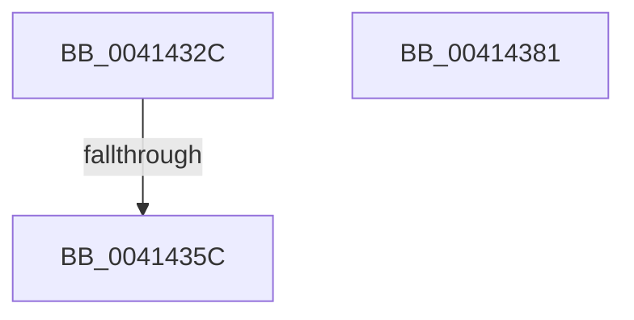

# PpmEventHgsCoresUnparkedCount

- RVA: `0x0041432C`–`0x00414382` (길이 `86` bytes)
- VA: `0x000000014041432C`
- 실행 섹션: `.text`
- PDB 이름 있음: `예`; PDB Function 태그: `예`
- unwind 정보 RVA: `0x0009C0DC`
- 디코드: `21`개 명령, `86/86` bytes 표시
- 미해석 바이트: `0` (있으면 어셈블리에 `.byte`로 보존)

> 이 문서는 커널 이미지의 기계어와 PDB 기호를 분석해 생성했습니다. 4번과 5번은 함수 원형과 자료형을 바이너리 사용 방식에서 추정한 C 해석이며 원본 소스 복구 결과는 아닙니다.

## 1. Dependencies

- 직접 호출 지점: **3**; 고유 호출 대상: **3**
- 직접 호출자로 확인된 함수: **1**
- RIP 상대 이미지 참조: **1**

### Outgoing calls
- `0x0041434F` → [Feature_PpmParkEx__private_IsEnabledDeviceUsageNoInline](../4F/Feature_PpmParkEx__private_IsEnabledDeviceUsageNoInline_function_004F135C.md) (function, `0x004F135C`)
- `0x0041435F` → [PpmEventHgsCoresUnparkedCountEx](../4F/PpmEventHgsCoresUnparkedCountEx_function_004F2E48.md) (function, `0x004F2E48`)
- `0x0041436B` → [_security_check_cookie](../6A/_security_check_cookie_function_006AC640.md) (function, `0x006AC640`)

### Direct callers
- [PpmParkCalculateUnparkCount](PpmParkCalculateUnparkCount_function_00413750.md) at `0x00413966`

### Static image references
- `0x0041433E` → RVA `0x00E0A740` (`.data`; read)

## 2. Other-region calls and transfers

- 다른 실행 섹션으로 향하는 call: **0**
- call이 아닌 외부 분기/꼬리 이동: **1**
  - `0x00414356` → [sub_006ED1B6](../6E/Unknown_function_006ED1B6.md) (`tail-transfer`)

## 3. Assembly (complete function range)

```asm
0041432C  48 89 5C 24 10                  mov qword ptr [rsp + 0x10], rbx
00414331  55                              push rbp
00414332  48 8D 6C 24 A9                  lea rbp, [rsp - 0x57]
00414337  48 81 EC C0 00 00 00            sub rsp, 0xc0
0041433E  48 8B 05 FB 63 9F 00            mov rax, qword ptr [rip + 0x9f63fb]
00414345  48 33 C4                        xor rax, rsp
00414348  48 89 45 47                     mov qword ptr [rbp + 0x47], rax
0041434C  48 8B D9                        mov rbx, rcx
0041434F  E8 08 D0 0D 00                  call 0x1404f135c
00414354  85 C0                           test eax, eax
00414356  0F 84 5A 8E 2D 00               je 0x1406ed1b6
0041435C  48 8B CB                        mov rcx, rbx
0041435F  E8 E4 EA 0D 00                  call 0x1404f2e48
00414364  48 8B 4D 47                     mov rcx, qword ptr [rbp + 0x47]
00414368  48 33 CC                        xor rcx, rsp
0041436B  E8 D0 82 29 00                  call 0x1406ac640
00414370  48 8B 9C 24 D8 00 00 00         mov rbx, qword ptr [rsp + 0xd8]
00414378  48 81 C4 C0 00 00 00            add rsp, 0xc0
0041437F  5D                              pop rbp
00414380  C3                              ret
00414381  CC                              int3
```

## 4. C-style interpretation (structured pseudocode)

```c
__int64 __fastcall PpmEventHgsCoresUnparkedCount(__int64 a1)
{
    __int64 result;
    __int64 v_rsp;
    unsigned __int64 v_stack_m18;
    unsigned __int64 v_stack_m5F;
    unsigned __int64 v_stack_p10;

    v_stack_p10 = v_rbx;
    v_rsp = (v_rsp) - (192);
    result = (*(unsigned __int64 *)(v_rip + 10445819)) ^ (v_rsp);
    v_stack_m18 = result;
    result = Feature_PpmParkEx__private_IsEnabledDeviceUsageNoInline(a1, a2, a3, a4);
    result = PpmEventHgsCoresUnparkedCountEx(a1, a2, a3, a4);
    a1 = (v_stack_m18) ^ (v_rsp);
    result = _security_check_cookie(a1, a2, a3, a4);
    v_rsp = (v_rsp) + (192);
    return result;
}
```

## 5. (Beta) C Style

```c
int64_t PpmEventHgsCoresUnparkedCount(int64_t Arg1)
{
    int64_t result;
    int64_t local_rsp;
    uint64_t v_stack_m18;
    uint64_t v_stack_m5F;
    uint64_t v_stack_p10;

    v_stack_p10 = local_rbx;
    local_rsp = (local_rsp) - (192);
    result = (*(uint64_t *)(v_rip + 0x9F63FB)) ^ (local_rsp);
    v_stack_m18 = result;
    result = Feature_PpmParkEx__private_IsEnabledDeviceUsageNoInline(Arg1, a2, a3, a4);
    result = PpmEventHgsCoresUnparkedCountEx(Arg1, a2, a3, a4);
    Arg1 = (v_stack_m18) ^ (local_rsp);
    result = _security_check_cookie(Arg1, a2, a3, a4);
    local_rsp = (local_rsp) + (192);
    return result;
}
```

## 6. Execution-region graph

[열기: 2D/3D 그래프와 함수 탐색 컨트롤 패널](../../../control-panel.html?section=text&rva=0x0041432C&view=graph)

- 2D 그래프는 위에서 아래로 흐르고, 3D 그래프는 빈 공간을 드래그해 회전합니다. Shift+드래그는 이동, 휠은 확대·축소, 함수 노드 선택은 대상 보고서 이동입니다.

### Static fallback


