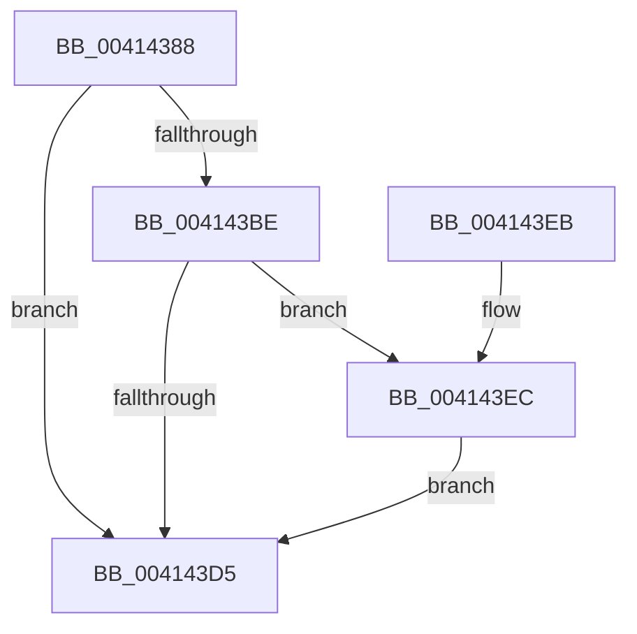

# PpmEventParkingCountSelection

- RVA: `0x00414388`–`0x004144DE` (길이 `342` bytes)
- VA: `0x0000000140414388`
- 실행 섹션: `.text`
- PDB 이름 있음: `예`; PDB Function 태그: `아니요`
- unwind 정보 RVA: `0x0009C108`
- 디코드: `72`개 명령, `342/342` bytes 표시
- 미해석 바이트: `0` (있으면 어셈블리에 `.byte`로 보존)

> 이 문서는 커널 이미지의 기계어와 PDB 기호를 분석해 생성했습니다. 4번과 5번은 함수 원형과 자료형을 바이너리 사용 방식에서 추정한 C 해석이며 원본 소스 복구 결과는 아닙니다.

## 1. Dependencies

- 직접 호출 지점: **3**; 고유 호출 대상: **3**
- 직접 호출자로 확인된 함수: **1**
- RIP 상대 이미지 참조: **4**

### Outgoing calls
- `0x004143CC` → [EtwEventEnabled](../39/EtwEventEnabled_function_00392450.md) (function, `0x00392450`)
- `0x004143DC` → [_security_check_cookie](../6A/_security_check_cookie_function_006AC640.md) (function, `0x006AC640`)
- `0x004144D4` → [EtwWriteEx](../25/EtwWriteEx_function_0025F0D0.md) (function, `0x0025F0D0`)

### Direct callers
- [PpmParkCalculateUnparkCount](PpmParkCalculateUnparkCount_function_00413750.md) at `0x004139B5`

### Static image references
- `0x004143A6` → RVA `0x00E0A740` (`.data`; read)
- `0x004143B6` → RVA `0x00E67A39` (`.data`; read)
- `0x004143BE` → RVA `0x00F083E8` (`.data`; read)
- `0x004143C5` → RVA `0x00013588` (`.rdata`; read)

## 2. Other-region calls and transfers

- 다른 실행 섹션으로 향하는 call: **0**
- 별도 외부 분기/꼬리 이동을 확인하지 못했습니다.

## 3. Assembly (complete function range)

```asm
00414388  48 8B C4                        mov rax, rsp
0041438B  44 88 48 20                     mov byte ptr [rax + 0x20], r9b
0041438F  44 88 40 18                     mov byte ptr [rax + 0x18], r8b
00414393  88 50 10                        mov byte ptr [rax + 0x10], dl
00414396  88 48 08                        mov byte ptr [rax + 8], cl
00414399  55                              push rbp
0041439A  53                              push rbx
0041439B  48 8D 68 E8                     lea rbp, [rax - 0x18]
0041439F  48 81 EC 08 01 00 00            sub rsp, 0x108
004143A6  48 8B 05 93 63 9F 00            mov rax, qword ptr [rip + 0x9f6393]
004143AD  48 33 C4                        xor rax, rsp
004143B0  48 89 45 F0                     mov qword ptr [rbp - 0x10], rax
004143B4  33 DB                           xor ebx, ebx
004143B6  38 1D 7D 36 A5 00               cmp byte ptr [rip + 0xa5367d], bl
004143BC  74 17                           je 0x1404143d5
004143BE  48 8B 0D 23 40 AF 00            mov rcx, qword ptr [rip + 0xaf4023]
004143C5  48 8D 15 BC F1 BF FF            lea rdx, [rip - 0x400e44]
004143CC  E8 7F E0 F7 FF                  call 0x140392450
004143D1  84 C0                           test al, al
004143D3  75 17                           jne 0x1404143ec
004143D5  48 8B 4D F0                     mov rcx, qword ptr [rbp - 0x10]
004143D9  48 33 CC                        xor rcx, rsp
004143DC  E8 5F 82 29 00                  call 0x1406ac640
004143E1  48 81 C4 08 01 00 00            add rsp, 0x108
004143E8  5B                              pop rbx
004143E9  5D                              pop rbp
004143EA  C3                              ret
004143EB  CC                              int3
004143EC  48 8B 0D F5 3F AF 00            mov rcx, qword ptr [rip + 0xaf3ff5]
004143F3  48 8D 45 20                     lea rax, [rbp + 0x20]
004143F7  48 89 44 24 40                  mov qword ptr [rsp + 0x40], rax
004143FC  48 8D 15 85 F1 BF FF            lea rdx, [rip - 0x400e7b]
00414403  48 8D 45 28                     lea rax, [rbp + 0x28]
00414407  48 C7 44 24 48 01 00 00 00      mov qword ptr [rsp + 0x48], 1
00414410  48 89 44 24 50                  mov qword ptr [rsp + 0x50], rax
00414415  45 33 C9                        xor r9d, r9d
00414418  48 8D 45 30                     lea rax, [rbp + 0x30]
0041441C  48 C7 44 24 58 01 00 00 00      mov qword ptr [rsp + 0x58], 1
00414425  48 89 44 24 60                  mov qword ptr [rsp + 0x60], rax
0041442A  45 33 C0                        xor r8d, r8d
0041442D  48 8D 45 38                     lea rax, [rbp + 0x38]
00414431  48 C7 44 24 68 01 00 00 00      mov qword ptr [rsp + 0x68], 1
0041443A  48 89 44 24 70                  mov qword ptr [rsp + 0x70], rax
0041443F  48 8D 45 40                     lea rax, [rbp + 0x40]
00414443  48 89 45 80                     mov qword ptr [rbp - 0x80], rax
00414447  48 8D 45 48                     lea rax, [rbp + 0x48]
0041444B  48 89 45 90                     mov qword ptr [rbp - 0x70], rax
0041444F  48 8D 45 50                     lea rax, [rbp + 0x50]
00414453  48 89 45 A0                     mov qword ptr [rbp - 0x60], rax
00414457  48 8D 45 58                     lea rax, [rbp + 0x58]
0041445B  48 89 45 B0                     mov qword ptr [rbp - 0x50], rax
0041445F  48 8D 45 60                     lea rax, [rbp + 0x60]
00414463  48 89 45 C0                     mov qword ptr [rbp - 0x40], rax
00414467  48 8D 45 68                     lea rax, [rbp + 0x68]
0041446B  48 89 45 D0                     mov qword ptr [rbp - 0x30], rax
0041446F  48 8D 45 70                     lea rax, [rbp + 0x70]
00414473  48 89 45 E0                     mov qword ptr [rbp - 0x20], rax
00414477  48 8D 44 24 40                  lea rax, [rsp + 0x40]
0041447C  48 89 44 24 38                  mov qword ptr [rsp + 0x38], rax
00414481  C7 44 24 30 0B 00 00 00         mov dword ptr [rsp + 0x30], 0xb
00414489  48 89 5C 24 28                  mov qword ptr [rsp + 0x28], rbx
0041448E  48 89 5C 24 20                  mov qword ptr [rsp + 0x20], rbx
00414493  48 C7 44 24 78 01 00 00 00      mov qword ptr [rsp + 0x78], 1
0041449C  48 C7 45 88 01 00 00 00         mov qword ptr [rbp - 0x78], 1
004144A4  48 C7 45 98 04 00 00 00         mov qword ptr [rbp - 0x68], 4
004144AC  48 C7 45 A8 01 00 00 00         mov qword ptr [rbp - 0x58], 1
004144B4  48 C7 45 B8 01 00 00 00         mov qword ptr [rbp - 0x48], 1
004144BC  48 C7 45 C8 04 00 00 00         mov qword ptr [rbp - 0x38], 4
004144C4  48 C7 45 D8 04 00 00 00         mov qword ptr [rbp - 0x28], 4
004144CC  48 C7 45 E8 04 00 00 00         mov qword ptr [rbp - 0x18], 4
004144D4  E8 F7 AB E4 FF                  call 0x14025f0d0
004144D9  E9 F7 FE FF FF                  jmp 0x1404143d5
```

## 4. C-style interpretation (structured pseudocode)

```c
__int64 __fastcall PpmEventParkingCountSelection(unsigned __int8 a1, unsigned __int8 a2, int a3, int a4)
{
    __int64 result;
    __int64 v_rbx;
    __int64 v_rsp;
    unsigned __int64 v_stack_p20;
    unsigned __int64 v_stack_p28;
    unsigned int v_stack_p30;
    unsigned __int64 v_stack_p38;
    unsigned __int64 v_stack_p40;
    unsigned __int64 v_stack_p48;
    unsigned __int64 v_stack_p50;
    unsigned __int64 v_stack_p58;
    unsigned __int64 v_stack_p60;
    unsigned __int64 v_stack_p68;
    unsigned __int64 v_stack_p70;
    unsigned __int64 v_stack_p78;

    *(unsigned __int8 *)(v_rsp + 32) = (unsigned __int8)(a4);
    *(unsigned __int8 *)(v_rsp + 24) = (unsigned __int8)(a3);
    *(unsigned __int8 *)(v_rsp + 16) = a2;
    *(unsigned __int8 *)(v_rsp + 8) = a1;
    v_rsp = (v_rsp) - (264);
    result = (*(unsigned __int64 *)(v_rip + 10445715)) ^ (v_rsp);
    *(unsigned __int64 *)(v_rsp - 24 - 16) = result;
    v_rbx = 0;
    if ((*(unsigned __int8 *)(v_rip + 10827389)) == 0) goto loc_004143D5;
    result = EtwEventEnabled(*(unsigned __int64 *)(v_rip + 11485219), v_rip - 4197956, a3, a4);
    if ((unsigned __int8)(result) != 0) goto loc_004143EC;
loc_004143D5:
    a1 = (*(unsigned __int64 *)(v_rsp - 24 - 16)) ^ (v_rsp);
    result = _security_check_cookie(a1, v_rip - 4197956, a3, a4);
    v_rsp = (v_rsp) + (264);
    return result;
loc_004143EC:
    v_stack_p40 = v_rsp - 24 + 32;
    v_stack_p48 = 1;
    v_stack_p50 = v_rsp - 24 + 40;
    a4 = 0;
    v_stack_p58 = 1;
    v_stack_p60 = v_rsp - 24 + 48;
    a3 = 0;
    v_stack_p68 = 1;
    v_stack_p70 = v_rsp - 24 + 56;
    *(unsigned __int64 *)(v_rsp - 24 - 128) = v_rsp - 24 + 64;
    *(unsigned __int64 *)(v_rsp - 24 - 112) = v_rsp - 24 + 72;
    *(unsigned __int64 *)(v_rsp - 24 - 96) = v_rsp - 24 + 80;
    *(unsigned __int64 *)(v_rsp - 24 - 80) = v_rsp - 24 + 88;
    *(unsigned __int64 *)(v_rsp - 24 - 64) = v_rsp - 24 + 96;
    *(unsigned __int64 *)(v_rsp - 24 - 48) = v_rsp - 24 + 104;
    *(unsigned __int64 *)(v_rsp - 24 - 32) = v_rsp - 24 + 112;
    v_stack_p38 = v_stack_p40;
    v_stack_p30 = 11;
    v_stack_p28 = 0;
    v_stack_p20 = 0;
    v_stack_p78 = 1;
    *(unsigned __int64 *)(v_rsp - 24 - 120) = 1;
    *(unsigned __int64 *)(v_rsp - 24 - 104) = 4;
    *(unsigned __int64 *)(v_rsp - 24 - 88) = 1;
    *(unsigned __int64 *)(v_rsp - 24 - 72) = 1;
    *(unsigned __int64 *)(v_rsp - 24 - 56) = 4;
    *(unsigned __int64 *)(v_rsp - 24 - 40) = 4;
    *(unsigned __int64 *)(v_rsp - 24 - 24) = 4;
    result = EtwWriteEx(*(unsigned __int64 *)(v_rip + 11485173), v_rip - 4198011, a3, a4);
    goto loc_004143D5;
}
```

## 5. (Beta) C Style

```c
int64_t PpmEventParkingCountSelection(uint8_t Arg1, uint8_t Arg2, int32_t Arg3, int32_t Arg4)
{
    int64_t result;
    int64_t local_rbx;
    int64_t local_rsp;
    uint64_t v_stack_p20;
    uint64_t v_stack_p28;
    uint32_t v_stack_p30;
    uint64_t v_stack_p38;
    uint64_t v_stack_p40;
    uint64_t v_stack_p48;
    uint64_t v_stack_p50;
    uint64_t v_stack_p58;
    uint64_t v_stack_p60;
    uint64_t v_stack_p68;
    uint64_t v_stack_p70;
    uint64_t v_stack_p78;

    *(uint8_t *)(local_rsp + 0x20) = (uint8_t)(Arg4);
    *(uint8_t *)(local_rsp + 0x18) = (uint8_t)(Arg3);
    *(uint8_t *)(local_rsp + 0x10) = Arg2;
    *(uint8_t *)(local_rsp + 0x8) = Arg1;
    local_rsp = (local_rsp) - (264);
    result = (*(uint64_t *)(v_rip + 0x9F6393)) ^ (local_rsp);
    *(uint64_t *)(local_rsp - 0x18 - 0x10) = result;
    local_rbx = 0;
    if ((*(uint8_t *)(v_rip + 0xA5367D)) == 0) goto loc_004143D5;
    result = EtwEventEnabled(*(uint64_t *)(v_rip + 0xAF4023), v_rip - 4197956, Arg3, Arg4);
    if ((uint8_t)(result) != 0) goto loc_004143EC;
loc_004143D5:
    Arg1 = (*(uint64_t *)(local_rsp - 0x18 - 0x10)) ^ (local_rsp);
    result = _security_check_cookie(Arg1, v_rip - 4197956, Arg3, Arg4);
    local_rsp = (local_rsp) + (264);
    return result;
loc_004143EC:
    v_stack_p40 = local_rsp - 24 + 32;
    v_stack_p48 = 1;
    v_stack_p50 = local_rsp - 24 + 40;
    Arg4 = 0;
    v_stack_p58 = 1;
    v_stack_p60 = local_rsp - 24 + 48;
    Arg3 = 0;
    v_stack_p68 = 1;
    v_stack_p70 = local_rsp - 24 + 56;
    *(uint64_t *)(local_rsp - 0x18 - 0x80) = local_rsp - 24 + 64;
    *(uint64_t *)(local_rsp - 0x18 - 0x70) = local_rsp - 24 + 72;
    *(uint64_t *)(local_rsp - 0x18 - 0x60) = local_rsp - 24 + 80;
    *(uint64_t *)(local_rsp - 0x18 - 0x50) = local_rsp - 24 + 88;
    *(uint64_t *)(local_rsp - 0x18 - 0x40) = local_rsp - 24 + 96;
    *(uint64_t *)(local_rsp - 0x18 - 0x30) = local_rsp - 24 + 104;
    *(uint64_t *)(local_rsp - 0x18 - 0x20) = local_rsp - 24 + 112;
    v_stack_p38 = v_stack_p40;
    v_stack_p30 = 11;
    v_stack_p28 = 0;
    v_stack_p20 = 0;
    v_stack_p78 = 1;
    *(uint64_t *)(local_rsp - 0x18 - 0x78) = 1;
    *(uint64_t *)(local_rsp - 0x18 - 0x68) = 4;
    *(uint64_t *)(local_rsp - 0x18 - 0x58) = 1;
    *(uint64_t *)(local_rsp - 0x18 - 0x48) = 1;
    *(uint64_t *)(local_rsp - 0x18 - 0x38) = 4;
    *(uint64_t *)(local_rsp - 0x18 - 0x28) = 4;
    *(uint64_t *)(local_rsp - 0x18 - 0x18) = 4;
    result = EtwWriteEx(*(uint64_t *)(v_rip + 0xAF3FF5), v_rip - 4198011, Arg3, Arg4);
    goto loc_004143D5;
}
```

## 6. Execution-region graph

[열기: 2D/3D 그래프와 함수 탐색 컨트롤 패널](../../../control-panel.html?section=text&rva=0x00414388&view=graph)

- 2D 그래프는 위에서 아래로 흐르고, 3D 그래프는 빈 공간을 드래그해 회전합니다. Shift+드래그는 이동, 휠은 확대·축소, 함수 노드 선택은 대상 보고서 이동입니다.

### Static fallback


