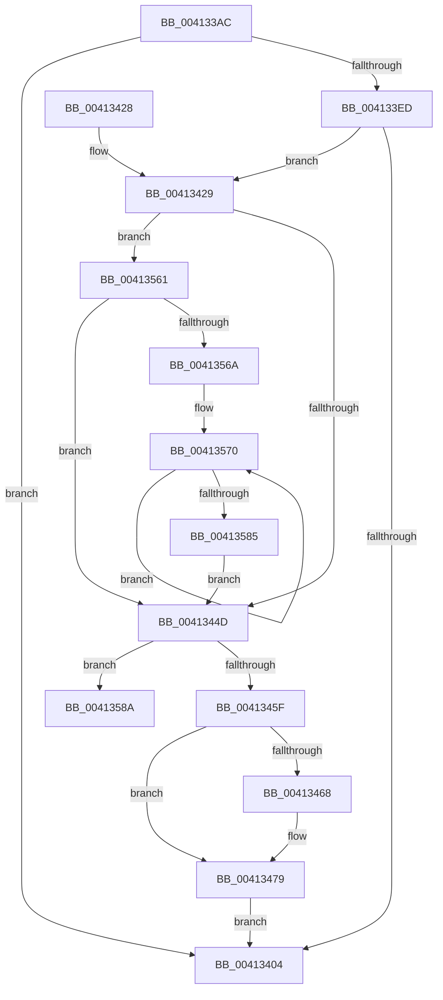

# PpmEventTraceHeteroResponse

- RVA: `0x004133AC`–`0x004135A4` (길이 `504` bytes)
- VA: `0x00000001404133AC`
- 실행 섹션: `.text`
- PDB 이름 있음: `예`; PDB Function 태그: `예`
- unwind 정보 RVA: `0x0009BF7C`
- 디코드: `114`개 명령, `504/504` bytes 표시
- 미해석 바이트: `0` (있으면 어셈블리에 `.byte`로 보존)

> 이 문서는 커널 이미지의 기계어와 PDB 기호를 분석해 생성했습니다. 4번과 5번은 함수 원형과 자료형을 바이너리 사용 방식에서 추정한 C 해석이며 원본 소스 복구 결과는 아닙니다.

## 1. Dependencies

- 직접 호출 지점: **3**; 고유 호출 대상: **3**
- 직접 호출자로 확인된 함수: **2**
- RIP 상대 이미지 참조: **5**

### Outgoing calls
- `0x004133FB` → [EtwEventEnabled](../39/EtwEventEnabled_function_00392450.md) (function, `0x00392450`)
- `0x0041340B` → [_security_check_cookie](../6A/_security_check_cookie_function_006AC640.md) (function, `0x006AC640`)
- `0x00413557` → [EtwWriteEx](../25/EtwWriteEx_function_0025F0D0.md) (function, `0x0025F0D0`)

### Direct callers
- [PpmCheckComputeMultiClassHeteroResponse](PpmCheckComputeMultiClassHeteroResponse_function_00412534.md) at `0x00412964`
- [sub_006FA0AE](../6F/Unknown_function_006FA0AE.md) at `0x006FA41A`

### Static image references
- `0x004133CA` → RVA `0x00E0A740` (`.data`; read)
- `0x004133DE` → RVA `0x00E67A39` (`.data`; read)
- `0x004133ED` → RVA `0x00F083E8` (`.data`; read)
- `0x004133F4` → RVA `0x00013578` (`.rdata`; read)
- `0x0041345F` → RVA `0x00FC6A86` (`ALMOSTRO`; read)

## 2. Other-region calls and transfers

- 다른 실행 섹션으로 향하는 call: **0**
- call이 아닌 외부 분기/꼬리 이동: **1**
  - `0x0041359F` → [sub_006ED19E](../6E/Unknown_function_006ED19E.md) (`tail-transfer`)

## 3. Assembly (complete function range)

```asm
004133AC  48 8B C4                        mov rax, rsp
004133AF  48 89 58 08                     mov qword ptr [rax + 8], rbx
004133B3  48 89 70 10                     mov qword ptr [rax + 0x10], rsi
004133B7  4C 89 48 20                     mov qword ptr [rax + 0x20], r9
004133BB  55                              push rbp
004133BC  57                              push rdi
004133BD  41 56                           push r14
004133BF  48 8D 68 D8                     lea rbp, [rax - 0x28]
004133C3  48 81 EC 10 01 00 00            sub rsp, 0x110
004133CA  48 8B 05 6F 73 9F 00            mov rax, qword ptr [rip + 0x9f736f]
004133D1  48 33 C4                        xor rax, rsp
004133D4  48 89 45 00                     mov qword ptr [rbp], rax
004133D8  45 33 F6                        xor r14d, r14d
004133DB  49 8B F8                        mov rdi, r8
004133DE  44 38 35 54 46 A5 00            cmp byte ptr [rip + 0xa54654], r14b
004133E5  48 8B F2                        mov rsi, rdx
004133E8  48 8B D9                        mov rbx, rcx
004133EB  74 17                           je 0x140413404
004133ED  48 8B 0D F4 4F AF 00            mov rcx, qword ptr [rip + 0xaf4ff4]
004133F4  48 8D 15 7D 01 C0 FF            lea rdx, [rip - 0x3ffe83]
004133FB  E8 50 F0 F7 FF                  call 0x140392450
00413400  84 C0                           test al, al
00413402  75 25                           jne 0x140413429
00413404  48 8B 4D 00                     mov rcx, qword ptr [rbp]
00413408  48 33 CC                        xor rcx, rsp
0041340B  E8 30 92 29 00                  call 0x1406ac640
00413410  4C 8D 9C 24 10 01 00 00         lea r11, [rsp + 0x110]
00413418  49 8B 5B 20                     mov rbx, qword ptr [r11 + 0x20]
0041341C  49 8B 73 28                     mov rsi, qword ptr [r11 + 0x28]
00413420  49 8B E3                        mov rsp, r11
00413423  41 5E                           pop r14
00413425  5F                              pop rdi
00413426  5D                              pop rbp
00413427  C3                              ret
00413428  CC                              int3
00413429  44 0F B6 43 0A                  movzx r8d, byte ptr [rbx + 0xa]
0041342E  41 BA 01 00 00 00               mov r10d, 1
00413434  8A 83 A4 04 00 00               mov al, byte ptr [rbx + 0x4a4]
0041343A  44 88 44 24 41                  mov byte ptr [rsp + 0x41], r8b
0041343F  88 44 24 42                     mov byte ptr [rsp + 0x42], al
00413443  4C 39 55 48                     cmp qword ptr [rbp + 0x48], r10
00413447  0F 87 14 01 00 00               ja 0x140413561
0041344D  0F B6 43 0C                     movzx eax, byte ptr [rbx + 0xc]
00413451  44 88 74 24 40                  mov byte ptr [rsp + 0x40], r14b
00413456  41 3B C2                        cmp eax, r10d
00413459  0F 87 2B 01 00 00               ja 0x14041358a
0041345F  44 38 35 20 36 BB 00            cmp byte ptr [rip + 0xbb3620], r14b
00413466  74 11                           je 0x140413479
00413468  48 8B 83 08 05 00 00            mov rax, qword ptr [rbx + 0x508]
0041346F  8A 88 86 02 00 00               mov cl, byte ptr [rax + 0x286]
00413475  88 4C 24 40                     mov byte ptr [rsp + 0x40], cl
00413479  48 8B 0D 68 4F AF 00            mov rcx, qword ptr [rip + 0xaf4f68]
00413480  48 8D 43 04                     lea rax, [rbx + 4]
00413484  48 89 44 24 50                  mov qword ptr [rsp + 0x50], rax
00413489  48 8D 15 E8 00 C0 FF            lea rdx, [rip - 0x3fff18]
00413490  48 8D 43 10                     lea rax, [rbx + 0x10]
00413494  48 C7 44 24 58 02 00 00 00      mov qword ptr [rsp + 0x58], 2
0041349D  48 89 44 24 60                  mov qword ptr [rsp + 0x60], rax
004134A2  45 33 C9                        xor r9d, r9d
004134A5  48 8D 44 24 41                  lea rax, [rsp + 0x41]
004134AA  48 C7 44 24 68 08 00 00 00      mov qword ptr [rsp + 0x68], 8
004134B3  48 89 44 24 70                  mov qword ptr [rsp + 0x70], rax
004134B8  42 8D 04 85 00 00 00 00         lea eax, [r8*4]
004134C0  89 45 88                        mov dword ptr [rbp - 0x78], eax
004134C3  42 8D 04 C5 00 00 00 00         lea eax, [r8*8]
004134CB  89 45 98                        mov dword ptr [rbp - 0x68], eax
004134CE  45 33 C0                        xor r8d, r8d
004134D1  48 8D 45 48                     lea rax, [rbp + 0x48]
004134D5  4C 89 54 24 78                  mov qword ptr [rsp + 0x78], r10
004134DA  48 89 45 A0                     mov qword ptr [rbp - 0x60], rax
004134DE  48 8D 83 A2 04 00 00            lea rax, [rbx + 0x4a2]
004134E5  48 89 45 B0                     mov qword ptr [rbp - 0x50], rax
004134E9  48 8D 44 24 42                  lea rax, [rsp + 0x42]
004134EE  48 89 45 C0                     mov qword ptr [rbp - 0x40], rax
004134F2  48 8D 45 50                     lea rax, [rbp + 0x50]
004134F6  48 89 45 D0                     mov qword ptr [rbp - 0x30], rax
004134FA  48 8D 44 24 40                  lea rax, [rsp + 0x40]
004134FF  48 89 45 E0                     mov qword ptr [rbp - 0x20], rax
00413503  48 8D 45 58                     lea rax, [rbp + 0x58]
00413507  48 89 45 F0                     mov qword ptr [rbp - 0x10], rax
0041350B  48 8D 44 24 50                  lea rax, [rsp + 0x50]
00413510  48 89 44 24 38                  mov qword ptr [rsp + 0x38], rax
00413515  C7 44 24 30 0B 00 00 00         mov dword ptr [rsp + 0x30], 0xb
0041351D  4C 89 74 24 28                  mov qword ptr [rsp + 0x28], r14
00413522  4C 89 74 24 20                  mov qword ptr [rsp + 0x20], r14
00413527  48 89 75 80                     mov qword ptr [rbp - 0x80], rsi
0041352B  44 89 75 8C                     mov dword ptr [rbp - 0x74], r14d
0041352F  48 89 7D 90                     mov qword ptr [rbp - 0x70], rdi
00413533  44 89 75 9C                     mov dword ptr [rbp - 0x64], r14d
00413537  48 C7 45 A8 08 00 00 00         mov qword ptr [rbp - 0x58], 8
0041353F  4C 89 55 B8                     mov qword ptr [rbp - 0x48], r10
00413543  4C 89 55 C8                     mov qword ptr [rbp - 0x38], r10
00413547  4C 89 55 D8                     mov qword ptr [rbp - 0x28], r10
0041354B  4C 89 55 E8                     mov qword ptr [rbp - 0x18], r10
0041354F  48 C7 45 F8 04 00 00 00         mov qword ptr [rbp - 8], 4
00413557  E8 74 BB E4 FF                  call 0x14025f0d0
0041355C  E9 A3 FE FF FF                  jmp 0x140413404
00413561  45 84 C0                        test r8b, r8b
00413564  0F 84 E3 FE FF FF               je 0x14041344d
0041356A  48 8B CF                        mov rcx, rdi
0041356D  4D 8B C8                        mov r9, r8
00413570  48 8B 01                        mov rax, qword ptr [rcx]
00413573  33 D2                           xor edx, edx
00413575  48 F7 75 48                     div qword ptr [rbp + 0x48]
00413579  48 89 01                        mov qword ptr [rcx], rax
0041357C  48 8D 49 08                     lea rcx, [rcx + 8]
00413580  4D 2B CA                        sub r9, r10
00413583  75 EB                           jne 0x140413570
00413585  E9 C3 FE FF FF                  jmp 0x14041344d
0041358A  48 8B 93 08 05 00 00            mov rdx, qword ptr [rbx + 0x508]
00413591  44 8D 48 FF                     lea r9d, [rax - 1]
00413595  48 81 C2 86 02 00 00            add rdx, 0x286
0041359C  41 8A CE                        mov cl, r14b
0041359F  E9 FA 9B 2D 00                  jmp 0x1406ed19e
```

## 4. C-style interpretation (structured pseudocode)

```c
__int64 __fastcall PpmEventTraceHeteroResponse(__int64 a1, __int64 a2, __int64 a3, __int64 a4)
{
    __int64 result;
    __int64 v_r14;
    __int64 v_rsp;
    unsigned __int64 v_stack_m18;
    unsigned __int64 v_stack_m98;
    unsigned __int64 v_stack_mA0;
    unsigned __int64 v_stack_mA8;
    unsigned __int64 v_stack_mB0;
    unsigned __int64 v_stack_mB8;
    unsigned __int64 v_stack_mC0;
    unsigned __int8 v_stack_mCE;
    unsigned __int8 v_stack_mCF;
    unsigned __int8 v_stack_mD0;
    unsigned __int64 v_stack_mD8;
    unsigned int v_stack_mE0;
    unsigned __int64 v_stack_mE8;
    unsigned __int64 v_stack_mF0;

    *(unsigned __int64 *)(v_rsp + 8) = v_rbx;
    *(unsigned __int64 *)(v_rsp + 16) = v_rsi;
    *(unsigned __int64 *)(v_rsp + 32) = a4;
    v_rsp = (v_rsp) - (272);
    result = (*(unsigned __int64 *)(v_rip + 10449775)) ^ (v_rsp);
    *(unsigned __int64 *)(v_rsp - 40) = result;
    v_r14 = 0;
    if ((*(unsigned __int8 *)(v_rip + 10831444)) == 0) goto loc_00413404;
    result = EtwEventEnabled(*(unsigned __int64 *)(v_rip + 11489268), v_rip - 4193923, a3, a4);
    if ((unsigned __int8)(result) != 0) goto loc_00413429;
loc_00413404:
    a1 = (*(unsigned __int64 *)(v_rsp - 40)) ^ (v_rsp);
    result = _security_check_cookie(a1, v_rip - 4193923, a3, a4);
    return result;
loc_00413429:
    v_stack_mCF = (unsigned __int8)(*(unsigned __int8 *)(*(unsigned __int64 *)(v_stack_m18 + 32) + 10));
    v_stack_mCE = (unsigned __int8)(*(unsigned __int8 *)(*(unsigned __int64 *)(v_stack_m18 + 32) + 1188));
    if ((*(unsigned __int64 *)(v_rsp - 40 + 72)) > 1) goto loc_00413561;
loc_0041344D:
    v_stack_mD0 = 0;
    if (((unsigned int)(*(unsigned __int8 *)(*(unsigned __int64 *)(v_stack_m18 + 32) + 12))) > 1) goto loc_0041358A;
    result = *(unsigned __int8 *)(*(unsigned __int64 *)(v_stack_m18 + 32) + 12);
    if ((*(unsigned __int8 *)(v_rip + 12269088)) != 0) {
        result = *(unsigned __int64 *)(*(unsigned __int64 *)(v_stack_m18 + 32) + 1288);
        a1 = *(unsigned __int8 *)(result + 646);
        v_stack_mD0 = (unsigned __int8)(a1);
    }
    v_stack_mC0 = *(unsigned __int64 *)(v_stack_m18 + 32) + 4;
    v_stack_mB8 = 2;
    v_stack_mB0 = *(unsigned __int64 *)(v_stack_m18 + 32) + 16;
    a4 = 0;
    v_stack_mA8 = 8;
    v_stack_mA0 = v_stack_mCF;
    *(unsigned int *)(v_rsp - 40 - 120) = (unsigned int)(*(unsigned __int8 *)(*(unsigned __int64 *)(v_stack_m18 + 32) + 10) * 4);
    *(unsigned int *)(v_rsp - 40 - 104) = (unsigned int)(*(unsigned __int8 *)(*(unsigned __int64 *)(v_stack_m18 + 32) + 10) * 8);
    a3 = 0;
    v_stack_m98 = 1;
    *(unsigned __int64 *)(v_rsp - 40 - 96) = v_rsp - 40 + 72;
    *(unsigned __int64 *)(v_rsp - 40 - 80) = *(unsigned __int64 *)(v_stack_m18 + 32) + 1186;
    *(unsigned __int64 *)(v_rsp - 40 - 64) = v_stack_mCE;
    *(unsigned __int64 *)(v_rsp - 40 - 48) = v_rsp - 40 + 80;
    *(unsigned __int64 *)(v_rsp - 40 - 32) = v_stack_mD0;
    *(unsigned __int64 *)(v_rsp - 40 - 16) = v_rsp - 40 + 88;
    v_stack_mD8 = v_stack_mC0;
    v_stack_mE0 = 11;
    v_stack_mE8 = 0;
    v_stack_mF0 = 0;
    *(unsigned __int64 *)(v_rsp - 40 - 128) = *(unsigned __int64 *)(v_stack_m18 + 40);
    *(unsigned int *)(v_rsp - 40 - 116) = 0;
    *(unsigned __int64 *)(v_rsp - 40 - 112) = 0;
    *(unsigned int *)(v_rsp - 40 - 100) = 0;
    *(unsigned __int64 *)(v_rsp - 40 - 88) = 8;
    *(unsigned __int64 *)(v_rsp - 40 - 72) = 1;
    *(unsigned __int64 *)(v_rsp - 40 - 56) = 1;
    *(unsigned __int64 *)(v_rsp - 40 - 40) = 1;
    *(unsigned __int64 *)(v_rsp - 40 - 24) = 1;
    *(unsigned __int64 *)(v_rsp - 40 - 8) = 4;
    result = EtwWriteEx(*(unsigned __int64 *)(v_rip + 11489128), v_rip - 4194072, a3, a4);
    goto loc_00413404;
loc_00413561:
    if (0 == 0) goto loc_0041344D;
loc_00413570:
    a2 = 0;
    *(unsigned __int64 *)(0) = *(unsigned __int64 *)(0);
    a4 = (0) - (1);
    if (condition_is_not_equal) goto loc_00413570;
    goto loc_0041344D;
loc_0041358A:
    a2 = (*(unsigned __int64 *)(*(unsigned __int64 *)(v_stack_m18 + 32) + 1288)) + (646);
}
```

## 5. (Beta) C Style

```c
int64_t PpmEventTraceHeteroResponse(void *Arg1, int64_t Arg2, void *Arg3, int64_t Arg4)
{
    uint8_t *arg1 = (uint8_t *)Arg1;
    uint8_t *arg3 = (uint8_t *)Arg3;

    int64_t result;
    int64_t local_r14;
    int64_t local_rsp;
    uint64_t v_stack_m18;
    uint64_t v_stack_m98;
    uint64_t v_stack_mA0;
    uint64_t v_stack_mA8;
    uint64_t v_stack_mB0;
    uint64_t v_stack_mB8;
    uint64_t v_stack_mC0;
    uint8_t v_stack_mCE;
    uint8_t v_stack_mCF;
    uint8_t v_stack_mD0;
    uint64_t v_stack_mD8;
    uint32_t v_stack_mE0;
    uint64_t v_stack_mE8;
    uint64_t v_stack_mF0;

    *(uint64_t *)(local_rsp + 0x8) = local_rbx;
    *(uint64_t *)(local_rsp + 0x10) = local_rsi;
    *(uint64_t *)(local_rsp + 0x20) = Arg4;
    local_rsp = (local_rsp) - (272);
    result = (*(uint64_t *)(v_rip + 0x9F736F)) ^ (local_rsp);
    *(uint64_t *)(local_rsp - 0x28) = result;
    local_r14 = 0;
    if ((*(uint8_t *)(v_rip + 0xA54654)) == 0) goto loc_00413404;
    result = EtwEventEnabled(*(uint64_t *)(v_rip + 0xAF4FF4), v_rip - 4193923, Arg3, Arg4);
    if ((uint8_t)(result) != 0) goto loc_00413429;
loc_00413404:
    Arg1 = (*(uint64_t *)(local_rsp - 0x28)) ^ (local_rsp);
    result = _security_check_cookie(Arg1, v_rip - 4193923, Arg3, Arg4);
    return result;
loc_00413429:
    v_stack_mCF = (uint8_t)(*(uint8_t *)(*(uint64_t *)(v_stack_m18 + 0x20) + 0xA));
    v_stack_mCE = (uint8_t)(*(uint8_t *)(*(uint64_t *)(v_stack_m18 + 0x20) + 0x4A4));
    if ((*(uint64_t *)(local_rsp - 0x28 + 0x48)) > 1) goto loc_00413561;
loc_0041344D:
    v_stack_mD0 = 0;
    if (((uint32_t)(*(uint8_t *)(*(uint64_t *)(v_stack_m18 + 0x20) + 0xC))) > 1) goto loc_0041358A;
    result = *(uint8_t *)(*(uint64_t *)(v_stack_m18 + 0x20) + 0xC);
    if ((*(uint8_t *)(v_rip + 0xBB3620)) != 0) {
        result = *(uint64_t *)(*(uint64_t *)(v_stack_m18 + 0x20) + 0x508);
        Arg1 = *(uint8_t *)(result + 0x286);
        v_stack_mD0 = (uint8_t)(Arg1);
    }
    v_stack_mC0 = *(uint64_t *)(v_stack_m18 + 0x20) + 4;
    v_stack_mB8 = 2;
    v_stack_mB0 = *(uint64_t *)(v_stack_m18 + 0x20) + 16;
    Arg4 = 0;
    v_stack_mA8 = 8;
    v_stack_mA0 = v_stack_mCF;
    *(uint32_t *)(local_rsp - 0x28 - 0x78) = (uint32_t)(*(uint8_t *)(*(uint64_t *)(v_stack_m18 + 0x20) + 0xA) * 4);
    *(uint32_t *)(local_rsp - 0x28 - 0x68) = (uint32_t)(*(uint8_t *)(*(uint64_t *)(v_stack_m18 + 0x20) + 0xA) * 8);
    Arg3 = 0;
    v_stack_m98 = 1;
    *(uint64_t *)(local_rsp - 0x28 - 0x60) = local_rsp - 40 + 72;
    *(uint64_t *)(local_rsp - 0x28 - 0x50) = *(uint64_t *)(v_stack_m18 + 0x20) + 1186;
    *(uint64_t *)(local_rsp - 0x28 - 0x40) = v_stack_mCE;
    *(uint64_t *)(local_rsp - 0x28 - 0x30) = local_rsp - 40 + 80;
    *(uint64_t *)(local_rsp - 0x28 - 0x20) = v_stack_mD0;
    *(uint64_t *)(local_rsp - 0x28 - 0x10) = local_rsp - 40 + 88;
    v_stack_mD8 = v_stack_mC0;
    v_stack_mE0 = 11;
    v_stack_mE8 = 0;
    v_stack_mF0 = 0;
    *(uint64_t *)(local_rsp - 0x28 - 0x80) = *(uint64_t *)(v_stack_m18 + 0x28);
    *(uint32_t *)(local_rsp - 0x28 - 0x74) = 0;
    *(uint64_t *)(local_rsp - 0x28 - 0x70) = 0;
    *(uint32_t *)(local_rsp - 0x28 - 0x64) = 0;
    *(uint64_t *)(local_rsp - 0x28 - 0x58) = 8;
    *(uint64_t *)(local_rsp - 0x28 - 0x48) = 1;
    *(uint64_t *)(local_rsp - 0x28 - 0x38) = 1;
    *(uint64_t *)(local_rsp - 0x28 - 0x28) = 1;
    *(uint64_t *)(local_rsp - 0x28 - 0x18) = 1;
    *(uint64_t *)(local_rsp - 0x28 - 0x8) = 4;
    result = EtwWriteEx(*(uint64_t *)(v_rip + 0xAF4F68), v_rip - 4194072, Arg3, Arg4);
    goto loc_00413404;
loc_00413561:
    if (0 == 0) goto loc_0041344D;
loc_00413570:
    Arg2 = 0;
    *(uint64_t *)(0) = *(uint64_t *)(0);
    Arg4 = (0) - (1);
    if (condition_is_not_equal) goto loc_00413570;
    goto loc_0041344D;
loc_0041358A:
    Arg2 = (*(uint64_t *)(*(uint64_t *)(v_stack_m18 + 0x20) + 0x508)) + (646);
}
```

### 관측된 메모리 오프셋

구조체 형식이 확인되지 않은 접근은 인자 기준의 오프셋으로만 기록했습니다.

| 기준 인자 | 오프셋 표현 | 폭 (bit) | 접근 |
|---|---:|---:|---|
| `Arg1` | `+ 0x4` | `64` | `R` |
| `Arg1` | `+ 0xA` | `8` | `R` |
| `Arg1` | `+ 0xC` | `8` | `R` |
| `Arg1` | `+ 0x10` | `64` | `R` |
| `Arg1` | `+ 0x4A2` | `64` | `R` |
| `Arg1` | `+ 0x4A4` | `8` | `R` |
| `Arg1` | `+ 0x508` | `64` | `R` |
| `Arg3` | `+ 0x0` | `64` | `R` |
| `Arg3` | `+ 0x0` | `64` | `W` |
| `Arg3` | `+ 0x8` | `64` | `R` |

## 6. Execution-region graph

[열기: 2D/3D 그래프와 함수 탐색 컨트롤 패널](../../../control-panel.html?section=text&rva=0x004133AC&view=graph)

- 2D 그래프는 위에서 아래로 흐르고, 3D 그래프는 빈 공간을 드래그해 회전합니다. Shift+드래그는 이동, 휠은 확대·축소, 함수 노드 선택은 대상 보고서 이동입니다.

### Static fallback


