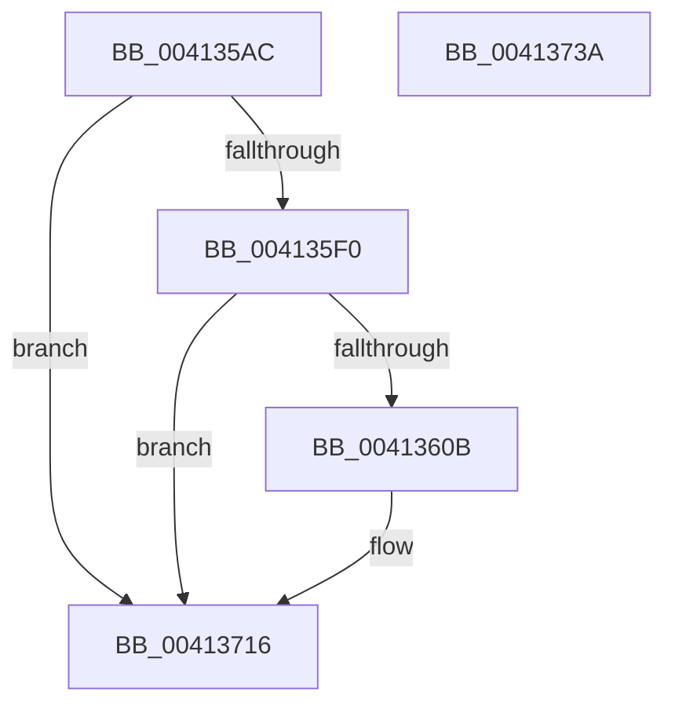

# PpmEventTraceMultiClassHeteroResponse

- RVA: `0x004135AC`–`0x0041373B` (길이 `399` bytes)
- VA: `0x00000001404135AC`
- 실행 섹션: `.text`
- PDB 이름 있음: `예`; PDB Function 태그: `아니요`
- unwind 정보 RVA: `0x0009BFB0`
- 디코드: `84`개 명령, `399/399` bytes 표시
- 미해석 바이트: `0` (있으면 어셈블리에 `.byte`로 보존)

> 이 문서는 커널 이미지의 기계어와 PDB 기호를 분석해 생성했습니다. 4번과 5번은 함수 원형과 자료형을 바이너리 사용 방식에서 추정한 C 해석이며 원본 소스 복구 결과는 아닙니다.

## 1. Dependencies

- 직접 호출 지점: **3**; 고유 호출 대상: **3**
- 직접 호출자로 확인된 함수: **2**
- RIP 상대 이미지 참조: **4**

### Outgoing calls
- `0x004135FE` → [EtwEventEnabled](../39/EtwEventEnabled_function_00392450.md) (function, `0x00392450`)
- `0x00413711` → [EtwWriteEx](../25/EtwWriteEx_function_0025F0D0.md) (function, `0x0025F0D0`)
- `0x0041371D` → [_security_check_cookie](../6A/_security_check_cookie_function_006AC640.md) (function, `0x006AC640`)

### Direct callers
- [PpmHeteroComputeMultiClassUnparkCount](PpmHeteroComputeMultiClassUnparkCount_function_00411F94.md) at `0x00412180`
- [PpmCheckComputeMultiClassHeteroResponse](PpmCheckComputeMultiClassHeteroResponse_function_00412534.md) at `0x0041290C`

### Static image references
- `0x004135C9` → RVA `0x00E0A740` (`.data`; read)
- `0x004135DD` → RVA `0x00E67A39` (`.data`; read)
- `0x004135F0` → RVA `0x00F083E8` (`.data`; read)
- `0x004135F7` → RVA `0x000135A8` (`.rdata`; read)

## 2. Other-region calls and transfers

- 다른 실행 섹션으로 향하는 call: **0**
- 별도 외부 분기/꼬리 이동을 확인하지 못했습니다.

## 3. Assembly (complete function range)

```asm
004135AC  48 8B C4                        mov rax, rsp
004135AF  48 89 58 10                     mov qword ptr [rax + 0x10], rbx
004135B3  48 89 70 18                     mov qword ptr [rax + 0x18], rsi
004135B7  88 48 08                        mov byte ptr [rax + 8], cl
004135BA  55                              push rbp
004135BB  57                              push rdi
004135BC  41 56                           push r14
004135BE  48 8D 68 C8                     lea rbp, [rax - 0x38]
004135C2  48 81 EC 20 01 00 00            sub rsp, 0x120
004135C9  48 8B 05 70 71 9F 00            mov rax, qword ptr [rip + 0x9f7170]
004135D0  48 33 C4                        xor rax, rsp
004135D3  48 89 45 10                     mov qword ptr [rbp + 0x10], rax
004135D7  45 33 F6                        xor r14d, r14d
004135DA  49 8B F9                        mov rdi, r9
004135DD  44 38 35 55 44 A5 00            cmp byte ptr [rip + 0xa54455], r14b
004135E4  49 8B F0                        mov rsi, r8
004135E7  48 8B DA                        mov rbx, rdx
004135EA  0F 84 26 01 00 00               je 0x140413716
004135F0  48 8B 0D F1 4D AF 00            mov rcx, qword ptr [rip + 0xaf4df1]
004135F7  48 8D 15 AA FF BF FF            lea rdx, [rip - 0x400056]
004135FE  E8 4D EE F7 FF                  call 0x140392450
00413603  84 C0                           test al, al
00413605  0F 84 0B 01 00 00               je 0x140413716
0041360B  F3 48 0F B8 0B                  popcnt rcx, qword ptr [rbx]
00413610  48 8D 45 40                     lea rax, [rbp + 0x40]
00413614  89 4C 24 40                     mov dword ptr [rsp + 0x40], ecx
00413618  48 89 44 24 50                  mov qword ptr [rsp + 0x50], rax
0041361D  48 8D 15 84 FF BF FF            lea rdx, [rip - 0x40007c]
00413624  48 8D 43 08                     lea rax, [rbx + 8]
00413628  48 C7 44 24 58 01 00 00 00      mov qword ptr [rsp + 0x58], 1
00413631  48 89 44 24 60                  mov qword ptr [rsp + 0x60], rax
00413636  45 33 C9                        xor r9d, r9d
00413639  48 8D 44 24 40                  lea rax, [rsp + 0x40]
0041363E  48 C7 44 24 68 02 00 00 00      mov qword ptr [rsp + 0x68], 2
00413647  48 89 45 80                     mov qword ptr [rbp - 0x80], rax
0041364B  45 33 C0                        xor r8d, r8d
0041364E  8D 04 8D 00 00 00 00            lea eax, [rcx*4]
00413655  48 89 5C 24 70                  mov qword ptr [rsp + 0x70], rbx
0041365A  89 45 98                        mov dword ptr [rbp - 0x68], eax
0041365D  8D 04 8D 00 00 00 00            lea eax, [rcx*4]
00413664  48 8B 0D 7D 4D AF 00            mov rcx, qword ptr [rip + 0xaf4d7d]
0041366B  89 45 A8                        mov dword ptr [rbp - 0x58], eax
0041366E  48 8D 45 60                     lea rax, [rbp + 0x60]
00413672  48 89 45 B0                     mov qword ptr [rbp - 0x50], rax
00413676  48 8D 45 68                     lea rax, [rbp + 0x68]
0041367A  48 89 45 C0                     mov qword ptr [rbp - 0x40], rax
0041367E  48 8D 45 70                     lea rax, [rbp + 0x70]
00413682  48 89 45 D0                     mov qword ptr [rbp - 0x30], rax
00413686  48 8D 45 78                     lea rax, [rbp + 0x78]
0041368A  48 89 45 E0                     mov qword ptr [rbp - 0x20], rax
0041368E  48 8D 85 80 00 00 00            lea rax, [rbp + 0x80]
00413695  48 89 45 F0                     mov qword ptr [rbp - 0x10], rax
00413699  48 8D 85 88 00 00 00            lea rax, [rbp + 0x88]
004136A0  48 89 45 00                     mov qword ptr [rbp], rax
004136A4  48 8D 44 24 50                  lea rax, [rsp + 0x50]
004136A9  48 89 44 24 38                  mov qword ptr [rsp + 0x38], rax
004136AE  C7 44 24 30 0C 00 00 00         mov dword ptr [rsp + 0x30], 0xc
004136B6  4C 89 74 24 28                  mov qword ptr [rsp + 0x28], r14
004136BB  4C 89 74 24 20                  mov qword ptr [rsp + 0x20], r14
004136C0  48 C7 44 24 78 08 00 00 00      mov qword ptr [rsp + 0x78], 8
004136C9  48 C7 45 88 04 00 00 00         mov qword ptr [rbp - 0x78], 4
004136D1  48 89 75 90                     mov qword ptr [rbp - 0x70], rsi
004136D5  44 89 75 9C                     mov dword ptr [rbp - 0x64], r14d
004136D9  48 89 7D A0                     mov qword ptr [rbp - 0x60], rdi
004136DD  44 89 75 AC                     mov dword ptr [rbp - 0x54], r14d
004136E1  48 C7 45 B8 08 00 00 00         mov qword ptr [rbp - 0x48], 8
004136E9  48 C7 45 C8 04 00 00 00         mov qword ptr [rbp - 0x38], 4
004136F1  48 C7 45 D8 01 00 00 00         mov qword ptr [rbp - 0x28], 1
004136F9  48 C7 45 E8 01 00 00 00         mov qword ptr [rbp - 0x18], 1
00413701  48 C7 45 F8 01 00 00 00         mov qword ptr [rbp - 8], 1
00413709  48 C7 45 08 08 00 00 00         mov qword ptr [rbp + 8], 8
00413711  E8 BA B9 E4 FF                  call 0x14025f0d0
00413716  48 8B 4D 10                     mov rcx, qword ptr [rbp + 0x10]
0041371A  48 33 CC                        xor rcx, rsp
0041371D  E8 1E 8F 29 00                  call 0x1406ac640
00413722  4C 8D 9C 24 20 01 00 00         lea r11, [rsp + 0x120]
0041372A  49 8B 5B 28                     mov rbx, qword ptr [r11 + 0x28]
0041372E  49 8B 73 30                     mov rsi, qword ptr [r11 + 0x30]
00413732  49 8B E3                        mov rsp, r11
00413735  41 5E                           pop r14
00413737  5F                              pop rdi
00413738  5D                              pop rbp
00413739  C3                              ret
0041373A  CC                              int3
```

## 4. C-style interpretation (structured pseudocode)

```c
__int64 __fastcall PpmEventTraceMultiClassHeteroResponse(unsigned __int8 a1, __int64 a2, __int64 a3, __int64 a4)
{
    __int64 result;
    __int64 v_r14;
    __int64 v_rsp;
    unsigned __int64 v_stack_m100;
    unsigned int v_stack_m108;
    unsigned __int64 v_stack_m110;
    unsigned __int64 v_stack_m118;
    unsigned __int64 v_stack_m18;
    unsigned __int64 v_stack_mC0;
    unsigned __int64 v_stack_mC8;
    unsigned __int64 v_stack_mD0;
    unsigned __int64 v_stack_mD8;
    unsigned __int64 v_stack_mE0;
    unsigned __int64 v_stack_mE8;
    unsigned int v_stack_mF8;

    *(unsigned __int64 *)(v_rsp + 16) = v_rbx;
    *(unsigned __int64 *)(v_rsp + 24) = v_rsi;
    *(unsigned __int8 *)(v_rsp + 8) = a1;
    v_rsp = (v_rsp) - (288);
    result = (*(unsigned __int64 *)(v_rip + 10449264)) ^ (v_rsp);
    *(unsigned __int64 *)(v_rsp - 56 + 16) = result;
    v_r14 = 0;
    if ((*(unsigned __int8 *)(v_rip + 10830933)) == 0) goto loc_00413716;
    result = EtwEventEnabled(*(unsigned __int64 *)(v_rip + 11488753), v_rip - 4194390, a3, a4);
    if ((unsigned __int8)(result) != 0) {
        result = v_rsp - 56 + 64;
        v_stack_mF8 = (unsigned int)(*(unsigned __int64 *)(v_rip + 11488753));
        v_stack_mE8 = result;
        a2 = v_rip - 4194428;
        result = a2 + 8;
        v_stack_mE0 = 1;
        v_stack_mD8 = result;
        a4 = 0;
        result = v_stack_mF8;
        v_stack_mD0 = 2;
        *(unsigned __int64 *)(v_rsp - 56 - 128) = result;
        a3 = 0;
        result = *(unsigned __int64 *)(v_rip + 11488753) * 4;
        v_stack_mC8 = a2;
        *(unsigned int *)(v_rsp - 56 - 104) = (unsigned int)(result);
        result = *(unsigned __int64 *)(v_rip + 11488753) * 4;
        a1 = *(unsigned __int64 *)(v_rip + 11488637);
        *(unsigned int *)(v_rsp - 56 - 88) = (unsigned int)(result);
        result = v_rsp - 56 + 96;
        *(unsigned __int64 *)(v_rsp - 56 - 80) = result;
        result = v_rsp - 56 + 104;
        *(unsigned __int64 *)(v_rsp - 56 - 64) = result;
        result = v_rsp - 56 + 112;
        *(unsigned __int64 *)(v_rsp - 56 - 48) = result;
        result = v_rsp - 56 + 120;
        *(unsigned __int64 *)(v_rsp - 56 - 32) = result;
        result = v_rsp - 56 + 128;
        *(unsigned __int64 *)(v_rsp - 56 - 16) = result;
        result = v_rsp - 56 + 136;
        *(unsigned __int64 *)(v_rsp - 56) = result;
        result = v_stack_mE8;
        v_stack_m100 = result;
        v_stack_m108 = 12;
        v_stack_m110 = 0;
        v_stack_m118 = 0;
        v_stack_mC0 = 8;
        *(unsigned __int64 *)(v_rsp - 56 - 120) = 4;
        *(unsigned __int64 *)(v_rsp - 56 - 112) = 0;
        *(unsigned int *)(v_rsp - 56 - 100) = 0;
        *(unsigned __int64 *)(v_rsp - 56 - 96) = 0;
        *(unsigned int *)(v_rsp - 56 - 84) = 0;
        *(unsigned __int64 *)(v_rsp - 56 - 72) = 8;
        *(unsigned __int64 *)(v_rsp - 56 - 56) = 4;
        *(unsigned __int64 *)(v_rsp - 56 - 40) = 1;
        *(unsigned __int64 *)(v_rsp - 56 - 24) = 1;
        *(unsigned __int64 *)(v_rsp - 56 - 8) = 1;
        *(unsigned __int64 *)(v_rsp - 56 + 8) = 8;
        result = EtwWriteEx(a1, a2, a3, a4);
    }
    a1 = (*(unsigned __int64 *)(v_rsp - 56 + 16)) ^ (v_rsp);
    result = _security_check_cookie(a1, a2, a3, a4);
    return result;
}
```

## 5. (Beta) C Style

```c
int64_t PpmEventTraceMultiClassHeteroResponse(uint8_t Arg1, void *Arg2, int64_t Arg3, int64_t Arg4)
{
    uint8_t *arg2 = (uint8_t *)Arg2;

    int64_t result;
    int64_t local_r14;
    int64_t local_rsp;
    uint64_t v_stack_m100;
    uint32_t v_stack_m108;
    uint64_t v_stack_m110;
    uint64_t v_stack_m118;
    uint64_t v_stack_m18;
    uint64_t v_stack_mC0;
    uint64_t v_stack_mC8;
    uint64_t v_stack_mD0;
    uint64_t v_stack_mD8;
    uint64_t v_stack_mE0;
    uint64_t v_stack_mE8;
    uint32_t v_stack_mF8;

    *(uint64_t *)(local_rsp + 0x10) = local_rbx;
    *(uint64_t *)(local_rsp + 0x18) = local_rsi;
    *(uint8_t *)(local_rsp + 0x8) = Arg1;
    local_rsp = (local_rsp) - (288);
    result = (*(uint64_t *)(v_rip + 0x9F7170)) ^ (local_rsp);
    *(uint64_t *)(local_rsp - 0x38 + 0x10) = result;
    local_r14 = 0;
    if ((*(uint8_t *)(v_rip + 0xA54455)) == 0) goto loc_00413716;
    result = EtwEventEnabled(*(uint64_t *)(v_rip + 0xAF4DF1), v_rip - 4194390, Arg3, Arg4);
    if ((uint8_t)(result) != 0) {
        result = local_rsp - 56 + 64;
        v_stack_mF8 = (uint32_t)(*(uint64_t *)(v_rip + 0xAF4DF1));
        v_stack_mE8 = result;
        Arg2 = v_rip - 4194428;
        result = Arg2 + 8;
        v_stack_mE0 = 1;
        v_stack_mD8 = result;
        Arg4 = 0;
        result = v_stack_mF8;
        v_stack_mD0 = 2;
        *(uint64_t *)(local_rsp - 0x38 - 0x80) = result;
        Arg3 = 0;
        result = *(uint64_t *)(v_rip + 0xAF4DF1) * 4;
        v_stack_mC8 = Arg2;
        *(uint32_t *)(local_rsp - 0x38 - 0x68) = (uint32_t)(result);
        result = *(uint64_t *)(v_rip + 0xAF4DF1) * 4;
        Arg1 = *(uint64_t *)(v_rip + 0xAF4D7D);
        *(uint32_t *)(local_rsp - 0x38 - 0x58) = (uint32_t)(result);
        result = local_rsp - 56 + 96;
        *(uint64_t *)(local_rsp - 0x38 - 0x50) = result;
        result = local_rsp - 56 + 104;
        *(uint64_t *)(local_rsp - 0x38 - 0x40) = result;
        result = local_rsp - 56 + 112;
        *(uint64_t *)(local_rsp - 0x38 - 0x30) = result;
        result = local_rsp - 56 + 120;
        *(uint64_t *)(local_rsp - 0x38 - 0x20) = result;
        result = local_rsp - 56 + 128;
        *(uint64_t *)(local_rsp - 0x38 - 0x10) = result;
        result = local_rsp - 56 + 136;
        *(uint64_t *)(local_rsp - 0x38) = result;
        result = v_stack_mE8;
        v_stack_m100 = result;
        v_stack_m108 = 12;
        v_stack_m110 = 0;
        v_stack_m118 = 0;
        v_stack_mC0 = 8;
        *(uint64_t *)(local_rsp - 0x38 - 0x78) = 4;
        *(uint64_t *)(local_rsp - 0x38 - 0x70) = 0;
        *(uint32_t *)(local_rsp - 0x38 - 0x64) = 0;
        *(uint64_t *)(local_rsp - 0x38 - 0x60) = 0;
        *(uint32_t *)(local_rsp - 0x38 - 0x54) = 0;
        *(uint64_t *)(local_rsp - 0x38 - 0x48) = 8;
        *(uint64_t *)(local_rsp - 0x38 - 0x38) = 4;
        *(uint64_t *)(local_rsp - 0x38 - 0x28) = 1;
        *(uint64_t *)(local_rsp - 0x38 - 0x18) = 1;
        *(uint64_t *)(local_rsp - 0x38 - 0x8) = 1;
        *(uint64_t *)(local_rsp - 0x38 + 0x8) = 8;
        result = EtwWriteEx(Arg1, Arg2, Arg3, Arg4);
    }
    Arg1 = (*(uint64_t *)(local_rsp - 0x38 + 0x10)) ^ (local_rsp);
    result = _security_check_cookie(Arg1, Arg2, Arg3, Arg4);
    return result;
}
```

### 관측된 메모리 오프셋

구조체 형식이 확인되지 않은 접근은 인자 기준의 오프셋으로만 기록했습니다.

| 기준 인자 | 오프셋 표현 | 폭 (bit) | 접근 |
|---|---:|---:|---|
| `Arg2` | `+ 0x0` | `64` | `R` |
| `Arg2` | `+ 0x8` | `64` | `R` |

## 6. Execution-region graph

[열기: 2D/3D 그래프와 함수 탐색 컨트롤 패널](../../../control-panel.html?section=text&rva=0x004135AC&view=graph)

- 2D 그래프는 위에서 아래로 흐르고, 3D 그래프는 빈 공간을 드래그해 회전합니다. Shift+드래그는 이동, 휠은 확대·축소, 함수 노드 선택은 대상 보고서 이동입니다.

### Static fallback


