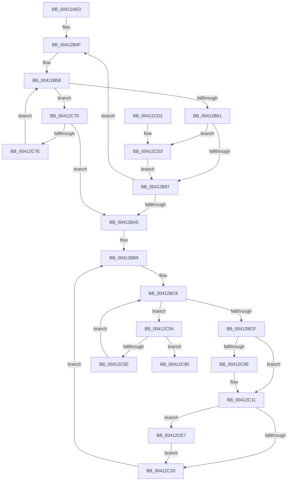

# PpmHeteroComputeCoreParkingUtilities

- RVA: `0x00412AE0`–`0x00412CFC` (길이 `540` bytes)
- VA: `0x0000000140412AE0`
- 실행 섹션: `.text`
- PDB 이름 있음: `예`; PDB Function 태그: `아니요`
- unwind 정보 RVA: `0x0009BF30`
- 디코드: `141`개 명령, `540/540` bytes 표시
- 미해석 바이트: `0` (있으면 어셈블리에 `.byte`로 보존)

> 이 문서는 커널 이미지의 기계어와 PDB 기호를 분석해 생성했습니다. 4번과 5번은 함수 원형과 자료형을 바이너리 사용 방식에서 추정한 C 해석이며 원본 소스 복구 결과는 아닙니다.

## 1. Dependencies

- 직접 호출 지점: **10**; 고유 호출 대상: **4**
- 직접 호출자로 확인된 함수: **2**
- RIP 상대 이미지 참조: **3**

### Outgoing calls
- `0x00412B2B` → [memset](../6C/memset_function_006C6C40.md) (function, `0x006C6C40`)
- `0x00412B38` → [memset](../6C/memset_function_006C6C40.md) (function, `0x006C6C40`)
- `0x00412B85` → [KeGetPrcb](../2D/KeGetPrcb_function_002D85D0.md) (function, `0x002D85D0`)
- `0x00412BEF` → [KeGetPrcb](../2D/KeGetPrcb_function_002D85D0.md) (function, `0x002D85D0`)
- `0x00412C11` → [PpmHeteroUtilityToNormalizedUtility](PpmHeteroUtilityToNormalizedUtility_function_00413394.md) (function, `0x00413394`)
- `0x00412C1D` → [PpmHeteroUtilityToNormalizedUtility](PpmHeteroUtilityToNormalizedUtility_function_00413394.md) (function, `0x00413394`)
- `0x00412CA4` → [qsort](../50/qsort_function_005009F0.md) (function, `0x005009F0`)
- `0x00412CB8` → [qsort](../50/qsort_function_005009F0.md) (function, `0x005009F0`)
- `0x00412CD6` → [KeGetPrcb](../2D/KeGetPrcb_function_002D85D0.md) (function, `0x002D85D0`)
- `0x00412CEA` → [PpmHeteroUtilityToNormalizedUtility](PpmHeteroUtilityToNormalizedUtility_function_00413394.md) (function, `0x00413394`)

### Direct callers
- [PpmHeteroComputeMultiClassUnparkCount](PpmHeteroComputeMultiClassUnparkCount_function_00411F94.md) at `0x004120D6`
- [PpmCheckComputeMultiClassHeteroResponse](PpmCheckComputeMultiClassHeteroResponse_function_00412534.md) at `0x00412679`

### Static image references
- `0x00412B77` → RVA `0x00F231B8` (`.data`; read)
- `0x00412BF4` → RVA `0x00F0B244` (`.data`; read)
- `0x00412C9A` → RVA `0x0047F870` (`PpmUtilityComparer`; read)

## 2. Other-region calls and transfers

- 다른 실행 섹션으로 향하는 call: **0**
- 별도 외부 분기/꼬리 이동을 확인하지 못했습니다.

## 3. Assembly (complete function range)

```asm
00412AE0  48 89 5C 24 18                  mov qword ptr [rsp + 0x18], rbx
00412AE5  4C 89 4C 24 20                  mov qword ptr [rsp + 0x20], r9
00412AEA  89 4C 24 08                     mov dword ptr [rsp + 8], ecx
00412AEE  55                              push rbp
00412AEF  56                              push rsi
00412AF0  57                              push rdi
00412AF1  41 54                           push r12
00412AF3  41 55                           push r13
00412AF5  41 56                           push r14
00412AF7  41 57                           push r15
00412AF9  48 83 EC 20                     sub rsp, 0x20
00412AFD  48 8B 84 24 88 00 00 00         mov rax, qword ptr [rsp + 0x88]
00412B05  4D 8B E0                        mov r12, r8
00412B08  33 ED                           xor ebp, ebp
00412B0A  48 8B F2                        mov rsi, rdx
00412B0D  BB 00 01 00 00                  mov ebx, 0x100
00412B12  33 D2                           xor edx, edx
00412B14  44 8B C3                        mov r8d, ebx
00412B17  49 8B CC                        mov rcx, r12
00412B1A  48 21 28                        and qword ptr [rax], rbp
00412B1D  4D 8B E9                        mov r13, r9
00412B20  48 8B 84 24 80 00 00 00         mov rax, qword ptr [rsp + 0x80]
00412B28  48 21 28                        and qword ptr [rax], rbp
00412B2B  E8 10 41 2B 00                  call 0x1406c6c40
00412B30  44 8B C3                        mov r8d, ebx
00412B33  33 D2                           xor edx, edx
00412B35  49 8B CD                        mov rcx, r13
00412B38  E8 03 41 2B 00                  call 0x1406c6c40
00412B3D  0F B7 5E 08                     movzx ebx, word ptr [rsi + 8]
00412B41  8D 45 01                        lea eax, [rbp + 1]
00412B44  48 8B 3E                        mov rdi, qword ptr [rsi]
00412B47  41 B7 FF                        mov r15b, 0xff
00412B4A  44 8B 6C 24 60                  mov r13d, dword ptr [rsp + 0x60]
00412B4F  21 6C 24 68                     and dword ptr [rsp + 0x68], ebp
00412B53  0F B7 CB                        movzx ecx, bx
00412B56  03 C8                           add ecx, eax
00412B58  48 85 FF                        test rdi, rdi
00412B5B  0F 84 0F 01 00 00               je 0x140412c70
00412B61  48 0F BC D7                     bsf rdx, rdi
00412B65  0F B7 CB                        movzx ecx, bx
00412B68  0F B6 C2                        movzx eax, dl
00412B6B  C1 E1 06                        shl ecx, 6
00412B6E  48 0F B3 C7                     btr rdi, rax
00412B72  0F B6 C2                        movzx eax, dl
00412B75  03 C8                           add ecx, eax
00412B77  48 8B 05 3A 06 B1 00            mov rax, qword ptr [rip + 0xb1063a]
00412B7E  44 8B 34 88                     mov r14d, dword ptr [rax + rcx*4]
00412B82  41 8B CE                        mov ecx, r14d
00412B85  E8 46 5A EC FF                  call 0x1402d85d0
00412B8A  44 3A B8 08 8A 00 00            cmp r15b, byte ptr [rax + 0x8a08]
00412B91  0F 83 3C 01 00 00               jae 0x140412cd3
00412B97  41 0F B6 C7                     movzx eax, r15b
00412B9B  41 3B C5                        cmp eax, r13d
00412B9E  B8 01 00 00 00                  mov eax, 1
00412BA3  75 AA                           jne 0x140412b4f
00412BA5  0F B7 5E 08                     movzx ebx, word ptr [rsi + 8]
00412BA9  48 8B 3E                        mov rdi, qword ptr [rsi]
00412BAC  4C 8B 6C 24 78                  mov r13, qword ptr [rsp + 0x78]
00412BB1  4C 8B B4 24 88 00 00 00         mov r14, qword ptr [rsp + 0x88]
00412BB9  83 A4 24 88 00 00 00 00         and dword ptr [rsp + 0x88], 0
00412BC1  0F B7 CB                        movzx ecx, bx
00412BC4  03 C8                           add ecx, eax
00412BC6  48 85 FF                        test rdi, rdi
00412BC9  0F 84 85 00 00 00               je 0x140412c54
00412BCF  48 0F BC D7                     bsf rdx, rdi
00412BD3  0F B7 CB                        movzx ecx, bx
00412BD6  0F B6 C2                        movzx eax, dl
00412BD9  48 0F B3 C7                     btr rdi, rax
00412BDD  C1 E1 06                        shl ecx, 6
00412BE0  0F B6 C2                        movzx eax, dl
00412BE3  03 C8                           add ecx, eax
00412BE5  48 8B 05 CC 05 B1 00            mov rax, qword ptr [rip + 0xb105cc]
00412BEC  8B 0C 88                        mov ecx, dword ptr [rax + rcx*4]
00412BEF  E8 DC 59 EC FF                  call 0x1402d85d0
00412BF4  83 3D 49 86 AF 00 05            cmp dword ptr [rip + 0xaf8649], 5
00412BFB  44 8A 90 08 8A 00 00            mov r10b, byte ptr [rax + 0x8a08]
00412C02  48 8D 88 B0 89 00 00            lea rcx, [rax + 0x89b0]
00412C09  8B 51 28                        mov edx, dword ptr [rcx + 0x28]
00412C0C  74 03                           je 0x140412c11
00412C0E  2B 51 30                        sub edx, dword ptr [rcx + 0x30]
00412C11  E8 7E 07 00 00                  call 0x140413394
00412C16  41 89 04 AC                     mov dword ptr [r12 + rbp*4], eax
00412C1A  8B 51 34                        mov edx, dword ptr [rcx + 0x34]
00412C1D  E8 72 07 00 00                  call 0x140413394
00412C22  41 89 44 AD 00                  mov dword ptr [r13 + rbp*4], eax
00412C27  44 8B C0                        mov r8d, eax
00412C2A  45 3A D7                        cmp r10b, r15b
00412C2D  0F 87 B4 00 00 00               ja 0x140412ce7
00412C33  48 8B 8C 24 80 00 00 00         mov rcx, qword ptr [rsp + 0x80]
00412C3B  41 8B C0                        mov eax, r8d
00412C3E  49 01 06                        add qword ptr [r14], rax
00412C41  41 8B 04 AC                     mov eax, dword ptr [r12 + rbp*4]
00412C45  48 01 01                        add qword ptr [rcx], rax
00412C48  B8 01 00 00 00                  mov eax, 1
00412C4D  03 E8                           add ebp, eax
00412C4F  E9 65 FF FF FF                  jmp 0x140412bb9
00412C54  66 03 D8                        add bx, ax
00412C57  0F B7 DB                        movzx ebx, bx
00412C5A  3B D9                           cmp ebx, ecx
00412C5C  73 32                           jae 0x140412c90
00412C5E  48 8B 3C DD 08 00 00 00         mov rdi, qword ptr [rbx*8 + 8]
00412C66  B8 01 00 00 00                  mov eax, 1
00412C6B  E9 56 FF FF FF                  jmp 0x140412bc6
00412C70  66 03 D8                        add bx, ax
00412C73  0F B7 DB                        movzx ebx, bx
00412C76  3B D9                           cmp ebx, ecx
00412C78  0F 83 27 FF FF FF               jae 0x140412ba5
00412C7E  48 8B 3C DD 08 00 00 00         mov rdi, qword ptr [rbx*8 + 8]
00412C86  B8 01 00 00 00                  mov eax, 1
00412C8B  E9 C8 FE FF FF                  jmp 0x140412b58
00412C90  BF 04 00 00 00                  mov edi, 4
00412C95  8B D5                           mov edx, ebp
00412C97  44 8B C7                        mov r8d, edi
00412C9A  4C 8D 0D CF CB 06 00            lea r9, [rip + 0x6cbcf]
00412CA1  49 8B CC                        mov rcx, r12
00412CA4  E8 47 DD 0E 00                  call 0x1405009f0
00412CA9  4C 8D 0D C0 CB 06 00            lea r9, [rip + 0x6cbc0]
00412CB0  8B D5                           mov edx, ebp
00412CB2  44 8B C7                        mov r8d, edi
00412CB5  49 8B CD                        mov rcx, r13
00412CB8  E8 33 DD 0E 00                  call 0x1405009f0
00412CBD  48 8B 5C 24 70                  mov rbx, qword ptr [rsp + 0x70]
00412CC2  48 83 C4 20                     add rsp, 0x20
00412CC6  41 5F                           pop r15
00412CC8  41 5E                           pop r14
00412CCA  41 5D                           pop r13
00412CCC  41 5C                           pop r12
00412CCE  5F                              pop rdi
00412CCF  5E                              pop rsi
00412CD0  5D                              pop rbp
00412CD1  C3                              ret
00412CD2  CC                              int3
00412CD3  41 8B CE                        mov ecx, r14d
00412CD6  E8 F5 58 EC FF                  call 0x1402d85d0
00412CDB  44 8A B8 08 8A 00 00            mov r15b, byte ptr [rax + 0x8a08]
00412CE2  E9 B0 FE FF FF                  jmp 0x140412b97
00412CE7  8B 51 38                        mov edx, dword ptr [rcx + 0x38]
00412CEA  E8 A5 06 00 00                  call 0x140413394
00412CEF  44 03 C0                        add r8d, eax
00412CF2  45 89 44 AD 00                  mov dword ptr [r13 + rbp*4], r8d
00412CF7  E9 37 FF FF FF                  jmp 0x140412c33
```

## 4. C-style interpretation (structured pseudocode)

```c
__int64 __fastcall PpmHeteroComputeCoreParkingUtilities(int a1, __int64 a2, __int64 a3, __int64 a4, __int64 a5, unsigned int a6)
{
    __int64 result;
    __int64 v_rbp;
    __int64 v_rbx;
    __int64 v_rsp;
    unsigned int v_stack_p10;
    unsigned __int64 v_stack_p18;
    unsigned __int64 v_stack_p20;
    unsigned int v_stack_p8;

    v_stack_p18 = v_rbx;
    v_stack_p20 = a4;
    v_stack_p8 = a1;
    v_rsp = (v_rsp) - (32);
    v_rbp = 0;
    a2 = 0;
    result = memset(a3, a2, 256, a4);
    a2 = 0;
    result = memset(a4, a2, 256, a4);
loc_00412B4F:
    a1 = (unsigned int)(((unsigned __int16)(*(unsigned __int16 *)(a2 + 8))) + ((unsigned int)(v_rbp + 1)));
loc_00412B58:
    if (*(unsigned __int64 *)(a2) == 0) goto loc_00412C70;
    a1 = (unsigned int)(((unsigned __int16)(*(unsigned __int16 *)(a2 + 8))) << (6));
    a1 = (unsigned int)((a1) + (0));
    result = KeGetPrcb((unsigned int)((unsigned int)((unsigned int)(*(unsigned int *)(*(unsigned __int64 *)(v_rip + 11601466) + a1 * 4)))), a2, 256, a4);
    if (255 >= (*(unsigned __int8 *)(result + 35336))) goto loc_00412CD3;
loc_00412B97:
    if (255 != ((unsigned int)((unsigned int)(v_stack_p8)))) goto loc_00412B4F;
loc_00412BA5:
loc_00412BB9:
    a1 = (unsigned int)(((unsigned __int16)(*(unsigned __int16 *)(a2 + 8))) + (1));
loc_00412BC6:
    if (*(unsigned __int64 *)(a2) == 0) goto loc_00412C54;
    a1 = (unsigned int)(((unsigned __int16)(*(unsigned __int16 *)(a2 + 8))) << (6));
    a1 = (unsigned int)((a1) + (0));
    result = KeGetPrcb((unsigned int)(*(unsigned int *)(*(unsigned __int64 *)(v_rip + 11601356) + a1 * 4)), a2, 256, a4);
    if ((*(unsigned int *)(v_rip + 11503177)) != 5) {
        a2 = (unsigned int)(((unsigned int)(*(unsigned int *)(result + 35248 + 40))) - (*(unsigned int *)(result + 35248 + 48)));
    }
    result = PpmHeteroUtilityToNormalizedUtility(result + 35248, a2, 256, a4);
    *(unsigned int *)(a3 + v_rbp * 4) = (unsigned int)(result);
    result = PpmHeteroUtilityToNormalizedUtility(result + 35248, (unsigned int)(*(unsigned int *)(result + 35248 + 52)), 256, a4);
    *(unsigned int *)(v_stack_p20 + v_rbp * 4) = (unsigned int)(result);
    if (((unsigned __int8)(*(unsigned __int8 *)(result + 35336))) > 255) goto loc_00412CE7;
loc_00412C33:
    v_rbp = (unsigned int)((v_rbp) + (1));
    goto loc_00412BB9;
loc_00412C54:
    v_rbx = (unsigned __int16)((*(unsigned __int16 *)(a2 + 8)) + (1));
    if (((unsigned int)((unsigned __int16)(v_rbx))) >= ((unsigned int)(a5))) goto loc_00412C90;
    goto loc_00412BC6;
loc_00412C70:
    v_rbx = (unsigned __int16)(((unsigned __int16)(v_rbx)) + (1));
    if (((unsigned int)((unsigned __int16)(v_rbx))) >= ((unsigned int)(a5))) goto loc_00412BA5;
    goto loc_00412B58;
loc_00412C90:
    result = qsort(a3, (unsigned int)((unsigned int)(v_rbp)), 4, v_rip + 445391);
    result = qsort(v_stack_p20, (unsigned int)((unsigned int)(v_rbp)), 4, v_rip + 445376);
    v_rsp = (v_rsp) + (32);
    return result;
loc_00412CD3:
    result = KeGetPrcb((unsigned int)(a6), (unsigned int)((unsigned int)(v_rbp)), 4, v_rip + 445376);
    goto loc_00412B97;
loc_00412CE7:
    result = PpmHeteroUtilityToNormalizedUtility((unsigned int)(a6), (unsigned int)(*(unsigned int *)((unsigned int)(a6) + 56)), 4, v_rip + 445376);
    a3 = (unsigned int)((4) + ((unsigned int)(result)));
    *(unsigned int *)(v_stack_p20 + v_rbp * 4) = (unsigned int)(a3);
    goto loc_00412C33;
}
```

## 5. (Beta) C Style

```c
int64_t PpmHeteroComputeCoreParkingUtilities(int32_t Arg1, void *Arg2, void *Arg3, int64_t Arg4, void *Arg5, void *Arg6)
{
    uint8_t *arg2 = (uint8_t *)Arg2;
    uint8_t *arg3 = (uint8_t *)Arg3;
    uint8_t *arg5 = (uint8_t *)Arg5;
    uint8_t *arg6 = (uint8_t *)Arg6;

    int64_t result;
    int64_t local_rbp;
    int64_t local_rbx;
    int64_t local_rsp;
    uint32_t v_stack_p10;
    uint64_t v_stack_p18;
    uint64_t v_stack_p20;
    uint32_t v_stack_p8;

    v_stack_p18 = local_rbx;
    v_stack_p20 = Arg4;
    v_stack_p8 = Arg1;
    local_rsp = (local_rsp) - (32);
    local_rbp = 0;
    Arg2 = 0;
    result = memset(Arg3, Arg2, 256, Arg4);
    Arg2 = 0;
    result = memset(Arg4, Arg2, 256, Arg4);
loc_00412B4F:
    Arg1 = (uint32_t)(((uint16_t)(*(uint16_t *)(arg2 + 0x8))) + ((uint32_t)(local_rbp + 1)));
loc_00412B58:
    if (*(uint64_t *)(arg2) == 0) goto loc_00412C70;
    Arg1 = (uint32_t)(((uint16_t)(*(uint16_t *)(arg2 + 0x8))) << (6));
    Arg1 = (uint32_t)((Arg1) + (0));
    result = KeGetPrcb((uint32_t)((uint32_t)((uint32_t)(*(uint32_t *)(*(uint64_t *)(v_rip + 0xB1063A) + Arg1 * 4)))), Arg2, 256, Arg4);
    if (255 >= (*(uint8_t *)(result + 0x8A08))) goto loc_00412CD3;
loc_00412B97:
    if (255 != ((uint32_t)((uint32_t)(v_stack_p8)))) goto loc_00412B4F;
loc_00412BA5:
loc_00412BB9:
    Arg1 = (uint32_t)(((uint16_t)(*(uint16_t *)(arg2 + 0x8))) + (1));
loc_00412BC6:
    if (*(uint64_t *)(arg2) == 0) goto loc_00412C54;
    Arg1 = (uint32_t)(((uint16_t)(*(uint16_t *)(arg2 + 0x8))) << (6));
    Arg1 = (uint32_t)((Arg1) + (0));
    result = KeGetPrcb((uint32_t)(*(uint32_t *)(*(uint64_t *)(v_rip + 0xB105CC) + Arg1 * 4)), Arg2, 256, Arg4);
    if ((*(uint32_t *)(v_rip + 0xAF8649)) != 5) {
        Arg2 = (uint32_t)(((uint32_t)(*(uint32_t *)(result + 0x89B0 + 0x28))) - (*(uint32_t *)(result + 0x89B0 + 0x30)));
    }
    result = PpmHeteroUtilityToNormalizedUtility(result + 35248, Arg2, 256, Arg4);
    *(uint32_t *)(arg3 + local_rbp * 4) = (uint32_t)(result);
    result = PpmHeteroUtilityToNormalizedUtility(result + 35248, (uint32_t)(*(uint32_t *)(result + 0x89B0 + 0x34)), 256, Arg4);
    *(uint32_t *)(v_stack_p20 + local_rbp * 4) = (uint32_t)(result);
    if (((uint8_t)(*(uint8_t *)(result + 0x8A08))) > 255) goto loc_00412CE7;
loc_00412C33:
    local_rbp = (uint32_t)((local_rbp) + (1));
    goto loc_00412BB9;
loc_00412C54:
    local_rbx = (uint16_t)((*(uint16_t *)(arg2 + 0x8)) + (1));
    if (((uint32_t)((uint16_t)(local_rbx))) >= ((uint32_t)(Arg5))) goto loc_00412C90;
    goto loc_00412BC6;
loc_00412C70:
    local_rbx = (uint16_t)(((uint16_t)(local_rbx)) + (1));
    if (((uint32_t)((uint16_t)(local_rbx))) >= ((uint32_t)(Arg5))) goto loc_00412BA5;
    goto loc_00412B58;
loc_00412C90:
    result = qsort(Arg3, (uint32_t)((uint32_t)(local_rbp)), 4, v_rip + 445391);
    result = qsort(v_stack_p20, (uint32_t)((uint32_t)(local_rbp)), 4, v_rip + 445376);
    local_rsp = (local_rsp) + (32);
    return result;
loc_00412CD3:
    result = KeGetPrcb((uint32_t)(Arg6), (uint32_t)((uint32_t)(local_rbp)), 4, v_rip + 445376);
    goto loc_00412B97;
loc_00412CE7:
    result = PpmHeteroUtilityToNormalizedUtility((uint32_t)(Arg6), (uint32_t)(*(uint32_t *)((uint32_t)(arg6) + 0x38)), 4, v_rip + 445376);
    Arg3 = (uint32_t)((4) + ((uint32_t)(result)));
    *(uint32_t *)(v_stack_p20 + local_rbp * 4) = (uint32_t)(Arg3);
    goto loc_00412C33;
}
```

### 관측된 메모리 오프셋

구조체 형식이 확인되지 않은 접근은 인자 기준의 오프셋으로만 기록했습니다.

| 기준 인자 | 오프셋 표현 | 폭 (bit) | 접근 |
|---|---:|---:|---|
| `Arg2` | `+ 0x0` | `64` | `R` |
| `Arg2` | `+ 0x8` | `16` | `R` |
| `Arg3` | `+ 0x0 + rbp*4` | `32` | `R` |
| `Arg3` | `+ 0x0 + rbp*4` | `32` | `W` |
| `Arg5` | `+ 0x0` | `64` | `R/W` |
| `Arg6` | `+ 0x0` | `64` | `R/W` |

## 6. Execution-region graph

[열기: 2D/3D 그래프와 함수 탐색 컨트롤 패널](../../../control-panel.html?section=text&rva=0x00412AE0&view=graph)

- 2D 그래프는 위에서 아래로 흐르고, 3D 그래프는 빈 공간을 드래그해 회전합니다. Shift+드래그는 이동, 휠은 확대·축소, 함수 노드 선택은 대상 보고서 이동입니다.

### Static fallback


